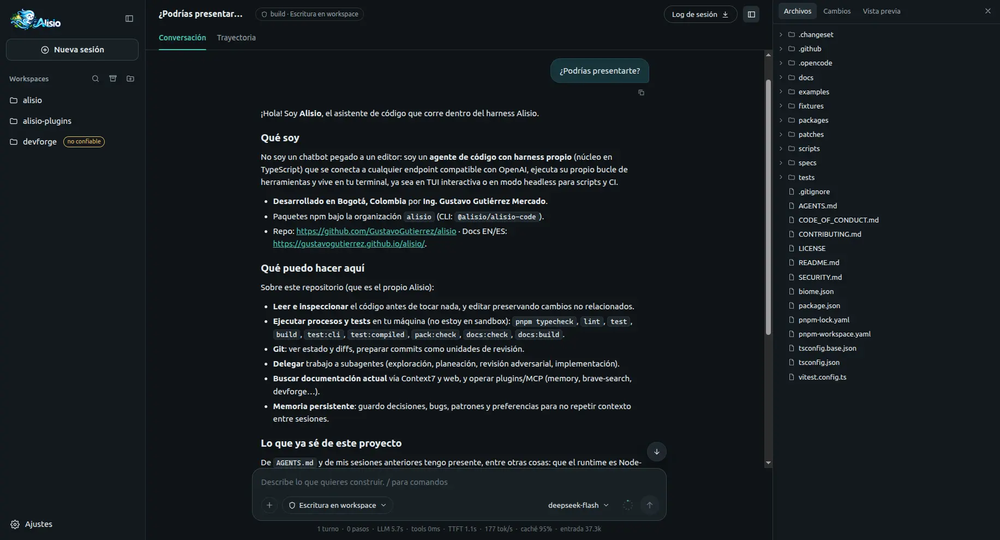

# Alisio

[English](README.md) · **Español**

<p align="center">
  
</p>

[](https://github.com/GustavoGutierrez/alisio/actions/workflows/ci.yml)
[](https://www.npmjs.com/package/@alisio/alisio-code)
[](LICENSE)
[](https://alisioair.com/es/)

**Alisio — Inteligencia artificial que trabaja contigo. Tu trabajo. Con más posibilidades.** Alisio
es una aplicación de escritorio con inteligencia artificial que te ayuda con tareas de tu trabajo,
tus estudios y tu vida diaria. Describe lo que necesitas: Alisio organiza los pasos, utiliza las
herramientas disponibles y te ayuda a obtener un resultado que puedes revisar y usar, como un PDF,
una hoja de cálculo, un gráfico, un informe o un panel. Encuentra aplicaciones para tus tareas en el
catálogo de complementos, crea las tuyas con el creador de complementos describiendo lo que
necesitas y conecta herramientas y servicios desde el catálogo MCP. Está pensada para docentes,
estudiantes, personal de oficina, contadores y el hogar, y funciona con el modelo que elijas.
Programar sigue siendo posible, como [uso avanzado](#uso-avanzado).

**[Descargar Alisio](https://alisioair.com/es/#download)** ·
[Ver cómo funciona](https://alisioair.com/es/#how-it-works) ·
[Documentación (ES/EN)](https://alisioair.com/es/)

## ¿En qué te puede ayudar?

- **Convierte una hoja de cálculo en un informe.** Adjunta una tabla CSV o de Excel y pide un resumen
  con gráficos. Obtienes un panel o un informe que puedes abrir, revisar y compartir
  ([Smart Dashboard](https://alisioair.com/es/smart-dashboard)).
- **Prepara un examen imprimible.** Con el complemento Evalúa, un docente prepara un examen escolar de
  **matemáticas** como documento imprimible, lo revisa y reutiliza su formato. Hoy cubre solo
  matemáticas escolares.
- **Elabora certificados y tarjetas.** Con el complemento Cardsmith, el personal de oficina prepara
  certificados, tarjetas y gráficos a partir de sus propios datos.

Lo que existe hoy, según quién lo usa:

| Quién | Lo que Alisio puede hacer hoy | Qué utiliza |
| --- | --- | --- |
| Estudiantes | Redactar una tesis, investigar fuentes, estudiar | `@alisio/plugin-thesis` (planifica, investiga, redacta y compone tesis universitarias en PDF), `@alisio/plugin-literature-research` y la memoria incluida |
| Docentes | Crear exámenes imprimibles (por ahora solo de **matemáticas** escolares) | `@alisio/plugin-evalua` |
| Contadores | Papeles de trabajo y análisis de hojas de cálculo | Análisis de datos incluido |
| Oficina y secretarías | Analizar datos de Excel y CSV, gráficos, certificados, informes | Análisis de datos incluido, `@alisio/plugin-cardsmith` |
| Hogar | Presupuestos, gráficos, organizar información | Análisis de datos incluido (sin complemento específico) |

## Qué necesitas y qué obtienes

**Necesitas:**

- Un equipo con Windows 10 u 11 (x64), macOS (Apple Silicon o Intel) o Linux (x86_64).
- Un modelo con el que trabajar: una clave de un servicio de modelos en línea, o un servidor de
  modelos compatible en tu propio equipo. Lo conectas una vez en **Ajustes → Modelos**.
- La carpeta con los archivos en los que quieres trabajar.
- Para algunas tareas, un programa adicional: por ejemplo Python 3.10 o posterior para leer archivos
  de Excel. Alisio te indica lo que falta.

**Obtienes:** documentos, tablas, gráficos, informes, paneles y PDF diseñados que puedes revisar,
pedir que se corrijan y luego guardar, imprimir o compartir. La conversación te ayuda a pedir y
aclarar; el resultado es el archivo que conservas.

## Así trabajas con Alisio

1. **Eliges.** Abre la carpeta en la que quieres trabajar y describe la tarea con tus palabras, o
   abre una aplicación desde el menú **Aplicaciones**.
2. **Aportas.** Añade los archivos y datos que faltan. Alisio lee la carpeta que abriste y, en el
   modo de permisos **Preguntar**, pregunta antes de cambiar un archivo, ejecutar un programa o usar
   internet.
3. **Revisas.** El resultado aparece como documento, tabla, gráfico o aplicación. Revísalo, pide
   correcciones y luego guárdalo, imprímelo o compártelo. La última palabra es tuya.

<p align="center">
  
</p>

La aplicación de escritorio muestra esta interfaz en su propia ventana; también se abre en tu
navegador.

### Aplicaciones para tu oficio

Los complementos (plugins) añaden herramientas y aplicaciones para cada profesión.

- **Encuentra herramientas para tu trabajo.** Abre **Ajustes → Complementos → Catálogo de complementos** e
  instala lo que necesitas con un clic. Desde la misma pantalla puedes actualizar o quitar los
  complementos instalados, e instalar uno privado desde un archivo. También puedes explorar el
  [catálogo de complementos](https://plugins.alisioair.com/) en línea.
- **Crea una ayuda a tu medida.** Abre **Creador de complementos** y describe una tarea que repites.
  Construye el complemento, lo comprueba y te deja decidir cuándo instalarlo, incluso con su propia
  pantalla en el menú **Aplicaciones**
  ([Creador de complementos](https://alisioair.com/es/plugin-creator)).
- **Conecta una herramienta o servicio.** **Ajustes → Servidores MCP → Explorar** muestra las
  herramientas y servicios que puedes conectar, con inicio de sesión guiado, prueba de conexión y
  eliminación con un clic. Aparecer en esa lista no es una revisión de seguridad, y algunos servicios
  aún requieren configuración manual
  ([Catálogo MCP](https://alisioair.com/es/mcp-catalog)).

| Lo que quieres hacer | Qué utiliza | Estado |
| --- | --- | --- |
| Analizar tablas CSV y Excel, gráficos, informes y paneles | Incluido | Incluido |
| Documentos PDF diseñados | Incluido | Incluido |
| Exámenes imprimibles | `@alisio/plugin-evalua` | Complemento para instalar; solo matemáticas escolares |
| Redacción de tesis e investigación bibliográfica | `@alisio/plugin-thesis`, `@alisio/plugin-literature-research` | Complementos para instalar |
| Certificados, tarjetas y gráficos | `@alisio/plugin-cardsmith` | Complemento para instalar |
| Una ayuda para tu propia tarea | Creador de complementos | Incluido |
| Conectar una herramienta o servicio | Catálogo MCP | Incluido |

Los complementos por profesión están en el repositorio público
[alisio-plugins](https://github.com/GustavoGutierrez/alisio-plugins) y **todavía no vienen incluidos
en la aplicación de escritorio**: los instalas desde el catálogo. La calidad de un resultado depende
del complemento, del modelo y de los servicios que utilices. En salud, contabilidad, educación o
cualquier decisión delicada, Alisio apoya tu trabajo; no sustituye tu criterio profesional.

## Tus datos y permisos

- **Tú eliges la carpeta.** Alisio trabaja con la carpeta que abres. En el modo de permisos
  **Preguntar**, pregunta antes de cambiar un archivo, ejecutar un programa o usar internet; otros
  modos dejan que más acciones se ejecuten sin preguntar, y puedes cambiarlo en cualquier momento.
  Consulta [Modos de permisos](https://alisioair.com/es/tools#permission-modes).
- **Trabajar con archivos locales no es lo mismo que mantenerlo todo en tu equipo.** Tus
  conversaciones y ajustes se guardan en tu equipo, pero lo que Alisio lee para responderte se envía
  al modelo que configuraste. Con un servicio en línea, ese servicio lo recibe; las herramientas y
  servicios conectados reciben lo que necesitan para su tarea. Con un modelo en tu propio equipo, ese
  contenido se queda en él, salvo en las herramientas que usan internet.
- **Las claves quedan protegidas.** Las claves se guardan como credenciales, nunca en archivos de
  configuración en texto plano.
- **No es un sandbox.** Los complementos y programas se ejecutan con los permisos de tu usuario;
  instala solo lo que sea de tu confianza.

## Lo que todavía no hace

- **No hay rutinas programadas ni ejecución sin supervisión.** Alisio trabaja cuando se lo pides; no
  ejecuta tareas según un horario ni por su cuenta.
- **Evalúa cubre solo matemáticas escolares.**
- **La aplicación de escritorio todavía no se actualiza sola**: una versión nueva se instala con su
  instalador, y los instaladores no están firmados. Consulta los
  [límites de la aplicación de escritorio](https://alisioair.com/es/desktop#limitations)
  y las [Limitaciones conocidas](https://alisioair.com/es/limitations).
- **Las comprobaciones ayudan, no garantizan.** Revisa cada resultado antes de usarlo.

## Descarga y requisitos

Descarga la aplicación de escritorio desde la
[versión 0.11.11 de Alisio](https://github.com/GustavoGutierrez/alisio/releases/tag/v0.11.11):

- Windows 10/11 (x64): [`Alisio-Setup-0.11.11-x64.exe`](https://github.com/GustavoGutierrez/alisio/releases/download/v0.11.11/Alisio-Setup-0.11.11-x64.exe)
- macOS Apple Silicon: [`Alisio-0.11.11-arm64.dmg`](https://github.com/GustavoGutierrez/alisio/releases/download/v0.11.11/Alisio-0.11.11-arm64.dmg) · Intel: [`Alisio-0.11.11-x64.dmg`](https://github.com/GustavoGutierrez/alisio/releases/download/v0.11.11/Alisio-0.11.11-x64.dmg)
- Linux: [`Alisio-0.11.11-x86_64.AppImage`](https://github.com/GustavoGutierrez/alisio/releases/download/v0.11.11/Alisio-0.11.11-x86_64.AppImage) · Debian/Ubuntu: [`Alisio-0.11.11-amd64.deb`](https://github.com/GustavoGutierrez/alisio/releases/download/v0.11.11/Alisio-0.11.11-amd64.deb)

Los instaladores no están firmados, así que Windows SmartScreen y macOS Gatekeeper piden un paso
extra la primera vez (consulta [apps/website/es/desktop.md](apps/website/es/desktop.md)). Después conecta un modelo
en **Ajustes → Modelos**, abre una carpeta y describe la tarea.

**¿Es gratis?** Alisio es libre y de código abierto, con licencia MIT. El modelo que conectes puede
tener su propio costo: los servicios de modelos en línea cobran según sus propios precios y algunos
servicios conectados requieren una cuenta. Un modelo que se ejecuta en tu propio equipo no tiene
tarifa de servicio.

**¿Funciona sin internet?** Depende del modelo y de la herramienta. Con un modelo en línea necesitas
internet. Con un modelo en tu propio equipo, Alisio puede trabajar sin conexión, pero instalar
complementos, actualizar los catálogos, buscar en la web y usar servicios en línea requieren
conexión.

> **Estado: estable, probado y documentado, todavía anterior a 1.0.** Hasta la 1.0.0 se aplican las
> reglas habituales de semver 0.x: las correcciones salen como versiones de parche y una nueva versión
> menor puede incluir cambios incompatibles. La insignia de npm de arriba siempre muestra la última
> versión publicada; consulta las [limitaciones](https://alisioair.com/es/limitations)
> y [Estabilidad y versionado](https://alisioair.com/es/publishing#estabilidad-y-versionado).

## Uso avanzado

Todo lo anterior funciona desde la aplicación de escritorio, sin terminal. Esta parte es para
desarrolladores y para quien quiere más control: la línea de comandos, los scripts, el modo código,
escribir complementos con código y los detalles técnicos.

### Lo más destacado para desarrolladores

- **Interfaz de terminal (TUI)**: Markdown en streaming, bloques de herramientas con indicadores,
  duraciones y diffs, una barra de contexto/tokens, comandos slash con autocompletado, cambio de
  modelo, aprobaciones interactivas y copiar al seleccionar.
- **Interfaz web**: `alisio serve` abre un espacio de trabajo local en el navegador, protegido con un
  token, para varios workspaces y sesiones, con conversaciones en streaming, aprobaciones, archivos,
  cambios, artefactos y el visor del plan, sobre el mismo núcleo de agente. La aplicación de
  escritorio es una capa fina de Electron alrededor de este mismo servidor.
- **Cualquier proveedor compatible con OpenAI**: APIs Chat Completions y Responses, endpoints al
  estilo DeepSeek, servidores locales. Las claves se leen solo de variables de entorno. Los
  proveedores dedicados DeepSeek, OpenCode Console (Zen) y OpenCode Go son complementos aparte:
  `alisio install npm:@alisio/plugin-deepseek`, `alisio install npm:@alisio/plugin-opencode`,
  `alisio install npm:@alisio/plugin-opencode-go`.
- **Herramientas locales con permisos explícitos**: lectura por defecto; la TUI pregunta antes de
  cada escritura, proceso o llamada de red, salvo que pases `--allow-write`/`--allow-process`/`--allow-external`
  (no preguntar) o `--read-only` (ni siquiera se ofrecen). Alisio en su conjunto no es un sandbox, y
  lo dice: solo Forja aísla código. El `.alisio/config.json` y los complementos propios de un
  repositorio se cargan solo después de una confirmación de confianza única por directorio (o
  `--trust-project`).
- **Compactación del contexto**: un punto de control estructurado (objetivo, restricciones,
  hallazgos, estado, siguientes pasos, archivos) que nunca separa las llamadas a herramientas de sus
  resultados.
- **Memoria persistente**: observaciones en SQLite FTS5, upserts por topic key, compactación que tiene
  en cuenta la memoria y resúmenes de sesión, distribuida como el complemento desactivable
  `@alisio/plugin-memory`.
- **Agentes**: crea agentes con ayuda del modelo activo (o desde plantillas), guardados como Markdown
  portable en `.agents/agents` (proyecto) o `~/.agents/agents` (global), recargados sin reiniciar y
  seleccionables con `/agents` o `/agent:<id>` en la interfaz web y la TUI.
- **Modo plan y visor del plan**: un agente de plan de solo lectura propone un plan (con diagramas
  Mermaid opcionales) que apruebas antes de que cambie nada; la interfaz web lo abre en un visor del
  plan.
- **Forja, modo código elegido según el objetivo**: `js_run` ejecuta JavaScript en una VM QuickJS de
  WebAssembly nueva, sin acceso a archivos, red ni procesos, para combinar llamadas a herramientas,
  filtrar resultados y transformar datos con los mismos permisos del agente. `python_run` se encarga
  del análisis de datos, estadística, scikit-learn, gráficos y dashboards a medida en un contenedor
  (`oci`) o en un proceso Pyodide restringido (`wasm`) cuando están disponibles, y
  `analysis.isolation: required` lo mantiene fuera de tu equipo. Las guías se cargan bajo demanda con
  `forge_guide`, y cada sesión tiene un espacio de trabajo temporal privado. Consulta la
  [documentación de Forja](https://alisioair.com/es/forja) para los límites del
  aislamiento.
- **Dashboards y gráficos**: el análisis en Python publica dashboards, informes y hojas de cálculo
  como artefactos, con gráficos interactivos de un Chart.js integrado que funciona sin conexión.
- **Reliability Lab**: `alisio eval` ejecuta conjuntos de tareas k veces con verificadores
  deterministas, informa tasas de éxito con intervalos de Wilson, compara informes y variantes de
  configuración, y reproduce cassettes grabados para detectar regresiones del harness sin un modelo
  (la reproducción mide el harness, no el modelo). Consulta la
  [documentación de Reliability Lab](https://alisioair.com/es/eval).
- **Proof**: criterios de aceptación cuyo estado sale de la evidencia que Alisio capturó de los
  comandos, lecturas de archivos y consultas de datos que el agente ejecutó de verdad, no de lo que
  dice el modelo. Se muestra en la interfaz web, la terminal y `alisio run --proof` (códigos de salida
  0/10/11, JSON `proof/v1`). No demuestra que el código sea correcto. Consulta la
  [documentación de Proof](https://alisioair.com/es/proof).
- **SDK tipado de complementos**: herramientas, comandos, hooks de contexto, compactación y sesión,
  completions independientes del proveedor y un puerto de almacenamiento. Carga complementos desde una
  ruta o un paquete npm; instálalos de forma global con `alisio install npm:<paquete>` (o deja que el
  agente lo haga con la herramienta `plugin_install`, sujeta a permisos). Consulta
  [Escribir complementos](https://alisioair.com/es/plugins).
- **Además**: modo headless con JSONL, subagentes, servidores MCP (con un consentimiento global
  persistente opcional `mcp.allow` que conecta los servidores habilitados en cada inicio, o permisos
  por sesión desde la TUI), ámbitos de AGENTS.md, Agent Skills, integración con Herdr.
- **Funciona con Node.js >= 22.16 o Bun**; binarios independientes para Linux, macOS y Windows. El
  backend de Python Pyodide (`wasm`) necesita Node.js >= 22.22, >= 24.13 o >= 25.3.

### Instalar desde la línea de comandos

La línea de comandos es la vía avanzada (Node.js >= 22.16).

```sh
npm install -g @alisio/alisio-code   # o: pnpm add -g @alisio/alisio-code · bun add -g @alisio/alisio-code
alisio                                  # el binario de la CLI se instala como `alisio`
# Binario independiente (verifica la suma SHA-256):
curl -fsSL https://raw.githubusercontent.com/GustavoGutierrez/alisio/main/scripts/install.sh | sh
```

### Inicio rápido

```sh
alisio setup                                 # escribe .alisio/config.json sin secretos
export DEEPSEEK_API_KEY='...'                # las claves vienen del entorno
alisio --config .alisio/config.json          # TUI
alisio run "Explain this repository" --config .alisio/config.json --read-only
```

```json
{
  "provider": {
    "baseURL": "https://api.deepseek.com/v1",
    "apiKeyEnv": "DEEPSEEK_API_KEY",
    "model": "deepseek-chat",
    "streamUsage": true
  }
}
```

### Paquetes

Todos los paquetes se publican en la [organización alisio de npm](https://www.npmjs.com/settings/alisio/packages):

| Paquete | npm | Propósito |
| --- | --- | --- |
| [`alisio-code`](packages/cli) | [npm](https://www.npmjs.com/package/@alisio/alisio-code) | La CLI y la TUI que instalas (binario `alisio`) |
| [`@alisio/core`](packages/core) | [npm](https://www.npmjs.com/package/@alisio/core) | Núcleo de agente embebible: runner, compactación, proveedor, herramientas, Forja, host de complementos |
| [`@alisio/server`](packages/server) | [npm](https://www.npmjs.com/package/@alisio/server) | Servidor local HTTP + SSE detrás de `alisio serve` (la interfaz web) |
| [`@alisio/sdk`](packages/sdk) | [npm](https://www.npmjs.com/package/@alisio/sdk) | Contrato tipado de complementos, sin dependencias en tiempo de ejecución |
| [`@alisio/plugin-memory`](packages/plugin-memory) | [npm](https://www.npmjs.com/package/@alisio/plugin-memory) | Complemento de memoria persistente incluido |
| [`@alisio/plugin-subagents`](packages/plugin-subagents) | [npm](https://www.npmjs.com/package/@alisio/plugin-subagents) | Complemento de delegación en subagentes |
| [`@alisio/plugin-openai-compatible`](packages/plugin-openai-compatible) | [npm](https://www.npmjs.com/package/@alisio/plugin-openai-compatible) | Proveedor de modelos genérico compatible con OpenAI, incluido |

Los proveedores de modelos dedicados son complementos independientes publicados desde el monorepo
[alisio-plugins](https://github.com/GustavoGutierrez/alisio-plugins) y se instalan por separado:
`alisio install npm:@alisio/plugin-deepseek`, `alisio install npm:@alisio/plugin-opencode`,
`alisio install npm:@alisio/plugin-opencode-go`.

La aplicación de escritorio se construye desde este repositorio y no se publica en npm; consulta
[apps/website/es/desktop.md](apps/website/es/desktop.md) para ejecutarla desde un checkout o construir los
instaladores.

### Desarrollo

```sh
pnpm install --frozen-lockfile
pnpm dev                 # ejecuta la CLI desde el código fuente (Bun)
pnpm check               # typecheck, lint, tests, build, e2e de la CLI (Node y binario), paquetes, docs
pnpm publish -- --all --dry-run   # previsualiza los paquetes publicables; consulta apps/website/es/publishing.md
```

Consulta [CONTRIBUTING.md](CONTRIBUTING.md) y
[Publicación](https://alisioair.com/es/publishing).

Lee [SECURITY.md](SECURITY.md) antes de informar una vulnerabilidad y sigue
[CODE_OF_CONDUCT.md](CODE_OF_CONDUCT.md) al participar.

## Documentación

- [Documentación en español](https://alisioair.com/es/)
- [English docs](https://alisioair.com/)
- [Especificación del producto](apps/website/specification.md) (en inglés): la dirección del producto,
  guardada en el repositorio.
- [Registro de validación](apps/website/validation.txt) y [datos del benchmark](apps/website/benchmark.json): salida
  de validación sin procesar.

El sitio de documentación es bilingüe (español e inglés). El estado detallado de la implementación
([apps/website/implementation-status.md](apps/website/implementation-status.md)) se mantiene en español.

## Autor y licencia

Alisio está **desarrollado en Bogotá, Colombia** por el **Ing. Gustavo Gutiérrez Mercado**
([GitHub](https://github.com/GustavoGutierrez) ·
[LinkedIn](https://www.linkedin.com/in/gustavo-gutierrez-mercado)).

[MIT](LICENSE) · Mantenedor: **Gustavo Gutiérrez**

Aviso de terceros: [Chart.js](https://www.chartjs.org/) 4.5.1 (MIT, © Chart.js Contributors) se
incluye en `@alisio/core` para los gráficos de los dashboards. Su encabezado de copyright se mantiene
en el archivo incluido y el texto de su licencia está en
`packages/core/src/analysis/python/alisio_runtime/chart.LICENSE.txt`.
[OverlayScrollbars](https://kingsora.github.io/OverlayScrollbars/) 2.17.0 (MIT, © Rene Haas) se
incluye en la interfaz web (un chunk diferido) para las barras de desplazamiento superpuestas.
