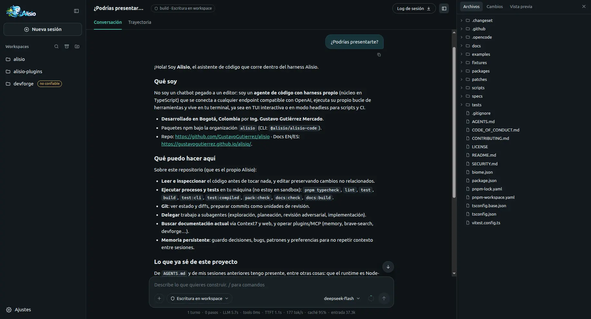

# Alisio

**English** · [Español](README.es.md)

<p align="center">
  
</p>

[](https://github.com/GustavoGutierrez/alisio/actions/workflows/ci.yml)
[](https://www.npmjs.com/package/@alisio/alisio-code)
[](LICENSE)
[](https://alisioair.com/)

**Alisio — AI that works with you. Your work, with more possibilities.** Alisio is a desktop app
with artificial intelligence that helps you with tasks from your work, your studies and your daily
life. Describe what you need: Alisio organizes the steps, uses the tools available and helps you
reach a result you can review and use, such as a PDF, a spreadsheet, a chart, a report or a
dashboard. Find apps for your tasks in the plugin catalog, build your own with the plugin creator by
describing what you need, and connect tools and services from the MCP catalog. It is made for
teachers, students, office staff, accountants and the home, and it works with the model you choose.
Programming is still possible, as an [advanced use](#advanced-use).

**[Download Alisio](https://alisioair.com/#download)** ·
[See how it works](https://alisioair.com/#how-it-works) ·
[Documentation (EN/ES)](https://alisioair.com/)

## What can it help you with?

- **Turn a spreadsheet into a report.** Attach a CSV or Excel table and ask for a summary with
  charts. You get a dashboard or a report you can open, check and share
  ([Smart Dashboard](https://alisioair.com/smart-dashboard)).
- **Prepare a printable exam.** With the Evalúa plugin, a teacher prepares a school **math** exam as
  a printable document, reviews it and reuses its format. Today it covers school math only.
- **Make certificates and cards.** With the Cardsmith plugin, office staff prepare certificates,
  cards and charts from their own data.

What exists today, by person:

| Who | What Alisio can do today | What it uses |
| --- | --- | --- |
| Students | Draft a thesis, research sources, study | `@alisio/plugin-thesis` (plans, researches, drafts and typesets university theses into PDF), `@alisio/plugin-literature-research` and the built-in memory |
| Teachers | Create printable exams (school **math** only for now) | `@alisio/plugin-evalua` |
| Accountants | Working papers and spreadsheet analysis | Built-in data analysis |
| Office and secretaries | Analyze Excel and CSV data, charts, certificates, reports | Built-in data analysis, `@alisio/plugin-cardsmith` |
| Home | Budgets, charts, organizing information | Built-in data analysis (no dedicated plugin) |

## What you need and what you get

**You need:**

- A computer with Windows 10 or 11 (x64), macOS (Apple Silicon or Intel) or Linux (x86_64).
- A model to work with: a key from an online model service, or a compatible model server on your
  own computer. You connect it once in **Settings → Models**.
- The folder with the files you want to work on.
- For some tasks, an extra program: for example Python 3.10 or newer to read Excel files. Alisio
  tells you what is missing.

**You get:** documents, tables, charts, reports, dashboards and designed PDFs that you can review,
ask to correct, then save, print or share. The conversation helps you ask and clarify; the result is
the file you keep.

## How you work with Alisio

1. **Choose.** Open the folder you want to work on and describe the task in your own words, or open
   an app from the **Apps** menu.
2. **Provide.** Add the files and data that are missing. Alisio reads the folder you opened and, in
   the **Ask** permission mode, asks before it changes a file, runs a program or uses the internet.
3. **Review.** The result appears as a document, table, chart or app. Check it, ask for corrections,
   then save, print or share it. You keep the final word.

<p align="center">
  
</p>

The desktop app shows this interface in its own window; it also opens in your browser.

### Apps for your work

Plugins add tools and apps for a profession.

- **Find tools for your work.** Open **Settings → Plugins → Plugin catalog** and install what you
  need in one click. Installed plugins can be updated or removed from the same screen, and you can
  install a private plugin from a file. Browse the
  [plugin catalog](https://plugins.alisioair.com/) online.
- **Build a helper made for you.** Open **Plugin creator** and describe a task you repeat. It builds
  the plugin, checks it and lets you decide when to install it, even with its own screen in the
  **Apps** menu ([Plugin creator](https://alisioair.com/plugin-creator)).
- **Connect a tool or service.** **Settings → MCP servers → Explore** lists tools and services you
  can connect, with guided sign-in, a connection check and one-click removal. Appearing in that list
  is not a security review, and some services still need manual setup
  ([MCP catalog](https://alisioair.com/mcp-catalog)).

| What you want to do | What it uses | Status |
| --- | --- | --- |
| Analyze CSV and Excel tables, charts, reports and dashboards | Built in | Included |
| Designed PDF documents | Built in | Included |
| Printable exams | `@alisio/plugin-evalua` | Plugin to install; school math only |
| Thesis writing and literature research | `@alisio/plugin-thesis`, `@alisio/plugin-literature-research` | Plugins to install |
| Certificates, cards and charts | `@alisio/plugin-cardsmith` | Plugin to install |
| A helper for your own task | Plugin creator | Included |
| Connect a tool or service | MCP catalog | Included |

The profession plugins live in the public
[alisio-plugins](https://github.com/GustavoGutierrez/alisio-plugins) repository and are **not bundled
in the desktop app yet**: you install them from the catalog. The quality of a result depends on the
plugin, the model and the services you use. In health, accounting, education or any sensitive
decision, Alisio supports your work; it does not replace your professional judgment.

## Your data and permissions

- **You choose the folder.** Alisio works with the folder you open. In the **Ask** permission mode
  it asks before it changes a file, runs a program or uses the internet; other modes let more run
  without asking, and you can switch at any time. See
  [Permission modes](https://alisioair.com/tools#permission-modes).
- **Working with local files is not the same as keeping everything on your computer.** Your
  conversations and settings are saved on your computer, but what Alisio reads to answer you is sent
  to the model you configured. With an online service, that service receives it; connected tools
  and services receive what they need for their task. With a model on your own computer, that
  content stays on it, except for tools that use the internet.
- **Keys stay protected.** Keys are stored as credentials, never in plain configuration files.
- **Not a sandbox.** Plugins and programs run with your user's permissions; install only what you
  trust.

## What it does not do yet

- **No scheduled or unsupervised routines.** Alisio works when you ask it to; it does not run tasks
  on a schedule or on its own.
- **Evalúa covers school math only.**
- **The desktop app has no automatic update yet**: you install a new version with its installer,
  and the installers are not signed. See the
  [desktop app limits](https://alisioair.com/desktop#limitations) and
  [Known limitations](https://alisioair.com/limitations).
- **Checks help, they do not guarantee.** Review every result before you use it.

## Download and requirements

Download the desktop app from the
[Alisio 0.11.11 release](https://github.com/GustavoGutierrez/alisio/releases/tag/v0.11.11):

- Windows 10/11 (x64): [`Alisio-Setup-0.11.11-x64.exe`](https://github.com/GustavoGutierrez/alisio/releases/download/v0.11.11/Alisio-Setup-0.11.11-x64.exe)
- macOS Apple Silicon: [`Alisio-0.11.11-arm64.dmg`](https://github.com/GustavoGutierrez/alisio/releases/download/v0.11.11/Alisio-0.11.11-arm64.dmg) · Intel: [`Alisio-0.11.11-x64.dmg`](https://github.com/GustavoGutierrez/alisio/releases/download/v0.11.11/Alisio-0.11.11-x64.dmg)
- Linux: [`Alisio-0.11.11-x86_64.AppImage`](https://github.com/GustavoGutierrez/alisio/releases/download/v0.11.11/Alisio-0.11.11-x86_64.AppImage) · Debian/Ubuntu: [`Alisio-0.11.11-amd64.deb`](https://github.com/GustavoGutierrez/alisio/releases/download/v0.11.11/Alisio-0.11.11-amd64.deb)

The installers are not signed, so Windows SmartScreen and macOS Gatekeeper ask for one extra step the
first time (see [apps/website/desktop.md](apps/website/desktop.md)). Then connect a model in **Settings → Models**,
open a folder and describe the task.

**Is it free?** Alisio is free and open source, under the MIT license. The model you connect may
have its own cost: online model services charge according to their own prices, and some connected
services require an account. A model running on your own computer has no service fee.

**Does it work without internet?** It depends on the model and the tool. With an online model you
need internet. With a model on your own computer, Alisio can work offline, but installing plugins,
refreshing the catalogs, web search and online services need a connection.

> **Status: stable, tested and documented, still pre-1.0.** Until 1.0.0 the usual 0.x semver rules
> apply: fixes ship as patch releases and a new minor release may include breaking changes. The npm
> badge above always shows the latest published version; see the
> [limitations](https://alisioair.com/limitations) and
> [Stability and versioning](https://alisioair.com/publishing#stability-and-versioning).

## Advanced use

Everything above works from the desktop app without a terminal. This part is for developers and
people who want more control: the command line, scripts, code mode, writing plugins in code and the
technical details.

### Highlights for developers

- **Terminal UI**: streaming Markdown, tool blocks with spinners, durations and diffs, a context/token
  bar, slash commands with autocomplete, model switching, interactive approvals and copy-on-select.
- **Web UI**: `alisio serve` opens a local, token-protected browser workspace for several workspaces
  and sessions, with streaming conversations, approvals, files, changes, artifacts and the plan
  viewer, on the same agent core. The desktop app is a thin Electron shell around this same server.
- **Any OpenAI-compatible provider**: Chat Completions and Responses APIs, DeepSeek-style endpoints, local servers.
  Keys are read from environment variables only. Dedicated DeepSeek, OpenCode Console (Zen) and
  OpenCode Go providers are separate plugins: `alisio install npm:@alisio/plugin-deepseek`,
  `alisio install npm:@alisio/plugin-opencode`, `alisio install npm:@alisio/plugin-opencode-go`.
- **Local tools with explicit permissions**: reads by default; the TUI asks before every
  write/process/network call unless you pass `--allow-write`/`--allow-process`/`--allow-external`
  (skip asking) or `--read-only` (never even offered). Alisio as a whole is not a sandbox, and it
  says so: only Forja isolates code. A repository's
  own `.alisio/config.json` and plugins load only after a one-time per-directory trust prompt (or
  `--trust-project`).
- **Context compaction**: a structured checkpoint (goal, constraints, discoveries, state, next steps,
  files) that never splits tool calls from their results.
- **Persistent memory**: SQLite FTS5 observations, topic-key upserts, memory-aware compaction and
  session summaries, shipped as the disableable `@alisio/plugin-memory`.
- **Agents**: create agents with the active model's help (or from templates), stored as portable
  Markdown in `.agents/agents` (project) or `~/.agents/agents` (global), reloaded without a restart
  and switched with `/agents` or `/agent:<id>` in the web UI and the TUI.
- **Plan mode and plan viewer**: a read-only plan agent proposes a plan (with optional Mermaid diagrams)
  that you approve before anything changes; the web UI opens it in a plan viewer.
- **Forja, code mode picked by goal**: `js_run` runs JavaScript in a fresh QuickJS WebAssembly VM with
  no file, network or process access, to combine tool calls, filter results and transform data under
  the agent's own permissions. `python_run` handles data analysis, statistics, scikit-learn, charts
  and custom dashboards in a container (`oci`) or a restricted Pyodide process (`wasm`) when
  available, and `analysis.isolation: required` keeps it off your host. Guides load on demand with
  `forge_guide`, and each session gets a private scratchpad. See the
  [Forja docs](https://alisioair.com/forja) for the isolation limits.
- **Dashboards and charts**: Python analysis publishes dashboards, reports and spreadsheets as
  artifacts, with interactive charts from an embedded Chart.js that works offline.
- **Reliability Lab**: `alisio eval` runs task suites k times with deterministic verifiers, reports
  pass rates with Wilson intervals, compares reports and config variants, and replays recorded
  cassettes to catch harness regressions without a model (replay measures the harness, not the
  model). See the [Reliability Lab docs](https://alisioair.com/eval).
- **Proof**: acceptance criteria whose status comes from evidence Alisio captured from the commands,
  file reads and data queries the agent really ran, not from what the model says. Shown in the web UI,
  the terminal and `alisio run --proof` (exit codes 0/10/11, `proof/v1` JSON). It does not prove the
  code is correct. See the [Proof docs](https://alisioair.com/proof).
- **Typed plugin SDK**: tools, commands, context, compaction and session hooks, provider-agnostic
  completions and a storage port. Load plugins from a path or an npm package — install them
  globally with `alisio install npm:<package>` (or let the agent do it via the permissioned
  `plugin_install` tool). See [Writing plugins](https://alisioair.com/plugins).
- **Also**: headless JSONL mode, subagents, MCP servers (with an optional persistent global
  `mcp.allow` consent that auto-connects enabled servers on every start, or per-session grants from
  the TUI), AGENTS.md scopes, Agent Skills, Herdr integration.
- **Runs on Node.js >= 22.16 or Bun**; standalone binaries for Linux, macOS and Windows. The Pyodide
  (`wasm`) Python backend needs Node.js >= 22.22, >= 24.13 or >= 25.3.

### Install from the command line

The command line is the advanced path (Node.js >= 22.16).

```sh
npm install -g @alisio/alisio-code   # or: pnpm add -g @alisio/alisio-code · bun add -g @alisio/alisio-code
alisio                                  # the CLI binary is installed as `alisio`
# Standalone binary (verifies the SHA-256 checksum):
curl -fsSL https://raw.githubusercontent.com/GustavoGutierrez/alisio/main/scripts/install.sh | sh
```

### Quick start

```sh
alisio setup                                 # writes .alisio/config.json without secrets
export DEEPSEEK_API_KEY='...'                # keys come from the environment
alisio --config .alisio/config.json          # TUI
alisio run "Explain this repository" --config .alisio/config.json --read-only
```

```json
{
  "provider": {
    "baseURL": "https://api.deepseek.com/v1",
    "apiKeyEnv": "DEEPSEEK_API_KEY",
    "model": "deepseek-chat",
    "streamUsage": true
  }
}
```

### Packages

All packages are published under the [alisio npm organization](https://www.npmjs.com/settings/alisio/packages):

| Package | npm | Purpose |
| --- | --- | --- |
| [`alisio-code`](packages/cli) | [npm](https://www.npmjs.com/package/@alisio/alisio-code) | The CLI and TUI you install (`alisio` bin) |
| [`@alisio/core`](packages/core) | [npm](https://www.npmjs.com/package/@alisio/core) | Embeddable agent core: runner, compaction, provider, tools, Forja, plugin host |
| [`@alisio/server`](packages/server) | [npm](https://www.npmjs.com/package/@alisio/server) | Local HTTP + SSE server behind `alisio serve` (the Web UI) |
| [`@alisio/sdk`](packages/sdk) | [npm](https://www.npmjs.com/package/@alisio/sdk) | Typed plugin contract, zero runtime dependencies |
| [`@alisio/plugin-memory`](packages/plugin-memory) | [npm](https://www.npmjs.com/package/@alisio/plugin-memory) | Built-in persistent memory plugin |
| [`@alisio/plugin-subagents`](packages/plugin-subagents) | [npm](https://www.npmjs.com/package/@alisio/plugin-subagents) | Subagent delegation plugin |
| [`@alisio/plugin-openai-compatible`](packages/plugin-openai-compatible) | [npm](https://www.npmjs.com/package/@alisio/plugin-openai-compatible) | Built-in generic OpenAI-compatible model provider |

Dedicated model providers are independent plugins published from the
[alisio-plugins](https://github.com/GustavoGutierrez/alisio-plugins) monorepo and installed
separately: `alisio install npm:@alisio/plugin-deepseek`,
`alisio install npm:@alisio/plugin-opencode`, `alisio install npm:@alisio/plugin-opencode-go`.

The desktop app is built from this repository and is not published to npm; see
[apps/website/desktop.md](apps/website/desktop.md) to run it from a checkout or build the installers.

### Development

```sh
pnpm install --frozen-lockfile
pnpm dev                 # run the CLI from source (Bun)
pnpm check               # typecheck, lint, tests, build, CLI e2e (Node and binary), packs, docs
pnpm publish -- --all --dry-run   # preview the publishable packages; see apps/website/publishing.md
```

See [CONTRIBUTING.md](CONTRIBUTING.md) and [Publishing](https://alisioair.com/publishing).

Please read [SECURITY.md](SECURITY.md) before reporting a vulnerability, and follow
[CODE_OF_CONDUCT.md](CODE_OF_CONDUCT.md) when participating.

## Documentation

- [English docs](https://alisioair.com/)
- [Documentación en español](https://alisioair.com/es/)
- [Product specification](apps/website/specification.md): the product direction, kept in the repository.
- [Validation log](apps/website/validation.txt) and [benchmark data](apps/website/benchmark.json): raw validation output.

The documentation site is bilingual (English and Spanish). The detailed implementation status
([apps/website/implementation-status.md](apps/website/implementation-status.md)) is maintained in Spanish.

## Author and license

Alisio is **developed in Bogotá, Colombia** by **Ing. Gustavo Gutiérrez Mercado**
([GitHub](https://github.com/GustavoGutierrez) ·
[LinkedIn](https://www.linkedin.com/in/gustavo-gutierrez-mercado)).

[MIT](LICENSE) · Maintainer: **Gustavo Gutiérrez**

Third-party notice: [Chart.js](https://www.chartjs.org/) 4.5.1 (MIT, © Chart.js Contributors) is
bundled in `@alisio/core` for dashboard charts. Its copyright header stays in the bundled file and
its license text is kept in
`packages/core/src/analysis/python/alisio_runtime/chart.LICENSE.txt`.
[OverlayScrollbars](https://kingsora.github.io/OverlayScrollbars/) 2.17.0 (MIT, © Rene Haas) is
bundled in the web UI (a lazy chunk) for the overlay scrollbars.
