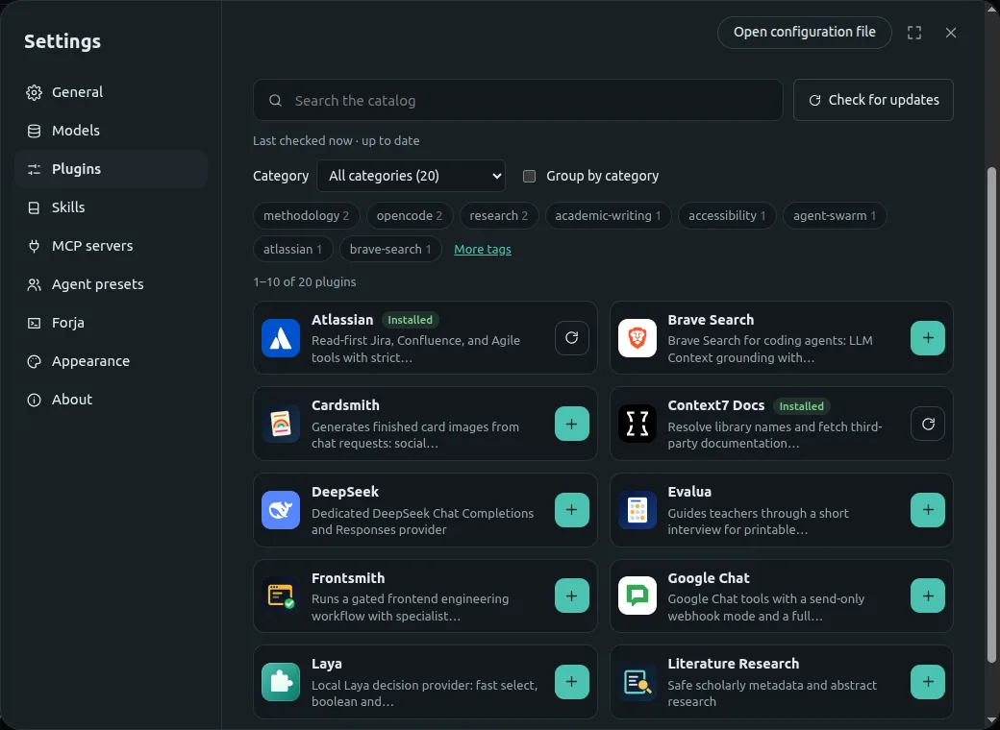
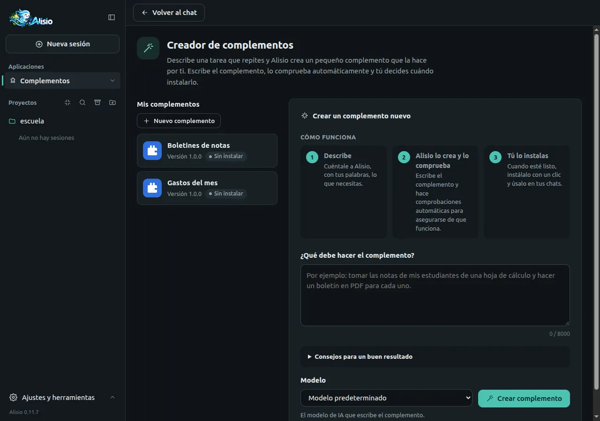

## ¿Qué es Alisio?

Alisio es una aplicación de escritorio con inteligencia artificial que te ayuda a realizar tareas de
tu trabajo, tus estudios y tu vida diaria. Describe lo que necesitas: Alisio organiza los pasos,
utiliza las herramientas disponibles y te ayuda a obtener un resultado que puedas revisar y usar.
Trabaja con los archivos de la carpeta que eliges, pregunta antes de cambiar algo y te permite añadir
[aplicaciones para tu oficio](#apps), desde el catálogo o creadas por ti. Docentes, estudiantes,
personal de oficina, contadores y cualquier persona en su hogar pueden empezar sin aprender términos
técnicos nuevos; programar sigue siendo posible, como uso avanzado.

<section data-component="web-ui-preview" aria-labelledby="alisio-web-ui-heading" class="home-showcase">
  <h3 id="alisio-web-ui-heading">Conversación, archivos y aprobaciones en una sola ventana</h3>
  
Pide lo que necesitas con tus palabras, mira qué está haciendo Alisio y aprueba cada cambio. La aplicación de escritorio muestra esta interfaz en su propia ventana; también se abre en tu navegador.

<ShowcaseSlider />

</section>

## Lo que Alisio te ofrece

### Encuentra herramientas para tu trabajo

Explora el catálogo de complementos e instala lo que necesitas con un clic: redacción de tesis, investigación bibliográfica, exámenes de matemáticas imprimibles, certificados y tarjetas. Desde la misma pantalla puedes actualizar o quitar los complementos instalados.

[Catálogo de complementos en la aplicación](/es/web#plugin-catalog) · [Explora el catálogo de complementos](https://plugins.alisioair.com/)

<figure class="offer-shot">

<button type="button" class="media-btn media-expand" data-expand="image" hidden data-label-close="Cerrar" aria-label="Ver esta captura en grande"><svg viewBox="0 0 24 24" width="18" height="18" aria-hidden="true"><path d="M14 4h6v6M10 20H4v-6M20 4l-7 7M4 20l7-7" /></svg></button>

</figure>

### [Crea una ayuda a tu medida](/es/plugin-creator)

Describe con tus palabras una tarea que repites. El creador de complementos construye el complemento, lo comprueba y te deja decidir cuándo instalarlo, incluso con su propia pantalla en el menú Apps.

<figure class="offer-shot">

<button type="button" class="media-btn media-expand" data-expand="image" hidden data-label-close="Cerrar" aria-label="Ver esta captura en grande"><svg viewBox="0 0 24 24" width="18" height="18" aria-hidden="true"><path d="M14 4h6v6M10 20H4v-6M20 4l-7 7M4 20l7-7" /></svg></button>

</figure>

### [Obtén resultados que puedes usar](/es/smart-dashboard)

Trabaja con tus documentos y datos y obtén PDF, hojas de cálculo, gráficos, informes y paneles que puedes revisar, ajustar, abrir, imprimir o compartir.

<figure class="offer-shot">

<button type="button" class="media-btn media-expand" data-expand="image" hidden data-label-close="Cerrar" aria-label="Ver esta captura en grande"><svg viewBox="0 0 24 24" width="18" height="18" aria-hidden="true"><path d="M14 4h6v6M10 20H4v-6M20 4l-7 7M4 20l7-7" /></svg></button>

</figure>

### También incluye

- **[Conecta una herramienta o servicio](/es/mcp-catalog)** Un catálogo con inicio de sesión guiado y prueba de conexión.
- **[Recuerda lo importante](/es/memory)** Notas que se mantienen entre tus proyectos.
- **[También en tu navegador](/es/web)** La misma interfaz, abierta en tu navegador.

## ¿En qué te puede ayudar?

- **[Convierte una hoja de cálculo en un informe](/es/smart-dashboard)** Adjunta una tabla CSV o de Excel y pide un resumen con gráficos. Obtienes un panel o un informe que puedes abrir, revisar y compartir.
- **[Prepara un examen imprimible](/es/about#para-quien-es)** Con el complemento Evalúa, un docente prepara un examen escolar de **matemáticas** como documento imprimible, lo revisa y reutiliza su formato. Hoy cubre solo matemáticas escolares.
- **[Elabora certificados y tarjetas](/es/about#para-quien-es)** Con el complemento Cardsmith, el personal de oficina prepara certificados, tarjetas y gráficos a partir de sus propios datos.

## Así trabajas con Alisio {#how-it-works}

<svg class="steps-wind" viewBox="0 0 1000 52" preserveAspectRatio="none" aria-hidden="true" focusable="false"><path pathLength="1" d="M24 32C150 10 330 50 500 30S850 10 1000 30" /></svg>

1. **Eliges** Abre la carpeta en la que quieres trabajar y describe la tarea con tus palabras, o abre una aplicación desde el menú **Aplicaciones**.
2. **Aportas** Añade los archivos y datos que faltan. Alisio lee la carpeta que abriste y, en el modo de permisos **Preguntar**, pregunta antes de cambiar un archivo, ejecutar un programa o usar internet.
3. **Revisas** El resultado aparece como documento, tabla, gráfico o aplicación. Revísalo, pide correcciones y luego guárdalo, imprímelo o compártelo. La última palabra es tuya.

## Aplicaciones para tu oficio {#apps}

Los complementos añaden herramientas y aplicaciones para cada profesión. Los encuentras en
**Ajustes → Complementos → Catálogo de complementos**, puedes instalar uno privado desde un archivo o crear el
tuyo con el [creador de complementos](/es/plugin-creator). Las conexiones con otras herramientas y
servicios vienen del [catálogo MCP](/es/mcp-catalog), con inicio de sesión guiado, prueba de conexión
y eliminación con un clic.

| Lo que quieres hacer | Qué utiliza | Estado |
| --- | --- | --- |
| Analizar tablas CSV y Excel, gráficos, informes y paneles | Incluido ([Smart Dashboard](/es/smart-dashboard), [Forja](/es/forja)) | Incluido |
| Documentos PDF diseñados | Incluido ([PDF diseñados](/es/documents)) | Incluido |
| Exámenes imprimibles | `@alisio/plugin-evalua` | Complemento para instalar; solo matemáticas escolares |
| Redacción de tesis e investigación bibliográfica | `@alisio/plugin-thesis`, `@alisio/plugin-literature-research` | Complementos para instalar |
| Certificados, tarjetas y gráficos | `@alisio/plugin-cardsmith` | Complemento para instalar |
| Una ayuda para tu propia tarea | [Creador de complementos](/es/plugin-creator) | Incluido |
| Conectar una herramienta o servicio | [Catálogo MCP](/es/mcp-catalog) | Incluido |

La calidad de un resultado depende del complemento, del modelo y de los servicios que utilices. En
salud, contabilidad, educación o cualquier decisión delicada, Alisio apoya tu trabajo; no sustituye
tu criterio profesional.

## Tus datos y permisos {#data-and-permissions}

- **Tú eliges la carpeta.** Alisio trabaja con la carpeta que abres. En el modo de permisos
  **Preguntar**, pregunta antes de cambiar un archivo, ejecutar un programa o usar internet; otros
  modos dejan que más acciones se ejecuten sin preguntar, y puedes cambiarlo en cualquier momento.
  Consulta [Modos de permisos](/es/tools#permission-modes).
- **[Tú apruebas los cambios.](/es/tools#permission-flags)** Alisio pregunta antes de cambiar archivos o ejecutar programas.
- **[Un plan antes de actuar.](/es/plan)** Revisa y aprueba los pasos primero.
- **Trabajar con archivos locales no es lo mismo que mantenerlo todo en tu equipo.** Tus
  conversaciones y ajustes se guardan en tu equipo, pero lo que Alisio lee para responderte se envía
  al modelo que configuraste. Con un servicio en línea, ese servicio lo recibe; las herramientas y
  servicios conectados reciben lo que necesitan para su tarea.
- **Las claves quedan protegidas.** Las claves se guardan como credenciales, nunca en archivos de
  configuración en texto plano.
- **No es un sandbox.** Los complementos y programas se ejecutan con los permisos de tu usuario;
  instala solo lo que sea de tu confianza.

<DesktopDownloads />

### Requisitos

- **Sistema operativo** Windows 10 u 11 (x64) macOS (Apple Silicon o Intel) Linux (x86_64)
- **[Un modelo con el que trabajar](/es/configuration)** Una clave de un servicio de modelos en línea, o un servidor de modelos compatible en tu propio equipo.
- **Programas adicionales** Algunas tareas necesitan programas adicionales, por ejemplo Python 3.10 o posterior para leer archivos de Excel; Alisio te indica lo que falta.
- **Primer arranque** Los instaladores no están firmados, así que el primer arranque pide un paso extra (consulta [Aplicación de escritorio](/es/desktop#unsigned)).

## Preguntas frecuentes {#faq}

¿Necesito saber programar?

No. Instalas la aplicación, conectas un modelo en **Ajustes → Modelos**, abres una carpeta y describes
la tarea. Los complementos se instalan desde el catálogo y el creador de complementos construye
otros nuevos a partir de una descripción. Límites actuales: algunos servicios del catálogo MCP aún requieren
configuración manual.

¿Es gratis?

Alisio es libre y de código abierto, con licencia MIT. El modelo que conectes puede tener su propio
costo: los servicios de modelos en línea cobran según sus propios precios y algunos servicios
conectados requieren una cuenta. Un modelo que se ejecuta en tu propio equipo no tiene tarifa de
servicio.

¿Mis archivos salen de mi equipo?

Depende de lo que conectes. Alisio y tus sesiones están en tu equipo, pero el contenido que lee para
ayudarte se envía al modelo que configuraste y, cuando los usas, a las herramientas y servicios
conectados. Con un modelo en tu propio equipo, ese contenido se queda en él, salvo en las
herramientas que usan internet.

¿Funciona sin internet?

Depende del modelo y de la herramienta. Con un modelo en línea necesitas internet. Con un modelo que
se ejecuta en tu propio equipo, Alisio puede trabajar sin conexión, pero instalar complementos,
actualizar los catálogos, buscar en la web y usar servicios en línea requieren conexión.

¿Puedo usarlo en mi oficio?

Sí, para las tareas de [Aplicaciones para tu oficio](#apps): análisis de datos e informes, PDF
diseñados, exámenes de matemáticas escolares, redacción de tesis, certificados y tarjetas. Para otras
tareas, comprueba si existe un complemento o crea uno con el creador de complementos. Revisa cada
resultado antes de usarlo.

## Para desarrolladores {#for-developers}

Programar es un uso avanzado y opcional. Este video corto muestra Alisio en la terminal, la vía para desarrolladores y scripts.

<TerminalInstall />

<section data-component="video" aria-labelledby="alisio-cli-demo-heading">
  <h3 id="alisio-cli-demo-heading" class="visually-hidden">Para uso avanzado: la terminal</h3>
  

    <video autoplay playsinline loop muted preload="metadata" width="960" height="500" poster="/assets/alisio-cli-demo-poster.jpg">
      <source src="/assets/alisio-cli-demo.mp4" type="video/mp4" />
      Tu navegador no admite el video de demostración de la CLI de Alisio.
    </video>
    <button type="button" class="media-btn media-expand" data-expand="video" hidden data-label-close="Cerrar" aria-label="Ver la demostración de la CLI en grande"><svg viewBox="0 0 24 24" width="18" height="18" aria-hidden="true"><path d="M14 4h6v6M10 20H4v-6M20 4l-7 7M4 20l7-7" /></svg></button>
    <button type="button" class="media-btn video-toggle" data-video-toggle hidden data-label-pause="Pausar el video de demostración de la CLI" data-label-play="Reproducir el video de demostración de la CLI" aria-label="Pausar el video de demostración de la CLI">
      <svg class="icon-pause" viewBox="0 0 24 24" width="18" height="18" aria-hidden="true"><path d="M8 5v14M16 5v14" /></svg>
      <svg class="icon-play" viewBox="0 0 24 24" width="18" height="18" aria-hidden="true"><path d="M8 5l11 7-11 7z" /></svg>
    </button>
  

</section>

- **[Ejecuciones headless](/es/tui)** `alisio run` con eventos JSONL y reanudación de sesiones, para scripts y CI.
- **[Herramientas locales](/es/tools)** Leer, buscar, editar, ejecutar procesos y Git, siempre con permisos explícitos.
- **[Contexto del proyecto](/es/context)** Instrucciones jerárquicas `AGENTS.md` y Agent Skills.
- **[Avanzado: terminal y scripts](/es/tui)** Una interfaz de terminal y un modo para scripts.
- **[Avanzado: complementos con código](/es/plugins)** Un kit tipado de complementos para desarrolladores.

### Uso avanzado: modo código con Forja

- **[JavaScript para todo lo demás](/es/forja#language)** `js_run` combina varias llamadas a herramientas, filtra y pagina resultados, transforma JSON y texto. Se ejecuta en una VM QuickJS de WebAssembly nueva, sin acceso a archivos, red ni procesos: solo puede llamar herramientas de Alisio, con los mismos permisos que el agente.
- **[Python para análisis de datos e IA](/es/forja#isolation)** `python_run` cubre pandas y NumPy, estadística, scikit-learn, gráficos y dashboards a medida. Se ejecuta en un contenedor (`oci`) o en un proceso Pyodide de WebAssembly restringido (`wasm`) cuando están disponibles; con `analysis.isolation: required` nunca se ejecuta sin aislamiento.
- **[Contexto bajo demanda](/es/forja#forge-guide)** Con `forge_guide`, la guía de cada lenguaje se carga solo cuando la tarea la necesita, adaptada a los motores y paquetes que de verdad están instalados, así el prompt se mantiene pequeño.

Alisio `__ALISIO_VERSION__` es una versión **estable**, todavía anterior a 1.0: las versiones menores pueden incluir cambios incompatibles (consulta [Estabilidad y versionado](/es/publishing#estabilidad-y-versionado)). Lee [Limitaciones conocidas](/es/limitations)
antes de depender de él. Alisio en su conjunto **no es un sandbox**: el shell, las herramientas locales
y los complementos se ejecutan con tus privilegios de usuario. Solo Forja aísla código (`js_run`, y Python
con los backends `oci` o `wasm`), con los límites que documenta [Forja](/es/forja).

## Siguiente paso

[Descargar Alisio](/es/desktop#descargar-e-instalar) [Inicio rápido](/es/quick-start) [Instalación](/es/installation)

