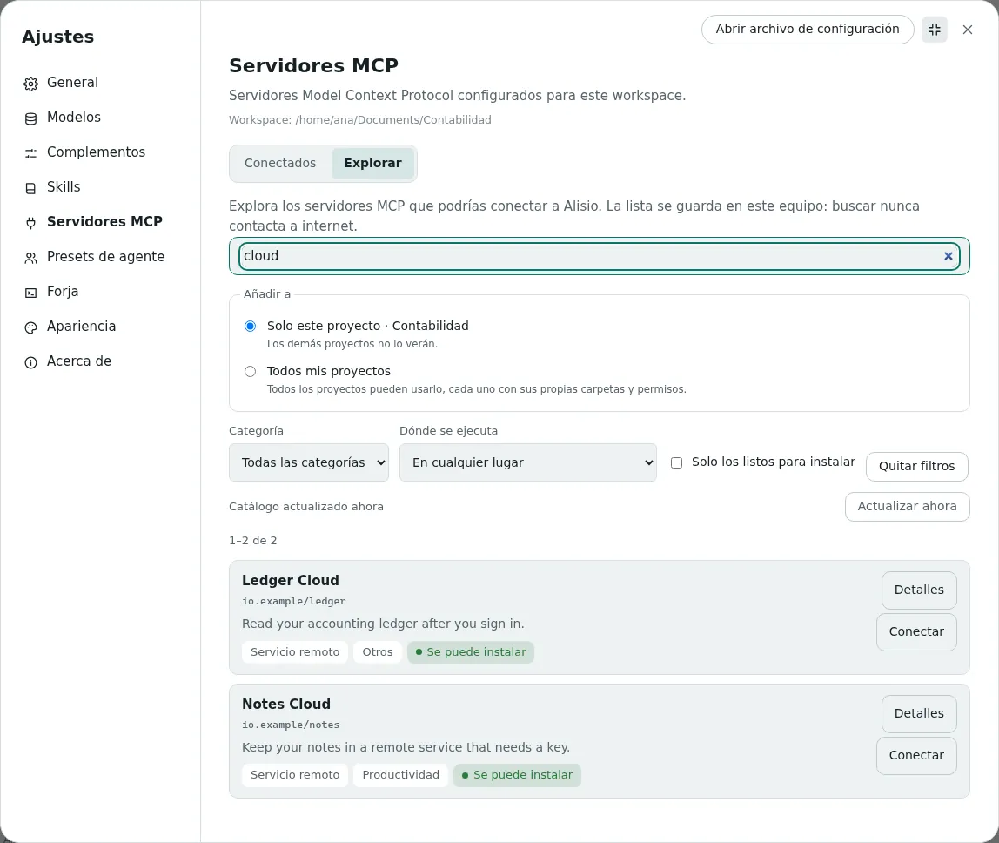
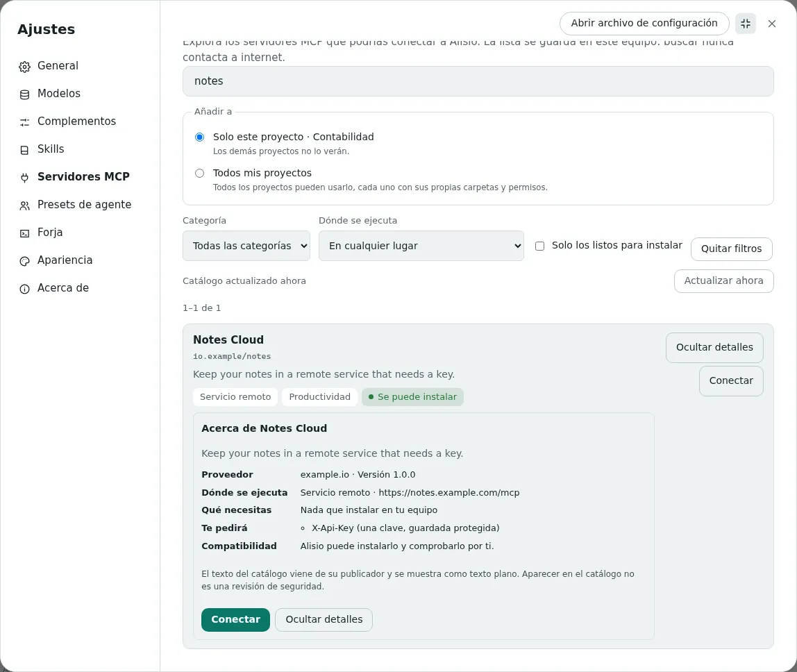
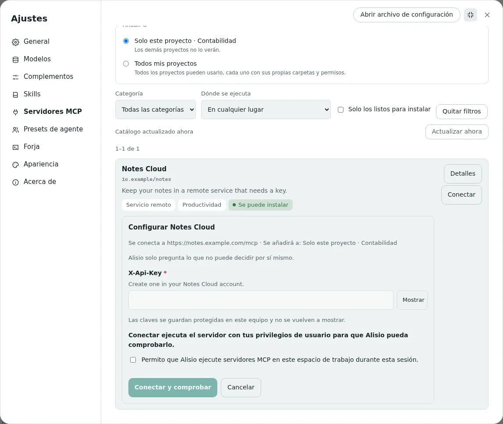
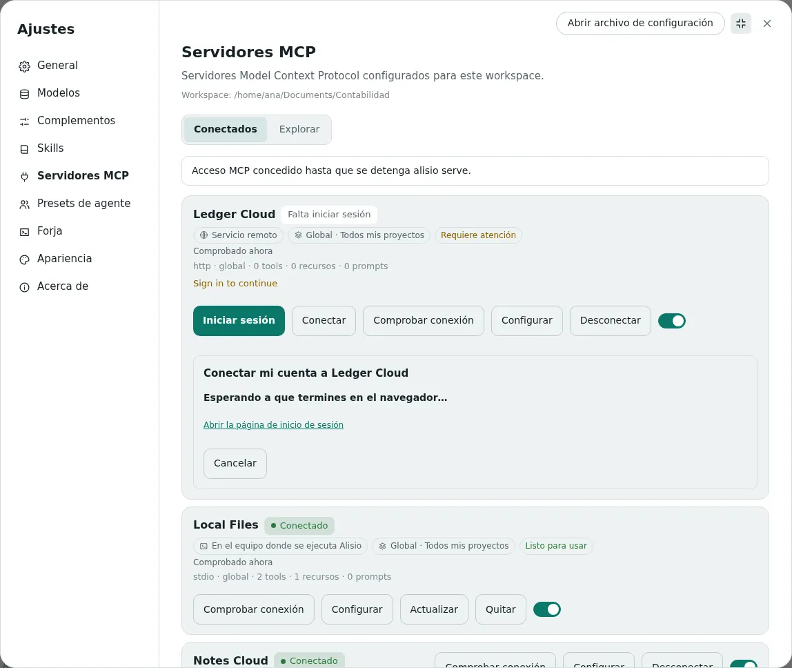
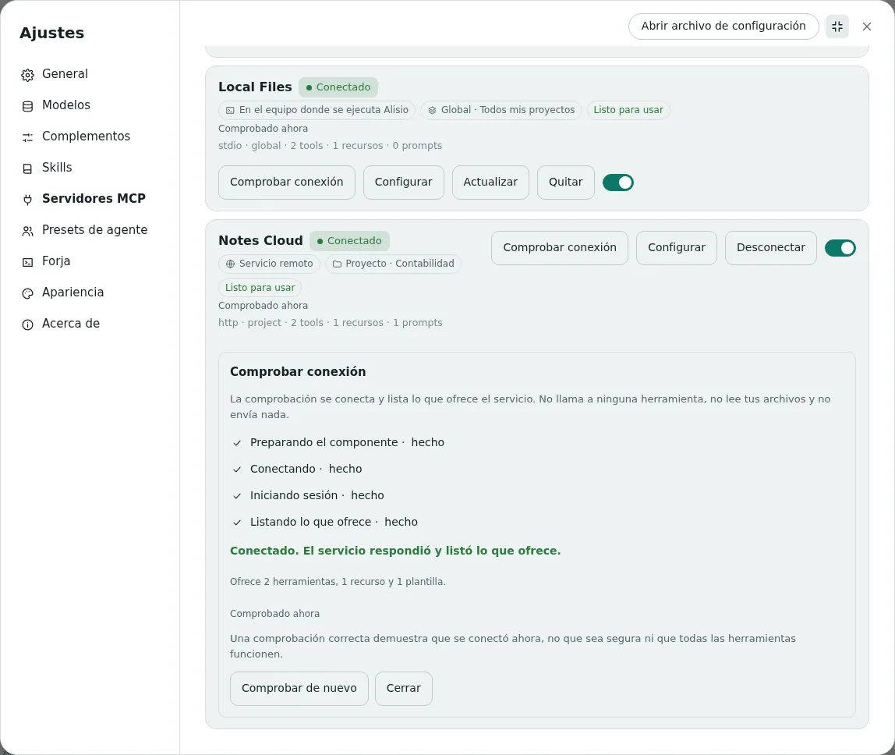
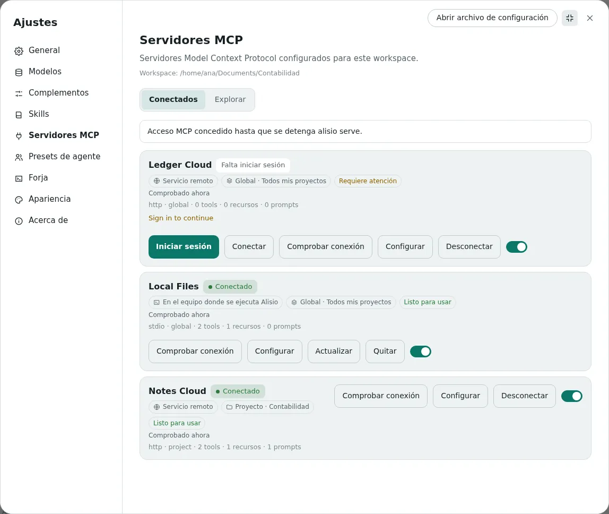

# Catálogo MCP

El catálogo MCP permite conectar herramientas y servicios a Alisio sin editar archivos ni escribir
comandos. Encuentra un servidor en una lista, elige dónde estará disponible, dale una clave si la
necesita y Alisio lo instala, lo conecta y comprueba que responde. Está en **Ajustes → Servidores
MCP**, en la interfaz web y en la app de escritorio. Para desarrolladores: la
[última sección](#cambiar-la-fuente-del-catalogo) explica cómo se puede sustituir la fuente del
catálogo y [Configuración](/es/configuration#servidores-mcp) lista los formatos de archivo.

## Qué es el catálogo

Un servidor MCP es un programa pequeño o un servicio en línea que da a Alisio nuevas capacidades,
como leer tus notas, consultar un libro contable o explorar una carpeta. El catálogo es una lista con
buscador, construida desde el registro oficial de MCP (`registry.modelcontextprotocol.io`) y guardada
en tu equipo. Buscar nunca contacta con internet y la lista se actualiza sola como máximo una vez por
hora mientras Alisio está abierto (o cuando pulsas **Actualizar ahora**).

Aparecer en el catálogo **no** es una revisión de seguridad. El registro publica descripciones y
comprueba quién es dueño de un nombre; no audita lo que hace un servidor. Lee
[Seguridad y límites](#seguridad-y-limites) antes de conectar algo que no conozcas.

## Buscar un servidor

Abre **Ajustes → Servidores MCP → Explorar**. La lista ya está ahí: no hace falta escribir nada. Usa lo
que te ayude:

- **Busca** por nombre, descripción o categoría, en español o en inglés. Con dos letras basta.
- **Categoría** (desarrollo, productividad, archivos y documentos, datos, comunicación, investigación,
  diseño y multimedia, otros), **Dónde se ejecuta** y **Solo los listos para instalar** acotan la
  lista. Las entradas que Alisio no puede instalar no se ocultan: cada una dice por qué.
- El número de resultados, la página (24 por página) y la fecha de la última actualización siempre
  están a la vista. Sin internet sigues viendo la última lista guardada, con su fecha.

<figure class="doc-shot">
  
  <figcaption>Explorar: búsqueda, filtros y el lugar donde se añadirá el servidor, todo en una pantalla.</figcaption>
</figure>

**Detalles** abre una ficha dentro de la lista: quién lo ofrece, dónde se ejecuta, qué necesitas en tu
equipo, qué te va a pedir (por ejemplo una clave) y si Alisio puede instalarlo. El texto del catálogo
viene de su publicador y se muestra como texto simple.

<figure class="doc-shot">
  
  <figcaption>La ficha de detalles, escrita para personas que no son técnicas.</figcaption>
</figure>

## Dónde se ejecuta y dónde está disponible

Cada servidor muestra dos etiquetas separadas. Responden preguntas distintas y ninguna depende de la
otra.

| Etiqueta | Significado |
| --- | --- |
| **En este equipo** | El servidor es un programa que se ejecuta en tu equipo, con tus privilegios de usuario. Si usas Alisio en un navegador servido por otro equipo, dice **En el equipo donde se ejecuta Alisio**: nunca es el equipo del navegador. |
| **Servicio remoto** | El servidor es un servicio en línea. Alisio solo le envía solicitudes; nada de él se ejecuta en tu equipo. |
| **Global · Todos mis proyectos** | El servidor está disponible en todos los proyectos. Cada proyecto sigue teniendo su propia conexión, carpetas y permisos. |
| **Proyecto · nombre** | El servidor está disponible solo en ese proyecto. Los demás proyectos no lo ven. |

Así, **En este equipo · Global** y **Servicio remoto · Proyecto: Contabilidad** son combinaciones
válidas. Cuando el mismo nombre existe en global y en un proyecto, se usa el del proyecto y la lista
muestra ambos.

## Instalar un servidor

1. Elige **Solo este proyecto** o **Todos mis proyectos** sobre la lista. El proyecto abierto viene
   preseleccionado.
2. Pulsa **Instalar** (un programa en tu equipo) o **Conectar** (un servicio en línea) en la tarjeta.
3. Si Alisio necesita algo que no puede decidir, aparece un formulario corto con solo esos campos: una
   clave (oculta, con botón **Mostrar**), una carpeta o una dirección. Los campos opcionales quedan
   plegados. Una clave guardada no se vuelve a mostrar.
4. Si aún no se concedió el acceso MCP, el mismo formulario lo pide en una casilla que empieza sin
   marcar. Instalar no concede por sí solo permiso para ejecutar nada.
5. Pulsa **Instalar y comprobar** o **Conectar y comprobar**. Ves los pasos (descargar, añadir,
   conectar, comprobar) y puedes **Cancelar**; cancelar deja el sistema como estaba.

Si no falta nada y el acceso MCP ya existe, un clic basta y no aparece ningún formulario vacío. Cuando
algo falla, recibes la causa en palabras sencillas y la siguiente acción (cambiar la clave, reintentar,
elegir otra carpeta) sin perder lo que escribiste.

<figure class="doc-shot">
  
  <figcaption>El formulario compacto: solo lo que Alisio no puede decidir, con la clave oculta.</figcaption>
</figure>

## Iniciar sesión en un servicio

Algunos servicios en línea quieren que inicies sesión en lugar de pegar una clave. Su fila en
**Conectados** dice **Falta iniciar sesión** e **Iniciar sesión** abre la página del propio servicio en
tu navegador. Alisio nunca ve tu contraseña: recibe una autorización solo para ese servicio y la
renueva sola. **Cerrar sesión** borra la autorización guardada en este equipo; no cancela tu cuenta ni
pide al servicio que la revoque.

<figure class="doc-shot">
  
  <figcaption>Iniciar sesión: Alisio espera mientras terminas en el navegador.</figcaption>
</figure>

## Comprobar, configurar, actualizar y quitar

La pestaña **Conectados** lista todo lo configurado, también los servidores que añadiste a mano. Cada
fila muestra el estado, dónde se ejecuta, dónde está disponible y si la última comprobación pasó y
cuándo.

- **Comprobar conexión** se conecta en una sesión aparte y lista lo que el servicio anuncia
  (herramientas, recursos, prompts). No llama a ninguna herramienta, no lee tus archivos ni envía
  nada. Necesita el acceso MCP, porque un servidor local es un programa que se ejecuta. Pasar la
  comprobación significa que se conectó ahora mismo, no que sea seguro ni que todas sus herramientas
  funcionen. Una comprobación queda **desactualizada** cuando cambian los ajustes, una clave guardada
  o la versión.
- **Configurar** edita lo que pidió la tarjeta. Una clave guardada solo aparece como **Clave
  guardada**; dejarla vacía la conserva y **Sustituir clave** guarda una nueva.
- **Actualizar** busca una versión más nueva de un programa instalado, la instala junto a la actual, la
  comprueba y vuelve a la anterior si no conecta. Los servicios remotos se actualizan solos. Nada se
  actualiza sin que lo pulses.
- **Quitar** (local) o **Desconectar** (remoto) pregunta una vez y dice exactamente qué ocurre: quitar
  uno global lo saca de todos los proyectos, quitar uno de proyecto solo de ese proyecto, y
  desconectar nunca borra tu cuenta ni cancela una suscripción. El programa descargado se borra solo
  cuando ningún otro proyecto lo usa.
- El interruptor activa o desactiva un servidor sin borrar nada.

<figure class="doc-shot">
  
  <figcaption>Una comprobación de conexión, con sus etapas y lo que ofrece el servicio.</figcaption>
</figure>

<figure class="doc-shot">
  
  <figcaption>Conectados: dónde se ejecuta cada servidor y dónde está disponible, como etiquetas separadas.</figcaption>
</figure>

## Qué se puede instalar

| Tipo de servidor | Estado |
| --- | --- |
| Programa publicado en npm que se ejecuta en tu equipo (stdio) | Se instala automáticamente cuando la versión es exacta, no tiene scripts de instalación y su programa no es ambiguo. Necesita npm; Alisio usa el Node de tu equipo o el entorno en el que se ejecuta. |
| Servicio en línea por Streamable HTTP | Se conecta automáticamente cuando su dirección es HTTPS pública. Se pide una clave o un inicio de sesión cuando hace falta. |
| Python (PyPI), contenedores (OCI, como Docker), paquetes MCPB y servicios SSE heredados | **No se instalan automáticamente.** La tarjeta lo dice y remite a la configuración manual en [Configuración](/es/configuration#instalar-desde-el-catalogo). |
| Paquetes npm con scripts de instalación, sin versión exacta o con varios programas | **No se instalan automáticamente.** La tarjeta indica qué motivo aplica. |

Alisio no instala Node, Python ni Docker por ti. Si falta algo, la tarjeta dice qué y ofrece **Volver a
comprobar** cuando lo tengas.

## Seguridad y límites

- El registro no audita código. Un servidor que instalas se ejecuta con tus privilegios de usuario (uno
  local) o recibe lo que le envías (uno remoto). Las comprobaciones de Alisio (versión exacta, sin
  scripts de instalación, carpeta de descarga privada) reducen el riesgo; **no son un sandbox**.
- Conectar ejecuta el programa, así que necesita el consentimiento MCP existente. Instalar por sí solo
  nunca lo concede y un proyecto no puede concedérselo a sí mismo. `--read-only` bloquea instalar,
  sincronizar y conectar.
- Las claves y los tokens de inicio de sesión se guardan en `<config home>/mcp-secrets.json` con
  permisos que solo tú puedes leer. Están protegidos por esos permisos, **no cifrados**, y nunca
  aparecen en la configuración, en los registros ni en pantalla. La configuración solo guarda
  referencias a ellos.
- Las direcciones del catálogo deben ser HTTPS públicas (sin credenciales, bucle local ni redes
  privadas). Las direcciones que escribes tú para un servidor que configuras a mano no se restringen.
- La página de inicio de sesión vuelve al equipo donde se ejecuta Alisio, así que no puede terminar
  cuando tu navegador está en otro equipo. El inicio de sesión funciona para los servidores instalados
  desde el catálogo.
- Los mensajes que vienen del propio servidor o del catálogo (descripciones, algunos textos de error)
  se muestran en el idioma de su origen, sin traducir.

La lista completa de comportamiento verificado y no verificado está en [Limitaciones
conocidas](/es/limitations).

## Cambiar la fuente del catálogo

El catálogo no depende del registro oficial. Todo lo que va después de la fuente (el índice local, la
sincronización, las rutas HTTP y la interfaz web) lee el modelo propio de Alisio, de modo que cambiar
de proveedor solo cambia un adaptador.

- **Puerto.** `CatalogSource` en `@alisio/core` (`packages/core/src/mcp/catalog/source.ts`) tiene un
  `sourceId`, sus `capabilities`, `listPage(request)` (paginación por cursor, `updatedSince`
  opcional) y `get(name, version?)`. Devuelve el `CatalogEntry` de Alisio, nunca las formas del
  proveedor, e informa de las entradas que no puede usar como `rejected` con un motivo.
- **Adaptador.** `OfficialRegistrySource` traduce el registro (tres revisiones de esquema) a ese
  modelo, con 15 segundos de tiempo límite por petición, dos reintentos que respetan `Retry-After`,
  5 MiB por respuesta y 128 KiB por registro. Un proveedor nuevo es una clase nueva como esa.
- **Fábrica.** `createSourceFactory(extra)` asocia un id de fuente con un constructor; `official` viene
  incluido. Registra otro adaptador una vez y nada aguas abajo cambia:

```ts
import { createSourceFactory } from "@alisio/core";

const factory = createSourceFactory({
  acme: (config) => new AcmeCatalogSource({ baseUrl: config.baseUrl }),
});
```

- **Configuración.** Dos claves opcionales, leídas **solo de tu configuración de usuario** (un proyecto
  no puede redirigir de dónde viene el catálogo):

```json
{
  "mcp": {
    "catalog": { "source": "official", "baseUrl": "https://registry.modelcontextprotocol.io" }
  }
}
```

  `source` elige el adaptador y `baseUrl` debe ser HTTPS (`http` solo para réplicas en `localhost`) y
  sin credenciales. Reinicia `alisio serve` tras cambiarlas: la siguiente actualización reemplaza el
  índice guardado y nunca mezcla entradas de dos fuentes, porque cada fila lleva su `sourceId`.
- **Pruebas.** `tests/mcp-catalog-source-contract.test.ts` ejecuta los mismos casos (paginación,
  actualizaciones incrementales, entradas eliminadas, esquema no compatible) contra el adaptador
  oficial y un falso en memoria; `tests/mcp-catalog-source.test.ts` muestra una segunda fuente
  atravesando sincronización, almacén, ruta y modelo de vista web sin cambiar esos módulos.

Consulta también [Interfaz web](/es/web#usar-la-interfaz-web), [Configuración](/es/configuration#servidores-mcp)
y [Herramientas y permisos](/es/tools#mcp).
