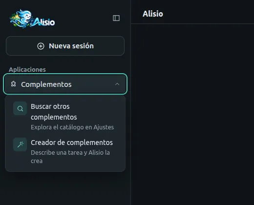
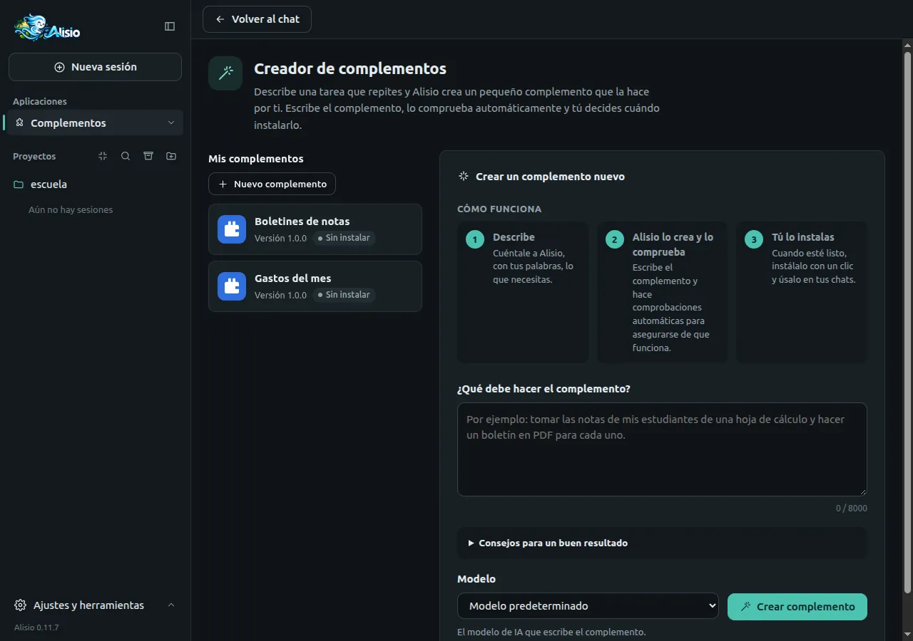
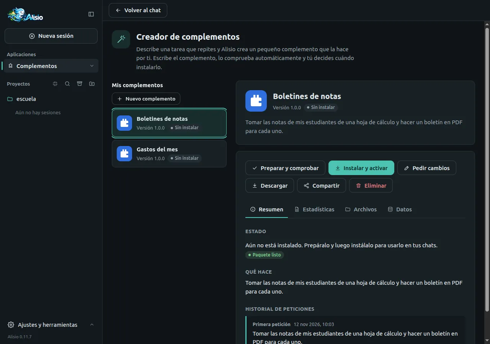
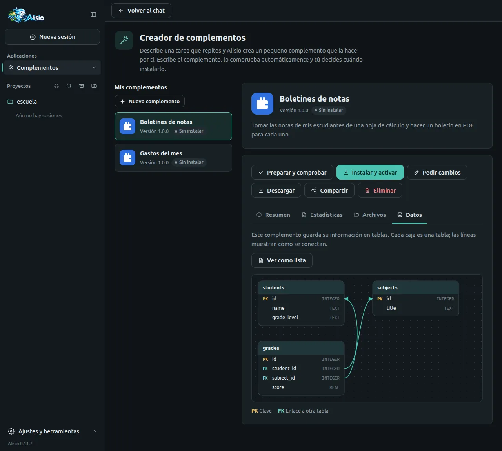
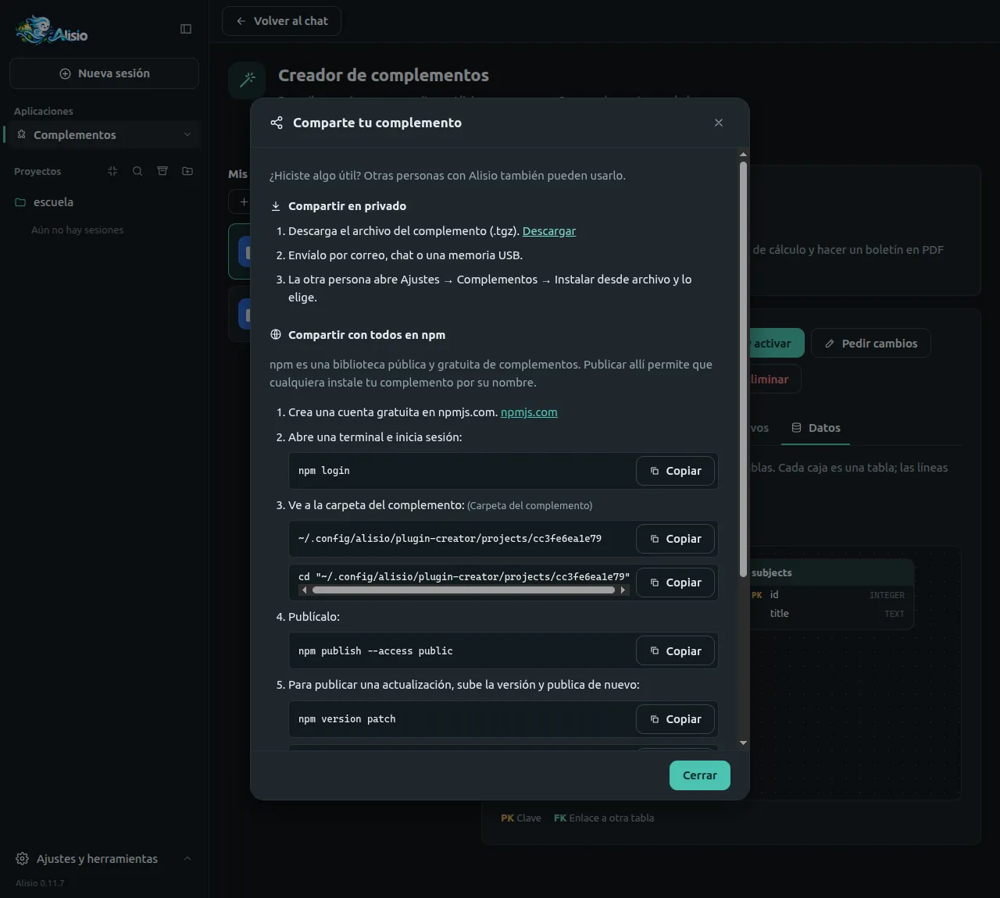

# Creador de complementos

El creador de complementos construye por ti un pequeño complemento (un complemento). Describes con palabras
sencillas una tarea que repites, Alisio escribe el complemento, lo comprueba automáticamente y tú decides
cuándo instalarlo. No necesitas programar. Está en la interfaz web y en la app de escritorio:
**Complementos** en la barra lateral y luego **Creador de complementos**. Para desarrolladores: la
[referencia](/es/plugins#plugin-creator) lista la estructura generada, las comprobaciones y las rutas
HTTP.

## Abrir el creador

Al final de **Aplicaciones**, el menú **Complementos** tiene dos entradas: **Buscar otros
complementos**, que abre **Ajustes → Complementos → Catálogo de complementos**, y **Creador de complementos**,
que abre una página completa con tus complementos a la izquierda y el panel de nueva petición a la
derecha.

<figure class="doc-shot">
  
  <figcaption>El menú Complementos: busca en el catálogo o crea el tuyo.</figcaption>
</figure>

## Crear un complemento, paso a paso

1. Escribe lo que debe hacer en **¿Qué debe hacer el complemento?** Di qué entra (un archivo, una
   tabla, un texto) y qué debe salir; un ejemplo real ayuda. Empieza por algo pequeño: luego puedes
   pedir cambios.
2. Elige el **Modelo** que escribe el complemento (cualquiera que tengas configurado; el
   predeterminado sirve) y pulsa **Crear complemento**.
3. Mira el progreso: **Planear**, **Escribir comprobaciones**, **Escribir el complemento**, **Hacer
   las comprobaciones** y **Empaquetar**, con el tiempo transcurrido y lo que hace Alisio. Puedes
   responder sus preguntas, pulsar **Detener** o, si algo falla, **Intentar de nuevo**.
4. Cuando el complemento está listo, su página muestra **Paquete listo**.

<figure class="doc-shot">
  
  <figcaption>El creador: tus complementos a la izquierda y el panel de nueva petición a la derecha.</figcaption>
</figure>

### Aprobaciones mientras se crea

Para comprobar un complemento, Alisio tiene que ejecutarlo en tu equipo. El creador trabaja en el
modo de permisos **ask**, así que ves una tarjeta **Alisio necesita tu permiso** antes de cada
ejecución: **Permitir** si confías en la petición; **Denegar** detiene ese paso. La tarjeta aparece
solo mientras la página del creador está abierta; si sales de la página, la creación espera por ti.
Ejecutar un complemento usa los permisos de tu usuario y no es un sandbox.

### Una pantalla en el menú Aplicaciones

Pide «su propia pantalla», «una ventana», «una página» o «una sección en el menú» y el complemento
tendrá una aplicación de complemento: una entrada en el menú **Aplicaciones** de la barra lateral que abre
una página completa (consulta [Aplicaciones de complementos](/es/plugins#plugin-apps)). El plan de Alisio
registra que la petición necesita una pantalla, y la preparación falla con «Pediste una pantalla
propia en el menú Aplicaciones, pero aún no la tiene» cuando el complemento no la añade. Justo
después de **Instalar y activar**, **Actualizar**, desinstalar, o activar o desactivar el
complemento, el menú **Aplicaciones** se actualiza sin recargar la página.

## Tu complemento

Abre un complemento en **Mis complementos** para ver su estado (**Sin instalar**, **Instalado** o
**Actualización disponible**) y estos botones:

| Botón | Qué hace |
| --- | --- |
| **Preparar y comprobar** | Valida el complemento, hace sus comprobaciones automáticas y lo empaqueta |
| **Instalar y activar** / **Actualizar** | Lo instala como complemento privado (local) y lo activa; tras un cambio, **Actualizar** instala la versión nueva |
| **Pedir cambios** | Describe qué debe cambiar; Alisio edita el complemento y sube su versión |
| **Descargar** | Guarda el complemento como un archivo `.tgz` |
| **Compartir** | Muestra cómo compartirlo (ver abajo) |
| **Eliminar** | Quita el complemento del creador y, si quieres, también lo desinstala |

<figure class="doc-shot">
  
  <figcaption>La página de un complemento: estado, acciones y las pestañas Resumen, Estadísticas, Archivos y Datos.</figcaption>
</figure>

Las pestañas muestran el **Resumen** (estado, qué hace, historial de peticiones), las
**Estadísticas** (tiempo de creación, última preparación, archivos, tamaño, comprobaciones
superadas o fallidas), los **Archivos** (vista de solo lectura de cada archivo) y los **Datos**.
Cada complemento recibe un icono y una portada provisionales con su nombre; Alisio puede
reemplazarlos por un dibujo propio.

### Instalar, actualizar y modificar

**Instalar y activar** siempre vuelve a preparar el complemento antes, para que lo instalado sea
exactamente lo que ves. Instalar pide tu confirmación, porque un complemento se ejecuta en tu equipo
con tus permisos. Si el complemento estaba desactivado en el proyecto actual, se activa. Algunas
actualizaciones necesitan reiniciar Alisio para empezar a funcionar; el mensaje lo indica.

Para cambiar un complemento, pulsa **Pedir cambios**, describe el cambio y envíalo. Alisio prepara la
versión nueva; cuando la página muestre **Actualización disponible**, pulsa **Actualizar**. Los datos
de tu complemento se conservan.

### Ver los datos que guarda

Si el complemento guarda información en tablas, **Datos** dibuja un diagrama: cada caja es una tabla,
con sus columnas clave (PK) y los enlaces a otras tablas (FK). **Ver como lista** muestra lo mismo
como una tabla de columnas. El diagrama se lee del código del complemento, así que es una guía, no una
garantía.

<figure class="doc-shot">
  
  <figcaption>La pestaña Datos: las tablas del complemento, sus claves y cómo se enlazan.</figcaption>
</figure>

### Eliminar un complemento

**Eliminar** pide confirmación. Quita los archivos y el historial del complemento del creador. Marca
**Desinstalarlo también de Alisio** para quitar además el complemento instalado; déjalo sin marcar
para seguir usándolo, solo que ya no aparecerá en el creador. No se puede deshacer.

## Descargar e instalar desde un archivo

**Descargar** guarda el paquete `.tgz`. Cualquier persona puede instalarlo en Alisio desde **Complementos → Instalar desde archivo**, en cualquier equipo. Consulta [Catálogo de complementos, instalación y
actualizaciones](/es/web#plugin-catalog).

## Compartir tu complemento

**Compartir** abre un tutorial breve.

- **En privado.** Descarga el archivo, envíalo por correo, chat o una memoria USB, y la otra persona
  usa **Instalar desde archivo**.
- **Con todos en npm.** npm es una biblioteca pública y gratuita de complementos. Crea una cuenta
  gratuita en npmjs.com y, en una terminal, ejecuta `npm login`, ve a la carpeta del complemento (el
  diálogo la muestra) y ejecuta `npm publish --access public`. Para publicar una actualización,
  ejecuta `npm version patch` y publica de nuevo. Consulta [Publicación](/es/publishing) para saber cómo
  se publica Alisio.
- **En el catálogo de Alisio.** Para que aparezca en **Ajustes → Complementos → Catálogo de complementos**,
  envía el enlace de npm de tu complemento al desarrollador de Alisio; el diálogo tiene los enlaces de
  contacto.

<figure class="doc-shot">
  
  <figcaption>El tutorial de compartir: en privado, en npm y en el catálogo.</figcaption>
</figure>

## Solución de problemas

Cuando una preparación falla, la página enumera en palabras sencillas lo que hay que corregir, con
**Pedir a Alisio que lo corrija**, que le devuelve la lista a Alisio.

| Mensaje | Qué significa |
| --- | --- |
| Se hizo para otra versión de Alisio | El complemento no coincide con el `@alisio/sdk` instalado; pide a Alisio que lo corrija o actualiza Alisio |
| Usa una función de Alisio que esta versión no tiene | La misma causa: pide una corrección |
| Aún contiene código de ejemplo de la plantilla inicial | El complemento aún no se ha escrito; pide cambios |
| Aún no tiene comprobaciones automáticas | Pide a Alisio que escriba las comprobaciones |
| Intenta usar archivos de fuera del complemento | Un complemento solo puede importar sus propios archivos y módulos integrados de Node |
| Su icono o portada contiene contenido no permitido | Los iconos y portadas deben ser imágenes seguras (sin scripts ni enlaces externos) |
| N de M comprobaciones fallaron | Pulsa **Pedir a Alisio que lo corrija** o **Intentar de nuevo** |
| Este complemento está ocupado con otra tarea | Espera a que termine la preparación, la instalación o la eliminación |

Otros casos: **Alisio está en modo de solo lectura** (iniciado con `--read-only`) significa que no se
pueden crear, preparar, instalar ni eliminar complementos, pero sí verlos; **Ese modelo ya no está
configurado** significa que debes elegir otro modelo.

### Comprobaciones antes de instalar

Cada preparación comprueba el complemento empaquetado tal como Alisio lo usará: lo desempaqueta en
una carpeta temporal y lo inicia con el host de complementos real de Alisio (con carpetas de ajustes
y datos temporales), comprueba que se acepta cada herramienta, llama una vez a cada herramienta con
una entrada mínima válida, lo cierra y lo vuelve a iniciar, y verifica que cada herramienta tenga
una comprobación automática. Cuando el complemento tiene una pantalla en el menú **Aplicaciones**, la
preparación también abre su página una vez (debe cargar, ocupar menos de 8 MiB y usar solo lo que
permite el marco de la aplicación: scripts con la marca del nonce, sin manejadores `onclick=` en
línea ni archivos de fuera), pulsa una vez cada una de sus acciones con una entrada mínima válida, y
verifica que cada acción tenga una comprobación automática y que la pantalla desaparezca al cerrar
el complemento. **Instalar** y **Actualizar** siguen desactivados hasta que la última
preparación pase todas las comprobaciones con los archivos tal como están ahora. Cuando una
comprobación falla durante una preparación, Alisio lee los problemas y los corrige por su cuenta;
tras unos pocos intentos fallidos se detiene y la página muestra **Intentar de nuevo**.

| Mensaje | Qué significa |
| --- | --- |
| Alisio no pudo iniciarlo | El complemento no arrancó en Alisio; abre **Ver el motivo** (por ejemplo, una entrada de herramienta con dos tipos) y pide a Alisio que lo corrija |
| Uno de sus archivos no es JavaScript válido / Contiene archivos TypeScript | Los complementos se entregan en JavaScript simple |
| Usa un archivo que quedaría fuera del paquete | Un archivo que importa no está en el paquete |
| Una de sus herramientas falló cuando Alisio la probó | Una herramienta lanzó un error en lugar de responder |
| Falla cuando Alisio lo cierra / No se puede iniciar una segunda vez | Cerrar o reiniciar el complemento falla |
| Una de sus herramientas no tiene comprobación automática | Cada herramienta necesita su propia comprobación |
| Pediste una pantalla propia en el menú Aplicaciones, pero aún no la tiene | El plan dijo que la petición necesita una pantalla y el complemento no añade ninguna |
| Su pantalla del menú Aplicaciones no se abre / es demasiado grande para abrirse | Su página falló, estaba vacía o ocupa más de 8 MiB |
| Una parte de su pantalla no funcionaría / Algunos botones de su pantalla no harían nada | Un script sin la marca del nonce, o un manejador `onclick=` en línea, que el marco de la aplicación bloquea |
| Su pantalla intenta cargar archivos de fuera del complemento | La página carga un script o una hoja de estilos desde un archivo o una dirección en lugar de incluirlos |
| Su pantalla falló cuando Alisio probó uno de sus botones / Algo que hace su pantalla no tiene comprobación automática | Una acción de la aplicación lanzó un error o no respondió con datos JSON, o no tiene su propia comprobación |
| Su pantalla sigue abierta después de que Alisio cierra el complemento | La aplicación seguía registrada después de cerrar el complemento |
| Alisio no pudo ejecutar sus comprobaciones de seguridad en este equipo | No es el complemento: actualiza o reinstala Alisio. Nada se instala sin las comprobaciones |

### Instalado, pero no pudo iniciarse

Si un complemento instalado no arranca, la página dice **Instalado, pero no pudo iniciarse**, con el
motivo en **Ver el motivo** y **Pedir a Alisio que lo corrija**. Justo después de instalar o
actualizar, Alisio comprueba que el complemento arrancó de verdad; si no, deshace la instalación
(una actualización vuelve a la versión anterior) y muestra la misma opción. Los complementos
instalados antes de estas comprobaciones se muestran igual.

## Limitaciones

- Los complementos son JavaScript simple, sin dependencias y sin paso de compilación; el creador no
  puede instalar otros paquetes.
- Un complemento no es un sandbox: una vez instalado se ejecuta con tus permisos. Instala solo
  complementos que entiendas o en los que confíes.
- Las aprobaciones de una preparación solo se muestran mientras la página del creador está abierta.
- La calidad del complemento depende del modelo que elijas y de lo clara que sea la petición.
- Los proyectos viven en este equipo, en `<config home>/plugin-creator/projects/`; no hay
  sincronización.
