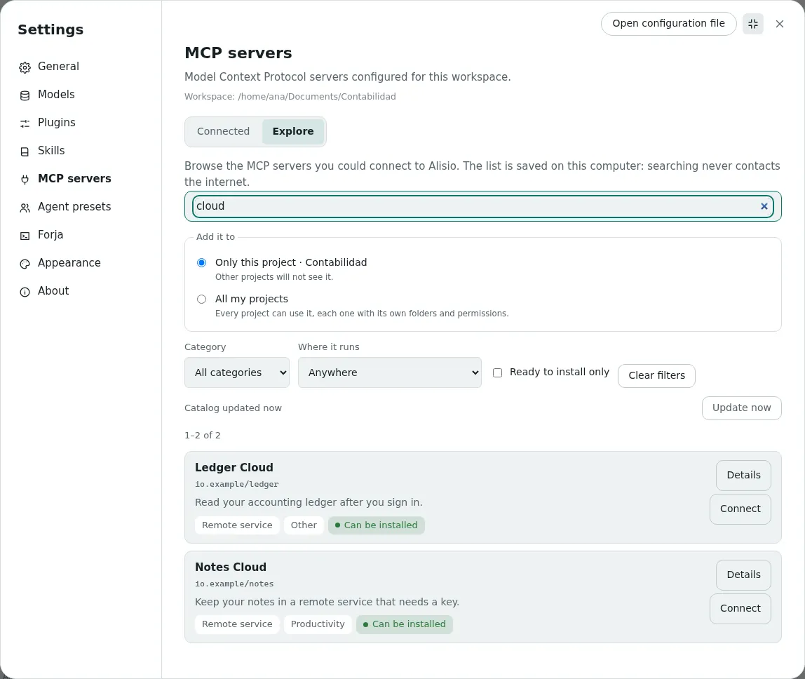
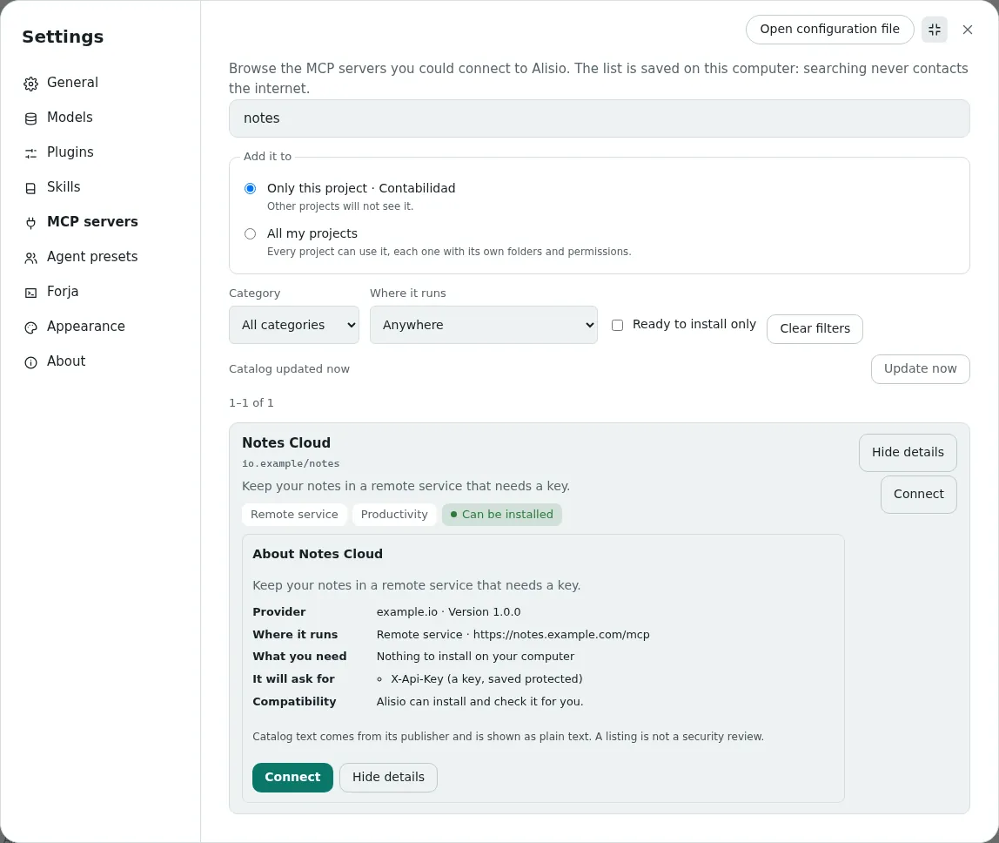
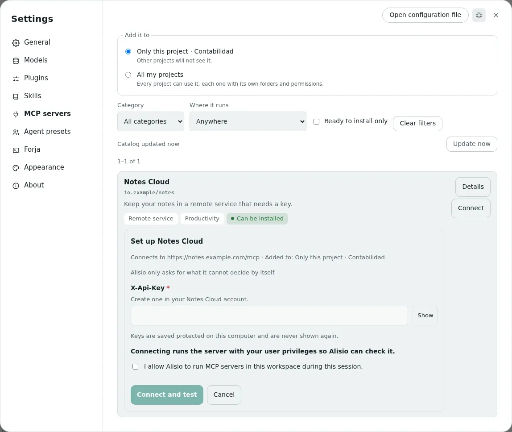
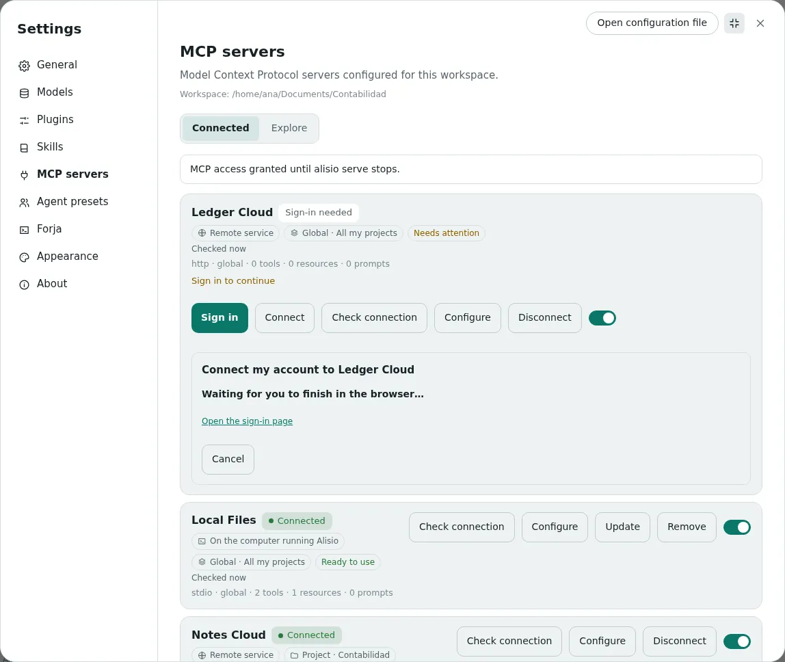
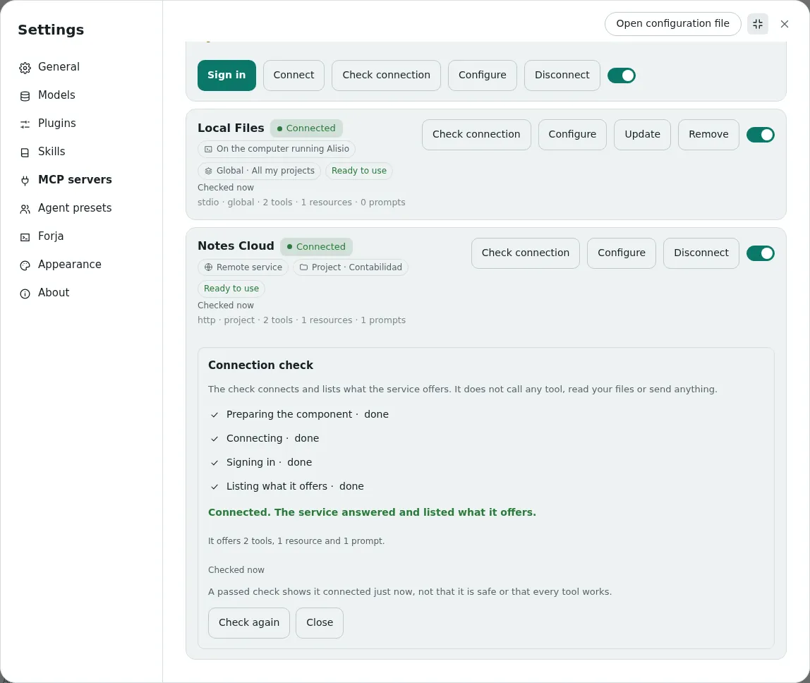
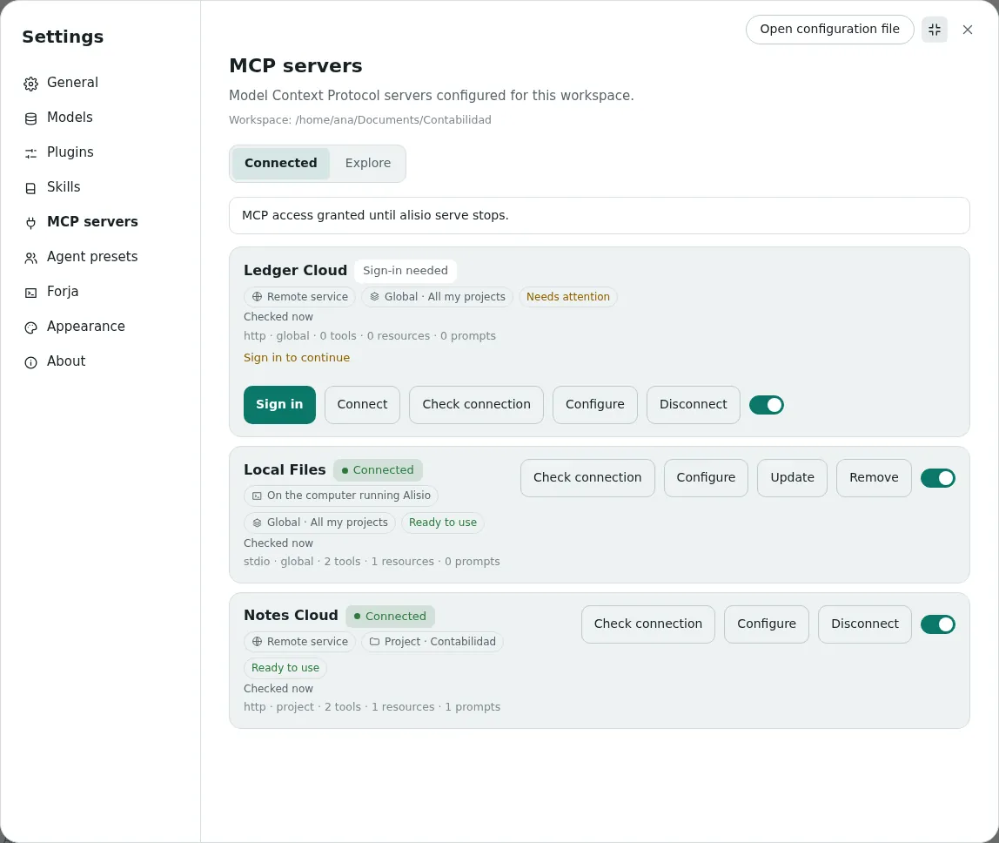

# MCP catalog

The MCP catalog lets you connect tools and services to Alisio without editing files or typing commands.
You find a server in a list, choose where it is available, give it a key if it needs one, and Alisio
installs it, connects it and checks that it answers. It lives in **Settings → MCP servers**, in the
web UI and the desktop app. Developers: the [last section](#swap-the-catalog-source) explains how the
catalog source can be replaced, and [Configuration](/configuration#mcp-servers) lists the file formats.

## What the catalog is

An MCP server is a small program or online service that gives Alisio new abilities, such as reading
your notes, querying an accounting ledger or browsing a folder. The catalog is a searchable list of
them, built from the official MCP registry (`registry.modelcontextprotocol.io`) and saved on your
computer. Searching never contacts the internet, and the list refreshes by itself at most once an
hour while Alisio is open (or when you press **Update now**).

Appearing in the catalog is **not** a security review. The registry publishes descriptions and checks
who owns a name; it does not audit what a server does. Read [Security and limits](#security-and-limits)
before you connect something you do not know.

## Find a server

Open **Settings → MCP servers → Explore**. The list is already there: you do not need to type
anything. Use what helps you:

- **Search** by name, description or category, in English or Spanish. Two letters are enough.
- **Category** (development, productivity, files and documents, data, communication, research, design
  and media, other), **Where it runs** and **Ready to install only** narrow the list. Entries Alisio
  cannot install are not hidden: each one says why.
- The result count, the page (24 per page) and the date of the last update are always visible. With no
  internet you still see the last saved list, with its date.

<figure class="doc-shot">
  
  <figcaption>Explore: search, filters and the place where the server will be added, all on one screen.</figcaption>
</figure>

**Details** opens a card inside the list: who provides it, where it runs, what you need on your
computer, what it will ask you for (for example a key) and whether Alisio can install it. Catalog text
comes from its publisher and is shown as plain text.

<figure class="doc-shot">
  
  <figcaption>The details card, written for people who are not technical.</figcaption>
</figure>

## Where it runs and where it is available

Every server shows two separate labels. They answer different questions, and neither depends on the
other.

| Label | Meaning |
| --- | --- |
| **On this computer** | The server is a program that runs on your computer, with your user privileges. If you use Alisio in a browser served by another computer, it says **On the computer running Alisio**: it is never the browser's computer. |
| **Remote service** | The server is an online service. Alisio only sends it requests; nothing of it runs on your computer. |
| **Global · All my projects** | The server is available in every project. Each project still has its own connection, folders and permissions. |
| **Project · name** | The server is available only in that project. Other projects do not see it. |

So **On this computer · Global** and **Remote service · Project: Accounting** are both valid
combinations. When the same name exists globally and in a project, the project one is used and the
list shows both.

## Install a server

1. Choose **Only this project** or **All my projects** above the list. The open project is
   preselected.
2. Press **Install** (a program on your computer) or **Connect** (an online service) on the card.
3. If Alisio needs something it cannot decide, one short form appears with only those fields: a key
   (hidden, with a **Show** button), a folder or an address. Optional fields stay collapsed. A saved key
   is never shown again.
4. If MCP access has not been granted yet, the same form asks for it in a checkbox that starts
   unchecked. Installing does not grant permission to run anything by itself.
5. Press **Install and test** or **Connect and test**. You see the steps (download, add, connect,
   check) and can **Cancel**; cancelling leaves the system as it was.

If nothing is missing and MCP access already exists, one click is enough and no empty form appears.
When something fails, you get the cause in plain words and the next action (change the key, try again,
choose another folder) without losing what you typed.

<figure class="doc-shot">
  
  <figcaption>The compact form: only what Alisio cannot decide on its own, with the key hidden.</figcaption>
</figure>

## Sign in to a service

Some online services want you to sign in instead of pasting a key. Their row in **Connected** says
**Sign-in needed**, and **Sign in** opens the service's own page in your browser. Alisio never sees
your password: it receives an authorization for that service only and renews it by itself. **Sign out**
removes the saved authorization from this computer; it does not cancel your account or ask the service
to revoke it.

<figure class="doc-shot">
  
  <figcaption>Signing in: Alisio waits while you finish in the browser.</figcaption>
</figure>

## Check, configure, update and remove

The **Connected** tab lists everything configured, including servers you added by hand. Each row shows
the state, where it runs, where it is available, and whether the last check passed and when.

- **Check connection** connects in a separate session and lists what the service announces (tools,
  resources, prompts). It does not call any tool, read your files or send anything. It needs MCP
  access, because a local server is a program that runs. A pass means it connected just now, not that
  it is safe or that every tool works. A check goes **out of date** when the settings, a saved key or
  the version change.
- **Configure** edits what the card asked for. A saved key shows only as **Key saved**; leaving it
  empty keeps it and **Replace key** stores a new one.
- **Update** looks for a newer version of an installed program, installs it next to the current one,
  checks it and goes back to the old one if it does not connect. Remote services update by themselves.
  Nothing updates without you pressing it.
- **Remove** (local) or **Disconnect** (remote) asks once and says exactly what happens: removing a
  global one takes it out of all projects, removing a project one only from that project, and a
  disconnect never deletes your account or cancels a subscription. The downloaded program is deleted
  only when no other project uses it.
- The switch turns a server on or off without deleting anything.

<figure class="doc-shot">
  
  <figcaption>A connection check, with its stages and what the service offers.</figcaption>
</figure>

<figure class="doc-shot">
  
  <figcaption>Connected: where each server runs and where it is available, as separate labels.</figcaption>
</figure>

## What can be installed

| Kind of server | Status |
| --- | --- |
| Program published on npm that runs on your computer (stdio) | Installed automatically when the version is exact, it has no install scripts and its program is unambiguous. Needs npm; Alisio uses the Node on your computer or the runtime it runs on. |
| Online service over Streamable HTTP | Connected automatically when its address is public HTTPS. A key or a sign-in is asked for when needed. |
| Python (PyPI), containers (OCI, such as Docker), MCPB bundles and legacy SSE services | **Not installed automatically.** The card says so and points to manual setup in [Configuration](/configuration#installing-from-the-catalog). |
| npm packages with install scripts, without an exact version or with several programs | **Not installed automatically.** The card says which reason applies. |

Alisio does not install Node, Python or Docker for you. If something is missing, the card says what
and offers **Check again** once you have it.

## Security and limits

- The registry does not audit code. A server you install runs with your user privileges (a local
  one) or receives what you send it (a remote one). Alisio's checks (exact version, no install
  scripts, private download folder) reduce risk; they are **not a sandbox**.
- Connecting runs the program, so it needs the existing MCP consent. Installing alone never grants it,
  and a project cannot grant it for itself. `--read-only` blocks installing, syncing and connecting.
- Keys and sign-in tokens are stored in `<config home>/mcp-secrets.json` with permissions only you can
  read. They are protected by those permissions, **not encrypted**, and never appear in the
  configuration, in logs or in the screen. The configuration only holds references to them.
- Catalog addresses must be public HTTPS (no credentials, loopback or private networks). Addresses you
  type yourself for a server you configure by hand are not restricted.
- The sign-in page returns to the computer running Alisio, so it cannot finish when your browser is on
  another computer. Sign-in works for servers installed from the catalog.
- Messages that come from the server or the catalog itself (descriptions, some error texts) are shown
  in the language of their source, not translated.

The full list of verified and unverified behavior is in [Known limitations](/limitations).

## Swap the catalog source

The catalog does not depend on the official registry. Everything after the source (the local index,
the sync, the HTTP routes and the web UI) reads Alisio's own model, so changing the provider only
changes one adapter.

- **Port.** `CatalogSource` in `@alisio/core` (`packages/core/src/mcp/catalog/source.ts`) has a
  `sourceId`, its `capabilities`, `listPage(request)` (cursor paging, optional `updatedSince`) and
  `get(name, version?)`. It returns Alisio's `CatalogEntry`, never the provider's shapes, and reports
  entries it cannot use as `rejected` with a reason.
- **Adapter.** `OfficialRegistrySource` translates the registry (three schema revisions) into that
  model, with a 15-second timeout per request, two retries that respect `Retry-After`, 5 MiB per
  response and 128 KiB per record. A new provider is one new class like it.
- **Factory.** `createSourceFactory(extra)` maps a source id to a constructor; `official` is built in.
  Register another adapter once and nothing downstream changes:

```ts
import { createSourceFactory } from "@alisio/core";

const factory = createSourceFactory({
  acme: (config) => new AcmeCatalogSource({ baseUrl: config.baseUrl }),
});
```

- **Configuration.** Two optional keys, read from **your user configuration only** (a project cannot
  redirect where the catalog comes from):

```json
{
  "mcp": {
    "catalog": { "source": "official", "baseUrl": "https://registry.modelcontextprotocol.io" }
  }
}
```

  `source` selects the adapter and `baseUrl` must be HTTPS (plain `http` only for `localhost`
  mirrors) and without credentials. Restart `alisio serve` after changing them: the next update
  replaces the saved index and never mixes entries of two sources, because every row carries its
  `sourceId`.
- **Tests.** `tests/mcp-catalog-source-contract.test.ts` runs the same cases (paging, incremental
  updates, deleted entries, unsupported schema) against the official adapter and an in-memory fake;
  `tests/mcp-catalog-source.test.ts` shows a second source flowing through sync, store, route and web
  view model with no change to those modules.

See also [Web UI](/web#using-the-web-ui), [Configuration](/configuration#mcp-servers) and
[Tools & permissions](/tools#mcp).
