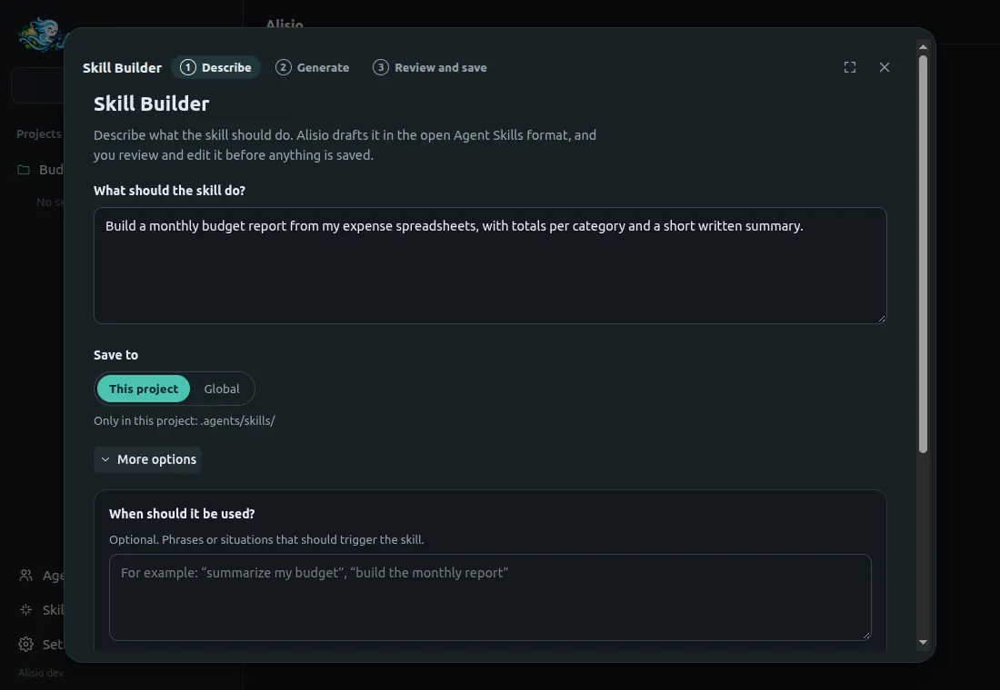
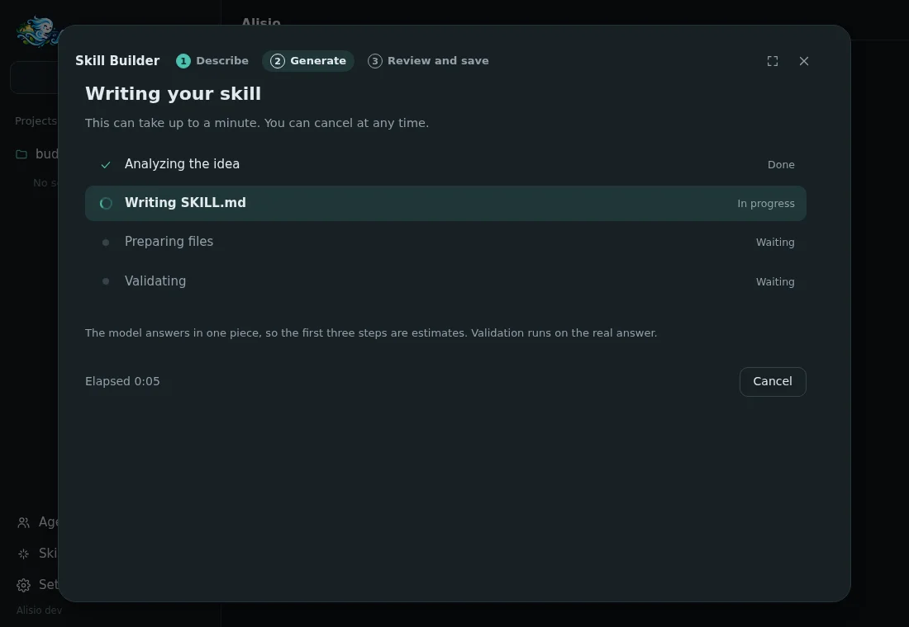
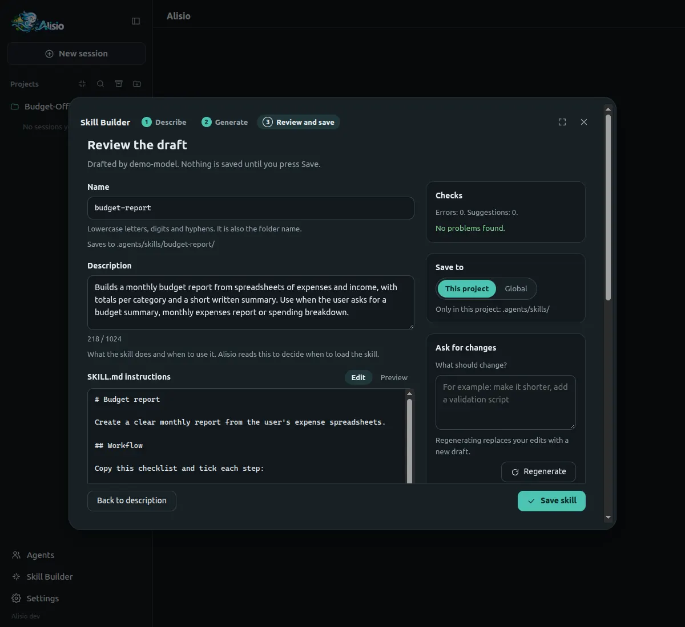

# Creador de skills

El Creador de skills redacta una skill nueva por ti. Describes qué debe hacer la skill, el modelo
activo la redacta en el formato abierto [Agent Skills](https://agentskills.io) y tú revisas y editas
el borrador antes de guardar nada. Está en la interfaz web y en la app de escritorio: **Creador de
skills** en la barra lateral, sobre **Ajustes**, o **Nueva skill** en **Ajustes → Skills**.

## Los tres pasos

**1. Describir.** Un solo campo es obligatorio: **¿Qué debe hacer la skill?** El botón principal
nombra el modelo que la redactará (**Generar con** *modelo*). Si aún no hay un modelo configurado,
la ventana lo explica y enlaza a **Ajustes → Modelos**. **Guardar en** elige dónde vive la skill, y
**Más opciones** agrega frases de ejemplo que deben activar la skill y si se incluyen scripts,
plantillas y recursos, o documentos de referencia (por defecto decide el modelo).

<figure class="doc-shot">
  
  <figcaption>Paso 1: describe la skill; todo lo demás es opcional.</figcaption>
</figure>

**2. Generar.** La ventana muestra las etapas (analizar la idea, escribir `SKILL.md`, preparar
archivos, validar), el tiempo transcurrido y un botón **Cancelar** que detiene la solicitud y
conserva tu descripción. El modelo responde de una sola vez, así que las tres primeras etapas son
estimaciones basadas en el tiempo; la validación se hace sobre la respuesta real y su etapa solo se
marca como lista después. Una solicitud fallida muestra el error y **Reintentar**, con todos tus
datos conservados.

<figure class="doc-shot">
  
  <figcaption>Paso 2: progreso por etapas con tiempo transcurrido y Cancelar.</figcaption>
</figure>

**3. Revisar y guardar.** Edita el nombre (se comprueba en vivo), la descripción (con contador de
caracteres), las instrucciones de `SKILL.md` (con vista previa renderizada) y cada archivo extra, o
quita un archivo. El panel **Comprobaciones** separa los **Errores**, que impiden guardar, de las
**Sugerencias**, que no. **Pedir cambios** envía al modelo tu borrador editado y una nota como
«hazla más corta» (**Regenerar**); **Restaurar la versión anterior** deshace una regeneración.
**Guardar skill** escribe los archivos y muestra dónde quedaron. Si la carpeta ya existe, no se
reemplaza nada hasta que confirmes **Reemplazarla**.

<figure class="doc-shot">
  
  <figcaption>Paso 3: edita el borrador, lee las comprobaciones y guarda.</figcaption>
</figure>

## Dónde se guardan las skills

| Ámbito | Ruta | Se carga cuando |
| --- | --- | --- |
| Proyecto | `<workspace>/.agents/skills/<name>/` | el workspace es de confianza |
| Global | `~/.agents/skills/<name>/` | siempre |

Una skill de proyecto necesita un workspace de confianza. Si no lo es, la ventana ofrece **Guardar
de forma global** o **Confiar en este proyecto**. Tras guardar, el workspace se recarga para que la
skill quede activa sin reiniciar. Si hay un turno o una tarea en segundo plano en curso, la skill se
guarda y la ventana indica que se activará después de recargar, con un botón **Recargar ahora**.

## El formato

Las skills siguen el estándar abierto. `SKILL.md` empieza con un frontmatter YAML que Alisio
construye a partir de los campos, nunca a partir de texto escrito por el modelo:

```yaml
---
name: budget-report
description: "Builds a monthly budget report from spreadsheets. Use when the user asks for a budget summary."
license: "MIT"
compatibility: "Needs Python 3 to run the summary script"
metadata:
  "author": "Ana"
---
```

Solo `name` y `description` son obligatorios. El cuerpo sigue al frontmatter. Los archivos extra
viven en `scripts/`, `references/` o `assets/`. La guía incluida que se envía al modelo pide una
descripción en tercera persona que termine con una cláusula «Use when», instrucciones concisas,
flujos numerados con un paso de validación, scripts deterministas con dependencias documentadas,
sin información sensible al tiempo y con divulgación progresiva hacia archivos de referencia. Una
skill llamada `alisio-skill-authoring` (de proyecto, de usuario o de un complemento) reemplaza esa
guía.

## Validación

Las mismas reglas se ejecutan en el navegador mientras editas y en el servidor antes de escribir.

| Errores (impiden guardar) | Sugerencias (no impiden guardar) |
| --- | --- |
| Nombre: letras minúsculas, dígitos y guiones simples, máximo 64 caracteres, sin `anthropic` ni `claude` | El cuerpo tiene más de 500 líneas o unos 5000 tokens |
| Descripción: obligatoria, máximo 1024 caracteres, sin `<` ni `>` | La descripción no tiene cláusula «Use when» o usa la primera o segunda persona |
| Compatibilidad: máximo 500 caracteres; metadatos: texto a texto | Un nombre vago como `helper`, `utils` o `data` |
| `SKILL.md` de máximo 64 KB | Un archivo de referencia de más de 100 líneas sin tabla de contenido |
| Archivos extra solo en `scripts/`, `references/` o `assets/`, relativos, con barras normales, sin `..`, sin archivos ocultos, nombres simples, un nivel de subcarpeta | Redacción sensible al tiempo, como fechas |
| Máximo 20 archivos, 256 KB cada uno, 1 MB en total, solo texto UTF-8 | Barras invertidas en las rutas |
| Cada archivo local al que apunta el cuerpo está en la skill | Un script sin uso ni dependencias documentados |
| | El nombre coincide con una skill existente, que la ocultaría o sería ocultada |

## Seguridad

El Creador de skills nunca ejecuta un script. Los archivos se escriben como texto plano con modo
`0644` (nunca ejecutables), dentro de la carpeta de la skill, a través de una carpeta temporal que
se renombra al final, de modo que un guardado fallido no deja una skill a medias. En los nombres de
carpeta se comprueban los enlaces simbólicos y las salidas de ruta. Los scripts de la skill se
ejecutan después como cualquier otra llamada a una herramienta, bajo tu modo de permisos. La
ventana no está disponible con `--read-only`. No es un sandbox: revisa un script antes de dejar que
una skill lo use.

## API

```text
POST /api/workspaces/:wid/skills/draft {idea, when?, include?, scope?, previous?, feedback?}
     → {draft, warnings, errors}   502 provider_unavailable, 409 cancelled
POST /api/workspaces/:wid/skills {scope, draft, overwrite?}
     → 201 {skill: {name, scope, path}, reloaded, reason?}   409 skill_exists, 403 not_manageable
```

Cerrar la solicitud cancela la llamada al modelo. Los tipos son `SkillDraft`, `SkillDraftRequest`,
`SkillDraftResult`, `SkillCreateRequest` y `SkillCreateResult` en `@alisio/sdk`, junto con
`validateSkillDraft` y `renderSkillMd`, los ayudantes puros que usan tanto el servidor como la web.

## Límites

- El modelo responde de una sola vez, así que las etapas de progreso previas a la validación son
  estimaciones.
- Un borrador se genera con una sola llamada al modelo sin herramientas (hasta 3 minutos, unos 8000
  tokens de salida).
- Una skill que necesite más de 20 archivos o 1 MB debe escribirse a mano.
- La ventana crea skills; para editar una después, cambia sus archivos o usa **Ajustes → Skills**
  para activarla o desactivarla.
