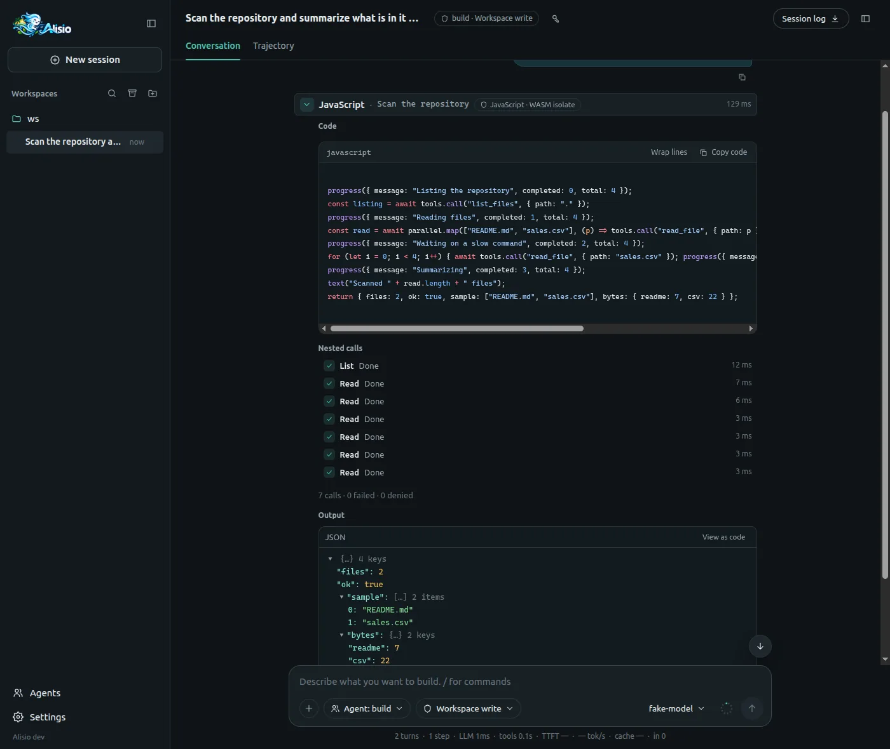
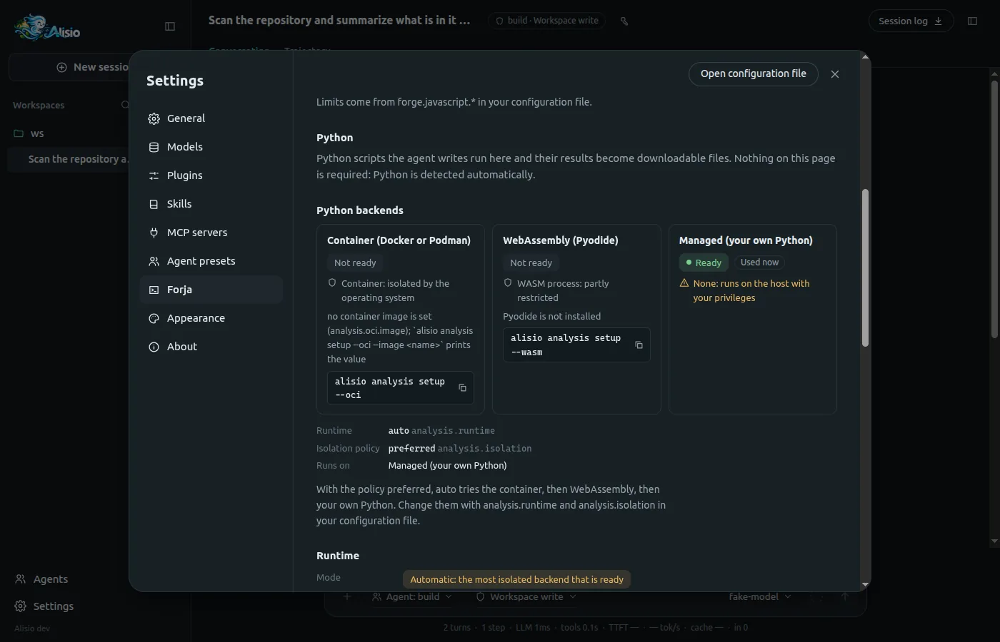
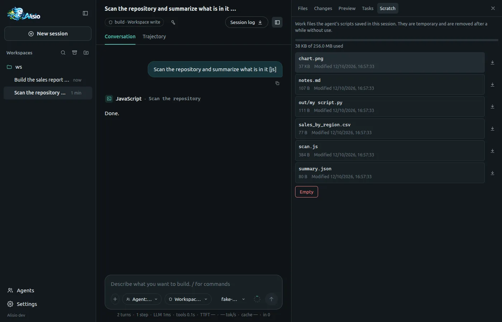
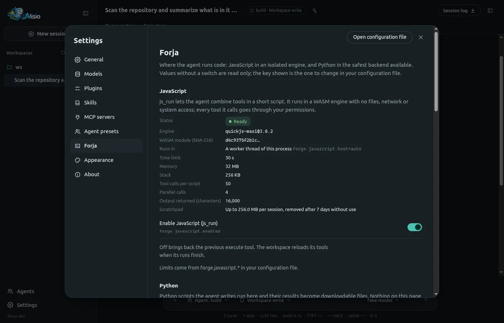
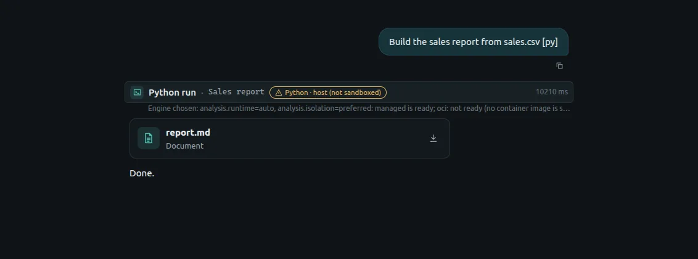

# Forja: code mode

Forja is how Alisio runs code on the model's behalf. Instead of calling ten tools one at a time and
carrying every answer through the conversation, the model writes a short script that composes the
calls, filters the data and returns only what matters. Two tools make up code mode:

- **`js_run`** composes tools: a JavaScript script in an isolated VM that calls other tools
  (`read_file`, `search_text`, your MCP tools…), runs them in parallel and returns a small result.
- **`python_run`** handles data, machine learning and dashboards: a Python script that reads
  files, analyses them and publishes the files it produces ([Python analysis](/analysis)).

Both run on the same execution core: every run is journaled, reports progress, has limits and can be
cancelled, and the result says which engine ran and why.

::: warning Know what each level of isolation means
`js_run` is isolated by construction. `python_run` is only as isolated as the backend Alisio picks,
and one of them is not a sandbox at all. [Isolation and its limits](#isolation) lists exactly what
is and is not guaranteed.
:::

## Choosing the language {#language}

The model chooses; you do not configure it. The routing rule in the system prompt tells it to use:

| Task | Tool |
| --- | --- |
| Combine several tool calls, filter or aggregate their results, paginate, fan out in parallel | `js_run` |
| Read a spreadsheet or CSV, statistics, charts, a report, a dashboard, scikit-learn or statsmodels | `python_run` |
| One call to one tool | The tool itself, no script needed |

Before writing non-trivial code the model can call [`forge_guide`](#forge-guide) for the current
limits, tools and packages. `js_run` scripts have no files, network or system access of their own:
everything goes through nested tool calls, and each nested call passes the same permission gate as
a call from the model (a call that would need an approval is refused with `APPROVAL_REQUIRED`
instead of asking, so the script cannot ask on its own). Stored grants do not apply to nested
calls: a direct call with a grant may run while the same call nested in a script receives
`APPROVAL_REQUIRED`. This is deliberate.

<figure class="doc-shot">
  
  <figcaption>A <code>js_run</code> card: the code, the nested calls with their status and duration, and what the script returned.</figcaption>
</figure>

When `forge.javascript.enabled` is on (the default), `js_run` replaces the older
`execute` tool, which is no longer registered; sessions saved with `execute` calls still open and
render as before. Set it to `false` to get `execute` and the previous prompt back.

## Isolation and its limits {#isolation}

| Engine | Where it runs | What it guarantees |
| --- | --- | --- |
| `js_run` | QuickJS compiled to WebAssembly, in a worker thread (Node) or a child process (Bun, the standalone binary) | No files, network, timers or process: the VM only sees what the host hands it. Time, heap, stack, call and output limits are enforced; a stop is confirmed. |
| `python_run` on `oci` | A Docker or Podman container | No network, a read-only root, only the job folders mounted. |
| `python_run` on `wasm` | Pyodide in a restricted Node process (Node Permission Model) | Files limited to the job (and a link-free copy of the scratchpad), no child processes. See the limits below. |
| `python_run` on `managed` | Your own Python | **None.** It runs with your user permissions. |

Alisio picks the Python backend (see [Where a script runs](/analysis#backends)); the model never
does. The honest limits:

- **`wasm`, network:** it is **not blocked on Node 22 and 24**: Python can reach `node:http` through
  the bridge. Alisio probes the real process and reports what it saw; `analysis.isolation: strict`
  excludes `wasm` unless the probe saw the network refused.
- **`wasm`, memory:** a soft limit. The parent samples the process every 250 ms and kills it above
  `analysis.wasm.memoryMb`, so it can overshoot briefly.
- **`wasm`, escaping:** the Permission Model is not a boundary against hostile code. A script can
  reach the runner's JavaScript (FFI reaches the process); the runner holds no secrets and the host
  validates everything it produces.
- **`wasm`, what a script can still see:** it is a mitigation, not a sealed box. Through the bridge
  a script can read `os.homedir()`, `os.hostname()` and `os.userInfo()` (user name and home path),
  and the absolute host paths of the distribution and of the job folders appear in the child's
  `process.argv`. File contents outside the job stay out of reach. What the runner prints when it
  fails has host paths replaced by placeholders (`<dist>`, `<job>/...`) before it reaches the model.
- **`wasm`, scratchpad:** the child never gets the real scratchpad. The parent copies it into the job
  folder without following links (symbolic links and special files are left out, 64 MB at most) and
  grants read access to that copy only, so a link planted in the scratchpad cannot lead anywhere. On
  `oci` the scratchpad is mounted read-only, and a link inside it resolves inside the container.
- **`wasm`, Node version:** the Node Permission Model had a symlink bypass (CVE-2025-55130, fixed in
  Node 22.22, 24.13 and 25.3). The `wasm` backend refuses any older Node and says why; Node 23 never
  got the fix.
- **`managed`:** not sandboxed. Read the script in the approval before allowing it.
- **`js_run` worker host:** the VM is isolated, but the worker is a thread of the Alisio process. A
  flaw that escaped the WebAssembly engine would compromise the host process, which is why Bun and
  the binary use a child process, and why `forge.javascript.host` exists for diagnosis.

<figure class="doc-shot">
  
  <figcaption>The Python backends: state, isolation in text and icon, the setup command when one is missing and the policy in force.</figcaption>
</figure>

## Configuration {#configuration}

Forja lives under `forge` in `config.json`; Python backends live under `analysis` (see
[Configuration](/configuration)). A project may only lower the limits and switch features off.

| Key | Default | Meaning |
| --- | --- | --- |
| `forge.javascript.enabled` | `true` | `js_run` on (and `execute` off) or off. Editable from the web UI |
| `forge.javascript.host` | `"auto"` | `auto` (worker on Node, process on Bun), `worker` or `process`. Global only |
| `forge.javascript.timeoutMs` | `30000` | Time limit per script (up to 300 000). A project may lower it |
| `forge.javascript.memoryBytes` | `33554432` | VM heap (up to 128 MiB). Global only |
| `forge.javascript.stackBytes` | `262144` | VM stack (up to 512 KiB). Global only |
| `forge.javascript.maxToolCalls` | `50` | Nested calls per script (up to 500). A project may lower it |
| `forge.javascript.maxConcurrency` | `4` | Nested calls at once (up to 16). A project may lower it |
| `forge.javascript.maxOutputChars` | `16000` | Characters returned to the model (up to 48 000). A project may lower it |
| `forge.state.enabled` | `true` | The `state` object scripts share across runs of the session |
| `forge.state.maxTotalBytes` | `524288` | Size of that state (up to 8 MiB). Global only |
| `forge.scratch.enabled` | `true` | The [scratchpad](#scratchpad). Global only |
| `forge.scratch.root` | unset | Base folder of the scratchpads; `ALISIO_TMPDIR` wins. Global only |
| `forge.scratch.retentionDays` | `7` | Days without activity before a scratchpad is removed; `0` never |
| `forge.scratch.maxBytes` | `268435456` | Quota per session |
| `forge.guides.enabled` | `true` | The [`forge_guide`](#forge-guide) tool. Editable from the web UI |
| `analysis.runtime` | `"auto"` | `auto`, `managed`, `oci` or `wasm`. Global only |
| `analysis.isolation` | `"preferred"` | `preferred`, `required` or `strict`: what `auto` may fall back to. Global only |
| `analysis.wasm.*` | | Memory, startup margin, input size and `node` path of the WebAssembly backend |

```json
{
  "forge": { "javascript": { "timeoutMs": 60000, "maxToolCalls": 100 } },
  "analysis": { "runtime": "auto", "isolation": "required" }
}
```

## Checking and preparing the engines {#status}

```sh
alisio forge status           # JavaScript and every Python backend: state, isolation, limits, why not ready
alisio forge status --probe   # also runs a real script through the isolate
alisio forge status --json
alisio analysis setup --wasm  # download the pinned Pyodide runtime (about 44 MB; --profile science adds scipy and scikit-learn)
```

`alisio forge status` verifies the WebAssembly module against its pinned SHA-256, shows the host
that will run it and, for each Python backend, whether it is ready, its isolation and whether the
operating system denies its network. The web UI shows the same on the Forja page.

## The scratchpad {#scratchpad}

A scratchpad is a private folder per session where the model keeps long scripts and intermediate
files, so it can edit `plan.js` between runs instead of resending the whole code, and run it with
`codePath`:

```text
js_run     { "codePath": "scan.js" }
python_run { "codePath": "out/report.py" }
```

| Property | Behavior |
| --- | --- |
| Location | `<tmp>/alisio-<uid>/<workspace>/<root session>/scratchpad/`, under `ALISIO_TMPDIR` or `forge.scratch.root` when set; a child session shares its root's scratchpad. If the shared folder is not private to you, Alisio falls back to `<state>/scratch/` and says so |
| Permissions | Created `0700` and checked (a directory, not a symbolic link, yours). Writes with the file tools need no approval inside it; `--read-only` still denies them |
| Retention | Removed after `forge.scratch.retentionDays` (7) without activity, or when the session is deleted; swept at most once a day, never outside the verified root |
| Quota | `forge.scratch.maxBytes` (256 MiB). A write that would exceed it is denied with a clear error; nothing is deleted |
| `codePath` | A relative path inside the scratchpad; `../` and symbolic links that escape fail with `INVALID_INPUT` |
| `ALISIO_SCRATCH_DIR` | Where `python_run` sees the scratchpad: **read-only**. On `managed` Python it cannot be enforced, because that backend is not a sandbox |

The web UI lists it in the **Scratch** tab of the side panel: name, size and date, a quota bar,
a preview of text and code files (`.js`, `.py`, `.csv`, `.json`, `.md`), download and **Empty** with
a confirmation. It does not edit anything. Emptying is refused while a Forja script of the session
is running.

<figure class="doc-shot">
  
  <figcaption>The Scratch tab: the session's work files, the quota used and the button to empty it.</figcaption>
</figure>

## On-demand guidance: forge_guide {#forge-guide}

`forge_guide(topic)` returns a short guide generated from the live state of the engines (limits,
callable tools, the Python backend that would run now and its packages). It exists while Forja is on
and `forge.guides.enabled` is not `false`; a script cannot call it. The topics, the `etag` mechanism
and the error hints are in [Tools and permissions](/tools#forge-guide).

## In the web UI {#web}

- **Forja settings page.** *Settings → Forja* shows the JavaScript engine (state, version, WASM hash,
  host, limits, scratchpad) with the `forge.javascript.enabled` switch, the Python section, and the
  guides switch. Values without a switch are read-only and show the key to change in the file.

  <figure class="doc-shot">
    
    <figcaption>Settings → Forja: the JavaScript engine, its effective limits and the switch for <code>js_run</code>.</figcaption>
  </figure>

- **`js_run` card.** Title, status, duration and a badge with the engine and its isolation; the body
  shows the highlighted code (with a copy button), the nested calls live with their status and
  duration, a progress bar when the script reports `completed` and `total`, the value, the text
  output and any error with its hint. There is no automatic re-run.
- **`python_run` badge.** A badge with the backend and its isolation, written out and never only a
  colour (the host backend is marked as not sandboxed), and one line with the reason it was chosen.
  Published artifacts also show their provenance (engine, isolation and reason).

  <figure class="doc-shot">
    
    <figcaption>A <code>python_run</code> card: the backend badge, the reason it was chosen and the artifact it published.</figcaption>
  </figure>

- **Scratch tab.** See [The scratchpad](#scratchpad).

## In the terminal {#tui}

The row of a `js_run` shows the script's own note and fraction when it reports one, then
`2/3 calls` (nested calls finished out of started); the row of a `python_run` adds `oci`, `wasm` or
`host!` for the backend. The final duration goes on the right as with any tool, and cancelling works
the same. Headless runs (`alisio run`) stream the same progress in the JSONL output.
