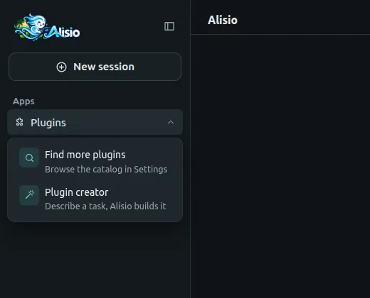
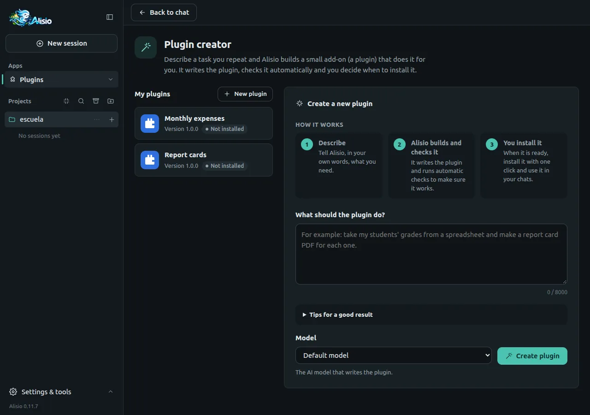
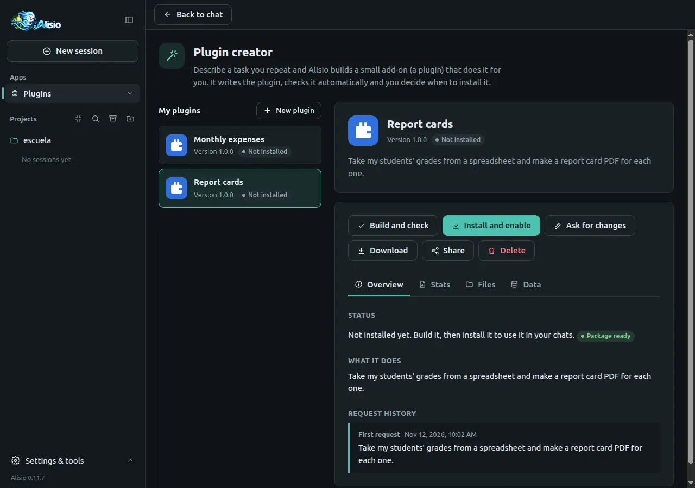
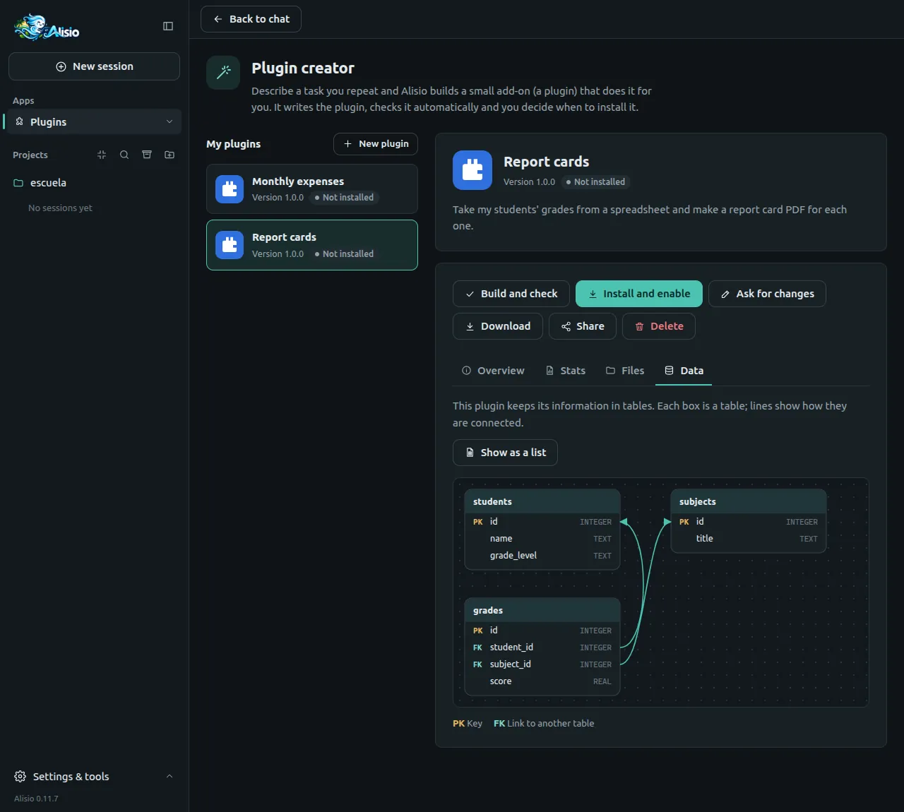
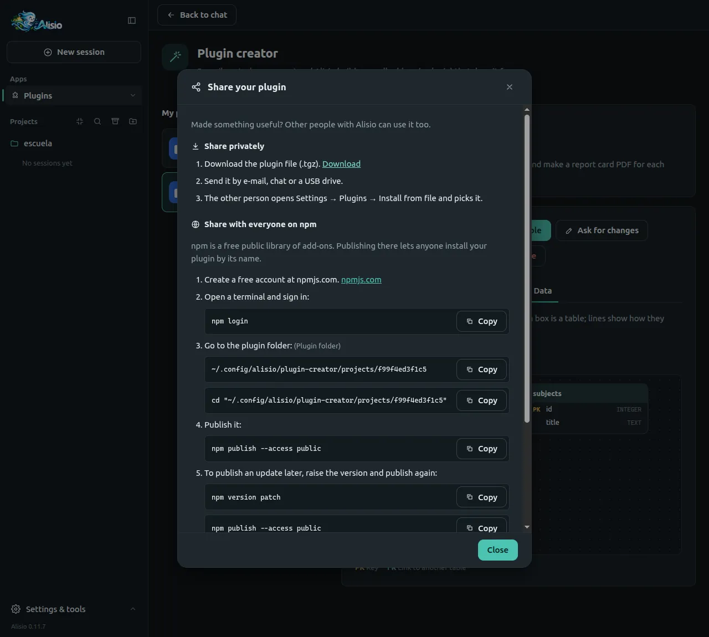

# Plugin creator

The plugin creator builds a small add-on (a plugin) for you. You describe a task you repeat in plain
words, Alisio writes the plugin, checks it automatically and you decide when to install it. You do
not need to program. It is in the web UI and the desktop app: **Plugins** in the sidebar, then
**Plugin creator**. Developers: the [reference](/plugins#plugin-creator) lists the generated layout,
the checks and the HTTP routes.

## Open the creator

At the bottom of **Apps**, the **Plugins** menu has two entries: **Find more plugins**, which opens
**Settings → Plugins → Plugin catalog**, and **Plugin creator**, which opens a full page with your
plugins on the left and the new-request panel on the right.

<figure class="doc-shot">
  
  <figcaption>The Plugins menu: find plugins in the catalog or create your own.</figcaption>
</figure>

## Create a plugin, step by step

1. Write what the plugin should do in **What should the plugin do?** Say what goes in (a file, a
   table, some text) and what should come out; one real example helps. Start small: you can ask for
   changes later.
2. Choose the **Model** that writes the plugin (any model you have configured; the default one
   works) and press **Create plugin**.
3. Watch the progress: **Plan**, **Write checks**, **Write the plugin**, **Run checks** and
   **Package**, with the time elapsed and what Alisio is doing. You can answer its questions, press
   **Stop** or, if something fails, **Try again**.
4. When the plugin is ready, its page shows **Package ready**.

<figure class="doc-shot">
  
  <figcaption>The creator: your plugins on the left, the new-request panel on the right.</figcaption>
</figure>

### Approvals while it builds

To check a plugin, Alisio has to run it on your computer. The creator works in the **ask** permission
mode, so you see an **Alisio needs your permission** card before each run: **Allow** it if you trust
the request, **Deny** stops that step. The card appears only while the creator page is open; if you
leave the page, the build waits for you. Running a plugin uses your user's permissions and it is not
a sandbox.

## Your plugin

Open a plugin in **My plugins** to see its status (**Not installed**, **Installed** or **Update
available**) and these buttons:

| Button | What it does |
| --- | --- |
| **Build and check** | Validates the plugin, runs its automatic checks and packages it |
| **Install and enable** / **Update** | Installs it as a private (local) plugin and turns it on; after you change it, **Update** installs the new version |
| **Ask for changes** | Describe what should change; Alisio edits the plugin and raises its version |
| **Download** | Saves the plugin as a `.tgz` file |
| **Share** | Shows how to share it (see below) |
| **Delete** | Removes the plugin from the creator, optionally uninstalling it too |

<figure class="doc-shot">
  
  <figcaption>A plugin's page: status, actions and the Overview, Stats, Files and Data tabs.</figcaption>
</figure>

The tabs show the **Overview** (status, what it does, request history), **Stats** (time to create,
last build, files, size, checks passed or failed), **Files** (a read-only view of every file) and
**Data**. Every plugin gets a placeholder icon and cover with its name; Alisio may replace them with
a custom drawing.

### Install, update and modify

**Install and enable** always builds the plugin again first, so what is installed is exactly what
you see. Installing asks for your confirmation, because a plugin runs on your computer with your
permissions. If the plugin was turned off in the current project, it is turned on. Some updates need
a restart of Alisio to start running; the message says so.

To change a plugin, press **Ask for changes**, describe the change and send it. Alisio builds the
new version; when the page shows **Update available**, press **Update**. Your plugin data is kept.

### See the data it keeps

If the plugin stores information in tables, **Data** draws a diagram: each box is a table, with its
key columns (PK) and links to other tables (FK). **Show as a list** gives the same information as a
table of columns. The diagram is read from the plugin's code, so it is a guide, not a guarantee.

<figure class="doc-shot">
  
  <figcaption>The Data tab: the plugin's tables, their keys and how they are linked.</figcaption>
</figure>

### Delete a plugin

**Delete** asks for confirmation. It removes the plugin's files and history from the creator. Tick
**Also uninstall it from Alisio** to remove the installed plugin too; leave it unticked to keep
using it, it just will not appear in the creator any more. This cannot be undone.

## Download and install from a file

**Download** saves the `.tgz` package. Anyone can install it in Alisio from **Settings → Plugins →
Install from file**, on any computer. See [Plugin catalog, install and updates](/web#plugin-catalog).

## Share your plugin

**Share** opens a short tutorial.

- **Privately.** Download the file, send it by e-mail, chat or a USB drive, and the other person
  uses **Install from file**.
- **With everyone on npm.** npm is a free public library of add-ons. Create a free account at
  npmjs.com, then in a terminal run `npm login`, go to the plugin folder (the dialog shows it) and
  run `npm publish --access public`. To publish an update, run `npm version patch` and publish
  again. See [Publishing](/publishing) for how Alisio itself is published.
- **In the Alisio catalog.** To make it appear in **Settings → Plugins → Plugin catalog**, send the
  npm link of your plugin to the Alisio developer; the dialog has the contact links.

<figure class="doc-shot">
  
  <figcaption>The share tutorial: privately, on npm and in the catalog.</figcaption>
</figure>

## Troubleshooting

When a build fails, the page lists what needs fixing in plain words, with **Ask Alisio to fix it**,
which sends the list back to Alisio.

| Message | What it means |
| --- | --- |
| It was made for a different Alisio version | The plugin does not match the installed `@alisio/sdk`; ask Alisio to fix it, or update Alisio |
| It uses an Alisio function this version does not have | Same cause: ask for a fix |
| It still contains example code from the starting template | The plugin has not been written yet; ask for changes |
| It has no automatic checks yet | Ask Alisio to write the checks |
| It tries to use files from outside the plugin | A plugin may only import its own files and Node built-ins |
| Its icon or cover contains content that is not allowed | Icons and covers must be safe images (no scripts or outside links) |
| N of M checks failed | Press **Ask Alisio to fix it** or **Try again** |
| This plugin is busy with another task | Wait for the build, install or delete to finish |

Other cases: **Alisio is running in read-only mode** (started with `--read-only`) means plugins
cannot be created, built, installed or deleted, but you can still look at them; **That model is not
configured anymore** means you should pick another model.

## Limitations

- Plugins are plain JavaScript with no dependencies and no build step; the creator cannot install
  other packages.
- A plugin is not a sandbox: it runs with your permissions once installed. Install only plugins you
  understand or trust.
- The approvals of a build show only while the creator page is open.
- The quality of the plugin depends on the model you choose and on how clear the request is.
- Projects live on this computer under `<config home>/plugin-creator/projects/`; there is no sync.
