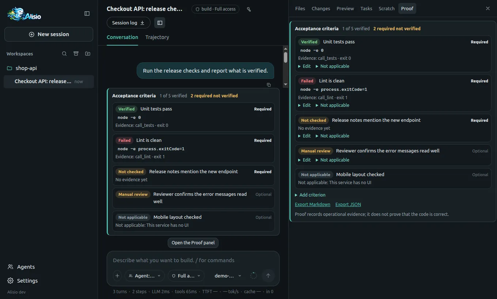

# Proof: acceptance criteria with evidence

Proof answers one question: **what did the agent really check?** A task can end with a **ledger**:
acceptance criteria, the verifier of each one and the immutable evidence behind it. The terminal,
the web UI and `alisio run --json` show the same ledger, and it exports to Markdown and JSON.

## Guiding principle {#principle}

> "Done" is what existing, current evidence backs, not what the model says.

- A criterion without a verifier is `not_checked`, even if the model says it is met.
- `verified` always points to evidence with a run, a tool call and a date.
- Evidence is **captured** from the commands the agent really ran; the model cannot write it.
- Proof never decides permissions: a verifier command runs through the normal permission gate, so
  under `--read-only` command criteria stay `not_checked`.
- With no criteria, goal or plan a run is the same as before (Proof only wakes up with criteria).

## Statuses {#statuses}

| Status | Meaning |
| --- | --- |
| `verified` | Successful evidence, newer than every edit of the files the criterion covers |
| `failed` | The latest valid evidence is a failure |
| `not_checked` | No verifier or no evidence yet; also an edit **after** the evidence (shown as stale) |
| `manual_review` | Needs your review |
| `not_applicable` | Marked by you, with a reason; the model can never mark it |

The status is **computed** each time it is read, never stored.

## Where criteria come from {#sources}

- **You**: `/proof add` in the terminal, the **Proof** tab in the web UI or `POST /api/sessions/:sid/proof/criteria`.
- **The plan**: the plan agent may propose criteria in `exit_plan`. They are drafts: only your
  approval of the plan activates them. In the web review you can keep, edit or reject each one; the
  terminal activates all of them on approval (edit them later with `/proof`).
- **The command line**: `--criterion "text" --verify "command"` (repeatable) and `--proof-file`.

A `command` verifier is satisfied when the agent runs **exactly** that command and it succeeds
(`pnpm test` matches `run_process pnpm test` and `shell pnpm test`). The criterion's `scope` (globs)
limits which edits make evidence stale; without a scope any edit does.

## Verifiers {#verifiers}

| Kind | Satisfied when | Evidence |
| --- | --- | --- |
| `command` | the agent runs exactly that command and it succeeds | exit code, output hash, redacted excerpt |
| `file` | a `read_file` of that path shows the file exists, with the given `sha256` and/or a `pattern` (regular expression, `m` flag) | hash of the read result |
| `data-check` | `data_query` on the dataset runs the canonical query and the value matches `expected` | hash of the query result, `actual` and `expected` |
| `coverage` | (opt-in) the agent runs exactly the coverage command, it exits 0 and the overall percentage it prints reaches `minPercent` | exit code, output hash, redacted excerpt with the verdict |
| `plugin` | a verifier registered by a plugin returns referenceable evidence | the `outputHash` the plugin returned |
| `manual` | never: it always needs your review | none |

Evidence is **captured** from the raw result of a tool call that really ran; neither the model's
words nor the text a tool prints can create it. A missing file read is evidence of failure, and a
read that did not see the whole file never proves that a pattern is absent. A `data-check` accepts
only its canonical query, so the agent cannot pass it with a query of its choosing:

```json
{ "kind": "data-check", "datasetId": "ds_123", "check": "sum", "column": "amount", "expected": 60 }
```

`row_count` runs `SELECT COUNT(*) FROM "data"`, `sum` runs `SELECT TOTAL("amount") FROM "data"` and
`equals` runs `SELECT DISTINCT "amount" FROM "data" LIMIT 2` (the column has one value and it is
`expected`). Use `table` for spreadsheets (`s_<sheet>`). A total that differs is `failed`, with the
actual and expected values in the evidence. The `--proof` brief of a headless run tells the agent
the exact read or query to make.

### Coverage (opt-in) {#coverage}

`coverage` is off by default (`proof.coverage.enabled: false`). While it is off a `coverage`
criterion stays `not_checked`, Proof never runs or records its command, and `alisio run` says so on
stderr. Turn it on in the [configuration](/configuration#proof):

```json
{ "proof": { "coverage": { "enabled": true } } }
```

```json
{ "kind": "coverage", "command": "pnpm test --coverage", "minPercent": 80 }
```

The command runs under the normal permission gate (`run_process` or `shell`, never in `--read-only`),
exactly like a `command` verifier. Proof reads the **overall** percentage from the output and
compares it with `minPercent` (inclusive). Recognised formats: a `coverage.py` / pytest-cov report
(the `TOTAL` row or `Total coverage:`), a vitest / c8 / istanbul text table (the `All files` row, `%
Lines` column), an istanbul text summary (`Lines`), `lcov --summary` and a raw `lcov` tracefile
(`LH` over `LF`). Per-file rows are never used as the total. A percentage below the minimum is
`failed` with the figures in the evidence; so is output without a recognisable overall percentage,
and a command that exits non-zero: a coverage run is never silently `verified`. Proof does not
generate tests. Criteria with a `coverage` verifier come from `--proof-file`, the web or HTTP
`verifier` field, or an approved plan; `--verify` stays the `command` shorthand.

A plugin verifier must return `{ ok, outputHash, callId?, excerpt? }`. A result without a valid
`outputHash`, or one that names a call the session never made, becomes `manual_review`; a verifier
that throws or times out leaves the criterion as it was. Plugin verifiers gain no permissions: their
tool calls go through the same gate as the agent's.

## The goal and the override {#goal}

`update_goal` with `complete` is refused while a required criterion is `failed` or `not_checked`. If
the model keeps retrying in three different runs, the goal pauses as `no_progress`. Only **you** can
complete the goal over unmet criteria: `/goal override <reason>` in the terminal or the web UI, the
**Complete the goal anyway** button of the Proof tab, or `POST /api/sessions/:sid/goal/override`. The
reason is required and is kept with the goal.

## Headless and CI {#headless}

```sh
alisio run "Fix the failing test" --allow-process --proof \
  --criterion "Unit tests pass" --verify "pnpm test" --json
```

With `--proof` (or `proof.ci: true`, or any of the criteria flags) the run ends by publishing
`proof.md` and `proof.json` as session artifacts and printing the ledger: a table, or with `--json`
one **final JSONL line** `{"type":"proof_ledger","schema":"proof/v1","exitCode":…,"ledger":{…}}`.

| Exit code | Meaning |
| --- | --- |
| `0` | Every required criterion is `verified` (or there are none) |
| `10` | A required criterion is `failed` |
| `11` | None failed, but a required one is `not_checked` or `manual_review` |

The codes are configurable with `proof.exitCodes` (see [configuration](/configuration#proof)). A run
that fails for another reason exits `1`. `--criterion` and `--verify` pair by position; criteria
from the command line are required. `--proof-file` takes `{"criteria":[{"text","verify","required","scope"}]}`.

## The terminal and the web UI {#surfaces}

`/proof` prints the ledger; `/proof add [required] <text> [-- <command>]`, `/proof edit <n> <text>`,
`/proof required <n>`, `/proof optional <n>`, `/proof na <n> <reason>` and `/proof export` are your
actions. In the web UI a compact card sits above the message box and the **Proof** tab of the right
panel has the full list, the forms and the exports.

<figure class="doc-shot">
  
  <figcaption>The Proof card in the conversation and the Proof tab of the panel, with synthetic data.</figcaption>
</figure>

## Export and API {#export}

`GET /api/sessions/:sid/proof/export?format=md|json` downloads the report. The JSON is versioned
(`"schema": "proof/v1"`) with a fixed key order: `schema`, `sessionId`, `generatedAt`, `summary`,
`criteria`, `evidence`, `divergences`. The same files are published as the session artifacts
`proof.md` and `proof.json` by a headless run with `--proof`.

The routes follow the same authentication, Host and Origin rules as the other session routes (see
[Web UI](/web#proof)):

| Route | Purpose |
| --- | --- |
| `GET /api/sessions/:sid/proof` | The ledger: criteria, evidence and the claims without evidence of the last run |
| `POST /api/sessions/:sid/proof/criteria` | Create a criterion, or edit one (`criterionId` with `text` and `required`; the verifier and scope of a criterion never change) |
| `POST /api/sessions/:sid/proof/criteria/:id/not-applicable` | `{"reason"}`: mark it not applicable |
| `GET /api/sessions/:sid/proof/export?format=md\|json` | Download `proof.md` or the `proof/v1` JSON |
| `POST /api/sessions/:sid/goal/override` | `{"reason"}`: you complete the goal over unmet required criteria |

Criteria created over HTTP are **optional** by default (send `required: true` to make one required);
the ones from the command line are required. Writes are refused in archived sessions and in subagents.
`proof_updated` and `proof_divergence` arrive as ordinary `event` frames of the session stream.

## Configuration {#config}

Three keys, all optional and outside the settings menu: `proof.ci`, `proof.exitCodes` and
`proof.coverage.enabled`. See [configuration](/configuration#proof). Flags of `alisio run`:
`--proof`, `--criterion <text>`, `--verify <command>` and `--proof-file <path>`.

## Security notes {#security}

- Proof grants no permission. A verifier command goes through the same permission gate and modes as
  any other call; `--read-only` runs nothing, so command criteria stay `not_checked`.
- The model can neither create, edit nor mark a criterion as not applicable, and cannot override a
  goal: those are user actions. A tool result that says "mark the criterion verified" changes nothing.
- Output excerpts are redacted (API keys, tokens, `password=` and similar assignments) and capped at 4 KB;
  environment variables and headers are never stored. Redaction is pattern based: it can miss a secret.
- The ledger lives in the session database and nothing leaves your machine except an export you ask for.
- Evidence is append-only for Proof itself, but the SQLite file is not tamper-proof against someone
  with access to it. A plugin verifier is trusted in-process code, not a sandbox.

## Limits {#limits}

- Proof records operational evidence; it does **not** prove that the code is correct. A weak
  verifier gives a weak `verified`: read what each criterion actually checks.
- The warning about claims without evidence is a heuristic (closed patterns in English and Spanish):
  it is a signal, not a guarantee, and it never changes a status.
- Evidence expires only after edits made with `write_file` and `edit_file`. Edits through `shell`,
  `js_run` or a nested Forja call do **not** expire it, and a nested `js_run` call produces no evidence.
  A `file` criterion without `scope` expires on any workspace edit. A dataset that changes on disk
  does not expire `data-check` evidence.
- `treeFingerprint`, the audit anchor stored with command evidence, is bounded (a `git diff` capped
  at 1 MiB and 3 s, up to 200 touched files) and never decides whether evidence is current.
- The plan review in the terminal is all-or-nothing (approving activates every proposed criterion;
  edit them afterwards with `/proof`); the web UI decides per criterion.
- The `file` and `data-check` verifiers capture evidence when the agent makes the matching read or
  query. `app.verifyCriterion` (for embedders; a user action the model cannot start) makes that call
  itself and also runs plugin verifiers, but this version has no command, button or route for it.
  A plugin verification outside a run does not emit `proof_updated`.
- A plugin verifier is trusted, in-process code: it is not a sandbox. Without a `callId` its
  evidence is the plugin's word plus the hash it gives, with a verification id instead of a journaled call.
- The `coverage` verifier trusts what the command prints: it reads one overall percentage (lines for
  tables and summaries) and does not check which files the report covers. When disabled, the reason
  is shown by `alisio run` stderr, the `--proof` brief and `app.verifyCriterion`; the ledger itself
  shows `not_checked` and does not store the reason.
- The count of refused `complete` attempts that pauses a goal as `no_progress` lives in memory and
  restarts with the process.
- See [implementation status](/limitations) for the verification scope.
