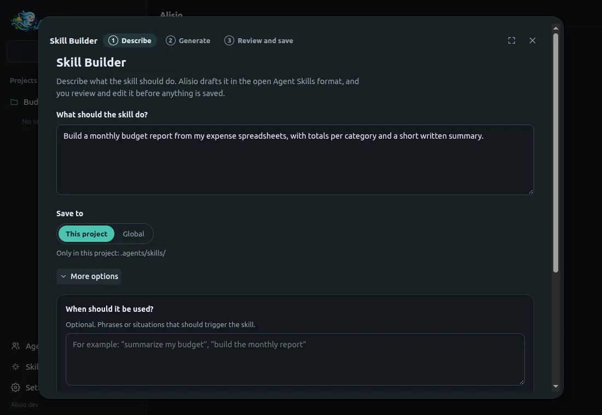
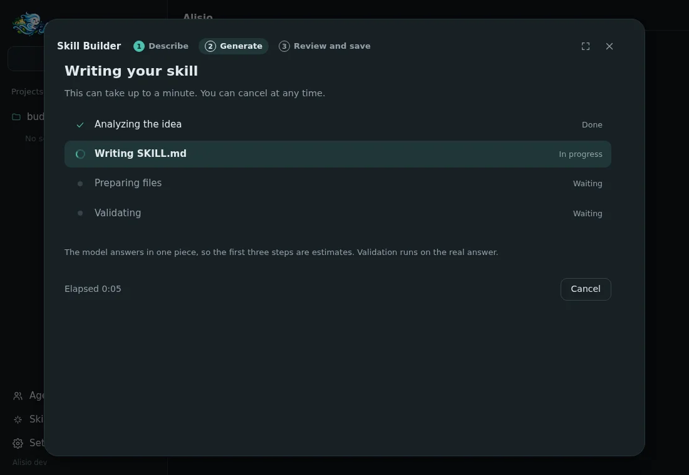
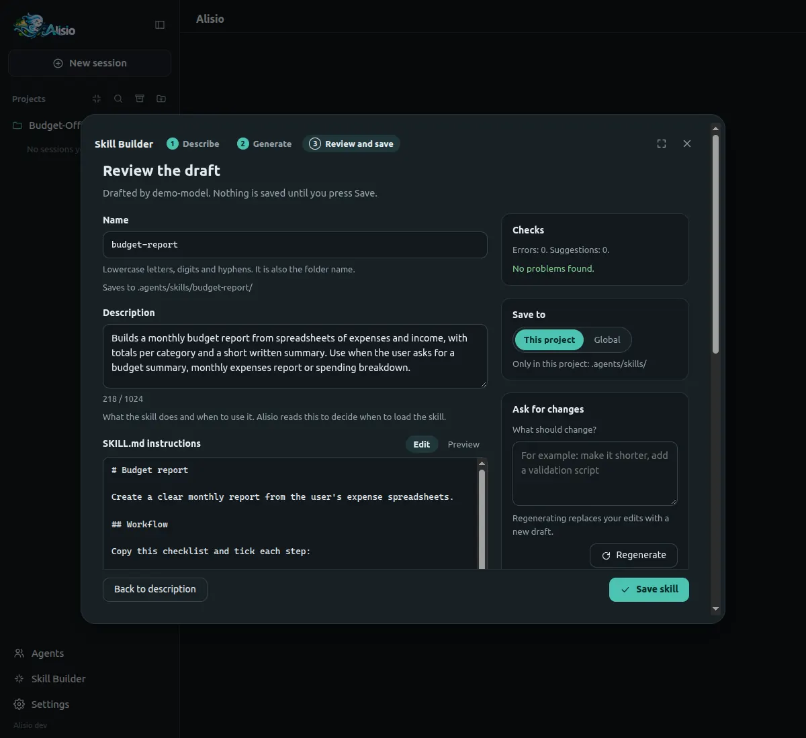

# Skill Builder

The Skill Builder writes a new skill for you. You describe what the skill should do, the active
model drafts it in the open [Agent Skills](https://agentskills.io) format, and you review and edit
the draft before anything is saved. It is in the web UI and the desktop app: **Skill Builder** in
the sidebar, above **Settings**, or **New skill** in **Settings → Skills**.

## The three steps

**1. Describe.** One field is required: **What should the skill do?** The primary button names the
model that will write it (**Generate with** *model*). If no model is configured yet, the window
explains it and links to **Settings → Models**. **Save to** chooses where the skill lives, and
**More options** adds example phrases that should trigger the skill and whether to include scripts,
templates and assets, or reference documents (by default the model decides).

<figure class="doc-shot">
  
  <figcaption>Step 1: describe the skill; everything else is optional.</figcaption>
</figure>

**2. Generate.** The window shows the stages (analyzing the idea, writing `SKILL.md`, preparing
files, validating), the elapsed time and a **Cancel** button that stops the request and keeps your
description. The model answers in one piece, so the first three stages are time-based estimates;
validation runs on the real answer and the stage is only marked done after it. A failed request
shows the error and **Try again**, with all your inputs kept.

<figure class="doc-shot">
  
  <figcaption>Step 2: staged progress with elapsed time and Cancel.</figcaption>
</figure>

**3. Review and save.** Edit the name (checked live), the description (with a character counter),
the `SKILL.md` instructions (with a rendered preview) and every extra file, or remove a file. The
**Checks** panel separates **Errors**, which block saving, from **Suggestions**, which do not.
**Ask for changes** sends your edited draft and a note such as "make it shorter" back to the model
(**Regenerate**); **Restore previous version** undoes a regeneration. **Save skill** writes the
files and shows where they went. If the folder already exists, nothing is replaced until you
confirm **Replace it**.

<figure class="doc-shot">
  
  <figcaption>Step 3: edit the draft, read the checks and save.</figcaption>
</figure>

## Where skills are saved

| Scope | Path | Loaded when |
| --- | --- | --- |
| Project | `<workspace>/.agents/skills/<name>/` | the workspace is trusted |
| Global | `~/.agents/skills/<name>/` | always |

A project skill needs a trusted workspace. If it is not trusted, the window offers **Save globally
instead** or **Trust this project**. After saving, the workspace reloads so the skill is active
without restarting. If a turn or a background task is running, the skill is saved and the window
says it becomes active after a reload, with a **Reload now** button.

## The format

Skills follow the open standard. `SKILL.md` starts with YAML frontmatter that Alisio builds from
the fields, never from text written by the model:

```yaml
---
name: budget-report
description: "Builds a monthly budget report from spreadsheets. Use when the user asks for a budget summary."
license: "MIT"
compatibility: "Needs Python 3 to run the summary script"
metadata:
  "author": "Ana"
---
```

Only `name` and `description` are required. The body follows the frontmatter. Extra files live
under `scripts/`, `references/` or `assets/`. The bundled guidance sent to the model asks for a
third-person description that ends with a "Use when" clause, concise instructions, numbered
workflows with a validation step, deterministic scripts with documented dependencies, no
time-sensitive information and progressive disclosure into reference files. A skill named
`alisio-skill-authoring` (project, user or plugin) replaces that guidance.

## Validation

The same rules run in the browser while you edit and on the server before writing.

| Errors (block saving) | Suggestions (do not block) |
| --- | --- |
| Name: lowercase letters, digits and single hyphens, at most 64 characters, no `anthropic` or `claude` | The body has more than 500 lines or about 5000 tokens |
| Description: required, at most 1024 characters, no `<` or `>` | The description has no "Use when" clause or uses the first or second person |
| Compatibility: at most 500 characters; metadata: text to text | A vague name such as `helper`, `utils` or `data` |
| `SKILL.md` at most 64 KB | A reference file over 100 lines without a table of contents |
| Extra files only under `scripts/`, `references/` or `assets/`, relative, forward slashes, no `..`, no hidden files, simple names, one subfolder level | Time-sensitive wording such as dates |
| At most 20 files, 256 KB each, 1 MB in total, UTF-8 text only | Backslashes in paths |
| Every local file the body points to is in the skill | A script without documented usage or dependencies |
| | The name matches an existing skill, which would shadow it or be shadowed |

## Safety

The Skill Builder never runs a script. Files are written as plain text with mode `0644` (never
executable), inside the skill folder, through a temporary folder that is renamed into place so a
failed save leaves no half-written skill. Folder names are checked for symbolic links and path
escapes. The skill's scripts run later like any other tool call, under your permission mode. The
window is unavailable under `--read-only`. It is not a sandbox: review a script before you let a
skill use it.

## API

```text
POST /api/workspaces/:wid/skills/draft {idea, when?, include?, scope?, previous?, feedback?}
     → {draft, warnings, errors}   502 provider_unavailable, 409 cancelled
POST /api/workspaces/:wid/skills {scope, draft, overwrite?}
     → 201 {skill: {name, scope, path}, reloaded, reason?}   409 skill_exists, 403 not_manageable
```

Closing the request cancels the model call. The types are `SkillDraft`, `SkillDraftRequest`,
`SkillDraftResult`, `SkillCreateRequest` and `SkillCreateResult` in `@alisio/sdk`, together with
`validateSkillDraft` and `renderSkillMd`, the pure helpers both the server and the web use.

## Limits

- The model answers in one piece, so progress stages before validation are estimates.
- A draft is generated by one tool-less model call (up to 3 minutes, about 8000 output tokens).
- A skill that needs more than 20 files or 1 MB should be written by hand.
- The window creates skills; to edit one later, change its files or use **Settings → Skills**
  to enable or disable it.
