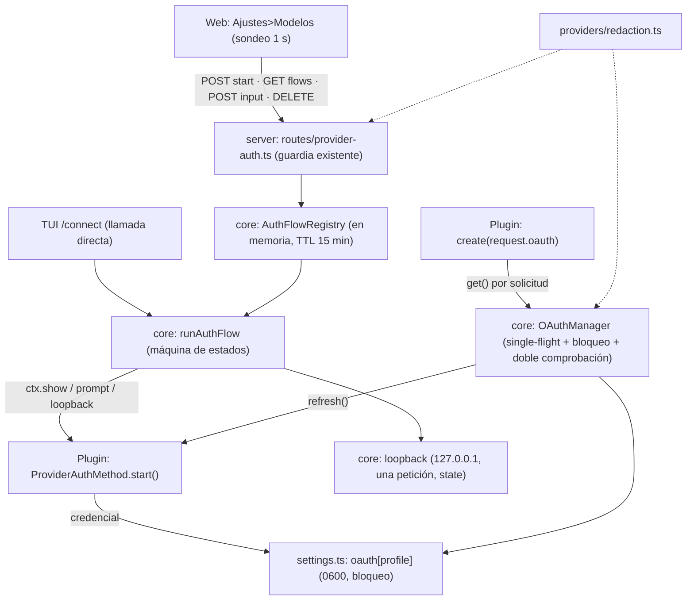

# Especificación Técnica: Provider OAuth — contrato de inicio de sesión de proveedores en `@alisio/sdk` y primer consumidor «Sign in with ChatGPT Plus/Pro»

| Campo | Valor |
|---|---|
| Versión | 0.1 |
| Origen | Fase 4 de `specs/backlog/024-provider-connect-v1.md` (D9-D12, AC-32..37), separada por la decisión O5 de esa spec, más un análisis de solo lectura del 2026-11-07 (Opus), las decisiones del propietario O1-O3 del 2026-11-07, los hallazgos de escritorio de la Fase 0 (D-20..D-30) la decisión O4 del 2026-11-07 (solo la vía oficial «Sign in with ChatGPT») y las mediciones en vivo de la Fase 0 del 2026-11-07 (D-31..D-36) y la revisión Opus de la compuerta de la Fase 0 (hallazgos F1-F18, D21-D30, 2026-11-07) |
| Proyecto | Alisio |
| Estado | **Aprobada por el propietario (2026-11-07), revisada por O4 (2026-11-07).** Fase 0 con pruebas reales autorizada por el propietario (2026-11-07); **Mediciones en vivo de la Fase 0 registradas (2026-11-07)** (D-31..D-36, §8); quedan sin medir P0-L8 (elegibilidad), P0-L9 (túnel SSH real) y el puerto aleatorio. **Sin preguntas abiertas** (Q4 cerrada por O5). **Compuerta de la Fase 0: GO del propietario (2026-11-07)**; **Revisión Opus (invocación 1): GO con condiciones, hallazgos F1-F18 aplicados (2026-11-07).** **Fase 1 implementada (2026-11-07)**: OA-AC-01..16, 18, 36, 39, 41, 42, 43, 44, 45, 47, 48, 49, 52, 53, 54, 55, 56, 59 y 61 cerradas; **Fase 2 implementada (2026-11-07)**: OA-AC-17, 19..31, 40, 46, 50, 57, 58 y 62 cerradas; **Fase 3 implementada (2026-11-07)**: OA-AC-32, 33, 51, 60 y 63 cerradas; **Fase 4 implementada (2026-11-07, sin commit ni publicación)**: OA-AC-34, 35, 37 y 38 cerradas, release 0.11.0 preparado pero NO publicado (ver los «Registro de implementación» en §8); Fase 5 NO implementada |
| Fecha | 2026-11-07 |
| Paquetes afectados | `@alisio/sdk` (tipos aditivos opcionales: `ProviderAuthMethod`, `ProviderAuthMethodInfo`, `ProviderAuthContext`, `ProviderAuthStep`, `ProviderAuthPrompt`, `ProviderAuthLoopback*`, `ProviderOAuthCredential`, `ProviderOAuthHandle`, `ProviderAuthFlowView`, `ProviderRegistration.auth?`, `ProviderCreateRequest.oauth?`, `ProviderTypeInfo.auth?`, campos nuevos de `CredentialStatus`) · `@alisio/core` (nuevo `packages/core/src/providers/oauth/{lock,manager,flow,loopback}.ts` y `providers/redaction.ts`; cambios en `providers/settings.ts`, `providers/registry.ts` o su punto de creación en `application.ts`) · `@alisio/server` (nuevo `routes/provider-auth.ts`; cambios en `routes/providers.ts` e `index.ts`) · `@alisio/web` (privado: `components/settings/ModelsPage.tsx`, nuevo `ProviderSignIn.tsx`, `net/api.ts`, i18n EN/ES) · `@alisio/alisio-code` (`packages/cli`: `/connect` y cierre de sesión en la TUI) · `apps/desktop` (`src/host.ts`: señal de navegador local) · **repositorio externo `alisio-plugins`**: `packages/plugin-openai` (Fase 5, entregable separado) |
| Paquetes nuevos | Ninguno. Sin dependencias nuevas de producción en el repo del host (el bloqueo de archivo y el listener de loopback usan `node:fs` y `node:http`) |
| Relación con otras especificaciones | **Reemplaza la Fase 4 de `specs/backlog/024-provider-connect-v1.md`** (D9-D12, AC-32..37 de esa spec); 024 sigue siendo el padre de sus Fases 1-3. Complementa a 024 sin depender de su implementación: 025 NO usa `resolveProviderAuth`, `shadowedEnv` ni `credentials.json` v2 de 024 (ver D6) y puede ejecutarse antes o después. Reutiliza el principio «plugin = código de confianza, no sandbox» de `specs/014-trust-boundaries-v1.md`. Independiente de `specs/backlog/019-capability-routing-v1.md` y `020-model-tier-router-v1.md` |
| Superficies | Web (Ajustes > Modelos), TUI (`/connect`), headless (solo lectura de credenciales ya guardadas; nunca inicia sesión), API HTTP de `alisio serve`, Alisio Desktop (señal de navegador local) |
| Política de versión | Cambia el contrato de `@alisio/sdk` (aditivo): **0.11.0** para todos los paquetes (D14). `RunEvent.schemaVersion`, `apiVersion` de plugins y `protocolVersion` no cambian. `credentials.json` conserva `schemaVersion: 1` (D6) |

## 0. Cómo usar este documento (para agentes de código)

1. Lee primero `AGENTS.md` y `CONTRIBUTING.md`; prevalecen sobre este documento. Carga `alisio-architecture`, `alisio-coding-standards`, `alisio-specs`, `alisio-plugins`, `alisio-pkg-sdk`, `alisio-pkg-core`, `alisio-pkg-server`, `alisio-pkg-web`, `alisio-pkg-cli-tui`, `alisio-docs-screenshots` y `alisio-publish` según la fase. La Fase 5 se ejecuta en `/home/meridian/Documentos/Proyectos/Personal/alisio-plugins` y sigue sus propias reglas (`AGENTS.md` de ese repo).
2. Etiquetas: **(verificado 2026-11-07)** = leído en el repositorio (rama `feat/electron-desktop`, commit `564368a`, árbol limpio) o medido por una ejecución ese día; **(no verificado)** = deducido o externo (comportamiento de OpenAI, de otros productos) sin prueba ejecutada aquí; **(nuevo)** = no existe.
3. Palabras clave **MUST, MUST NOT, SHOULD, SHOULD NOT, MAY** en mayúsculas según RFC 2119 (aclarado por RFC 8174), usadas solo donde importan para seguridad, interoperabilidad o pruebas; todo SHOULD indica su condición de excepción. Los requisitos de comportamiento usan forma EARS (`WHEN <disparador>, el <sistema> MUST <respuesta>`).
4. **TDD estricto Rojo → Verde → Refactor** (§6.1). Ninguna línea de producción sin una prueba que falle antes. Pruebas en `tests/*.test.ts` (host) y `test/*.test.ts` (plugin), sobre comportamiento en límites de módulo; sin pruebas de instantánea.
5. **Orden obligatorio**: Fase 0 (solo experimentos, sin código de producción; **ninguna ejecución en vivo sin el visto bueno explícito del propietario**) → compuerta del propietario → Fases 1-4 en orden → Fase 5 (entregable separado, en otro repo). Cada fase del host deja el repo verde con `pnpm typecheck`, `pnpm lint`, `pnpm test`, `pnpm build`, `pnpm test:cli`, `pnpm test:compiled`, `pnpm pack:check`, `pnpm docs:check` y `pnpm docs:build`. **No hagas commit hasta que el propietario lo pida.**
6. **Asignación de modelos**: §7. Opus solo en la revisión de la compuerta de Fase 0 y en la revisión adversarial de seguridad tras la Fase 2; Sonnet implementa; Haiku para trámites.
7. Reglas del repo que no se rompen: solo pnpm; Node >=22.16 y debe funcionar en Bun; solo APIs portables de Node, sin globals de Bun; **ningún SDK de proveedor, ningún ID de cliente OAuth y ningún endpoint de un proveedor concreto en `@alisio/sdk`, `@alisio/core`, `@alisio/server`, `@alisio/web` ni `@alisio/alisio-code`** (O4, D4); los plugins dependen solo de `@alisio/sdk` y no importan internos de `@alisio/core`; preservar IDs de llamadas a herramientas, datos de continuación del proveedor y consistencia de sesión; **un manifiesto de plugin o un subproceso no es un sandbox**; nunca imprimir ni copiar valores de tokens, códigos de autorización ni verificadores PKCE (ni en pruebas, ni en logs, ni en esta spec).
8. Idioma: identificadores, claves, códigos de error y textos generados en inglés; textos de UI en inglés y español (`packages/web/src/i18n/en.ts` y `es.ts`; TUI en inglés como hoy); esta especificación en español; documentación EN/ES en paridad (`docs/<página>.md` y `docs/es/<página>.md`).
9. **Esto es gestión de sesión de comodidad, no cifrado ni aislamiento.** Los tokens quedan en texto plano en `credentials.json` con permisos `0600`, legibles por cualquier proceso del mismo usuario y por cualquier plugin cargado. Ninguna sección puede presentarse en docs, UI o mensajes como almacén seguro, sandbox o garantía contra un atacante local.

---

## 1. Objetivo, alcance y principio rector

### 1.1 Objetivo

Dar a `@alisio/sdk` (con core, server, web y TUI) un **contrato genérico de inicio de sesión OAuth de proveedor**, de modo que un plugin externo pueda ofrecer «Iniciar sesión» usando **solo el SDK**, y que el host custodie el almacenamiento, la renovación, el bloqueo entre procesos y la redacción de los tokens. El consumidor primario y objetivo de aceptación de extremo a extremo es `@alisio/plugin-openai` (repo `alisio-plugins`, `packages/plugin-openai`), que añadirá «ChatGPT Plus/Pro» (vía oficial «Sign in with ChatGPT», SIWC; O4) sin tocar ningún código específico de proveedor en este repo.

### 1.2 Principio rector

> **El host custodia las credenciales y su ciclo de vida; el plugin solo sabe hablar con su proveedor. Y nunca un token sale del proceso hacia la web, los registros o los eventos.**

Reglas derivadas:

- El plugin posee PKCE, el registro dinámico del cliente, el intercambio de tokens y los datos propios del proveedor (D4). El host posee almacenamiento, planificación de renovación, bloqueo y redacción (D4, D7, D8).
- Una renovación fallida es un error duro `needs_sign_in`; **nunca** cae en silencio a una variable de entorno (D7).
- Un proveedor que solo admite inicio de sesión no declara ningún secreto obligatorio, y `/connect` no se bloquea por ello (D12).
- El `create()` de un proveedor vive horas: el plugin pide el token por solicitud con `oauth.get()`; nunca lo captura una vez (D11).

### 1.3 Alcance

Tipos aditivos del SDK; almacenamiento `oauth` en `credentials.json` con bloqueo entre procesos para **todas** las escrituras (D15); `get()` con agrupación de llamadas en proceso y renovación con doble comprobación entre procesos; ejecutor de flujos en el core; ayudante de loopback del host; rutas HTTP de sondeo bajo el guardia existente; interfaz web y TUI de inicio y cierre de sesión; redacción de JWT y de valores exactos; release 0.11.0; y, como entregable separado, la Fase 5 del plugin `plugin-openai`.

### 1.4 Fuera de alcance

| Excluido | Motivo |
|---|---|
| *Callback* genérico de servidor web (redirección al propio `alisio serve` o a una URL pública) | O3: v1 usa el loopback del host en `127.0.0.1` y pegar la URL (sin device code para ChatGPT). Un callback web exige HTTPS, registro de redirect y cambia el modelo de amenaza |
| Motor OAuth genérico declarativo del host (flujos descritos en JSON que el host ejecuta) | El plugin ya sabe su protocolo (D4); un motor declarativo duplica y limita |
| Ayudantes de PKCE o de sondeo de device code en el SDK | Posible mejora posterior y puramente aditiva; v1 no los necesita (D1) |
| Rotación o varias cuentas simultáneas por proveedor | Un perfil = una sesión; varias cuentas = varios perfiles, sin balanceo |
| OAuth de otros proveedores (Anthropic, Google, GitHub Copilot, etc.) | Solo el contrato es genérico; cada plugin lo implementaría aparte, bajo su propia decisión del propietario |
| TLS y endurecimiento del acceso remoto de `alisio serve` | Sigue siendo «sin TLS; preferir túnel SSH» (verificado, §3); spec propia futura |
| Fases 1-3 de `specs/backlog/024-provider-connect-v1.md` (resolvedor de precedencia, indirección, presets, `alisio connect`, autodetección) | Siguen en 024 |
| Evaluación legal o de términos de uso | SIWC es un programa oficial (D-27), pero los Términos de Uso vigentes no se han leído (D-27, **no verificado**); esta spec no es una opinión jurídica |
| Llavero del SO o cifrado en reposo | Misma exclusión que 024 §1.4; texto plano `0600` |
| Convertir un plugin en sandbox | Un plugin es código de confianza plena en proceso (D4, §10) |
| Vía Codex-cliente: ID de cliente prestado de Codex, `chatgpt.com/backend-api` y device code de Codex | **O4**: solo la vía oficial SIWC. Ningún ID de cliente de otro producto, ningún endpoint privado de ChatGPT, en el host ni en el plugin |
| Device code para ChatGPT | SIWC no lo documenta (D-27); el paso `device_code` queda solo en el contrato genérico del SDK (D3) |
| Revocar el agente en OpenAI al cerrar sesión (`revocation_endpoint`) | El cierre de sesión borra solo lo local (D9); el agente «Alisio» sigue listado en ChatGPT hasta que el usuario lo revoque allí; la documentación le indica revocar «Alisio» en los ajustes de ChatGPT (Sign in with ChatGPT) (§10, §11 Q5). Posible mejora aditiva posterior (`ProviderAuthMethod.revoke?`) |
| Copiar o transferir credenciales entre máquinas, y comando de exportar o importar la credencial | **O5:** no se soporta en la v1; la rotación del refresh token hace que las copias deriven (D-35). El uso remoto soportado es el túnel SSH (D3) |
| Alojamiento de terceros o comercial de `alisio serve` | **O5:** puede caer en el requisito del formulario de interés de OpenAI para apps alojadas en remoto (D-27); solo se cubre una VM remota propia y usada por el mismo usuario |

---

## 2. Decisiones

### 2.1 Decisiones del propietario (confirmadas 2026-11-07, se aplican exactamente)

| ID | Tema | Respuesta confirmada | Se aplica en |
|---|---|---|---|
| O1 | Inicio de sesión ChatGPT Plus/Pro | **Se publicará** en `@alisio/plugin-openai` mediante la vía **oficial** «Sign in with ChatGPT» (SIWC, O4). **No se necesita ninguna excepción a 024 D9/AC-37**: el cliente se registra dinámicamente (D4), sin ID de cliente prestado. *Historia:* la excepción de O1 (vía Codex, etiqueta «no oficial» y riesgo de TOS aceptado) queda **retirada por O4**. **Motivo del propietario**: el patrón es de uso amplio (OpenCode, Pi y otros) y existe una vía oficial para código abierto y apps locales | D4, D11, OA-AC-36, PO-AC-01, PO-AC-02, PO-AC-14, PO-AC-19, §10 |
| O2 | Dos proveedores en un paquete | `plugin-openai` registra **dos** proveedores: «OpenAI (API key)», sin cambios, y «ChatGPT Plus/Pro», solo inicio de sesión. **Motivo:** ambos usan el mismo backend público de Responses (`https://api.openai.com/v1/responses`, D11), pero son perfiles distintos, con credencial distinta (OAuth frente a clave de API), facturación distinta (plan de ChatGPT frente a clave de API) y los límites propios de elegibilidad y de la vista previa de SIWC (§10); mezclarlos en un perfil ocultaría qué se factura y cuándo aplican esos límites | §5.8, PO-AC-01, PO-AC-18 |
| O3 | Métodos de la v1 | **PKCE en navegador con listener de loopback que provee el host** en `127.0.0.1` (puerto 1455 por defecto; SIWC permite variar solo el puerto, D-27) cuando el navegador está en la misma máquina (Desktop, `alisio serve` local) + **alternativa «pegar la URL de redirección»** por `prompt`. **No hay device code en la v1 para ChatGPT** (SIWC no lo documenta). **Uso remoto:** (a) túnel SSH al puerto de loopback (`ssh -L 1455:127.0.0.1:1455`, además del túnel de la web) (copiar la credencial entre máquinas NO se soporta, O5). `ProviderAuthContext.show({type:"device_code"})` **se conserva en v1** en el contrato genérico del SDK (barato; otros proveedores pueden necesitarlo) **sin fila de aceptación de ChatGPT**. No hay *callback* genérico de servidor web | D2, D3, OA-AC-23..25, OA-AC-32, PO-AC-04, PO-AC-05, PO-AC-15, PO-AC-16 |
| O4 | Una sola vía: SIWC oficial | **Solo la vía oficial SIWC.** Se descarta por completo la vía Codex-cliente: ni ID de cliente prestado de Codex, ni `chatgpt.com/backend-api`, ni device code de Codex. Retira la excepción de O1 a 024 D9/AC-37. Consecuencias: O1-O3, D2-D4, D11 y D16 reescritos; riesgos de §10 y Fases 0 y 5 reformuladas; D-20, D-21, D-23, D-24 y D-25 pasan a historia | O1..O3, D2, D3, D4, D11, OA-AC-36, PO-AC-02, PO-AC-03, §10 |
| O5 | Uso remoto en la v1 (cierra Q4) | **El uso remoto está SOPORTADO solo por túnel SSH:** `ssh -L 1455:127.0.0.1:1455 <host>` (además del túnel de la web) y se inicia sesión desde el navegador local del usuario, con la alternativa de pegar la URL de redirección. Está documentado y cubierto por PO-AC-16 (y PO-AC-15 para pegar la URL). **Copiar credenciales entre máquinas NO se soporta en la v1** (la rotación del refresh token hace que las copias deriven, D-35). El escenario cubierto es una VM remota **propia y usada por el mismo usuario**; el alojamiento de terceros o comercial puede caer en el requisito del formulario de interés de OpenAI para «apps alojadas en remoto» (D-27) y queda fuera de alcance (§1.4, §10) | D3, D16, PO-AC-15, PO-AC-16, §1.4, §10 |

### 2.2 Decisiones de diseño (binding salvo que el código las contradiga; las desviaciones se registran)

| ID | Decisión (contexto → decisión → consecuencia) |
|---|---|
| D1 | **El SDK añade solo tipos, todos opcionales y aditivos** (§5.1): `ProviderRegistration.auth?: ProviderAuthMethod[]`; `ProviderAuthMethod {id, label, kind: "oauth", description?, unofficial?, start(ctx), refresh?(cred, signal)}`; `ProviderAuthContext {signal, show(step), prompt(req), loopback?(opts), previousMetadata?}`; pasos `auth_url`, `device_code` (con `verificationUriComplete?` e `intervalSeconds?` opcionales, D29), `progress`; `ProviderOAuthCredential {type:"oauth", access, refresh?, expires?, metadata?}`; `ProviderCreateRequest.oauth?: {get(signal?), invalidate(reason?: "sign_in_required")}` (D20, D27); `CredentialStatus` gana `kind?: "oauth"`, `expires?`, `state?: "ok" \| "needs_sign_in"` y **sin cola de token**. Sin SDK de proveedor en sdk/core. El SDK PUEDE ganar ayudantes puros después; fuera de la v1. Añadidos por la verificación: `unofficial?` (genérico: ChatGPT/SIWC es oficial y no lo usa, O4; D18), `previousMetadata?` (D4) y los tipos serializables para la web (D18) |
| D2 | **`loopback?(opts)` lo provee el host.** El host enlaza **solo** `127.0.0.1`, en el puerto pedido (`port: 0` = asignado por el SO; `redirectUri` informa el puerto real). Según la documentación de SIWC, la redirección es **solo** `http://127.0.0.1:<puerto>/auth/callback`, solo puede variar el puerto y no se debe sustituir por `localhost` (D-27). **Medido en vivo: `127.0.0.1:1455` funciona (verificado 2026-11-07, medición en vivo P0-L2, D-31); un puerto aleatorio NO se probó y sigue sin verificar.** Por eso `opts.redirectHost` vale **`"127.0.0.1"` por defecto** (D-29) y `"localhost"` queda como opción genérica para otros proveedores. El plugin pide 1455 y, si el listener rechaza con `loopback_unavailable`, cae a pegar la URL; el reintento con `port: 0` queda **desactivado** hasta que una medición confirme que SIWC acepta un puerto aleatorio (abierto, D-31). El host atiende exactamente una petición que coincida, valida `state` (por eso `opts` lleva `state`, que genera el plugin), devuelve una página mínima de éxito o de cierre y se cierra tras un uso o a los 15 min. Solo se ofrece cuando el host puede suponer navegador local (D16); si no, `loopback` es `undefined` y el plugin cae a pegar la URL. **El host valida solo `state`; el verificador PKCE queda en el plugin** |
| D3 | **Loopback en el navegador local; pegar la URL es el comodín universal; remoto = túnel SSH (O5).** SIWC no documenta device code (D-27; **no verificado en vivo**), así que el método de ChatGPT no lo usa (O3, O4). El plugin ofrece un único método `browser`: con `ctx.loopback` espera la redirección y, en carrera, acepta la URL pegada con `ctx.prompt()`; sin `loopback`, solo pegar. Uso remoto: el usuario reenvía el puerto de loopback con `ssh -L 1455:127.0.0.1:1455` (el plugin lo indica en `auth_url.instructions`) o pega la URL. **Copiar `oauth[perfil]` a otro host NO se soporta en la v1 (O5):** el refresh token **rota** (verificado 2026-11-07, medición en vivo P0-L4, D-35); aunque el token anterior se siguió aceptando, las copias derivan en cuanto una renueva y, si OpenAI impusiera el uso único, la que renovara segunda recibiría `needs_sign_in`. El host no ofrece comando ni la docs lo recomiendan. El paso `device_code` permanece en el SDK sin consumidor de ChatGPT (O3). Consecuencia: la aceptación remota usa un túnel SSH simulado (PO-AC-16) |
| D4 | **El plugin posee** el registro dinámico SIWC, PKCE, el intercambio de tokens y la renovación; **el host posee** almacenamiento, planificación de renovación, bloqueo y redacción. **Registro dinámico (D-30; verificado 2026-11-07, medición en vivo P0-L1; D-30, D-31):** no hay endpoint de registro aparte; la petición de autorización lleva `client_id=dynamic_agent_client`, `ext_agent_host_id` (`urn:uuid:…`) y `agent_name_hint`, y la redirección devuelve el `client_id` propio de la cuenta, que se usa en el canje y en el refresh. **Dónde vive:** no es un token de usuario, pero es propio de la cuenta y del agente; se guarda en `oauth[perfil].metadata` (`clientId`, y `hostId` para reutilizar el mismo agente), por el contrato del host y sin archivos privados del plugin. SIWC es cliente público: **no se emitió ningún secreto de cliente** (verificado 2026-11-07, medición en vivo P0-L1, D-32); no hay `metadata.clientSecret`. El registro en vivo se hizo por `ext_agent_host_id`: la pantalla de consentimiento registró un agente «Alisio» en la cuenta (D-31). Para sostenerlo el host MUST fusionar la `metadata` anterior con la que devuelva `refresh()` (§5.1, §5.3) y pasa `ctx.previousMetadata` a `start()` para reutilizar `hostId` al iniciar sesión de nuevo en el mismo perfil. **Único cambio al SDK por esta decisión:** `ProviderAuthContext.previousMetadata?`. **Id de cuenta:** no hay *claim* `chatgpt_account_id` en el access ni en el id token y no hace falta: las solicitudes funcionaron sin ninguna cabecera de cuenta (verificado 2026-11-07, medición en vivo P0-L6, D-32, D-34). No se guarda `metadata.accountId`. **Cadena de intentos:** cada primer inicio de sesión cancelado puede crear otro `hostId` y por tanto otro agente «Alisio» (no medido); el plugin reutiliza un `hostId` por cadena de intentos (D30). Consecuencia: ninguna lógica de OpenAI en este repo; añadir otro proveedor OAuth no toca el core |
| D5 | **Transporte por sondeo sobre un registro de flujos en memoria**, siguiendo el patrón existente de trabajos (`packages/server/src/plugins/jobs.ts`, `GET /api/plugins/jobs/:jobId`). `POST /api/providers/:profile/auth/:method/start` → `202 {flowId}`; `GET /api/providers/:profile/auth/flows/:flowId?after=n` → pasos con `n` > cursor más el estado; `POST .../flows/:flowId/input` con `{promptId, value}`; `DELETE .../flows/:flowId` cancela. Sondeo cada ~1 s; el flujo expira a los 15 min. Todo detrás del guardia existente (cookie, `Host`, `Origin` en no-GET); `readOnly` → `capability_ceiling`. Rutas por **perfil**, como las rutas de proveedores existentes (verificado, §3). Códigos `ApiErrorCode` existentes: `not_found`, `validation_failed`, `capability_ceiling`, `provider_unavailable`. **No se añade ningún `ApiErrorCode` nuevo**: un segundo inicio para el mismo perfil *reemplaza* al primero (que pasa a `cancelled`) en lugar de devolver un conflicto. Los resultados de fallo del flujo viajan en el cuerpo (`error.code`), no como error HTTP |
| D6 | **Almacenamiento: clave de nivel superior `oauth` en `credentials.json`**: `oauth: { [profile]: ProviderOAuthCredential & { method: string; state?: "ok" \| "needs_sign_in" } }` (`method` = id del método que la creó, para elegir su `refresh`; `provider` = id de la registración que la creó, D21; `generation` = entero monotónico tomado del contador superior `oauthSeq`, D22). `schemaVersion` sigue en 1; escritura atómica y `0600` (el mismo `atomicJson`). **Verificado:** las versiones actuales conservan claves superiores desconocidas al escribir, porque `read()` devuelve el objeto JSON completo y `setCredentials`, `deleteCredentials` y `saveActive` solo mutan `.providers` y reescriben el objeto entero (`settings.ts:24-31`, `:67-76`, `:99-131`). Por tanto **no hay migración y la bajada de versión es segura** (una versión vieja ignora `oauth` y no lo descarta, pero puede reescribir una copia obsoleta en una carrera; §10). Defecto conocido a corregir en la Fase 1: un `credentials.json` con `oauth` pero sin `providers` rompe `credentials.providers[name]` (se normaliza con `providers: {}` al leer). **Desvío respecto a 024 D11**: 025 NO sube a `schemaVersion: 2` |
| D7 | **Renovación.** (a) En proceso: agrupación de llamadas por perfil (`Map<profile, Promise>`). (b) Entre procesos: archivo de bloqueo con `open "wx"` y token de propietario, obsoleto a los 30 s por `mtime` con robo por `rename` (D24), reintentos acotados; tras tomar el bloqueo se **relee** y se renueva solo si el token sigue a ≤ 5 min de expirar (doble comprobación). (c) Los refresh tokens de SIWC **rotan** (verificado 2026-11-07, medición en vivo P0-L4, D-35), pero el uso único **no se impone**: en la medición el refresh anterior a la rotación se aceptó otra vez (200) y el vigente siguió funcionando, sin revocar la familia. El bloqueo entre procesos se conserva **como precaución** ante una imposición futura y contra escrituras perdidas (D15), no porque se haya observado un bloqueo de la sesión (Desktop y CLI pueden convivir). (d) El refresh rotado se persiste **antes** de devolver el token nuevo, y solo si la entrada sigue siendo la misma (`generation`, D22). (e) Un fallo permanente fija `state: "needs_sign_in"`, conserva la credencial, **no** cae a variables de entorno y la UI muestra «Iniciar sesión de nuevo»; un fallo marcado `retryable: true` por el plugin no cambia el estado y solo falla esa llamada. **Mapeo medido (verificado 2026-11-07, medición en vivo P0-L7, D-36):** 400 `invalid_grant` en el refresh y 401 con código `token_revoked` en inferencia o en `/v1/models` MUST fijar `state: "needs_sign_in"` (el segundo, por `oauth.invalidate("sign_in_required")`, D20, sin llamar a `refresh()`); un 401 **sin** ese código fuerza **una** renovación con `oauth.invalidate()` y un único reintento; un segundo 401 simple tras la renovación forzada hace que el plugin llame `oauth.invalidate("sign_in_required")` y el host fije `needs_sign_in` (PO-AC-09). (f) Los cores anteriores no toman el bloqueo: riesgo aceptado y documentado. (g) **Momento de renovar:** el host renueva a `expires - 5 min` (sin cambios). `earliest_refresh_at` (epoch en segundos, devuelto por el canje) es **solo informativo**: se guarda en `metadata.earliestRefreshAt` **en milisegundos, como `expires`** (D29) y no se hace cumplir, porque la renovación tuvo éxito unos 53 min antes de ese instante (D-35); nunca retrasa una renovación necesaria para un token vencido o a punto de vencer (OA-AC-42). Detalle de plazos y de los dos archivos de bloqueo en §5.3 |
| D8 | **Redacción.** Se añade una regla de JWT (`eyJ…` de tres partes base64url) y el borrado de **valores exactos** de tokens conocidos, aplicados a errores, registros, eventos, el informe de `/stats` y los mensajes de error de proveedor. Los tokens nunca llegan a la web; el estado no lleva colas. **Verificado y desviado:** `redactSecrets`/`findSecrets` (`packages/core/src/eval/secrets.ts`) hoy solo se usan en el eval harness (cassettes, export, fingerprint), **no** en errores de proveedor, registros ni eventos; y añadir la regla JWT a su tabla `RULES` cambiaría cuándo se *rechaza* un cassette. Ver D17 y D26 |
| D9 | **Cierre de sesión** reutiliza `DELETE /api/providers/:profile/credentials`, ampliado para borrar también `oauth[profile]` y cancelar un flujo en curso de ese perfil (impacto más amplio, incluido `--read-only`: §10). La TUI gana una acción de cerrar sesión dentro de `/connect`: **no existe** `/disconnect` hoy (verificado, §3) y 024 lo propone para sus propios fines; 025 no lo requiere |
| D10 | **Detección de la función por el plugin**: dentro de `create()`, `request.oauth !== undefined`. Los cores anteriores ignoran campos de registro desconocidos (verificado: `ProviderRegistry.register` hace `{ ...registration, ...owner }` sin validar, `registry.ts:25`) y no pasan `request.oauth`. Rango de par del plugin: `>=0.9.0 <0.12.0`. **Brecha de ecosistema (verificado 2026-11-07):** los 20 plugins de `alisio-plugins` declaran `peerDependencies["@alisio/sdk"]: "^0.9.0"`, que **ya excluye** la 0.10.0 publicada |
| D11 | **El plugin llama `oauth.get()` en cada solicitud**, porque `create()` se cachea durante la vida del proveedor activo (verificado: `application.ts:970`, `:1061`, `:1102`; `runtimeFor` guarda la promesa por `perfil\0modelo`, `:1095-1110`). `plugin-openai` hoy construye un `new OpenAI({apiKey})` estático (verificado, `provider.ts:54`). **Decisión (O4, D-26):** el proveedor ChatGPT usa **openai-node 7.33.0** con `apiKey` como función asíncrona (`() => oauth.get()` y su `access`; se evalúa por solicitud, verificado 2026-11-07 en `client.js` y `client.d.ts`) **sin ninguna cabecera adicional** (basta `Authorization: Bearer` (verificado 2026-11-07, medición en vivo P0-L6, D-34)), contra la **API pública** de Responses (`https://api.openai.com/v1/responses`, sin `baseURL` propio y nunca `chatgpt.com/backend-api`). El proveedor de clave de API y el de ChatGPT **comparten el mismo código de cliente y de Responses**; solo cambia la fuente de credencial (clave estática frente a la función). El comportamiento en ejecución, incluida la forma del cuerpo bajo las limitaciones de la vista previa, se midió con `fetch` directo contra la API pública (D-34); el comportamiento de openai-node en ejecución sigue **(no verificado)** hasta PO-AC-08 y PO-AC-11. **`GET /v1/models` NO devuelve la forma estándar `{data:[...]}` sino `{models:[...]}` (D-33): `client.models.list` de openai-node no sirve y `listModels` MUST usar un `fetch` directo o un parseo propio** |
| D12 | **Campos secretos obligatorios.** La TUI bloquea hoy con `if (field.required && !credentials[field.key]) return error(...)` (`app.ts:2008`). Para un proveedor con `auth`, el host ofrece «Iniciar sesión» junto a los campos de secreto o en su lugar; un proveedor solo-inicio-de-sesión no declara secretos y `fields` puede ser `[]`. Comportamiento exacto en web y TUI en §5.7 |
| D13 | **Headless/CI.** `start` nunca se ofrece (no hay ruta en `alisio run`), `prompt` resuelve `undefined`, y `get()`/renovación funcionan si hay credencial guardada. Sin credencial: error claro `OAUTH_SIGN_IN_REQUIRED` que indica iniciar sesión desde la web o la TUI |
| D14 | **Versionado**: npm **0.11.0** para todos los paquetes (el contrato de `@alisio/sdk` cambia) según `alisio-publish` |

### 2.3 Decisiones añadidas al verificar el código, por las mediciones en vivo y por la revisión Opus de la compuerta (D15-D30)

Surgen de leer el repo el 2026-11-07 (D15-D19), de las mediciones en vivo de la Fase 0 (D20) y de la revisión Opus de la compuerta de la Fase 0 (D21-D30, hallazgos F1-F18, GO con condiciones, aplicados el 2026-11-07); precisan o completan D1-D14 y prevalecen donde haya conflicto.

| ID | Decisión |
|---|---|
| D15 | **Todas las escrituras de `credentials.json` toman el bloqueo, no solo la renovación.** Contexto: `settings.ts` lee-modifica-escribe sin bloqueo (solo `rename` atómico) y `credentials()` devuelve el objeto completo; un `setCredentials` de otro proceso concurrente con una renovación puede sobrescribir con un objeto viejo y **perder el refresh token rotado**, lo que deja la sesión inutilizable de forma permanente. Decisión: dos archivos de bloqueo: `credentials.json.lock` (sección crítica leer-modificar-escribir, milisegundos; toma TODA mutación: `saveActive`, `setCredentials`, `deleteCredentials`, las nuevas de `oauth`) y `credentials.json.refresh.lock` (cubre la llamada de red de la renovación; solo `OAuthManager`). Así una renovación lenta no bloquea escrituras ordinarias. Endurecimiento de ambos bloqueos (token de propietario, robo por `rename`, umbral y esperas): D24 |
| D16 | **«Navegador local» no se deduce de «servidor enlazado a loopback».** Contexto: el propio repo recomienda un túnel SSH para el acceso remoto (`index.ts:204-206`, verificado): con `ssh -L` el servidor está en `127.0.0.1` pero el navegador está en otra máquina, y una redirección a `127.0.0.1:1455` llegaría a la máquina del usuario, no a la del servidor, **salvo que el usuario reenvíe también ese puerto** (`ssh -L 1455:127.0.0.1:1455`, O3a), caso en que sí llega al listener del servidor. Decisión: `ctx.loopback` se define si el servidor está enlazado a loopback (`isLoopbackHost`, `guard.ts:9`) **o** el host lo declara por una señal explícita (`localBrowser: true`, que pone Alisio Desktop, donde el servidor y la ventana son la misma máquina por construcción, verificado §3). En el segundo caso la UI no pregunta; en el primero la UI dice «solo si tu navegador está en este mismo equipo» y **siempre** muestra además la entrada para pegar la URL (y el device code, si el plugin lo ofrece; ChatGPT no). El plugin MUST aceptar la carrera entre loopback y pegar |
| D17 | **La redacción de credenciales vive en un módulo nuevo `packages/core/src/providers/redaction.ts`** que reutiliza `redactSecrets` y añade la regla JWT y los valores exactos; **no** se toca la tabla `RULES` de `eval/secrets.ts`. Consecuencia: `RULES` no cambia (un JWT desconocido no provoca rechazo nuevo), pero el `OAuthManager` alimenta sus valores exactos vivos y rotados como `secrets` al escaneo de cassettes y exportaciones, de modo que un valor de token conocido dentro de un cassette SÍ se rechaza (D26, OA-AC-16, OA-AC-55) |
| D18 | **Tipos serializables para la web.** El registro de proveedores contiene funciones (`start`, `refresh`); la web solo recibe `ProviderTypeInfo.auth?: ProviderAuthMethodInfo[]` (`{id, label, kind, description?, unofficial?}`), construido en `typesOf` (`routes/providers.ts`, verificado §3). El aviso genérico de método no oficial lo escribe el **host** (EN/ES, fijo) cuando `unofficial` es `true`; el plugin no aporta el texto del aviso (ChatGPT/SIWC es oficial y no lo activa, O4). `prompt` y el estado del flujo viajan como `ProviderAuthFlowView` (§5.5) |
| D19 | **El asa `oauth` la inyecta el core en un único punto**, no cada llamador. Hay seis llamadas a `providers.create` (`application.ts:970`, `:985`, `:1061`, `:1102`, `:1913`, `:1977`; verificado). Decisión: el core envuelve `ProviderRegistry.create` (o un `createProvider` interno) para construir `ProviderCreateRequest.oauth` **solo si la registración declara `auth`** (mínimo privilegio) y **ligado al nombre de perfil** que se le pasa y al id de la registración que lo construye (D21); un proveedor nunca puede leer el token de otro perfil ni el de un perfil que cambió de tipo de proveedor. Los llamadores sin nombre de perfil (`probeProvider`, `:1907`) reciben `profileName` explícito como argumento nuevo, igual que `activateProvider` ya tiene `profileName = id` (`:1967-1972`) |
| D20 | **Señal explícita de «hay que iniciar sesión de nuevo». Aceptada por el orquestador y por el GO del propietario (2026-11-07).** Contexto: D-36 mostró que una revocación en ChatGPT da 401 `token_revoked` de inmediato en inferencia y modelos, y que el refresh posterior daría 400 `invalid_grant`; sin una señal, el plugin solo podría provocar una renovación fallida. Decisión: `ProviderOAuthHandle.invalidate(reason?: "sign_in_required")` (parámetro opcional aditivo, §5.1): sin argumento registra el `access` rechazado (renovación en el siguiente `get()`, D27); con `"sign_in_required"` el host fija `state: "needs_sign_in"` de inmediato, conserva la credencial y **no** llama a `refresh()`. Un valor de `reason` desconocido MUST tratarse como `"sign_in_required"` (compatibilidad hacia delante). El plugin la usa ante 401 `token_revoked` y ante un segundo 401 simple tras una renovación forzada. Consecuencia: OA-AC-41, OA-AC-53, PO-AC-09, PO-AC-17, PO-AC-20 |
| D21 | **Una sesión OAuth queda ligada a la registración que la creó (F1).** Contexto: `PUT /api/providers/:profile` (`packages/server/src/routes/providers.ts:174-206`, **verificado 2026-11-07**) sobrescribe un perfil con cualquier tipo de proveedor: valida `provider` solo contra `typesOf` y llama `saveProfile` sin relacionarlo con el proveedor anterior ni con `oauth[perfil]`; sin vínculo, un perfil con sesión podría pasar a otro plugin y entregarle los tokens. Decisión: `oauth[perfil]` guarda `provider` (id de la registración que la creó). (a) IF `provider` difiere del proveedor actual del perfil (la registración que construye el asa, D19), THEN `get()`, `refresh()` y `previousMetadata` MUST tratar la sesión como ausente y no pasar nada al plugin (ni `access`, ni `refresh`, ni `metadata`). (b) `saveProfile` con un tipo de proveedor distinto del guardado MUST borrar `oauth[perfil]` bajo `credentials.json.lock`; la ruta del servidor además cancela el flujo activo del perfil. (a) cubre también carreras y ediciones manuales de `providers.json`. Consecuencia: OA-AC-40, OA-AC-43, OA-AC-44 |
| D22 | **Toda escritura de OAuth posterior a una espera es condicional (F2).** Contexto: una renovación lenta o un flujo de inicio de sesión terminan después de que `DELETE credentials`, un nuevo inicio de sesión o un cambio de proveedor hayan cambiado el estado; escribir sin comprobar resucita una sesión cerrada o pisa una más nueva. Decisión: cada entrada lleva `generation`, entero monotónico tomado del contador superior `oauthSeq`, que nunca retrocede ni se reutiliza (tampoco al borrar la entrada). Se elige `generation` y no comparar `refresh` porque cubre entradas sin `refresh` y el caso borrar y volver a crear con el mismo valor. (a) La renovación (§5.3 paso 5) escribe solo si, releída bajo `credentials.json.lock`, la entrada existe y su `generation` es la leída al empezar; si no, descarta el resultado. (b) El éxito de `start()` de un flujo escribe solo si el flujo no es terminal (`cancelled`, reemplazado o `expired`), comprobado bajo el mismo bloqueo; si lo es, descarta la credencial. (c) `markOAuthState` es igualmente condicional por `generation`. Consecuencia: OA-AC-45 (Fase 1, renovación) y OA-AC-46 (Fase 2, flujo) |
| D23 | **La renovación compartida usa solo su propio tiempo límite (F3).** Contexto: con agrupación de llamadas, pasar la señal del primer llamador a la promesa compartida haría fallar a los llamadores 2..N cuando el 1 aborta. Decisión: la renovación compartida usa únicamente `AbortSignal.timeout(10_000)` propio y MUST NOT recibir la señal de ningún llamador; cada llamador compite su propia `AbortSignal` contra la promesa compartida (abortar rechaza solo su `get()`), y ningún llamador aborta la renovación. Consecuencia: OA-AC-47 |
| D24 | **Bloqueos de archivo endurecidos (F4).** Contexto: un bloqueo que se borra sin comprobar propietario o que se roba sin atomicidad permite dos titulares. Decisión: (a) el archivo de bloqueo contiene un token de propietario aleatorio (16 bytes en hexadecimal); `release` borra solo si el contenido coincide con su token, y si no, no hace nada. (b) Robar un bloqueo obsoleto se hace con `rename` a un nombre único (`<lock>.stale.<token>`), luego se verifica que lo renombrado es el bloqueo obsoleto leído (mismo token y `mtime`) y solo entonces se borra y se intenta `open "wx"`; si dos procesos roban a la vez, `rename` deja un solo ganador y el otro, al no hallar el archivo, reintenta. (c) **Umbral de obsolescencia fijo de 30 s, sin latido** (no 5 s con latido): se elige el umbral sobre el latido porque evita temporizadores y fallos de latido bajo un bucle de eventos bloqueado, y 30 s duplica la retención máxima realista (~16 s, §5.3). (d) La espera máxima por `refresh.lock` (20 s) supera esa retención máxima. Límite aceptado: tras un cierre brusco del titular, los esperadores fallan con `CREDENTIAL_LOCK_TIMEOUT` o `OAUTH_REFRESH_BUSY` hasta que se cumple el umbral. Consecuencia: OA-AC-06, OA-AC-48, OA-AC-49 |
| D25 | **El ejecutor de flujos valida las URL de los pasos (F5).** Contexto: `auth_url.url` y `device_code.verificationUri` los produce un plugin y la web los abre; un `javascript:` o `data:` sería una inyección. Decisión: `runAuthFlow` MUST rechazar todo paso cuya URL (`auth_url.url`, `device_code.verificationUri`, `device_code.verificationUriComplete`) no sea `https:`, o `http:` con host `127.0.0.1` o `localhost` (análisis con `URL`); el paso no se guarda, `ctx.signal` se aborta y el flujo termina `failed` con `error.code: "unsafe_url"`. La web MUST abrir las URL solo con `window.open(url, "_blank", "noopener,noreferrer")` y nunca por navegación `javascript:`. Consecuencia: OA-AC-50 (Fase 2), OA-AC-51 (Fase 3) |
| D26 | **Alcance de la redacción y alimentación del escaneo de cassettes y exportaciones (F6, F11).** Decisión: (a) la lista MUST de salidas con redacción incluye (§5.4): errores de eventos de ejecución, persistencia de sesión en SQLite, tramas SSE, la salida `--json` de `alisio run`, stdout y stderr del host de Desktop, mensajes de `ApiError`, cassettes de evaluación y exportaciones. (b) El `OAuthManager` entrega sus valores exactos vivos y rotados como `secrets` a `writeCassette` (`packages/core/src/eval/cassette.ts`, `WriteOptions.secrets`) y a `ExportContext.secrets` (`eval/export.ts`) (verificado 2026-11-07), sin cambiar `RULES`. (c) Se registran para redacción exacta **todos** los valores de `prompt` de 8 o más caracteres, no solo los `secret: true`, y los valores rotados se conservan en el conjunto durante la vida del proceso (crecimiento acotado por la cadencia de renovación, ~1 por hora y perfil). Consecuencia: OA-AC-16, OA-AC-54, OA-AC-55, OA-AC-56, OA-AC-57 |
| D27 | **`invalidate()` guarda el `access` rechazado, no una bandera (F9).** Contexto: una bandera booleana de forzado haría renovar otra vez a un proceso cuando otro ya renovó. Decisión: `invalidate()` registra en memoria, por perfil, el valor de `access` que el llamador vio rechazado; bajo `refresh.lock`, la renovación se omite si el `access` releído difiere (otro proceso ya renovó) y se devuelve esa credencial. Consecuencia: OA-AC-52, OA-AC-09 |
| D28 | **Ciclo de vida del proveedor (F12).** Decisión: (a) dar de baja una registración de proveedor (desinstalar o reciclar el plugin) MUST cancelar sus flujos pendientes (estado `cancelled`, señal abortada, loopback cerrado). (b) `get()` sobre un perfil cuyo proveedor no tiene registración MUST rechazar con `OAUTH_SIGN_IN_REQUIRED`. (c) Una sesión guardada cuyo `method` ya no figura en el `auth` de la registración equivale a sesión ausente (`OAUTH_SIGN_IN_REQUIRED`). (d) WHEN el sondeo de un flujo recibe `not_found` (p. ej. tras reiniciar el host), la web MUST mostrar «inicio de sesión interrumpido, empieza de nuevo». Consecuencia: OA-AC-58, OA-AC-59, OA-AC-60 |
| D29 | **Higiene del contrato (F14).** Decisión: (a) el paso `device_code` gana `verificationUriComplete?` e `intervalSeconds?` opcionales (§5.1). (b) El registro MUST validar los ids de método de `auth`: no vacíos, `^[a-z0-9_-]{1,40}$` y únicos por proveedor; si no, MUST rechazar la registración. (c) `metadata.earliestRefreshAt` se guarda en milisegundos, como `expires` (el plugin convierte `earliest_refresh_at` de segundos a milisegundos). Consecuencia: OA-AC-42, OA-AC-61, OA-AC-62, PO-AC-06 |
| D30 | **Un `hostId` por cadena de intentos (F17).** Contexto: cada primer inicio de sesión cancelado puede generar un `hostId` nuevo y dejar agentes «Alisio» duplicados en ChatGPT (no medido). Decisión: el plugin SHOULD reutilizar un `hostId` por cadena de intentos, guardado en el estado de alcance de flujo del plugin (en memoria, descartado al éxito; solo se persiste en `metadata.hostId` al éxito); excepción: tras reiniciar el proceso el estado se pierde y puede nacer otro `hostId` (límite, §10). Consecuencia: PO-AC-21 |

### 2.4 Decisiones cerradas por la Fase 0

*(Investigación de escritorio de la Fase 0, 2026-11-07, **sin ejecuciones en vivo** (D-20..D-30); las mediciones en vivo del mismo día están en D-31..D-36. **Tras O4 (2026-11-07) la vía Codex queda descartada:** D-20, D-21, D-23, D-24 y D-25 se conservan solo como historia y NO son vinculantes; siguen vigentes D-26 (openai-node), D-27 (SIWC), D-29 (`127.0.0.1`), D-30 (flujo SIWC), D-31..D-36 (mediciones en vivo) y lo útil de D-22 (rotación). Los puntos que solo se resuelven en vivo quedan **(no verificado)** y los mide `p0/live-test.mjs` (guion desechable fuera del repo) con el propietario. El valor del ID de cliente público de Codex no se escribe aquí: solo dónde está definido.)*

| ID | P0 | Hallazgo |
|---|---|---|
| D-20 *(historia: vía Codex descartada por O4)* | P0-1 | **Cliente Codex, autorización y URI de redirección.** Emisor `https://auth.openai.com`; autorizar en `/oauth/authorize` con `response_type=code`, PKCE `S256`, `state` aleatorio de 32 bytes, `scope` (`openid profile email offline_access api.connectors.read api.connectors.invoke` en Codex; los clientes comunitarios piden solo `openid profile email offline_access`) y extras `id_token_add_organizations=true`, `codex_cli_simplified_flow=true`, `originator`. Canje en `/oauth/token` con cuerpo de formulario (`grant_type=authorization_code`, `client_id`, `code`, `redirect_uri`, `code_verifier`). El ID de cliente está definido en `codex-rs/login/src/auth/manager.rs` (`pub const CLIENT_ID`); su valor **no** se copia al repo de Alisio. Puerto por defecto **1455**, camino **`/auth/callback`**, y un puerto de reserva **1457** comentado «Keep in sync with the Codex CLI Hydra redirect URI allow-list». **Codex actual (main) usa `http://127.0.0.1:{puerto}/auth/callback`**, mientras OpenCode (plugin comunitario `numman-ali/opencode-openai-codex-auth`, `lib/auth/auth.ts:9`) y Pi (`earendil-works/pi`, `packages/ai/src/auth/oauth/openai-codex.ts:26`) usan `http://localhost:1455/auth/callback`; Pi enlaza el listener a `127.0.0.1` por defecto (`:41`). **(verificado 2026-11-07, fuente: `github.com/openai/codex @ main, codex-rs/login/src/server.rs:78-79,197,583-620`, `oauth/client.rs`, `oauth/authorization.rs`)**. Qué hosts y puertos acepta realmente el servidor de autorización: **(no verificado)**; solo constan 1455 y 1457. Consecuencia para D2: `redirectHost` debe seguir configurable y el listener debe poder enlazar 1455 y 1457; el valor por defecto recomendado es `127.0.0.1` (lo que usa Codex hoy) |
| D-21 *(historia: vía Codex descartada por O4)* | P0-2 | **Device code.** `POST https://auth.openai.com/api/accounts/deviceauth/usercode` con JSON `{client_id}` → `{device_auth_id, user_code (alias `usercode`), interval}`; **`interval` llega como cadena** (Codex la parsea desde `String`). URL de verificación: `https://auth.openai.com/codex/device`. Sondeo: `POST /api/accounts/deviceauth/token` con JSON `{device_auth_id, user_code}`; **403 o 404 = pendiente**, 200 = `{authorization_code, code_challenge, code_verifier}` (el servidor aporta el verificador PKCE); Pi además reconoce `deviceauth_authorization_pending` y `slow_down`. Tope de 15 min. Canje: `POST /oauth/token` (formulario) con `redirect_uri=https://auth.openai.com/deviceauth/callback`. Si `usercode` devuelve 404, Codex lo interpreta como «device code no habilitado» en ese servidor. Codex lo documenta como **beta** («Device code (beta)… `codex login --device-auth`»). **(verificado 2026-11-07, fuente: `github.com/openai/codex @ main, codex-rs/login/src/device_code_auth.rs`; `earendil-works/pi` `openai-codex.ts:27-30,200-285`; https://learn.chatgpt.com/docs/auth)**. Si exige un ajuste de seguridad de la cuenta: **(no verificado)** (la medición en vivo lo dirá; Codex cloud exige MFA según la documentación) |
| D-22 *(parcial: lo de Codex es historia; la renovación SIWC está en D-27, D-30 y D-35)* | P0-3 | **Refresh.** `POST https://auth.openai.com/oauth/token`, cuerpo **JSON** `{grant_type: "refresh_token", client_id, refresh_token}` (+ `refresh_reason` informativo en Codex), tiempo límite de 45 s. Respuesta `{id_token?, access_token?, refresh_token?}`: Codex persiste el `refresh_token` nuevo si viene. Códigos de error reconocidos: `refresh_token_expired`, `refresh_token_reused`, `refresh_token_invalidated`; **401 o 400 `invalid_grant` = fallo permanente**, el resto transitorio. Ventana proactiva de renovación **5 min** antes de `exp` del access token y un respaldo programado de **8 días** desde `last_refresh`. La existencia del código `refresh_token_reused` y del manejo «ya usado» **indica uso único con rotación**, lo que respalda D7(c) y D15. **(verificado 2026-11-07, fuente: `github.com/openai/codex @ main, codex-rs/login/src/auth/manager.rs:232-241,1806-1870,3655-3675`, `oauth/client.rs`)**. Vida real del access token, rotación efectiva y qué ocurre con un refresh reutilizado: **medidos en vivo en D-32 y D-35** (verificado 2026-11-07, medición en vivo P0-L3, P0-L4). Para el flujo oficial de «Sign in with ChatGPT» (D-27) la documentación indica access de 1 h y refresh de 30 días con ventana deslizante y rotación (https://developers.openai.com/siwc/token-sharing-open-source/token-reference) |
| D-23 *(historia: vía Codex descartada por O4)* | P0-4 | **Id de cuenta.** Ruta del *claim*: **`["https://api.openai.com/auth"].chatgpt_account_id`** (también `chatgpt_plan_type`, `chatgpt_user_id`, `chatgpt_account_is_fedramp`; perfil en `["https://api.openai.com/profile"].email`). **Codex lo lee del `id_token`**; **Pi lo lee del access token** (`openai-codex.ts:312-318`) y lanza «Failed to extract accountId» si falta. El plugin debe buscar en ambos. `~/.codex/auth.json` (solo nombres de clave leídos): `auth_mode, OPENAI_API_KEY, tokens{id_token, access_token, refresh_token, account_id}, last_refresh`. **(verificado 2026-11-07, fuente: `github.com/openai/codex @ main, codex-rs/login/src/token_data.rs:88-135`; `earendil-works/pi` `openai-codex.ts:311-314`; `~/.codex/auth.json` solo claves)**. En qué token está realmente hoy: **(no verificado)**, `claims` lo imprime |
| D-24 *(historia: vía Codex descartada por O4)* | P0-5 | **Cabeceras y cuerpo hacia `https://chatgpt.com/backend-api/codex/responses`** (URL base `https://chatgpt.com/backend-api/`). Cabeceras que envían los clientes: `Authorization: Bearer`, **`chatgpt-account-id`**, **`OpenAI-Beta: responses=experimental`**, **`originator`** (Codex: `codex_cli_rs` por defecto; Pi: `pi`, con el comentario «Codex expects an originator on every request; it is not attribution»), `accept: text/event-stream`, `content-type: application/json`, y un id de sesión (Codex y Pi: `session-id`; el plugin comunitario: `session_id` y `conversation_id`). Cuerpo: **`store: false` obligatorio** («Store must be set to false»), **`stream: true`**, **`instructions` no vacío**, `input` como arreglo, `include: ["reasoning.encrypted_content"]`, `text.verbosity`. Codex añade `x-client-request-id`, `x-codex-*`, `x-openai-subagent` (telemetría y encaminamiento, no autenticación). **(verificado 2026-11-07, fuente: `earendil-works/pi` `packages/ai/src/api/openai-codex-responses.ts:292-293,576-578,1540,1660-1700`; `numman-ali/opencode-openai-codex-auth` `lib/constants.ts`, `lib/request/fetch-helpers.ts:180-194`; `github.com/openai/codex @ main, codex-rs/codex-api/src/endpoint/responses.rs`, `requests/headers.rs`, `http-client/src/openai_headers.rs`)**. Cuáles son estrictamente obligatorias y si un `originator` propio (p. ej. `alisio`) es aceptado: **(no verificado)**, `call --originator alisio` y `call --no-session-id` lo miden |
| D-25 *(historia: vía Codex descartada por O4)* | P0-6 | **Modelos.** Sí hay endpoint: `GET https://chatgpt.com/backend-api/codex/models?client_version=<versión>` con las mismas cabeceras de autenticación → `{models: [ModelInfo]}`; cada entrada trae `slug`, `display_name`, `visibility` (`list`\|`hide`), `context_window`, `supported_reasoning_levels`, `priority`, `supported_in_api`, etc. El catálogo depende de la cuenta, de `client_version` y del `originator` (Codex tiene particiones por originator). Caché local de Codex 0.166.0 (`~/.codex/models_cache.json`, solo `slug` y `visibility`): visibles `gpt-6.1-sol, gpt-6-astra, gpt-6.1-terra, gpt-6-sol, gpt-6-luna, gpt-5.6-sol, gpt-5.6-terra, gpt-5.6-luna`; ocultos `gpt-reserve, codex-auto-review`; el `config.toml` del propietario usa `gpt-5.6-terra`. Los clientes comunitarios embeben listas fijas (plugin comunitario: `gpt-5.2`, `gpt-5.1-codex*`: ya obsoletas). **Decisión propuesta: el plugin lista modelos por el endpoint con una lista estática mínima de respaldo**, nunca solo estática. **(verificado 2026-11-07, fuente: `github.com/openai/codex @ main, codex-rs/codex-api/src/endpoint/models.rs`, `model-provider/src/models_endpoint.rs:50`; `~/.codex/models_cache.json`; `numman-ali/opencode-openai-codex-auth` README)**. Que el endpoint responda a un cliente que no es Codex: **(no verificado)**, `models` lo mide |
| D-26 *(vigente)* | P0-7 | **openai-node 7.33.0 sí sirve.** `RequestOptions.headers` existe por solicitud (`internal/request-options.d.ts:32`), `ClientOptions.defaultHeaders` (`client.d.ts:144`) y **`apiKey?: string \| ApiKeySetter \| null`, con `ApiKeySetter = () => Promise<string>`** (`client.d.ts:48,63`); `_callApiKey` invoca la función y envuelve sus errores (`client.js:458-480`) y se evalúa al construir las cabeceras de cada solicitud (`client.js:423-429`, vía `resolveRealtimeAPIKey`). Consecuencia para D11: el plugin puede usar `new OpenAI({apiKey: () => oauth.get()...})` más `chatgpt-account-id` por solicitud, sin `fetch` propio, **si se acepta que el SDK apunte a `baseURL` de ChatGPT**; la ruta `/codex/responses` y la forma del cuerpo (D-24) pueden no coincidir con lo que el SDK construye (`/responses`), y `store: false`/`instructions` hay que imponerlos. **(verificado 2026-11-07, fuente: `alisio-plugins/packages/plugin-openai/node_modules/openai` 7.33.0, `client.d.ts`, `client.js`)**. Comportamiento en ejecución: **(no verificado)**; una prueba con servidor falso en la Fase 5 lo cierra |
| D-27 *(vigente)* | P0-8 | **Hay una vía OFICIAL: «Sign in with ChatGPT» (SIWC), lanzada en septiembre de 2026.** OpenAI documenta que usuarios Plus/Pro (y, según el Centro de ayuda, Go) pueden usar su plan en apps de terceros; el uso de plan es **abierto para proyectos de código abierto y apps alojadas localmente**, y para apps comerciales, de pago o alojadas en remoto exige completar un formulario de interés (https://developers.openai.com/siwc/token-sharing-open-source). Fuentes primarias: https://developers.openai.com/siwc/token-sharing-open-source/sign-in , `.../models-and-inference`, `.../token-reference`, `.../errors-and-recovery`, `.../preview-limitations`, `.../self-hosted-vms`, https://developers.openai.com/siwc/ui-ux-guidelines , https://learn.chatgpt.com/docs/sign-in-with-chatgpt . Estado de la documentación citada: la **página principal está verificada (2026-11-07, HTTP 200)**; el resto del detalle de este D procede de la investigación de escritorio y es **(no verificado)** salvo lo que confirman las mediciones en vivo (D-31..D-36: autorización, canje, modelos, inferencia, rotación y revocación): las subpáginas `/siwc/sign-in`, `/siwc/models-and-inference` y `/siwc/preview-limitations` devolvieron 404 a una lectura directa ese día. Datos clave: registro dinámico con `client_id=dynamic_agent_client` + `ext_agent_host_id` (`urn:uuid:…` o huella JWK) + `agent_name_hint`, el callback devuelve un `client_id` propio de la cuenta que se guarda; autorizar en `https://auth.openai.com/api/accounts/authorize`, canjear y renovar en `https://auth.openai.com/api/accounts/oauth/token` (formulario, `resource=https://api.openai.com/v1`, sin secreto); scopes `openid profile email` + `offline_access resource.invoke chatgpt.tokens.use.direct`; redirección **solo loopback `http://127.0.0.1:1455/auth/callback`** (solo puede variar el puerto, «Do not substitute `localhost`»); inferencia en el **endpoint público `POST https://api.openai.com/v1/responses`** con `store:false`, `stream:true` y la advertencia «do not point it at ChatGPT's `backend-api` endpoints»; modelos por `GET https://api.openai.com/v1/models` (filtrar `visibility == "list"`); errores `subscription_sharing_*`; **no documenta device code** (el acceso remoto se resuelve transfiriendo el archivo de credenciales por un canal seguro, «Self-hosted VMs»); refresh con rotación, serialización entre procesos recomendada; cierre de sesión por revocación del `revocation_endpoint`; guía de UI («Continue with ChatGPT», «Using ChatGPT plan»). Es una **vista previa** con limitaciones (sin `temperature`, `max_output_tokens`, `previous_response_id` por HTTP, Code Interpreter, file search, MCP alojados, etc.). **Términos de uso**: las páginas de `openai.com/policies/*` respondieron 403 a la lectura automática; por fuentes secundarias (búsqueda), los Términos de Uso de consumo prohíben compartir credenciales de cuenta, extraer datos u Output de forma automática o programática y eludir límites de uso o medidas de protección; **(no verificado)** contra el texto vigente (leerlo en https://openai.com/policies/terms-of-use/ y https://openai.com/policies/business-terms/). La documentación de Codex (https://learn.chatgpt.com/docs/auth) describe el inicio de sesión con ChatGPT solo para la app de escritorio de ChatGPT, la CLI de Codex y la extensión de IDE, y **no menciona** su uso en apps de terceros; recomienda clave de API para automatización. No se halló declaración oficial sobre la tolerancia al reuso del ID de cliente público de Codex por terceros **(no verificado)** |
| D-28 *(resuelto por O4)* | P0-8 | **Impacto de D-27 en la spec (para decidir en la compuerta).** O1 afirma que «no se halló ninguna declaración oficial»; eso ya no es cierto. Hay dos vías: (A) **Codex-cliente** (O1 tal cual: ID de cliente de Codex, backend privado `chatgpt.com/backend-api/codex`, cuenta potencialmente restringible, etiqueta «no oficial»); (B) **SIWC oficial** (registro dinámico propio «Alisio», `api.openai.com/v1/responses` público, sin ID de cliente de otro producto, sin aviso de riesgo de TOS, con atribución y guía de UI de OpenAI, apta para «código abierto y alojadas localmente»). La vía B **no admite device code** (D3) y exige loopback en `127.0.0.1` (D2/D16) o transferir credenciales; la vía A sí admite device code. El script ya incluye `siwc-loopback` para medirla. **Resuelto por O4 (2026-11-07): se elige la vía B y la vía A queda descartada**; D1..D19 se reescriben en consecuencia. Antes: la elección A/B/ambas era del propietario |
| D-29 *(vigente)* | P0-9 | **`localhost` frente a `127.0.0.1` y `::1`.** Medido en esta máquina (Node v24.16.0, Linux): `/etc/hosts` mapea `localhost` solo a `127.0.0.1`, `dns.lookup('localhost', {all:true})` devuelve solo IPv4, `http.listen(0,'localhost')` enlaza `127.0.0.1` (Node enlaza la **primera** dirección resuelta, no todas), y `fetch('http://localhost:p')` alcanza un listener en `127.0.0.1`. En sistemas con `::1 localhost` y orden «verbatim» (valor por defecto de Node desde la 17), un listener en `localhost` puede quedar solo en `::1` y un navegador resolviendo a `127.0.0.1` fallaría: **(no verificado)** en este equipo, comportamiento conocido de Node. Consecuencia: enlazar **literalmente `127.0.0.1`** y poner `127.0.0.1` en `redirect_uri` evita la ambigüedad (es lo que hace Codex hoy y lo que exige SIWC). Si el servidor de autorización solo registra `localhost:1455` para el cliente Codex, hay que enlazar además `::1`, **(no verificado)**; `loopback` imprime cómo resuelve `localhost` y qué dirección alcanza. Túnel SSH (D16): con `ssh -L 1455:127.0.0.1:1455` la redirección llegaría al servidor del túnel solo si el puerto está reenviado; la documentación de Codex lo cita como alternativa («forwarding the localhost callback (default port 1455) over SSH», https://learn.chatgpt.com/docs/auth), lo que no cambia la decisión D16 (pegar URL como comodín) |
| D-30 | P0-10 | **Flujo SIWC tal como lo implementa el guion de Fase 0 (`siwc-loopback`).** **(verificado 2026-11-07 por lectura de `p0/live-test.mjs`; el guion se ejecutó después en vivo (D-31..D-36), que confirman el comportamiento real del servidor salvo puerto aleatorio, P0-L8 y P0-L9)**. (1) *Registro dinámico implícito*: no hay llamada previa; el guion genera o reutiliza un `host-id` opaco `urn:uuid:<uuid>` (archivo local solo del guion; en Alisio va en `metadata.hostId`, D4). (2) *Autorización*: abrir `https://auth.openai.com/api/accounts/authorize` con `response_type=code`, `client_id=dynamic_agent_client`, `redirect_uri=http://127.0.0.1:<puerto>/auth/callback` (por defecto 1455; `--port` lo cambia), `code_challenge` S256, `state` de 32 bytes, `scope=openid profile email offline_access resource.invoke chatgpt.tokens.use.direct`, `resource=https://api.openai.com/v1`, `nonce`, `ext_agent_host_id` y `agent_name_hint=Alisio`. (3) *Redirección*: `GET /auth/callback?code=…&state=…&client_id=<emitido>&scope=…`; se valida `state` y se toma el `client_id` emitido (error si falta). (4) *Canje*: `POST https://auth.openai.com/api/accounts/oauth/token`, formulario `grant_type=authorization_code`, `client_id` emitido, `code`, `redirect_uri`, `code_verifier` y `resource=https://api.openai.com/v1`; sin secreto de cliente. (5) *Renovación*: mismo endpoint, formulario `grant_type=refresh_token`, `client_id` emitido, `refresh_token` y `resource`. (6) *Inferencia*: `POST https://api.openai.com/v1/responses` con solo `Authorization: Bearer <access>` (sin `chatgpt-account-id`, `originator` ni `OpenAI-Beta`) y cuerpo `store:false`, `stream:true`, `instructions`, `input`. (7) *Modelos*: `GET https://api.openai.com/v1/models`. Variante `--paste`: sin listener, se pega la URL de redirección. Otros comandos del guion: `claims` (claves del JWT, id de cuenta enmascarado), `refresh` (¿rota?) y `reuse-old-refresh` (reuso) |
| D-31 | P0-L1, P0-L2 | **Autorización y registro del agente, en vivo.** Ejecución del 2026-11-07 del orquestador con la cuenta ChatGPT Plus/Pro del propietario y su autorización explícita, con `p0/live-test.mjs siwc-loopback`, seguida de `models`, `call`, `refresh`, `reuse-old-refresh` y las pruebas posteriores a la revocación; todas las credenciales de prueba se borraron después. URL: `https://auth.openai.com/api/accounts/authorize`. Parámetros: `client_id=dynamic_agent_client`, PKCE S256, `redirect_uri=http://127.0.0.1:1455/auth/callback`, `scope="openid profile email offline_access resource.invoke chatgpt.tokens.use.direct"`, `resource=https://api.openai.com/v1`, `nonce`, `ext_agent_host_id=urn:uuid:<uuid>`, `agent_name_hint=Alisio`. La pantalla de consentimiento registró un agente llamado «Alisio» en la cuenta. La redirección llegó a `127.0.0.1:1455` con `code`, `state`, un `client_id` emitido (32 caracteres) y `scope`. `localhost` resuelve solo a `127.0.0.1` en esta máquina (D-29). **(verificado 2026-11-07, medición en vivo P0-L1, P0-L2).** **Sin verificar (no se midieron):** un puerto aleatorio u otro distinto de 1455 (decide el reintento con `port: 0` de D2: sigue desactivado), el rechazo de `localhost` por el servidor de autorización y la variante de pegar la URL (`--paste`); y que reutilizar el `host-id` evite agentes duplicados |
| D-32 | P0-L1, P0-L3 | **Canje y access token, en vivo.** `POST https://auth.openai.com/api/accounts/oauth/token` (formulario: `grant_type=authorization_code`, `client_id` emitido, `code`, `redirect_uri`, `code_verifier`, `resource`) respondió 200 con `access_token`, `refresh_token`, `id_token`, `expires_in=3600`, `token_type`, `scope` y `earliest_refresh_at` (epoch en segundos). **No se emitió secreto de cliente.** El access token es un JWT RS256, `typ=at+jwt`, `aud="https://api.openai.com/v1"`, `iss=https://auth.openai.com`, vida de 3600 s; *claims*: `sub, aud, client_id, scope, https://api.openai.com/auth (claves: per_user_salt, encrypted_auth_metadata), iss, iat, exp, jti, nbf`. **No hay *claim* `chatgpt_account_id`** ni en el access ni en el id token, y no hace falta (D-34). **(verificado 2026-11-07, medición en vivo P0-L1, P0-L3, P0-L6).** Sin verificar: la ventana deslizante del refresh token (30 días según la documentación, D-22) |
| D-33 | P0-L5 | **Modelos, en vivo.** `GET https://api.openai.com/v1/models` con `Authorization: Bearer <access>` respondió 200 con `{models:[...]}`: **NO** es la forma estándar de OpenAI `{data:[...]}`, así que `listModels` de `plugin-openai` debe usar un `fetch` directo o un parseo propio (D11). Diez modelos; cada entrada trae `slug`, `display_name`, `context_window`/`max_context_window`, `visibility` (`list`\|`hide`), `supported_in_api`, `priority`, `supported_reasoning_levels`, entre otros. Visibles al medir: `gpt-6.1-sol, gpt-6-astra, gpt-6.1-terra, gpt-6-sol, gpt-6-luna, gpt-5.6-sol, gpt-5.6-terra, gpt-5.6-luna`; ocultos: `gpt-reserve, codex-auto-review`. **Decisión:** listar modelos de forma dinámica desde este endpoint, filtrar `visibility == "list"` y `supported_in_api`, y ordenar por `priority`; la lista estática mínima solo se usa si el endpoint falla (PO-AC-11). **(verificado 2026-11-07, medición en vivo P0-L5).** Sin verificar: cuáles modelos responden a `call` y los parámetros no admitidos de la vista previa |
| D-34 | P0-L6 | **Inferencia, en vivo.** `POST https://api.openai.com/v1/responses` en streaming con **solo** `Authorization: Bearer` respondió 200 con eventos SSE estándar de Responses y la salida «OK». **No** hizo falta `chatgpt-account-id`, `originator` ni `OpenAI-Beta`. Las cabeceras de respuesta incluyeron `x-codex-safety-buffering-enabled` y `x-codex-turn-state`, entre otras. Cuerpo enviado por el guion (rama SIWC de `cmdCall`): `model` (el guion usa `gpt-5.6-terra` salvo `--model`), `store: false`, `stream: true`, `instructions: "You are a helpful assistant."` e `input` con un único mensaje de usuario (`type: "message"`, `role: "user"`, `content: [{type: "input_text", text: "Say OK"}]`); no envió `include`, `text`, `tool_choice`, `parallel_tool_calls` ni `temperature`. **(verificado 2026-11-07, medición en vivo P0-L6).** Sin verificar: si se acepta `include: ["reasoning.encrypted_content"]` y qué parámetros rechaza la vista previa (D-27) |
| D-35 | P0-L4 | **Refresh y rotación, en vivo.** `POST https://auth.openai.com/api/accounts/oauth/token` (formulario: `grant_type=refresh_token`, `client_id` emitido, `refresh_token`, `resource=https://api.openai.com/v1`; rama SIWC de `doRefresh`) respondió 200 con un refresh token **NUEVO** (rotado) y un access token nuevo de 3600 s. Tuvo éxito unos **53 min ANTES** de `earliest_refresh_at`: ese campo es **informativo, no se hace cumplir**. Reutilizar después el refresh token **ANTERIOR** (previo a la rotación) **también se aceptó** (200) y el vigente siguió funcionando (sin revocar la familia): el uso único no se impone, al menos en minutos. **(verificado 2026-11-07, medición en vivo P0-L4).** Consecuencias: el bloqueo de D7/D15 es precaución y no una causa observada de bloqueo de sesión; el margen de 5 min no cambia. Sin verificar: si el uso único se impone a más largo plazo o con otras condiciones |
| D-36 | P0-L7 | **Revocación, en vivo.** Tras revocar el propietario «Alisio» en los ajustes de ChatGPT: **de inmediato**, el access token aún no vencido da **401** en `POST /v1/responses` y en `GET /v1/models`, con código de error `token_revoked` en el cuerpo y la cabecera `x-openai-ide-error-code: token_revoked`; el refresh da **400 `invalid_grant`**. **(verificado 2026-11-07, medición en vivo P0-L7).** Ambos casos MUST fijar `needs_sign_in` (D7e, D20); un 401 sin ese código solo fuerza una renovación y un reintento. Sin verificar: errores `subscription_sharing_*` y cuentas no elegibles (P0-L8) |

---

## 3. Estado actual del código (verificado 2026-11-07)

Rama `feat/electron-desktop`, commit `564368a`, árbol limpio. Repo del plugin: `/home/meridian/Documentos/Proyectos/Personal/alisio-plugins`.

| Área | Realidad |
|---|---|
| Contrato SDK de proveedor | `packages/sdk/src/index.ts`: `ModelProvider` (`:348`), `ProviderConfigurationField` (`:381`, `kind: text\|secret\|url\|select\|boolean`, `required?`), `ProviderCreateRequest` (`:393`: `profile`, `credentials`, `legacy?`), `ProviderRegistration` (`:402`: `id`, `name`, `description?`, `fields`, `capabilities?`, `create`). **No existe** ningún tipo de autenticación, inicio de sesión, renovación ni OAuth |
| Tipos de estado de la web | `CredentialStatus` (`:2608`: `configured`, `source?: "file"\|"env"`, `tail?`), `ProviderProfileInfo` (`:2615`, `credentials: Record<string, CredentialStatus>`), `ProviderTypeInfo` (`:2625`, `id`, `name`, `description?`, `fields`), `ProvidersOverview` (`:2632`). `ApiErrorCode` (`:2202`) |
| Registro de proveedores | `packages/core/src/providers/registry.ts`: `register` valida solo el id y guarda `{ ...registration, ...owner }` (`:25`): un campo `auth` desconocido se conserva; `create(id, request)` llama `registration.create(request)`. `plugins/host.ts:613-617` expone `api.providers.register` sin más validación |
| Almacén de credenciales | `packages/core/src/providers/settings.ts`: `read()` (`:24`) devuelve el JSON completo (solo `ENOENT` → valor por defecto); `atomicJson` (`:33-47`: directorio `0700`, temporal con `wx`, `fsync`, `rename`, `chmod 0600`); `maskSecret` (`:53`: cola de 3 caracteres solo si el secreto ≥ 16); `credentials()` (`:67`) hace `chmod 0600` y **ignora el error**; `saveActive` (`:99`), `setCredentials` (`:119`), `deleteCredentials` (`:125`), `credentialStatus` (`:134`). `ProviderCredentials = {schemaVersion: 1, providers: Record<string, Record<string,string>>}`. **Sin bloqueo entre procesos** ni validación de `schemaVersion`. `grep` de `lockfile`/`flock` en `packages/core/src` solo halla el `acquireLock` privado de `analysis/janitor.ts:100` (`wx`, obsoleto por `mtime`) |
| Puntos de creación de proveedor | `application.ts`: arranque `:970` y `:985`; catálogos configurados `:1061` (cache de 15 s, `dispose` tras listar); `runtimeFor` `:1095-1110` (promesa cacheada por perfil+modelo); `probeProvider` `:1907-1913` (sin nombre de perfil, crea, lista, `dispose`); `activateProvider` `:1967-1977` (crea candidato antes de `saveActive`; `profileName = id` por defecto); `activateProviderProfile` `:2001` |
| Rutas de proveedores | `packages/server/src/routes/providers.ts`: `GET /api/providers` (`:147`), `PUT /api/providers/:profile` (`:174`, rechaza campos `secret`), `PUT .../credentials` (`:210`, solo `apiKey`\|`bearerToken`, `^\S{1,4096}$`, exige que el perfil exista), `DELETE .../credentials` (`:231`, `deleteCredentials`, 404 sin credenciales), `POST .../activate`, `GET /api/models`. Clave de ruta = **nombre de perfil** (`PROFILE_NAME = ^[A-Za-z0-9][A-Za-z0-9._-]{0,63}$`). `typesOf` proyecta solo `id`, `name`, `description?`, `fields` (descarta el resto de la registración). **Estas rutas no consultan `readOnly`** (la única comprobación de `--read-only` en rutas de gestión usa `ctx.base.readOnly`, p. ej. `plugin-catalog.ts:212` `refuseReadOnly` → `capability_ceiling`); es un hueco previo, fuera de alcance (§11, Q1). **`PUT /api/providers/:profile` (`:174-206`) sobrescribe el perfil con cualquier tipo de proveedor**: valida `provider` solo contra `typesOf` y llama `saveProfile` (`settings.ts:113`) sin relacionarlo con el proveedor anterior ni con `oauth[perfil]` (D21; verificado 2026-11-07) |
| Guardia del servidor | `packages/server/src/auth/guard.ts`: `checkHost` (`:50`; con enlace comodín acepta cualquier host IP-literal en el puerto correcto), `checkOrigin` (`:66`: no-GET exige `Origin` igual al del servidor), cookie `alisio_session_<puerto>` `HttpOnly; SameSite=Strict; Path=/` (`:90-92`), `isLoopbackHost` (`:9`). `index.ts:627-660`: orden `checkHost` → (visor `/artifact-view/` fuera de cookie y `Origin`, solo GET/HEAD, autorizado por token firmado) → `checkOrigin` → cookie → `Content-Type: application/json` obligatorio en todo no-GET salvo cargas binarias (`:659-670`). `--allow-remote`: `index.ts:204-206`, mensaje «no TLS; prefer an SSH tunnel» (`main.ts:410-411`) |
| SSE | `routes/events.ts`: `GET /api/events?session=…`, un flujo multiplexado **por sesión** (hasta 8 sesiones por flujo, 16 flujos por servidor, `stream_limit`). Un flujo de inicio de sesión no pertenece a ninguna sesión: SSE no es el transporte (D5) |
| Precedente de sondeo | `plugins/jobs.ts`: `InstallJobs` en memoria, TTL 10 min tras terminar, `GET /api/plugins/jobs/:jobId` (`plugin-catalog.ts:571`) |
| Redacción | `packages/core/src/eval/secrets.ts`: `RULES` (Anthropic `sk-ant-`, `sk-`, GitHub, AWS, Slack, `Bearer …`, PEM, `*_API_KEY=`), `findSecrets(text, exact?)`, `redactSecrets(text, exact?)` (valores exactos ≥ 8 caracteres), `redactOutput`; exportadas en `core/src/index.ts:421`. Usadas **solo** en `eval/*` (cassette, export, fingerprint). **No hay regla JWT.** `/stats` es un comando de la TUI (`app.ts:3170`, `:3411`; `statsReport` `:3220`) que lista errores de hooks de plugin (`d.error`, `:3252` aprox.). Los escaneos de secretos de evaluación ya admiten valores exactos: `writeCassette(path, cassette, options)` con `WriteOptions.secrets` (`cassette.ts:185-202`) y `ExportContext.secrets` (`export.ts:26-29`, `:107`), ambos vía `findSecrets(texto, exacto)` (verificado 2026-11-07); hoy nada alimenta esos `secrets` con tokens OAuth |
| TUI `/connect` | `const connect = async` en `packages/cli/src/tui/app.ts:1973`; entrada de menú `id: "connect"` `:3070`; despacho `:3152` y `:3421`; el conjunto `mutating` incluye `connect` (`:3346`). Itera `registration.fields`; para `secret` usa `askInput({secret:true})` y **falla** con `field.required && !credentials[field.key]` (`:2008`). Después sondea con `app.probeProvider(..., AbortSignal.timeout(20_000))`. **No existe** `/disconnect`, `/login` ni `/logout` (las coincidencias de «disconnect» son MCP) |
| Web Ajustes > Modelos | `packages/web/src/components/settings/ModelsPage.tsx` (445 líneas): `CredentialRow` (`:33`, guardar/borrar credencial write-only), `ProfileForm` (`:115`, filtra los campos `secret`), `ProfileCard` (`:242`, lista `profile.credentials`), `ModelsPage` (`:362`). Cliente: `api.setCredentials`/`deleteCredentials` (`net/api.ts:511-514`); `Content-Type: application/json` en todo no-GET (`:133`) |
| Alisio Desktop | `apps/desktop/src/host.ts:30-33`: `startServer({host: "127.0.0.1", port: 0, ...})` en un proceso Node aparte; `apps/desktop/src/main.ts:73-83`: enlaces `http(s):` externos se abren con `shell.openExternal` (`classifyNavigation` en `navigation.ts`: origen propio = `allow`, `http:`/`https:`/`mailto:` = `external`). Un `auth_url` abierto con `window.open` sale al navegador del sistema |
| Estado real de 024 | **Aprobada, NO implementada.** `grep` en `packages/*/src`, `apps` y `tests` de `resolveProviderAuth`, `shadowedEnv`, `allowCommandValues`, `autodetectLocal`, `detectLocalProviders`, `LocalProviderSuggestion` y `file-lock`: **0 coincidencias**. Tampoco existe OAuth/`refresh_token` en `packages/*/src` |
| Pruebas existentes relacionadas | `tests/provider-credentials-store.test.ts`, `tests/providers-registry.test.ts`, `tests/provider.test.ts`, `tests/server-secrets.test.ts`, `tests/server-auth.test.ts`, `tests/server-plugin-catalog.test.ts`, `tests/web-plugin-catalog.test.ts`, `tests/connect-input.test.ts`, `tests/plugin-boundaries.test.ts` |
| `plugin-openai` hoy (`alisio-plugins`) | `packages/plugin-openai` versión **0.5.0**, dependencia `openai` **7.33.0**, par `"@alisio/sdk": "^0.9.0"`, dev `0.9.0`. `src/index.ts` (44 líneas): una sola registración `id: "openai"`, un campo `apiKey` (`secret`, `required`), `create` usa `request.credentials.apiKey \|\| process.env.OPENAI_API_KEY`. `src/provider.ts` (136 líneas): `OpenAIProvider` construye **un cliente estático** `new OpenAI({apiKey, maxRetries: 0, timeout: 120_000})` en el constructor (`:54`) y usa la Responses API (`store: false`, `include: ["reasoning.encrypted_content"]`). `listModels` usa `client.models.list`. Pruebas en `test/openai.test.ts` |
| Ecosistema de plugins | Los **20** `packages/plugin-*/package.json` de `alisio-plugins` declaran `"@alisio/sdk": "^0.9.0"` (`grep` 20/20). Para un 0.x, `^0.9.0` = `>=0.9.0 <0.10.0`: excluye la 0.10.0 ya publicada. El comprobador de compatibilidad del host (`packages/core/src/plugins/version-compat.ts`) soporta `^`, `~`, comparadores, `x` y `\|\|`, de modo que `>=0.9.0 <0.12.0` es válido (solo informa «incompatible» en el catálogo; no bloquea la carga por sí mismo) |
| Antecedente de OAuth fuera del almacén | `plugin-google-chat` (`alisio-plugins`): `src/oauth.ts` implementa su propio flujo de loopback (`createServer`, `listen(0, "127.0.0.1")`, `state` con comparación en tiempo constante, PKCE) y `src/token.ts` guarda `<configHome>/google-chat/token.json` con `0600`/`0700` por su cuenta. Es el patrón que 025 hace innecesario para proveedores: un archivo de tokens por plugin, sin bloqueo del host ni redacción común |
| Contra qué se compara | Comportamiento de SIWC: **medido en vivo el 2026-11-07** (D-31..D-36: registro dinámico, `127.0.0.1:1455`, canje, vida del token, rotación y reuso del refresh, modelos, cabeceras, revocación). **Aún no verificado:** puerto aleatorio, rechazo de `localhost`, `--paste`, elegibilidad y errores `subscription_sharing_*` (P0-L8), uso remoto (P0-L9), `include` y parámetros no admitidos de la vista previa, ventana deslizante del refresh |

---

## 4. Arquitectura

### 4.1 Vista general



### 4.2 Patrones y su lugar

| Patrón | Dónde | Por qué |
|---|---|---|
| Puerto del host, adaptador del plugin (hexagonal) | `ProviderAuthContext` / `ProviderOAuthHandle` en el SDK | El plugin ve solo un puerto; el host cambia almacenamiento, transporte y bloqueo sin tocar plugins |
| Máquina de estados | `oauth/flow.ts` (`running → awaiting_input → succeeded\|failed\|cancelled\|expired`) | Transiciones válidas explícitas; un terminal solo una vez; probable y mutable (§6.5) |
| Single-flight + doble comprobación bajo bloqueo | `oauth/manager.ts`, `oauth/lock.ts` | Una sola renovación por perfil aunque haya N llamadas y varios procesos; el refresh rotado es de un solo uso |
| Función de decisión pura | `needsRefresh(cred, now, margin)` en `manager.ts` | Probable por casos y apta para mutación sin E/S |
| Registro en memoria con TTL (precedente `jobs.ts`) | `AuthFlowRegistry` | Mismo patrón que los trabajos de instalación; sondeo, sin SSE por sesión |
| Mínimo privilegio | D19: `oauth` solo si hay `auth`, ligado al perfil | Un proveedor no lee el token de otro perfil |
| Fallo cerrado | D7, D13 | Ante credencial no renovable no se degrada a otra fuente |

### 4.3 Organización de archivos (nuevo)

```text
packages/sdk/src/index.ts                      # tipos aditivos (§5.1)
packages/core/src/providers/oauth/
  lock.ts          # withFileLock(path, {staleMs, waitMs}, fn): wx + token de propietario, release solo con token, robo por rename (D15, D24)
  manager.ts       # OAuthManager: get/invalidate/refresh, escrituras condicionales por generation, needsRefresh pura (D7, D11, D21, D22, D23, D27)
  flow.ts          # AuthFlow, AuthFlowRegistry, runAuthFlow (D5)
  loopback.ts      # openLoopback(options): 127.0.0.1, una petición, state (D2)
packages/core/src/providers/redaction.ts       # redactCredentials, JWT + valores exactos (vivos, rotados, prompts), alimentación de cassette/export (D8, D17, D26)
packages/core/src/providers/settings.ts        # oauth CRUD + bloqueo en toda escritura (D6, D15)
packages/server/src/routes/provider-auth.ts    # 4 rutas de flujo (D5)
packages/server/src/routes/providers.ts        # status oauth, auth en typesOf, DELETE ampliado (D9, D18)
packages/web/src/components/settings/ProviderSignIn.tsx
packages/cli/src/tui/connect-oauth.ts          # conductor puro del inicio de sesión en la TUI (testable)
apps/desktop/src/host.ts                       # localBrowser: true (D16)
tests/provider-oauth-*.test.ts · server-provider-auth.test.ts · web-provider-oauth.test.ts · connect-oauth.test.ts
alisio-plugins/packages/plugin-openai/src/chatgpt/{index,siwc,pkce,tokens,models}.ts   # Fase 5 (el cliente de Responses se comparte con src/provider.ts, D11)
```

---

## 5. Contratos

### 5.1 Tipos del SDK (aditivos, D1, D18) **(nuevo)**

```ts
/** A provider-defined sign-in method. Registered under `ProviderRegistration.auth`. */
export interface ProviderAuthMethod {
  id: string;                       // ^[a-z0-9_-]{1,40}$, non-empty, unique within the registration; the host rejects the registration otherwise (D29)
  label: string;
  kind: "oauth";
  description?: string;
  /** Not officially sanctioned by the provider: the host shows its fixed risk notice (D18). ChatGPT/SIWC is official and does not set it (O4). */
  unofficial?: boolean;
  /** Runs the whole sign-in; resolves with the credential, rejects on failure or abort. */
  start(ctx: ProviderAuthContext): Promise<ProviderOAuthCredential>;
  /** Renews a credential this method created. Absent = not renewable (expiry => needs_sign_in). */
  refresh?(credential: ProviderOAuthCredential, signal: AbortSignal): Promise<ProviderOAuthCredential>;
}
export interface ProviderAuthContext {
  signal: AbortSignal;
  show(step: ProviderAuthStep): void;
  /** Resolves `undefined` when the host has no way to ask (headless) or the user cancels. */
  prompt(request: ProviderAuthPrompt): Promise<string | undefined>;
  /** Defined only when the host can assume the browser is local (D16). */
  loopback?(options: ProviderAuthLoopbackOptions): Promise<ProviderAuthLoopback>;
  /** Metadata (never tokens) of the existing oauth[profile], if any: lets a plugin keep stable ids across re-sign-in (D4). */
  previousMetadata?: Readonly<Record<string, string>>;
}
export type ProviderAuthStep =
  | { type: "auth_url"; url: string; instructions?: string }   // url must pass D25 (https:, or http: on 127.0.0.1/localhost)
  | { type: "device_code"; verificationUri: string; userCode: string; expiresInSeconds: number;
      verificationUriComplete?: string; intervalSeconds?: number }   // generic; ChatGPT does not use it (O3, O4). URLs must pass D25
  | { type: "progress"; message: string };
export interface ProviderAuthPrompt { message: string; placeholder?: string; secret?: boolean }
export interface ProviderAuthLoopbackOptions {
  port: number;                       // 0 = OS-assigned; redirectUri reports the real port
  path: string; state: string; timeoutMs?: number;
  redirectHost?: "localhost" | "127.0.0.1";   // default "127.0.0.1" (D2, D-29)
}
export interface ProviderAuthLoopback {
  redirectUri: string;                              // http://<redirectHost>:<port><path>
  wait(): Promise<Record<string, string>>;          // query params of the one matching request
  close(): void;
}
export interface ProviderOAuthCredential {
  type: "oauth";
  access: string;
  refresh?: string;
  /** Epoch milliseconds. Absent = does not expire on its own. */
  expires?: number;
  metadata?: Record<string, string>;
}
/** What `create()` receives when the registration declares `auth`. */
export interface ProviderOAuthHandle {
  /** A currently valid credential; renews first when due. Rejects with `OAUTH_SIGN_IN_REQUIRED`. */
  get(signal?: AbortSignal): Promise<ProviderOAuthCredential>;
  /** Records the access token the caller saw rejected (e.g. a 401): the next `get()` renews, unless another process
   *  already renewed (the stored access differs, D27).
   *  With reason "sign_in_required" (e.g. 401 `token_revoked`, or a second plain 401 after a forced refresh) the host sets
   *  state "needs_sign_in" at once and does not call refresh. Unknown reason values are treated as "sign_in_required" (D20). */
  invalidate(reason?: "sign_in_required"): Promise<void>;
}
export interface ProviderCreateRequest { /* ...existing... */ oauth?: ProviderOAuthHandle }
export interface ProviderRegistration { /* ...existing... */ auth?: ProviderAuthMethod[] }
// Web-facing, serializable (D18)
export interface ProviderAuthMethodInfo { id: string; label: string; kind: "oauth"; description?: string; unofficial?: boolean }
export interface ProviderTypeInfo { /* ...existing... */ auth?: ProviderAuthMethodInfo[] }
export interface CredentialStatus {
  /* ...existing... */
  kind?: "oauth"; expires?: number; state?: "ok" | "needs_sign_in";   // never a tail for oauth
}
```

Reglas del contrato:

- Un plugin que rechaza `refresh()` con un error que tiene `retryable === true` indica un fallo transitorio (D7e); cualquier otro rechazo es permanente. Se documenta en el comentario del tipo; no se añade ninguna clase al SDK.
- Los consumidores MUST ignorar campos desconocidos (comentario en los tipos). No cambian `apiVersion` de plugins, `protocolVersion` ni `schemaVersion` de `RunEvent`: todo es opcional.
- `ProviderCreateRequest.oauth` MUST ser `undefined` si la registración no declara `auth` (D19).
- WHEN `refresh()` resuelve, el host MUST fusionar su `metadata` sobre la anterior (las claves nuevas ganan; las ausentes se conservan), de modo que `clientId` y `hostId` (D4) sobreviven a la renovación aunque el plugin no los repita (OA-AC-39).
- `ctx.previousMetadata` MUST contener solo `metadata` (jamás `access` ni `refresh`) y MUST estar presente aunque el estado sea `needs_sign_in` (OA-AC-40); es `undefined` sin credencial previa.
- WHEN el host registra una registración con `auth`, MUST validar los ids de método (no vacíos, `^[a-z0-9_-]{1,40}$`, únicos por proveedor) y MUST rechazar la registración si alguno no cumple (D29, OA-AC-61).
- Un valor de `reason` desconocido en `invalidate()` MUST tratarse como `"sign_in_required"` (compatibilidad hacia delante, D20, OA-AC-53).
- `show({type:"device_code"})` permanece en el contrato genérico en la v1 (O3): el flujo, la ruta de sondeo y la web lo soportan, incluidos `verificationUriComplete` e `intervalSeconds`, y se prueban con un método falso (OA-AC-32, OA-AC-62); ChatGPT no lo usa.

### 5.2 Almacenamiento (D6, D15)

```jsonc
// credentials.json (schemaVersion sigue en 1)
{ "schemaVersion": 1,
  "providers": { "<profile>": { "apiKey": "…" } },
  "oauthSeq": 7,
  "oauth": { "<profile>": { "type": "oauth", "access": "…", "refresh": "…", "expires": 1700000000000,
                            "metadata": { "clientId": "…", "hostId": "urn:uuid:…", "earliestRefreshAt": "1700000000000" },
                            "method": "browser", "provider": "chatgpt", "generation": 7, "state": "ok" } } }
```

- WHEN el almacén lee `credentials.json` sin clave `providers`, el almacén MUST normalizar a `providers: {}` (corrige el defecto de D6) y MUST conservar toda clave superior desconocida al reescribir.
- `ProviderSettingsStore.resolve()`/`active()` MUST NOT incluir `oauth` en `credentials` (el plugin recibe tokens solo por `request.oauth`, nunca mezclados con `apiKey`).
- Métodos nuevos: `getOAuth(name)`, `setOAuth(name, cred, guard?)`, `markOAuthState(name, state, expectedGeneration)`, `deleteOAuth(name)`; `deleteCredentials` ampliado borra `providers[name]` y `oauth[name]`. `deleteCredentials` devuelve `true` si borró cualquiera de las dos.
- **Vínculo con el proveedor (D21).** `setOAuth` guarda `provider` (id de la registración). `getOAuth(name, providerId)` devuelve `undefined` si `provider` difiere de `providerId`. `saveProfile(name, profile)` con un `provider` distinto del guardado MUST borrar `oauth[name]` en la misma sección crítica de `credentials.json.lock`.
- **Escritura condicional (D22).** Todo `setOAuth` y `markOAuthState` posterior a una espera MUST ejecutarse bajo `credentials.json.lock` y comprobar su condición tras releer: `expectedGeneration` igual (renovación y `markOAuthState`) o `guard()` verdadero (flujo no terminal). Cada escritura asigna `generation = ++oauthSeq`; `oauthSeq` nunca retrocede ni se reutiliza, ni siquiera tras `deleteOAuth`. Si la condición falla, la escritura se descarta y el método informa `false`.
- `credentialStatus` del servidor añade la clave sintética `"oauth"` a `ProviderProfileInfo.credentials` cuando el tipo declara `auth` o existe `oauth[profile]` con `provider` coincidente: `{configured, source: "file", kind: "oauth", state, expires?}`, **sin `tail`**.
- Permisos: igual que hoy (`0600`; directorio `0700`). Todas las mutaciones MUST tomar `credentials.json.lock` (D15).

### 5.3 Refresco, bloqueo y `OAuthManager` (D7, D11, D15)

Constantes (en `oauth/manager.ts` y `oauth/lock.ts`, no configurables en la v1): margen de renovación `300_000` ms; tiempo máximo de `refresh()` `10_000` ms (`AbortSignal.timeout`, solo de la renovación compartida, D23); umbral de bloqueo obsoleto `30_000` ms **sin latido** (D24: el umbral se elige sobre un latido de 5 s porque evita temporizadores y fallos de latido con el bucle de eventos bloqueado, y duplica la retención máxima realista); espera máxima por `credentials.json.lock` `5_000` ms (retención típica de milisegundos); espera máxima por `credentials.json.refresh.lock` `20_000` ms (**mayor que la retención máxima ≈ 16 s** = 10 s de `refresh()` + hasta 5 s esperando `credentials.json.lock` + la escritura, de modo que un esperador sobrevive a una renovación en curso); reintento con retardo de 50 ms más jitter de hasta 25 ms.

Algoritmo de `get(signal)` (por perfil):

1. Lee `oauth[profile]`; IF ausente, THEN rechaza con `OAUTH_SIGN_IN_REQUIRED` (D13). IF `state === "needs_sign_in"`, THEN rechaza igual. IF `cred.provider` difiere del id de la registración del asa (D21), THEN trata la sesión como ausente (mismo rechazo) y no pasa nada al plugin. IF el proveedor del perfil no tiene registración, o el `method` guardado ya no figura en su `auth` (D28), THEN rechaza con `OAUTH_SIGN_IN_REQUIRED`.
2. IF `!needsRefresh(cred, now, margin)`, THEN devuelve la credencial (sin E/S de escritura). `needsRefresh` es verdadera si `expires` existe y `expires - now <= margin`, o si `invalidate()` registró en memoria un `rejectedAccess` igual al `access` actual (D27; si el `access` ya cambió, no hay renovación forzada).
3. IF ya hay una renovación en proceso para este perfil, THEN el llamador se une a la misma promesa (**single-flight**). La promesa compartida usa solo su propio tiempo límite de 10 s y MUST NOT recibir la señal de ningún llamador; cada llamador compite su propia `signal` contra la promesa compartida, así que abortar al llamador 1 rechaza solo su `get()` y no afecta a los llamadores 2..N ni aborta la renovación (D23).
4. Si no, abre una renovación: toma `credentials.json.refresh.lock`; **relee** `oauth[profile]` y anota su `generation`; IF ya no `needsRefresh` (otro proceso renovó) o IF el `access` releído difiere del `rejectedAccess`, THEN devuelve esa credencial sin llamar a `refresh()` (**doble comprobación**); IF no hay `refresh` en el método guardado o falta `cred.refresh`, THEN `needs_sign_in` (condicional por `generation`, paso 6).
5. Llama `method.refresh(cred, AbortSignal.timeout(10_000))`. En éxito: toma `credentials.json.lock`, **relee** y escribe `oauth[profile]` con el nuevo valor y la `metadata` fusionada (§5.1) **solo si** la entrada sigue existiendo con la misma `generation` leída en el paso 4 (D22); la escritura ocurre **antes** de devolverlo al llamador (D7d). IF la entrada ya no existe (p. ej. `DELETE credentials`), THEN descarta el resultado, no escribe y rechaza con `OAUTH_SIGN_IN_REQUIRED` (no hay resurrección). IF la entrada existe con otra `generation` (nuevo inicio de sesión), THEN descarta el resultado y devuelve la credencial vigente releída. Suelta ambos bloqueos.
6. En fallo: IF el error tiene `retryable === true`, THEN rechaza esta llamada sin cambiar el estado; si no, `markOAuthState(profile, "needs_sign_in", generation)` (condicional: no marca una sesión más nueva), conserva la credencial, rechaza con `OAUTH_SIGN_IN_REQUIRED` (**sin** consultar variables de entorno). Un 400 `invalid_grant` del endpoint de renovación es permanente (D-36).

`invalidate(reason?)` registra en memoria, por perfil, el `access` vigente que el llamador vio rechazado y devuelve; no llama a `refresh()` por sí mismo (D27). El siguiente `get()` renueva solo si, releído bajo `refresh.lock`, el `access` sigue siendo el rechazado; si difiere, otro proceso ya renovó y se devuelve esa credencial (OA-AC-52). `invalidate("sign_in_required")`, y cualquier otro valor de `reason` desconocido, fija `needs_sign_in` en el acto (condicional por `generation`), conserva la credencial y no llama a `refresh()` (D20, OA-AC-41, OA-AC-53). Un token sin `expires` solo se renueva tras `invalidate()` y, si no hay `refresh`, pasa a `needs_sign_in`.

**Plazos (D-32, D-35).** El host renueva cuando `expires - now <= 300_000` ms. `earliest_refresh_at`, si el plugin lo devuelve, se guarda en `metadata.earliestRefreshAt` **en milisegundos, como `expires`** (D29): solo se guarda, no se hace cumplir y nunca retrasa la renovación de un token vencido o a punto de vencer (OA-AC-42).

Códigos de error internos (cadenas estables en `Error.code`, no `ApiErrorCode`): `OAUTH_SIGN_IN_REQUIRED`, `OAUTH_REFRESH_BUSY` (espera agotada, reintentable), `CREDENTIAL_LOCK_TIMEOUT`, `OAUTH_UNSAFE_URL` (D25). El mensaje nombra el perfil y la acción («Sign in again from Settings > Models or /connect»), nunca un token. Todo mensaje pasa por `redactCredentials` (D8).

### 5.4 Redacción (D8, D17)

`redactCredentials(text, exact?)` en `providers/redaction.ts` = `redactSecrets(text, exact)` más: (a) regla JWT `\beyJ[A-Za-z0-9_-]{8,}\.[A-Za-z0-9_-]{8,}\.[A-Za-z0-9_-]{4,}\b` → `[redacted]`; (b) el conjunto de valores exactos conocidos del proceso (access y refresh vivos, **valores rotados**, códigos de autorización, verificadores PKCE y **todo valor devuelto por `prompt` de 8 o más caracteres, sea o no `secret: true`**), con el mismo tope que `MIN_EXACT_LENGTH`.

- El `OAuthManager` y el ejecutor de flujos MUST registrar como «valores exactos» todo token que manejan y todo valor de `prompt` de 8 o más caracteres. Los valores rotados o reemplazados MUST permanecer en el conjunto durante la vida del proceso (D26, OA-AC-54).
- `redactCredentials` MUST aplicarse a **todas** estas salidas (D26, OA-AC-56, OA-AC-57): el mensaje de todo error que el host propaga desde un plugin de autenticación; el `error.message` de un flujo fallido; los errores de eventos de ejecución (`RunEvent` de error); la persistencia de sesión en SQLite; las tramas SSE; la salida `--json` de `alisio run` (headless); stdout y stderr del host de Alisio Desktop; los mensajes de `ApiError`; los cassettes de evaluación y las exportaciones; los registros del servidor y del core que contengan texto de proveedor; los errores de hook que muestra `statsReport` (`app.ts`); y el texto de error de proveedor devuelto por `probeProvider`.
- **Cassettes y exportaciones.** El `OAuthManager` MUST entregar sus valores exactos vivos y rotados como `secrets` a `writeCassette` (`WriteOptions.secrets`, `packages/core/src/eval/cassette.ts`) y a `ExportContext.secrets` (`packages/core/src/eval/export.ts`), con `RULES` sin cambios: un valor de token conocido dentro de un cassette o una exportación MUST provocar el rechazo existente (OA-AC-16, OA-AC-55).
- La tabla `RULES` de `eval/secrets.ts` MUST NOT cambiar (D17, OA-AC-16).
- Límite honesto: la redacción es de mejor esfuerzo y **no** sustituye a no registrar el valor; un plugin es código de confianza que puede leer los tokens que recibe.

### 5.5 Flujo y rutas del servidor (D5, D18) **(nuevo)**

Vista de flujo (`ProviderAuthFlowView`, en el SDK):

```ts
export interface ProviderAuthFlowView {
  status: "running" | "awaiting_input" | "succeeded" | "failed" | "cancelled" | "expired";
  steps: Array<ProviderAuthStep & { n: number }>;            // only those with n > after
  prompt?: ProviderAuthPrompt & { id: string };              // the one pending prompt, if any
  error?: { code: "auth_failed" | "loopback_unavailable" | "expired" | "cancelled" | "unsupported" | "unsafe_url"; message: string };
  credential?: CredentialStatus;                             // on success: kind/state/expires, no tail
}
```

| Ruta | Efecto | Errores |
|---|---|---|
| `POST /api/providers/:profile/auth/:method/start` | Crea el flujo, ejecuta `method.start(ctx)` en segundo plano y responde `202 {flowId}` | `capability_ceiling` (`readOnly`); `not_found` (perfil o método inexistente; `:method` debe estar en el `auth` de la registración del perfil); `validation_failed` (nombre inválido) |
| `GET /api/providers/:profile/auth/flows/:flowId?after=n` | Devuelve `ProviderAuthFlowView`. `n` entero ≥ 0 (por defecto 0) | `not_found` (flujo desconocido, de otro perfil o expirado) |
| `POST /api/providers/:profile/auth/flows/:flowId/input` | Cuerpo `{promptId, value}` (`value` ≤ 8 192 caracteres); resuelve el `prompt` pendiente | `capability_ceiling`; `not_found`; `validation_failed` (sin prompt pendiente o `promptId` no coincide) |
| `DELETE /api/providers/:profile/auth/flows/:flowId` | Aborta `ctx.signal`, cierra el loopback, estado `cancelled`; idempotente | `capability_ceiling`; `not_found` |

Requisitos:

- WHEN llega `start` para un perfil que ya tiene un flujo activo, el registro MUST cancelar el anterior (su estado pasa a `cancelled`) y crear el nuevo.
- WHILE el flujo está `running` o `awaiting_input`, el registro MUST expirarlo a los 15 min (`expired`), abortando la señal y cerrando el loopback. Un flujo terminal se conserva 2 min para que la web lea el desenlace y luego se barre.
- El registro MUST aceptar como máximo 4 flujos activos por proceso; el 5.º `start` MUST fallar con `validation_failed` y `details.fields: ["flows"]`. Cada flujo conserva como máximo 50 pasos (los más antiguos se descartan) con texto ≤ 2 048 caracteres y URL ≤ 4 096.
- IF `method.start` resuelve, THEN el ejecutor MUST escribir `setOAuth(profile, {...cred, method: id, provider: <id de la registración>, state: "ok"}, guard)` bajo `credentials.json.lock` (D15) **solo si el flujo no es terminal** (`cancelled`, reemplazado o `expired`; `guard()` comprobado bajo el bloqueo, D22) y marcar `succeeded`; si el flujo ya era terminal, MUST descartar la credencial sin escribir (OA-AC-46). IF rechaza, THEN `failed` con `error.code: "auth_failed"` y el mensaje pasado por `redactCredentials`; NO se escribe nada.
- WHEN un paso (`show`) lleva una URL (`auth_url.url`, `device_code.verificationUri`, `device_code.verificationUriComplete`) que no sea `https:` ni `http:` con host `127.0.0.1` o `localhost`, el ejecutor MUST rechazarlo: no guarda el paso, aborta `ctx.signal` y termina el flujo `failed` con `error.code: "unsafe_url"` (D25, OA-AC-50).
- WHEN se da de baja una registración de proveedor (desinstalar o reciclar su plugin), el registro MUST cancelar los flujos pendientes de ese proveedor: estado `cancelled`, señal abortada, loopback cerrado (D28, OA-AC-58; el punto de baja del host se fija en la Fase 2, **(no verificado)**).
- La vista MUST NOT contener `access`, `refresh`, el valor enviado por `input` ni un token; el valor de un `prompt` nunca se devuelve.
- Todas las rutas MUST pasar por `checkHost`, `checkOrigin` (no-GET) y la cookie, y exigir `Content-Type: application/json` en `POST`/`DELETE` (ya lo hace `index.ts`).
- `DELETE /api/providers/:profile/credentials` (D9) MUST cancelar el flujo activo del perfil y borrar `oauth[profile]`; `PUT /api/providers/:profile` que cambia el tipo de proveedor MUST cancelar el flujo activo del perfil (D21, OA-AC-31).
- No se añade ningún `ApiErrorCode` ni ninguna clave de configuración (las constantes de §5.3 y de esta sección son de módulo).

### 5.6 Ayudante de loopback (D2, D16)

`openLoopback(options)` (core) y su exposición en `ctx.loopback`:

- WHEN se llama, el ayudante MUST enlazar `127.0.0.1` (nunca `0.0.0.0`, `::` ni `::1`) en `options.port` (`0` = puerto asignado por el SO, que `redirectUri` informa); IF el puerto está ocupado o el enlace falla, THEN rechaza con un error `loopback_unavailable` y el plugin cae a pegar URL o device code.
- El ayudante MUST atender solo `GET` a `options.path`; cualquier otro método responde 405 y otro camino 404; el `Host` MUST ser `localhost:<port>` o `127.0.0.1:<port>` (si no, 400; defensa contra rebinding).
- WHEN llega una petición válida con `state` igual (comparación en tiempo constante), el ayudante MUST resolver `wait()` con sus parámetros de consulta, responder una página mínima estática (sin eco de parámetros, sin scripts de terceros) y cerrar el listener (**un solo uso**). Una petición con `state` ausente o distinto MUST recibir 400 y **no** consume el uso; **no hay tope de fallos**: el listener sigue esperando hasta el éxito, la cancelación o la expiración de 15 min (un tope permitiría a un proceso local cerrar el listener con peticiones malas, F8, OA-AC-23).
- WHEN pasan `options.timeoutMs` (por defecto y máximo 900 000), o `ctx.signal` aborta, o se llama `close()`, el ayudante MUST cerrar el listener y rechazar `wait()`.
- `ctx.loopback` MUST ser `undefined` salvo que se cumpla D16: servidor enlazado a loopback o `localBrowser: true`; en headless, `--read-only` o enlace remoto, siempre `undefined`.
- La respuesta MUST llevar `Cache-Control: no-store` y `Referrer-Policy: no-referrer` (la URL de redirección contiene el código).

### 5.7 Superficies

**Web (Ajustes > Modelos, `ModelsPage.tsx`, nuevo `ProviderSignIn.tsx`).**

- WHEN el tipo del perfil declara `auth`, la tarjeta del perfil MUST mostrar un bloque «Iniciar sesión» con un botón por método (`label`, `description`).
- WHERE el método es `unofficial`, la UI MUST mostrar antes de iniciar el aviso de riesgo del host (texto EN/ES, fijo, D18, genérico: el proveedor no ha autorizado oficialmente este método, el servicio puede cambiar y la cuenta podría ser restringida; ChatGPT/SIWC es oficial y no lo activa, O4) y el botón MUST exigir una confirmación explícita («Entiendo el riesgo»); la etiqueta del método MUST incluir «no oficial» / «unofficial».
- WHILE el flujo está activo, la UI MUST sondear cada 1 000 ms y MUST mostrar: el paso `device_code` (código de usuario y URI con botón de copiar), el paso `auth_url` (botón que abre la URL con `window.open(url, "_blank", "noopener,noreferrer")`, nunca por navegación `javascript:` (D25, OA-AC-51); en Desktop sale por `shell.openExternal`; más su `instructions`, p. ej. el comando `ssh -L` de O3a), los `progress`, un campo de texto para el `prompt` pendiente (enmascarado si `secret`) rotulado con el `prompt.message` del plugin, y un botón «Cancelar» (`DELETE`). El host MUST NOT escribir texto específico de un proveedor (p. ej. «si el navegador está en otro equipo…»): el texto del prompt lo aporta el plugin y el host solo añade texto genérico (botones «Enviar» y «Cancelar», estados) (OA-AC-63).
- WHEN el sondeo de un flujo recibe `not_found` (p. ej. tras reiniciar el host), la UI MUST dejar de sondear y mostrar «Inicio de sesión interrumpido, empieza de nuevo» («Sign-in interrupted, start again») con el botón para iniciar de nuevo (D28, OA-AC-60).
- WHEN el estado es `needs_sign_in`, la tarjeta MUST mostrar «Iniciar sesión de nuevo» y el estado «sesión caducada», no un campo de clave.
- Un proveedor **solo-inicio-de-sesión** (`fields` sin `secret` obligatorio) MUST NOT mostrar `CredentialRow` ni exigir una clave; MAY mostrar «Cerrar sesión» (`DELETE credentials`).
- Cadenas en `en.ts` y `es.ts` (claves nuevas `models.signIn.*`); paridad comprobada por `docs:check` y por `web-provider-oauth.test.ts`. La web nunca recibe un token ni una cola de token (OA-AC-29).

**TUI (`/connect`, `connect-oauth.ts` + `app.ts`).**

- WHEN el proveedor elegido declara `auth`, `/connect` MUST ofrecer un selector «Sign in» / «Enter API key» (este último solo si hay campos `secret`); un proveedor sin campos `secret` obligatorios MUST NOT fallar por `field.required` (D12; hoy `app.ts:2008`).
- El conductor `runConnectOAuth` MUST invocar `runAuthFlow` en proceso y MUST renderizar `device_code`/`auth_url`/`progress` como líneas de texto y resolver `prompt` con `askInput({secret})`; `Esc` cancela (aborta la señal).
- WHERE `unofficial`, la TUI MUST mostrar el mismo aviso y pedir confirmación («yes/no») antes de iniciar.
- La TUI MUST ofrecer cerrar sesión dentro de `/connect` para un perfil con `oauth` (D9), sin crear `/disconnect`.
- `loopback` en la TUI sigue D16 (el proceso de la TUI está en la misma máquina que su terminal: se ofrece si no hay `SSH_CONNECTION`/`SSH_TTY`, **(no verificado)** como heurística; si hay, solo pegar la URL, y device code si el plugin lo ofrece; ChatGPT no, O3).

**Headless (`alisio run`).** D13: sin `start`; `prompt` resuelve `undefined`; `get()` usa la credencial guardada; sin ella, `OAUTH_SIGN_IN_REQUIRED` con el mensaje de iniciar sesión desde la web o la TUI.

**Alisio Desktop.** `apps/desktop/src/host.ts` pasa `localBrowser: true` a `startServer` (opción nueva del servidor, solo declarativa). Sin cambios en `main.ts` (el enlace externo ya sale por `shell.openExternal`).

### 5.8 Plugin `plugin-openai` (Fase 5, repo `alisio-plugins`) **(nuevo)**

- Dos registraciones en el mismo `setup(api)` (O2): `openai` (sin cambios de comportamiento) y `chatgpt` («ChatGPT Plus/Pro»): `fields: []`, `auth: [{id: "browser", ...}]`, **sin** `unofficial` (SIWC es oficial, O4). Textos según la guía de interfaz de OpenAI: «Continue with ChatGPT» y «Using ChatGPT plan» (D-27; **no verificado** contra la guía vigente).
- Método `browser` (flujo de D-30): reutiliza `ctx.previousMetadata?.hostId` o, si no existe, el `hostId` del estado de alcance de flujo del plugin (cadena de intentos, D30), generando un `urn:uuid` solo si no hay ninguno (se persiste en `metadata.hostId` únicamente al éxito); genera PKCE S256 y `state`; muestra `auth_url` con `instructions` (incluye el comando `ssh -L` del puerto de loopback, O3a); espera `ctx.loopback?.({port: 1455, path: "/auth/callback", state})` y, en carrera, `ctx.prompt()` para pegar la URL (gana la primera y se cancela la otra); canjea con el `client_id` emitido y `resource`. Sin `loopback` ni `prompt`: error claro que sugiere el túnel SSH o pegar la URL. Si el listener rechaza con `loopback_unavailable` (puerto ocupado): cae a pegar la URL; el reintento con `port: 0` está desactivado hasta medir un puerto aleatorio (D2, D-31).
- Credencial: `access`, `refresh`, `expires` (de `expires_in`) y `metadata: {clientId, hostId}` más, si la respuesta lo trae, `earliestRefreshAt` (convertido de segundos a **milisegundos**, como cadena, igual que `expires`; solo informativo, D7g, D29) (D4). `refresh()`: formulario con `client_id` emitido y `resource`; devuelve el refresh rotado y la `metadata` completa; una revocación o `invalid_grant` es permanente (sin `retryable`); un error de red lleva `retryable: true`.
- `create(request)` de `chatgpt`: IF `request.oauth === undefined`, THEN lanza `ChatGPT sign-in requires Alisio >= 0.11` (D10); si no, construye el **mismo** proveedor de Responses que usa `openai`, con `apiKey` como función asíncrona sobre `oauth.get()` (D11) contra `https://api.openai.com/v1`. Ante 401 con código `token_revoked` (cuerpo o cabecera `x-openai-ide-error-code`), en inferencia o en modelos, llama `oauth.invalidate("sign_in_required")` y falla con «sign in again» sin reintentar (D-36, D20); ante cualquier otro 401 llama `oauth.invalidate()` y reintenta **una** vez; un segundo 401 simple tras la renovación forzada → llama `oauth.invalidate("sign_in_required")` (el host fija `needs_sign_in`) y falla con «sign in again». Los errores `subscription_sharing_*` se traducen a un mensaje claro (forma **no verificada**, P0-L8).
- Cabeceras: solo `Authorization: Bearer <access>`; ni `chatgpt-account-id`, ni `originator`, ni `OpenAI-Beta` (D-34).
- Cuerpo: `model`, `instructions`, `input`, `store: false`, `stream: true` (forma medida en D-34); el plugin MUST omitir los parámetros que la vista previa no admite (`temperature`, `max_output_tokens`, `previous_response_id` por HTTP, herramientas alojadas como Code Interpreter, file search y MCP alojados; D-27, **no verificado**: la medición D-34 no los envió ni probó `include`).
- Modelos: lista dinámica con `GET https://api.openai.com/v1/models`, cuya respuesta es `{models:[...]}` y **no** `{data:[...]}`: `fetch` directo o parseo propio (D-33). Filtra `visibility == "list"` y `supported_in_api`, y ordena por `priority`; la lista estática mínima de respaldo solo se usa si el endpoint falla.
- Constantes y endpoints de SIWC viven **solo en este repo** (O4); ni `chatgpt.com/backend-api`, ni ID de cliente de Codex, ni device code.
- Elegibilidad: SIWC está abierto a código abierto y apps alojadas localmente; una VM remota propia y usada por el mismo usuario es el escenario cubierto (O5); el alojamiento de terceros o comercial puede caer en «alojada en remoto» y queda fuera de alcance **(no verificado)** (§10).
- README del plugin con: vista previa y sus limitaciones, elegibilidad, facturación del plan de ChatGPT frente a la clave de API, uso remoto (solo túnel SSH, O5; copiar credenciales no se soporta), par `>=0.9.0 <0.12.0`, versión nueva (la que corresponda en ese repo) y `CHANGELOG.md`.

---

## 6. Pruebas

### 6.1 Ciclo y reglas

Rojo → Verde → Refactor según `alisio-specs` §8. **Caracterización primero** (antes de tocar `settings.ts`): fijar que `setCredentials`, `deleteCredentials` y `saveActive` conservan hoy una clave superior desconocida (OA-AC-03) y que `read()` de un archivo sin `providers` falla (**fallo conocido**, OA-AC-04). Pruebas de varios procesos: un guion auxiliar que se lanza con `node --experimental-strip-types` (precedente: el script `docs:check` de `package.json`), no con un sistema de mocks. El reloj de los TTL y márgenes MUST inyectarse. Ninguna prueba toca la red real ni un proveedor real; **las pruebas en vivo del plugin** van tras la bandera propia `ALISIO_TEST_CHATGPT_LIVE=1` (nueva, `alisio-plugins`), no se ejecutan por defecto ni en CI y requieren el visto bueno del propietario.

### 6.2 Matriz de aceptación del host (`OA-AC-xx`)

| ID | Caso | Resultado requerido | Cierra | Prueba |
|---|---|---|---|---|
| OA-AC-01 | Plugin antiguo sin `auth` y sin conocer los tipos nuevos | Se registra, crea y funciona; un plugin de ejemplo compila contra el SDK nuevo sin cambios; `ProviderRegistry.register` conserva `auth` de una registración que lo declara | D1, D10 | `tests/provider-oauth-sdk-compat.test.ts`, `tests/plugin-boundaries.test.ts` |
| OA-AC-02 | `setOAuth` sobre un perfil | `credentials.json` contiene `oauth[perfil]` con `method` y `state`; modo `0600`; escritura atómica (sin temporales residuales); `providers` intacto | D6 | `tests/provider-oauth-store.test.ts` |
| OA-AC-03 | Clave superior desconocida en `credentials.json` y llamadas a `saveActive`, `setCredentials`, `deleteCredentials`, `setOAuth`, `deleteOAuth` | La clave desconocida sigue presente y sin cambios tras cada una (la caracterización previa a la Fase 1 ya lo cumple para las tres existentes) | D6 | `tests/provider-oauth-store.test.ts`, `tests/provider-credentials-store.test.ts` |
| OA-AC-04 | `credentials.json` con `oauth` y sin `providers` | La lectura no falla y devuelve `providers: {}`; un `setCredentials` posterior conserva `oauth` | D6 | `tests/provider-oauth-store.test.ts` |
| OA-AC-05 | Dos procesos escriben a la vez credenciales de perfiles distintos (`setCredentials` y `setOAuth`), 20 iteraciones | Ambas escrituras persisten siempre; ninguna se pierde | D15 | `tests/provider-oauth-lock.test.ts` |
| OA-AC-06 | Bloqueo obsoleto (> 30 s por `mtime`), uno de 29 s y bloqueo vivo | El obsoleto se recupera (robo por `rename`, D24) y la escritura procede; el de 29 s no se roba; con uno vivo la espera de `credentials.json.lock` termina en ≤ 5 s con `CREDENTIAL_LOCK_TIMEOUT` y sin dejar archivo propio; la espera de `refresh.lock` (20 s) es mayor que la retención máxima | D7, D15, D24 | `tests/provider-oauth-lock.test.ts` |
| OA-AC-07 | 10 llamadas concurrentes a `get()` en un proceso con el token vencido | `refresh()` se llama **una** vez; las 10 reciben el mismo token nuevo | D7 | `tests/provider-oauth-manager.test.ts` |
| OA-AC-08 | Dos procesos llaman `get()` a la vez con el token vencido y un `refresh` que rota el refresh token | Una sola llamada real al refresco entre ambos; el segundo, tras tomar el bloqueo, relee y reutiliza el token nuevo; `credentials.json` queda con el refresh token rotado | D7 | `tests/provider-oauth-lock.test.ts` |
| OA-AC-09 | Token con `expires - now` de 301 000 ms, de 300 000 ms y de 0; token sin `expires`; tras `invalidate()` (con el `access` vigente como rechazado) | 301 000: sin renovar; 300 000 y 0: renueva; sin `expires`: no renueva salvo tras `invalidate()` (y sin `refresh` → `needs_sign_in`) | D7, D11, D27 | `tests/provider-oauth-manager.test.ts` |
| OA-AC-10 | `refresh()` rechaza de forma permanente (incluido un 400 `invalid_grant`, D-36) y hay una variable de entorno definida para el proveedor | `state: "needs_sign_in"`; la credencial **se conserva**; `get()` rechaza con `OAUTH_SIGN_IN_REQUIRED`; no se usa la variable de entorno ni ninguna otra fuente | D7 | `tests/provider-oauth-manager.test.ts` |
| OA-AC-11 | `refresh()` rechaza con `retryable: true` | El estado sigue `ok`; solo esa llamada falla; la siguiente reintenta | D7 | `tests/provider-oauth-manager.test.ts` |
| OA-AC-12 | `refresh()` devuelve refresh token nuevo y el proceso muere justo después de devolverlo | El archivo ya contiene el valor rotado (se persistió antes de devolver) | D7 | `tests/provider-oauth-manager.test.ts` |
| OA-AC-13 | `create()` se llama una vez y se usa durante la vida del token con reloj simulado | `request.oauth.get()` tras el vencimiento devuelve el token renovado; tras `invalidate()` fuerza renovación; ningún token capturado en `create()` se reutiliza | D11 | `tests/provider-oauth-manager.test.ts` |
| OA-AC-14 | Registración con `auth` y registración sin `auth`; dos perfiles del mismo proveedor | Solo la primera recibe `request.oauth`; el asa de un perfil nunca devuelve el token de otro | D19 | `tests/provider-oauth-manager.test.ts` |
| OA-AC-15 | Texto con un JWT, con un token exacto conocido (≥ 8 caracteres), con uno corto (< 8) y con un `Bearer …` | JWT y exacto → `[redacted]`; el corto no se toca; `Bearer` sigue cubierto por `redactSecrets` | D8 | `tests/provider-oauth-redaction.test.ts` |
| OA-AC-16 | Suite de `eval/secrets` existente; un cassette (`writeCassette`) y una exportación (`ExportContext`) que contienen el valor exacto de un access, de un refresh y de un valor rotado registrados por el `OAuthManager`; y un cassette con un JWT desconocido | `RULES` sin cambios: los tests existentes siguen verdes; un cassette o una exportación que contiene un valor de token **conocido** (vivo o rotado) **SÍ se rechaza** (`CassetteWriteError`, `EvalExportRefusedError`); un JWT no registrado y sin coincidencia en `RULES` **no** provoca un rechazo nuevo | D17, D26 | `tests/eval-bundled-suites.test.ts` (existente, sin cambios) y `tests/provider-oauth-redaction.test.ts` |
| OA-AC-17 | `GET /api/providers` con un perfil con sesión, con otro `needs_sign_in` y uno sin sesión | `credentials.oauth` = `{configured, source:"file", kind:"oauth", state, expires?}`; sin `tail`; `types[].auth` sin funciones | D1, D18 | `tests/server-provider-auth.test.ts`, `tests/server-secrets.test.ts` |
| OA-AC-18 | `satisfiesRange` con `>=0.9.0 <0.12.0` | `0.9.0`, `0.10.0`, `0.11.0` compatibles; `0.12.0` y `0.8.9` no | D10 | `tests/plugin-version-compat.test.ts` (existente, se amplía) |
| OA-AC-19 | Flujo de principio a fin con un método falso: `start` → `show` ×2 → `prompt` → `input` → éxito; consulta con `after=n` | Estados `running → awaiting_input → running → succeeded`; `after=n` devuelve solo pasos con `n` mayor; la credencial queda en `oauth[perfil]` con `method` | D5 | `tests/provider-oauth-flow.test.ts`, `tests/server-provider-auth.test.ts` |
| OA-AC-20 | `DELETE` de un flujo con loopback abierto y un `start` bloqueado | `ctx.signal` aborta; el listener se cierra (el puerto vuelve a estar libre); estado `cancelled`; no se escribe credencial; segundo `DELETE` idempotente | D5, D2 | `tests/provider-oauth-flow.test.ts` |
| OA-AC-21 | Flujo sin terminar con reloj simulado a +15 min | Estado `expired`; señal abortada; listener cerrado; sin credencial; tras 2 min más de un terminal, la consulta da `not_found` | D5 | `tests/provider-oauth-flow.test.ts` |
| OA-AC-22 | Dos `start` para el mismo perfil; cinco flujos activos | El primero pasa a `cancelled` y solo el segundo continúa; el 5.º activo se rechaza con `validation_failed`; más de 50 pasos descartan los más antiguos | D5 | `tests/provider-oauth-flow.test.ts` |
| OA-AC-23 | Callback de loopback con `state` incorrecto, ausente, y luego correcto; 100 peticiones con `state` incorrecto seguidas de una correcta | Los incorrectos reciben 400 y no consumen el uso ni cierran el listener (no hay tope de fallos); la petición correcta posterior resuelve `wait()`; sin éxito, el listener solo se cierra por cancelación o por la expiración de 15 min | D2 | `tests/provider-oauth-loopback.test.ts` |
| OA-AC-24 | Inspección del listener | Enlazado solo a `127.0.0.1` (no a `0.0.0.0`/`::`); `port: 0` → puerto asignado y `redirectUri` lo informa, con `redirectHost` por defecto `127.0.0.1`; método ≠ GET → 405; camino distinto → 404; `Host` ajeno → 400; segundo callback válido tras el primero → conexión rechazada (cerrado); cierra a los `timeoutMs`; página sin eco de parámetros; cabeceras `no-store` y `no-referrer`; puerto ocupado → `loopback_unavailable` | D2 | `tests/provider-oauth-loopback.test.ts` |
| OA-AC-25 | Disponibilidad de `ctx.loopback`: servidor en `127.0.0.1`; con `localBrowser: true`; enlazado a `0.0.0.0`; `--read-only`; headless | Definido en los dos primeros; `undefined` en los demás; en el primero la vista indica que el navegador local es una suposición | D2, D16, D13 | `tests/provider-oauth-flow.test.ts`, `tests/server-provider-auth.test.ts` |
| OA-AC-26 | Contexto headless | `ctx.prompt` resuelve `undefined`; no existe ninguna ruta ni comando que inicie un flujo en `alisio run` | D13 | `tests/provider-oauth-flow.test.ts`, `tests/connect-oauth.test.ts` |
| OA-AC-27 | Headless con credencial guardada vigente, vencida y ausente | Vigente: `get()` funciona; vencida: renueva; ausente: `OAUTH_SIGN_IN_REQUIRED` con texto que manda a iniciar sesión desde la web o la TUI, sin token | D13 | `tests/provider-oauth-manager.test.ts` |
| OA-AC-28 | Rutas de flujo con `readOnly`; con `Origin` ajeno; sin cookie; con `Host` ajeno; sin `Content-Type` JSON | 403 `capability_ceiling`; 403 `forbidden_origin`; 401 `unauthorized`; 403 `forbidden_host`; 415 `unsupported_media_type` | D5 | `tests/server-provider-auth.test.ts` |
| OA-AC-29 | Todas las respuestas y registros de un flujo completo y de `GET /api/providers`, serializados | Ninguna contiene `access`, `refresh`, el JWT ni el valor enviado por `input`; sin `tail` para `oauth` | D1, D8 | `tests/server-provider-auth.test.ts`, `tests/server-secrets.test.ts` |
| OA-AC-30 | Un plugin cuyo `start` lanza un error con un token y un JWT en el mensaje; un `prompt` secreto respondido | `error.message` del flujo y los registros salen redactados; el valor del `prompt` no se devuelve en ninguna vista | D8 | `tests/server-provider-auth.test.ts`, `tests/provider-oauth-flow.test.ts` |
| OA-AC-31 | `DELETE /api/providers/:perfil/credentials` con sesión OAuth, con flujo activo, sin nada | Borra `oauth[perfil]`, cancela el flujo, `configured:false`; 404 si no había nada; el siguiente `get()` da `OAUTH_SIGN_IN_REQUIRED`; un `PUT /api/providers/:perfil` que cambia el tipo de proveedor cancela además el flujo activo del perfil | D9, D21 | `tests/server-provider-auth.test.ts`, `tests/provider-credentials-store.test.ts` |
| OA-AC-32 | Web con un proveedor solo-inicio-de-sesión, con sesión caducada y con un flujo activo | Sin `CredentialRow`; muestra «Sign in» / «Iniciar sesión» y, en caducada, «Sign in again»; con el flujo muestra el código de usuario y la URI, el campo de pegado (enmascarado si `secret`) y «Cancelar»; sondea cada 1 000 ms y deja de sondear al terminar | D12, D18 | `tests/web-provider-oauth.test.ts` |
| OA-AC-33 | Web con un método `unofficial` (método falso; ChatGPT no lo usa, O4) | Muestra el aviso de riesgo y exige confirmación antes de `start`; el método lleva la etiqueta «no oficial»/«unofficial»; todas las cadenas nuevas existen en `en.ts` y `es.ts` | D18 | `tests/web-provider-oauth.test.ts` |
| OA-AC-34 | TUI `/connect` con un proveedor con `auth` y sin campos `secret` | No falla por `field.required`; ofrece «Sign in»; con campos `secret` ofrece además «Enter API key»; `Esc` cancela y aborta la señal | D12 | `tests/connect-oauth.test.ts` |
| OA-AC-35 | TUI con método `unofficial` (falso), y cierre de sesión | Muestra el aviso y pide confirmación; el cierre de sesión dentro de `/connect` borra `oauth[perfil]`; el texto no contiene tokens | D9, D18 | `tests/connect-oauth.test.ts` |
| OA-AC-36 | Barrido de `packages/*/src` y `apps/desktop/src` | Sin ID de cliente OAuth (patrón `app_[A-Za-z0-9]{16,}`), sin `auth.openai.com`, sin `dynamic_agent_client`, sin `chatgpt.com/backend-api` ni el SDK `openai`; `@alisio/sdk` sin imports de runtime | O4, D4 | `tests/provider-oauth-boundaries.test.ts`, `tests/plugin-boundaries.test.ts` |
| OA-AC-37 | Versión tras la Fase 4 | Los paquetes publicables y `packages/web` en `0.11.0`; `pnpm pack:check` en verde; `--all` de `alisio-publish` no se niega por incoherencia | D14 | `pnpm pack:check` y el chequeo de `alisio-publish` (sin archivo de prueba propio) |
| OA-AC-38 | `docs:check` | Páginas EN y ES presentes para las superficies nuevas, con paridad; la captura existe en `docs/assets/web-ui/` | DoD | `pnpm docs:check` (sin archivo de prueba propio) |
| OA-AC-39 | `refresh()` devuelve una credencial con `metadata` parcial (solo una clave nueva) o sin `metadata`, sobre una credencial con `metadata: {clientId, hostId}` | Tras renovar, `oauth[perfil].metadata` conserva `clientId` y `hostId` y gana la clave nueva; una clave repetida toma el valor nuevo; el archivo no pierde ninguna otra clave | D4, D7 | `tests/provider-oauth-manager.test.ts` |
| OA-AC-40 | `start()` de un método en un perfil con `oauth[perfil]` en estado `ok`, en `needs_sign_in` y sin credencial | `ctx.previousMetadata` trae la `metadata` guardada en los dos primeros y es `undefined` en el tercero; en ningún caso el contexto serializado contiene `access`, `refresh` ni otro token; si `oauth[perfil].provider` difiere del proveedor actual del perfil, `previousMetadata` es `undefined` | D4, D21 | `tests/provider-oauth-flow.test.ts` |
| OA-AC-41 | `oauth.invalidate("sign_in_required")` sobre un perfil con sesión vigente (401 `token_revoked` en inferencia o modelos, D-36), y `invalidate()` sin argumento | Con `"sign_in_required"`: `state: "needs_sign_in"` en el acto, la credencial **se conserva**, `refresh()` **no** se llama, `get()` rechaza con `OAUTH_SIGN_IN_REQUIRED` y no se usa ninguna variable de entorno; sin argumento: el estado sigue `ok` y el siguiente `get()` renueva | D7, D20 | `tests/provider-oauth-manager.test.ts` |
| OA-AC-42 | Credencial con `metadata.earliestRefreshAt` (milisegundos) en el futuro y `expires - now` de 300 000 ms; y otra ya vencida con el mismo campo en el futuro | En ambas el host renueva (el campo es informativo y no retrasa la renovación) y conserva el valor en `metadata`, en milisegundos; el campo ausente no cambia nada | D7, D29 | `tests/provider-oauth-manager.test.ts` |
| OA-AC-43 | `oauth[perfil]` con `provider: "a"` y el perfil ahora servido por la registración `"b"` (perfil cambiado a mano o por carrera) | `get()` y `refresh()` tratan la sesión como ausente: `OAUTH_SIGN_IN_REQUIRED`; el plugin `b` no recibe `access`, `refresh` ni `metadata`; `refresh()` de `a` no se llama | D21 | `tests/provider-oauth-manager.test.ts` |
| OA-AC-44 | `saveProfile` sobre un perfil con sesión OAuth: mismo tipo de proveedor, y tipo distinto | Mismo tipo: `oauth[perfil]` intacto; tipo distinto: `oauth[perfil]` borrado en la misma sección crítica de `credentials.json.lock`; `providers[perfil]` y claves superiores desconocidas sin cambios | D21 | `tests/provider-oauth-store.test.ts` |
| OA-AC-45 | Renovación en curso y, antes de que termine, (a) `deleteOAuth` y (b) un nuevo `setOAuth` (otro `generation`); luego `refresh()` resuelve | (a) No se escribe nada y `get()` rechaza con `OAUTH_SIGN_IN_REQUIRED` (sin resurrección tras `DELETE`); (b) se descarta el resultado y se devuelve la credencial vigente; `generation` y `oauthSeq` solo crecen y no se reutilizan tras borrar | D22 | `tests/provider-oauth-manager.test.ts`, `tests/provider-oauth-store.test.ts` |
| OA-AC-46 | `start()` de un flujo que resuelve con éxito después de `DELETE` del flujo, de ser reemplazado por otro `start` o de expirar | No se escribe ninguna credencial; el estado terminal previo se conserva; sin `oauth[perfil]` nuevo | D22 | `tests/provider-oauth-flow.test.ts` |
| OA-AC-47 | 3 llamadores comparten una renovación y el llamador 1 aborta su señal (y, en otro caso, 10 s sin respuesta del plugin) | El llamador 1 rechaza solo su `get()`; los llamadores 2 y 3 reciben el token nuevo; `refresh()` no se aborta por el llamador y se llama una sola vez; el único límite de la renovación es su tiempo propio de 10 s | D23 | `tests/provider-oauth-manager.test.ts` |
| OA-AC-48 | Proceso A toma el bloqueo, otro proceso B lo roba por obsolescencia y A hace `release` | `release` de A no borra el bloqueo de B (token distinto); B conserva la exclusión hasta su propio `release` | D24 | `tests/provider-oauth-lock.test.ts` |
| OA-AC-49 | Dos procesos intentan robar a la vez el mismo bloqueo obsoleto, 20 iteraciones | Siempre un solo ganador; el otro reintenta o expira con `CREDENTIAL_LOCK_TIMEOUT`; nunca dos titulares simultáneos | D24 | `tests/provider-oauth-lock.test.ts` |
| OA-AC-50 | Método falso que muestra pasos con `javascript:`, `data:`, `file:`, `http://ejemplo.com` y `http://127.0.0.1:1455/x`, `http://localhost/x`, `https://auth.ejemplo.com/x`, en `auth_url.url`, `device_code.verificationUri` y `verificationUriComplete` | Los cuatro primeros se rechazan: el paso no aparece en la vista, la señal se aborta y el flujo termina `failed` con `error.code: "unsafe_url"`; los tres últimos se aceptan | D25 | `tests/provider-oauth-flow.test.ts`, `tests/server-provider-auth.test.ts` |
| OA-AC-51 | Web con un `auth_url` (también uno con `javascript:` inyectado en una vista manipulada) | Abre con `window.open(url, "_blank", "noopener,noreferrer")`; una URL no `https:`/loopback no se abre y nunca hay navegación `javascript:` | D25 | `tests/web-provider-oauth.test.ts` |
| OA-AC-52 | `invalidate()` con el `access` rechazado A; (a) el almacén sigue con A; (b) otro proceso ya renovó y el almacén tiene B | (a) renueva una vez; (b) bajo `refresh.lock` el `access` releído difiere, no se llama a `refresh()` y se devuelve B | D27 | `tests/provider-oauth-manager.test.ts`, `tests/provider-oauth-lock.test.ts` |
| OA-AC-53 | `invalidate("sign_in_required")` y `invalidate("valor-futuro")` | Ambos fijan `needs_sign_in` en el acto, conservan la credencial y no llaman a `refresh()` (un `reason` desconocido se trata como `sign_in_required`) | D20 | `tests/provider-oauth-manager.test.ts` |
| OA-AC-54 | Valor de `prompt` de 8+ caracteres sin `secret`, y de menos de 8; un access rotado tras tres renovaciones | El de 8+ se redacta de todo texto saliente (sea o no `secret`); el corto no; los tres valores rotados siguen redactándose mientras viva el proceso | D26 | `tests/provider-oauth-redaction.test.ts` |
| OA-AC-55 | `OAuthManager` con tokens vivos y rotados; escritura de un cassette y una exportación de evaluación | El manager entrega esos valores como `secrets` a `writeCassette` y a `ExportContext`; sin tocar `RULES` (cubierto por OA-AC-16 para el rechazo); ningún valor vivo o rotado llega a un archivo | D26 | `tests/provider-oauth-redaction.test.ts`, `tests/eval-bundled-suites.test.ts` |
| OA-AC-56 | Un error de proveedor con un token vivo y un JWT en el mensaje, en el core: evento de ejecución de error y persistencia de sesión SQLite | El evento y la fila persistida salen redactados; ningún token vivo, rotado ni JWT en la base | D26 | `tests/provider-oauth-redaction.test.ts` |
| OA-AC-57 | El mismo error en las salidas del servidor, del CLI y de Desktop: trama SSE, `ApiError`, salida `alisio run --json`, stdout y stderr del host de Desktop | Ninguna contiene el token, el JWT ni un valor de `prompt` de 8+ caracteres | D26 | `tests/server-provider-auth.test.ts`, `tests/server-secrets.test.ts`, `tests/desktop-host-integration.test.ts` |
| OA-AC-58 | Plugin con un flujo pendiente que se desinstala o recicla (baja de la registración) | El flujo pasa a `cancelled`, la señal se aborta y el loopback se cierra; no se escribe credencial; la consulta posterior devuelve `cancelled` o `not_found` | D28 | `tests/provider-oauth-flow.test.ts`, `tests/server-provider-auth.test.ts` |
| OA-AC-59 | `get()` en un perfil cuyo proveedor no tiene registración; y con una sesión cuyo `method` ya no está en el `auth` | Ambos rechazan con `OAUTH_SIGN_IN_REQUIRED` y mensaje de iniciar sesión; no se llama a ningún `refresh()` | D28 | `tests/provider-oauth-manager.test.ts` |
| OA-AC-60 | Web que sondea un flujo y recibe `not_found` (reinicio del host) | Deja de sondear y muestra «Inicio de sesión interrumpido, empieza de nuevo» (EN y ES) con botón para reiniciar | D28 | `tests/web-provider-oauth.test.ts` |
| OA-AC-61 | Registrar un proveedor con ids de método vacío, con mayúsculas, de 41 caracteres, con caracteres fuera de `[a-z0-9_-]` y repetido; y uno válido | Los inválidos rechazan la registración (error definido); el válido se registra | D29 | `tests/provider-oauth-sdk-compat.test.ts` |
| OA-AC-62 | Método falso con `show({type:"device_code", verificationUriComplete, intervalSeconds})` | El paso llega a la vista con ambos campos opcionales y sin ellos; `verificationUriComplete` pasa la validación de D25 | D29 | `tests/provider-oauth-flow.test.ts`, `tests/server-provider-auth.test.ts` |
| OA-AC-63 | Web con un `prompt` pendiente | El campo se rotula con `prompt.message` del plugin; el host no añade texto específico de un proveedor (solo «Enviar» y «Cancelar»); cadenas en `en.ts` y `es.ts` | D5, D18 | `tests/web-provider-oauth.test.ts` |


### 6.3 Matriz de aceptación del plugin (`PO-AC-xx`, repo `alisio-plugins`)

| ID | Caso | Resultado requerido | Cierra | Prueba |
|---|---|---|---|---|
| PO-AC-01 | `setup` registra los dos proveedores; el `openai` existente | Dos registraciones (`openai`, `chatgpt`); `openai` conserva campos, `create` y los tests actuales sin cambios | O2 | `test/openai.test.ts`, `test/chatgpt-registration.test.ts` |
| PO-AC-02 | Registración `chatgpt` y barrido de límites | `fields: []`; `auth` con un único método `browser`, **sin** `unofficial`; el README declara vista previa, elegibilidad (código abierto y apps locales) y facturación del plan; barrido de `alisio-plugins`: ningún ID de cliente prestado, ningún `chatgpt.com/backend-api`, ningún `deviceauth`, ninguna cabecera `originator` ni `OpenAI-Beta`, y ningún endpoint SIWC fuera de `packages/plugin-openai` | O1, O4, D4 | `test/chatgpt-registration.test.ts` |
| PO-AC-03 | Registro dinámico y autorización SIWC contra un servidor de autorización falso | La URL de autorización lleva `client_id=dynamic_agent_client`, `ext_agent_host_id` (`urn:uuid:…`, el de `ctx.previousMetadata.hostId` si existe), `agent_name_hint`, los scopes y `resource` de D-30 y `redirect_uri` con `127.0.0.1`; el `client_id` emitido en la redirección se guarda en `metadata.clientId` y se usa en el canje; una redirección sin `client_id` falla con error claro y sin credencial | O4, D4 | `test/chatgpt-siwc.test.ts` |
| PO-AC-04 | PKCE con loopback falso | `code_challenge` S256 correcto a partir del verificador; `state` aleatorio y distinto por intento; callback válido intercambia el código (con `resource`); `state` ajeno rechazado; el verificador nunca se pasa a `loopback` ni al registro; con 1455 ocupado (`loopback_unavailable`) cae siempre a pegar la URL: **no hay reintento con `port: 0` en la v1** (determinista, coherente con D2) | O3, D2, D4 | `test/chatgpt-pkce.test.ts` |
| PO-AC-05 | Pegar la URL: URL válida, `state` ajeno, `prompt` que resuelve `undefined`, sin `loopback` | URL válida → intercambia; `state` ajeno → error; `prompt` `undefined` y sin `loopback` → fallo claro que sugiere el túnel SSH o pegar la URL; la carrera loopback/pegar resuelve con la primera y cancela la otra | O3 | `test/chatgpt-pkce.test.ts` |
| PO-AC-06 | Credencial resultante | `access`, `refresh`, `expires` (de `expires_in`) y `metadata.clientId` y `metadata.hostId`; ningún token ni JWT en errores o registros; sin `metadata.accountId` (no hay *claim* ni hace falta, D-32, D-34); `metadata.earliestRefreshAt` informativo, **en milisegundos** (convertido de `earliest_refresh_at` en segundos), si la respuesta lo trae | D4, D29 | `test/chatgpt-tokens.test.ts` |
| PO-AC-07 | `refresh()` con éxito (refresh rotado), 400 `invalid_grant` o revocación, y error de red | Éxito: devuelve el conjunto nuevo con la `metadata` y usa el `client_id` emitido con `resource`; `invalid_grant` o revocación: error sin `retryable`; red: error con `retryable: true` | D4, D7 | `test/chatgpt-tokens.test.ts` |
| PO-AC-08 | Dos solicitudes seguidas con `oauth.get()` que devuelve el token A y luego el B | La primera lleva `Authorization` con A; la segunda con B; nunca un cliente con clave estática; `openai` y `chatgpt` usan la misma clase de proveedor y solo cambia la fuente de credencial | D11 | `test/chatgpt-provider.test.ts` |
| PO-AC-09 | El backend responde 401 **sin** código `token_revoked`, y luego 401 de nuevo | Una llamada a `oauth.invalidate()` y **un** reintento; el segundo 401 → el plugin llama `oauth.invalidate("sign_in_required")` y lanza «sign in again»; sin bucle | D11, D7, D20 | `test/chatgpt-provider.test.ts` |
| PO-AC-10 | `create()` sin `request.oauth` (detección de la función en un core antiguo) | Lanza `ChatGPT sign-in requires Alisio >= 0.11`; el proveedor `openai` de API key sigue funcionando | D10 | `test/chatgpt-registration.test.ts` |
| PO-AC-11 | Modelos y forma de la solicitud | `listModels` hace `GET /v1/models` y analiza `{models:[...]}` (no `{data:[...]}`, D-33), filtra `visibility == "list"` y `supported_in_api`, ordena por `priority`, sin filtrar tokens; la lista estática de respaldo se usa solo si el endpoint falla; la solicitud lleva solo `Authorization: Bearer`; el cuerpo lleva `store: false` y `stream: true` y no incluye los parámetros no admitidos; la URL base es la pública (nunca `chatgpt.com/backend-api`) | D11 | `test/chatgpt-provider.test.ts` |
| PO-AC-12 | Servidor falso que repite tokens y JWT en sus cuerpos de error | Ningún error lanzado por el plugin contiene tokens, JWT, el código ni el verificador | D8 | `test/chatgpt-redaction.test.ts` |
| PO-AC-13 | Metadatos del paquete (rango de par) | Par `>=0.9.0 <0.12.0`; dev del SDK ≥ 0.11.0 al construir; versión y `CHANGELOG.md` actualizados; `pnpm build`, typecheck y tests verdes en `alisio-plugins` | D10 | `test/package-metadata.test.ts` |
| PO-AC-14 | **Extremo a extremo, automático (loopback local):** Alisio de este repo con `alisio serve` enlazado a `127.0.0.1` y servidores falsos de autorización y de Responses | Desde la Web UI: «Iniciar sesión», aparece el `auth_url`; al seguir la redirección al loopback la tarjeta pasa a conectada; una petición de modelo llega con el bearer; un vencimiento forzado renueva y la siguiente petición lleva el token nuevo | O3, D2, D11 | `test/chatgpt-e2e.test.ts` (en `alisio-plugins`, contra el build del monorepo) |
| PO-AC-15 | **Extremo a extremo, automático (pegar la URL):** servidor enlazado a `0.0.0.0` (sin `loopback`) y servidores falsos | La Web UI muestra el campo de pegado; pegar la URL de redirección completa conecta; un `state` ajeno falla sin credencial | O3, D16 | `test/chatgpt-e2e.test.ts` |
| PO-AC-16 | **Extremo a extremo, automático (remoto por túnel SSH simulado; vía de uso remoto soportada, O5):** servidor «remoto» en `127.0.0.1` y un reenviador TCP (`node:net`) del puerto de loopback desde un cliente «local» | El navegador simulado sigue la redirección por el reenviador, llega al listener del servidor y la tarjeta pasa a conectada | O3, O5, D3, D16 | `test/chatgpt-e2e.test.ts` |
| PO-AC-17 | **Revocación, extremo a extremo automático:** el servidor falso rechaza el refresh con `invalid_grant` tras «revocar» el agente, con `OPENAI_API_KEY` definida | La tarjeta pasa a «Iniciar sesión de nuevo» (`needs_sign_in`); la credencial se conserva; no se usa la variable de entorno; una petición con 401 `token_revoked` (sin refresh previo) fija `needs_sign_in` y da «sign in again»; un 401 repetido sin ese código (tras una renovación forzada) hace que el plugin llame `oauth.invalidate("sign_in_required")`, el host fije `needs_sign_in` y se dé «sign in again» | D7, D11 | `test/chatgpt-e2e.test.ts` |
| PO-AC-18 | **El proveedor de clave de API no se ve afectado:** perfil `openai` con clave y perfil `chatgpt` con sesión conviven, y `openai` en un core antiguo | Cerrar sesión de `chatgpt` no toca la clave de `openai` ni al revés; `openai` funciona con y sin `request.oauth` | O2 | `test/chatgpt-registration.test.ts`, `test/chatgpt-e2e.test.ts` |
| PO-AC-19 | **Manual, en vivo** (solo con visto bueno del propietario; `ALISIO_TEST_CHATGPT_LIVE=1`): (1) Alisio local, inicio de sesión por loopback en `127.0.0.1`; (2) Alisio en una máquina remota con túnel SSH que reenvía web y loopback; (3) respuesta real en streaming con un modelo elegible; (4) caducidad forzada → renovación real con rotación; (5) revocar «Alisio» en los ajustes de ChatGPT → siguiente refresh o petición da `needs_sign_in`; (6) cerrar sesión borra la credencial local | Los seis pasos se cumplen con una cuenta de prueba del propietario. El resultado se anota en §2.4 | O1, O4, D3, D11 | procedimiento manual de la Fase 5 + `test/chatgpt-live.test.ts` (bandera) |
| PO-AC-20 | El backend responde 401 con código `token_revoked` (cuerpo y cabecera `x-openai-ide-error-code`) en inferencia y en `GET /v1/models` | Una llamada a `oauth.invalidate("sign_in_required")` y **ningún** reintento; error «sign in again»; el host queda en `needs_sign_in` con la credencial conservada; sin tokens en el error | D7, D20 | `test/chatgpt-provider.test.ts` |
| PO-AC-21 | Cadena de intentos de primer inicio de sesión: iniciar, cancelar, iniciar de nuevo, iniciar de nuevo (sin `previousMetadata`), con servidor de autorización falso; luego éxito | Las tres URL de autorización llevan el **mismo** `ext_agent_host_id`; tras el éxito `metadata.hostId` es ese valor; un inicio posterior con `previousMetadata.hostId` usa ese valor; el estado de flujo se descarta al éxito (el siguiente primer inicio genera otro) | D4, D30 | `test/chatgpt-siwc.test.ts` |

### 6.4 Trazabilidad

O1 → OA-AC-36, PO-AC-01, 02, 14, 19 · O2 → PO-AC-01, 18 · O3 → OA-AC-23..25, 32, PO-AC-04, 05, 15, 16 · O4 → OA-AC-36, PO-AC-02, 03 · O5 → PO-AC-15, 16 · D1 → OA-AC-01, 17, 29 · D2 → OA-AC-20, 23, 24, 25, PO-AC-04 · D3 → OA-AC-25, PO-AC-15, 16, 19 · D4 → OA-AC-36, 39, 40, PO-AC-03, 04, 06, 07, 21 · D5 → OA-AC-19..22, 28, 63 · D6 → OA-AC-02..04 · D7 → OA-AC-06..12, 27, 39, 41, 42, PO-AC-07, 09, 17, 20 · D8 → OA-AC-15, 29, 30, PO-AC-12 · D9 → OA-AC-31, 35 · D10 → OA-AC-01, 18, PO-AC-10, 13 · D11 → OA-AC-09, 13, PO-AC-08, 09, 11, 14, 17, 19 · D12 → OA-AC-32, 34 · D13 → OA-AC-25, 26, 27 · D14 → OA-AC-37 · D15 → OA-AC-05, 06 · D16 → OA-AC-25, PO-AC-15, 16 · D17 → OA-AC-16 · D18 → OA-AC-17, 32, 33, 35, 63 · D19 → OA-AC-14 · D20 → OA-AC-41, 53, PO-AC-09, 17, 20 · D21 → OA-AC-31, 40, 43, 44 · D22 → OA-AC-45, 46 · D23 → OA-AC-47 · D24 → OA-AC-06, 48, 49 · D25 → OA-AC-50, 51 · D26 → OA-AC-16, 54, 55, 56, 57 · D27 → OA-AC-09, 52 · D28 → OA-AC-58, 59, 60 · D29 → OA-AC-42, 61, 62, PO-AC-06 · D30 → PO-AC-21.

**Partición por fase (cada AC cierra en exactamente una fase; F7).**

| Fase | AC que cierra |
|---|---|
| 1 | OA-AC-01..16, 18, 36, 39, 41, 42, 43, 44, 45, 47, 48, 49, 52, 53, 54, 55, 56, 59, 61 |
| 2 | OA-AC-17, 19..31, 40, 46, 50, 57, 58, 62 |
| 3 | OA-AC-32, 33, 51, 60, 63 |
| 4 | OA-AC-34, 35, 37, 38 |
| 5 (repo `alisio-plugins`) | PO-AC-01..21 (PO-AC-19 solo con visto bueno del propietario) |

Comprobación: OA-AC-01..63 aparecen cada uno en una sola fila de la tabla (63 AC del host); PO-AC-01..21 solo en la Fase 5. Las fases ya no «parten» OA-AC-13/14 ni OA-AC-38 (el cierre de OA-AC-38 es de la Fase 4; la Fase 3 solo aporta sus páginas y su captura).


### 6.5 Mutation testing lite (alcance)

Stryker con `testRunner: "command"` (`stryker.config.mjs` existente), fuera de `pnpm check` y de CI, presupuesto acotado, **solo** sobre lógica pura de decisión:

```text
packages/core/src/providers/oauth/lock.ts       # solo la decisión de obsolescencia y el reintento acotado
packages/core/src/providers/oauth/manager.ts    # needsRefresh y la decisión de estado tras fallo
packages/core/src/providers/oauth/flow.ts       # solo la máquina de estados y las reglas de TTL/tope
packages/core/src/providers/redaction.ts        # reglas JWT y valores exactos
```

Quedan **fuera**: hosts HTTP, listener de loopback (E/S), rutas, web, TUI, i18n y el código del plugin. Se añaden pruebas solo para supervivientes que revelen una laguna real de comportamiento, nunca para matar mutantes triviales (`alisio-specs` §8; la memoria del propietario fija «Stryker estrecho, barato»).

### 6.6 Qué NO probar

Getters/setters y pegamento trivial; el comportamiento de `node:http`, de `openai-node` o de `fetch`; el orden de llamadas internas (sin asserts de llamadas privadas); constantes y forma de configuración restadas en la prueba; el HTML o CSS de la página de éxito del loopback más allá de estado, cabeceras y ausencia de eco; instantáneas de la UI; el mismo caso en tres capas (el cursor `after` se prueba en el registro y una vez por HTTP, no en la web); los endpoints reales de OpenAI fuera de la bandera en vivo. Pruebas lentas o con proceso hijo (varios procesos) MUST ser < 2 s o ir tras `ALISIO_TEST_PROVIDER_REAL=1` (convención propuesta por 024 §9.1; si 024 no se ejecuta antes, 025 la introduce).

---

## 7. Asignación de modelos

| Paso | Modelo |
|---|---|
| Fase 0 (guiones de medición, lectura de términos, documentación de OpenAI) | Sonnet |
| **Revisión del informe de la Fase 0 y cierre de las mediciones en vivo de SIWC** (registro dinámico, redirección y puerto, rotación y reuso del refresh, efecto de la revocación, cabeceras) | **Opus (invocación 1 de 2; consumida el 2026-11-07: GO con condiciones, hallazgos F1-F18 aplicados como D21-D30)** |
| Fases 1-4 (SDK, core, servidor, web, TUI), pruebas, documentación, capturas | Sonnet |
| **Revisión adversarial de seguridad al cerrar la Fase 2** (loopback, `state`, flujo y registro, bloqueo y renovación, redacción, rutas y guardia, fuga de tokens) | **Opus (invocación 2 de 2)** |
| Fase 5 (plugin) y correcciones derivadas de las revisiones | Sonnet |
| Mover la spec de carpeta, cambiar `Estado`, corregir referencias, calcular numeración, subir versiones | Haiku |

Reglas: un solo escritor por fase; las revisiones Opus son de solo lectura y entregan hallazgos priorizados que pasan a decisiones o riesgos; si una tarea Sonnet se atasca dos veces en el mismo problema de diseño, se escala esa pregunta concreta a Opus (cuenta dentro de las dos invocaciones; superarlas requiere aprobación del propietario).

---

## 8. Fases

Cada fase del host termina con el repo verde: `pnpm typecheck`, `pnpm lint`, `pnpm test`, `pnpm build`, `pnpm test:cli`, `pnpm test:compiled`, `pnpm pack:check`, `pnpm docs:check`, `pnpm docs:build`. Cada fase añade changesets (`.changeset/`) y actualiza `docs/implementation-status.md`. No hay commit hasta que el propietario lo pida.

### Fase 0: experimentos y compuerta (sin código de producción)

**Ninguna ejecución en vivo contra OpenAI sin el visto bueno explícito del propietario.** Sin ese visto bueno, cada punto se resuelve con lectura de documentación pública, del código de clientes de terceros ya instalados en la máquina del propietario (solo lectura, sin copiar código ni secretos) y servidores falsos. Cada hallazgo se etiqueta (verificado fecha / no verificado) y se anota en §2.4 como `D-20..`.

**Estado (2026-11-07).** El trabajo de escritorio está hecho (D-20..D-30) y las **mediciones en vivo de SIWC se ejecutaron el mismo día** con el visto bueno del propietario (D-31..D-36); las credenciales de prueba se borraron. Por **O4** se descartan los puntos de la vía Codex (antiguos P0-1..P0-6). P0-7 queda resuelto por D-26, P0-9 por D-29 y P0-8 sigue pendiente de leer el texto vigente de los términos de uso. Resultado por punto de `p0/live-test.mjs`:

1. **P0-L1** **HECHO** (D-31, D-32). Registro dinámico: sí, la petición con `dynamic_agent_client` registra el agente «Alisio» en la cuenta; el `client_id` emitido tiene 32 caracteres; **no hay secreto de cliente**. Cierra D4. Sin medir: si reutilizar el `host-id` evita agentes duplicados.
2. **P0-L2** **PARCIAL** (D-31). `127.0.0.1:1455` funciona. **Sigue abierto:** el puerto aleatorio (`--port`), el rechazo de `localhost` y `--paste`; por eso el reintento con `port: 0` de D2 queda desactivado.
3. **P0-L3** **HECHO** (D-32). Access token de 3600 s (`expires_in` y `exp`); margen de 5 min sin cambios. Sin medir: la ventana deslizante del refresh.
4. **P0-L4** **HECHO** (D-35). El refresh **rota**, pero el uso único **no se impone** (el token anterior se aceptó otra vez y no hubo revocación de la familia); `earliest_refresh_at` es informativo. Replantea D7 y D15 como precaución.
5. **P0-L5** **HECHO** (D-33). `GET /v1/models` existe, con forma `{models:[...]}` y `visibility`; lista dinámica con filtros. Sin medir: cuáles modelos responden a `call` y los parámetros no admitidos.
6. **P0-L6** **HECHO** (D-32, D-34). Basta `Authorization: Bearer`; no hay `chatgpt-account-id`. Cierra D4 y D11. Sin medir: `include: ["reasoning.encrypted_content"]`.
7. **P0-L7** **HECHO** (D-36). Revocada «Alisio»: 401 `token_revoked` en inferencia y modelos, 400 `invalid_grant` en el refresh; ambos mapean a `needs_sign_in` (D7e, D20).
8. **P0-L8** **PENDIENTE.** Elegibilidad y errores `subscription_sharing_*`: qué cuentas (Plus, Pro, Go) sirven y cómo falla una no elegible.
9. **P0-L9** **PENDIENTE.** Uso remoto: ¿llega la redirección con un túnel SSH real? (la copia de credenciales y «Self-hosted VMs» quedan fuera, O5; ¿el `host-id` se ata al host? es informativo) Cierra D3 y D16. (Contexto de D-35: el refresh anterior siguió válido, pero la rotación hace derivar las copias.)

**Compuerta del propietario**: revisa las mediciones y las decisiones `D-26..D-36`, confirma que la Fase 5 sigue adelante (O1, O4) y que no hay bloqueo legal conocido (P0-8). **Revisión Opus (invocación 1).** **Resultado (2026-11-07):** GO del propietario y revisión Opus (invocación 1) con GO con condiciones; los hallazgos F1-F18 están aplicados como D21-D30 y OA-AC-43..63 / PO-AC-21. Se puede pasar a la Fase 1.

### Fase 1: tipos del SDK y núcleo de almacenamiento, bloqueo, renovación y redacción (D1, D4, D6-D8, D10, D11, D14 parcial, D15, D17, D19-D24, D26-D29)

Archivos: `packages/sdk/src/index.ts` (§5.1: tipos aditivos, `invalidate(reason?: "sign_in_required")`, `device_code` con `verificationUriComplete?`/`intervalSeconds?`, id de método `^[a-z0-9_-]{1,40}$`); `packages/core/src/providers/oauth/lock.ts` (token de propietario, `release` por token, robo por `rename`, umbral 30 s, D24) y `manager.ts` (single-flight con tiempo propio, carrera por llamador, escritura condicional por `generation`, vínculo con `provider`, `rejectedAccess`, `invalidate`, ciclo de vida de `get()`, D21-D23, D27, D28b-c); `providers/redaction.ts` (conjunto de valores exactos vivos, rotados y de `prompt` de 8+ caracteres; alimentación de `secrets` a `writeCassette` y `ExportContext`; sin tocar `RULES`; D26); los puntos de salida **core** (errores de eventos de ejecución y persistencia de sesión en SQLite; ubicación exacta por `grep` al empezar, **(no verificado)**); `providers/settings.ts` (`oauth` CRUD, `provider`, `generation`, `oauthSeq`, `saveProfile` que borra `oauth` si cambia el tipo, normalización de `providers`, bloqueo en toda escritura, `earliestRefreshAt` en ms); `providers/registry.ts` (validación de ids de método en el registro, D29); creación de proveedor con `request.oauth` (`registry.ts` o `application.ts:970/985/1061/1102/1913/1977`, un único punto, D19; `probeProvider` recibe `profileName`); exportaciones de `core/src/index.ts` si hace falta. Pruebas: caracterización de `settings.ts` **antes** del cambio (OA-AC-03/04), luego `provider-oauth-store`, `provider-oauth-lock`, `provider-oauth-manager`, `provider-oauth-redaction`, `provider-oauth-sdk-compat`, `provider-oauth-boundaries`. Cierra **OA-AC-01..16, 18, 36, 39, 41, 42, 43, 44, 45, 47, 48, 49, 52, 53, 54, 55, 56, 59, 61** (OA-AC-13 y OA-AC-14 completos). **Hallazgos que aterrizan aquí:** F1 (vínculo en el almacenamiento y en `get()`/`refresh()`), F2 (escritura condicional de la renovación), F3, F4, F6 (módulo de redacción, alimentación de cassette/export y salidas core), F9, F10 (tipo del SDK y lógica del manager), F11 (valores de `prompt` y retención de rotados), F12 (partes de `get()`: sin registración o método inexistente), F14 (tipos, validación de ids, `earliestRefreshAt` en ms). Mutation-lite sobre `lock.ts`, `manager.ts`, `redaction.ts`. Sin cambios de UI ni de rutas.

**Registro de implementación — Fase 1 (2026-11-07, sin commit; rama `feat/electron-desktop`).** Cerradas OA-AC-01..16, 18, 36, 39, 41, 42, 43, 44, 45, 47, 48, 49, 52, 53, 54, 55, 56, 59 y 61. Ficheros: `sdk/src/index.ts`; `core/src/providers/oauth/{lock,manager}.ts`, `providers/redaction.ts`, `providers/settings.ts`, `providers/registry.ts`, `application.ts` (un `OAuthManager` por aplicación, `app.oauth`, `profileName` en las seis llamadas a `create`), `core/runner.ts` (redacción del error de eventos y de `endRun`), `core/index.ts`, `cli/src/eval.ts` (alimenta `exactSecrets()` y `oauthSecretValues()` a los escaneos de cassettes y exportaciones). Pruebas: `tests/provider-oauth-{store,lock,manager,redaction,sdk-compat,boundaries}.test.ts`, `tests/provider-oauth-child.ts` (ayudante de procesos hijos, no es una prueba) y la ampliación de `tests/plugin-version-compat.test.ts` (OA-AC-18). Desvíos respecto a la spec: (1) el barrido de OA-AC-36 cubre `packages/{sdk,core,server,web,cli}/src` y `apps/desktop/src`, no `packages/*/src`: `plugin-openai-compatible` es un plugin integrado que importa legítimamente el SDK `openai`; (2) los hijos usan `--experimental-transform-types` (no `--experimental-strip-types`: el código del núcleo usa propiedades de parámetro); (3) `saveActive` también borra `oauth[perfil]` al cambiar el tipo de proveedor (la spec solo nombra `saveProfile`); (4) `markOAuthState` también avanza `generation`, para que una renovación iniciada antes no pise el estado; (5) si `refresh()` no devuelve `refresh`, se conserva el guardado; (6) el agotamiento del límite propio de 10 s de la renovación y el de la espera de `refresh.lock` se tratan como transitorios (`OAUTH_REFRESH_FAILED` y `OAUTH_REFRESH_BUSY`, con `retryable: true`); `OAUTH_REFRESH_FAILED` es un código nuevo; (7) el cable en `eval.ts` (CLI) se adelantó a la Fase 1 por pertenecer a D26b. Costuras para la Fase 2: `registerSecret()` para los valores de `prompt` y los códigos de autorización del ejecutor de flujos, `ProviderSettingsStore.setOAuth(..., {guard})` para la escritura condicional del flujo, `OAuthManager.handleFor` y `ProviderRegistry.attachOAuth`, `redactCredentials`/`redactEventData` para las salidas de servidor, CLI y Desktop, `probeProvider(..., profileName?)` (la TUI aún no lo pasa) y los tipos de vista del SDK que quedan por añadir (`ProviderAuthFlowView`).

### Fase 2: ejecutor de flujos, loopback y rutas del servidor (D2, D5, D8, D9, D13, D16, D18, D21b, D22b, D25, D26, D28a, D29)

Archivos: `core/src/providers/oauth/flow.ts` (validación de URL, escritura condicional con `guard`, cancelación por baja de registración, `previousMetadata` con vínculo), `loopback.ts` (sin tope de fallos); `server/src/routes/provider-auth.ts` (nuevo), `routes/providers.ts` (`typesOf` con `auth`, estado `oauth`, `DELETE credentials` ampliado, `PUT` que cancela el flujo al cambiar de tipo), `server/src/index.ts` (registro de rutas, `localBrowser`, redacción de tramas SSE y `ApiError`), `sdk` (`ProviderAuthFlowView` con `unsafe_url`, `ProviderTypeInfo.auth`, `CredentialStatus`), `apps/desktop/src/host.ts` (`localBrowser: true`; redacción de stdout y stderr), y la salida `--json` de `alisio run` en `packages/cli` (redacción). Pruebas: `provider-oauth-flow`, `provider-oauth-loopback`, `server-provider-auth`, `server-secrets`, `desktop-host-integration`. Cierra **OA-AC-17, 19..31, 40, 46, 50, 57, 58, 62**. **Hallazgos que aterrizan aquí:** F2 (parte del flujo), F5 (validación en el ejecutor), F6 (salidas de servidor, CLI y Desktop), F8, F12 (cancelación por baja y partes del ejecutor), F14 (`device_code` en flujo y vista). **Revisión adversarial Opus (invocación 2)** antes de la Fase 3; sus hallazgos pasan a decisiones o riesgos. Mutation-lite sobre `flow.ts` (máquina y TTL).

**Registro de implementación — Fase 2 (2026-11-07, sin commit; rama `feat/electron-desktop`).** Cerradas OA-AC-17, 19, 20, 21, 22, 23, 24, 25, 26, 27 (prueba añadida en `tests/provider-oauth-manager.test.ts`: la lógica ya era de la Fase 1), 28, 29, 30, 31, 40, 46, 50, 57, 58 y 62. Ficheros: `core/src/providers/oauth/{flow,loopback}.ts` (nuevos), `providers/registry.ts` (`onRemoved`), `providers/redaction.ts` (`redactDeep`), `core/index.ts`; `server/src/routes/provider-auth.ts` (nuevo), `routes/providers.ts`, `index.ts` (`localBrowser`, flujos, cancelación en el cierre), `http/errors.ts`, `sse/hub.ts` y `log.ts` (redacción); `sdk/src/index.ts` (`ProviderAuthFlowView`, `ProviderAuthFlowStarted`); `apps/desktop/src/{host,redact-output}.ts`; `cli/src/{main,json-lines}.ts`; pruebas `tests/provider-oauth-{flow,loopback}.test.ts` (y OA-AC-27 en `provider-oauth-manager`), `server-provider-auth`, `server-secrets` y `desktop-host-integration`; changesets `provider-oauth-flows-{sdk,core,server,cli}`; `docs/implementation-status.md` y `docs/limitations.md`. Mutation-lite (Stryker, solo `flow.ts`: constantes, máquina de estados con su TTL, `commit` y registro; configuración temporal con `mutate` por rangos, ya retirada): 274 mutantes, 75,9 % la primera vez y **85,9 %** tras añadir pruebas para los huecos reales (estado terminal final, expiración durante la escritura, `prompt` pendiente al terminar, fallo del almacén, credencial sin `expires`, barrido); los 28 supervivientes restantes son temporizadores por defecto, `unref`, el orden de cierre redundante con la señal abortada y contadores sin consumidor. Desvíos respecto a la spec: (1) la vista gana el campo opcional `loopback: "declared" | "assumed"` para OA-AC-25 («la vista indica que el navegador local es una suposición»), que §5.5 no listaba; (2) `ProviderAuthFlowStarted` se añade al SDK (cuerpo del 202); (3) `start` acepta `{workspace?}` en el cuerpo para elegir la aplicación cuya registración se usa (la spec no lo decía; sin él se usa la primera aplicación abierta y, si no hay ninguna, `not_found`); (4) una URL con usuario y contraseña se rechaza como `unsafe_url` y una URL de más de 4 096 caracteres también (la spec solo limita la longitud y exige `https:`/`http:` local); (5) `error.code` toma `loopback_unavailable` o `unsupported` cuando el método rechaza con ese `code`; el resto es `auth_failed`; (6) un cancelar o una expiración que llega cuando el `guard` de `setOAuth` ya pasó llega tarde (el flujo termina `succeeded`), para no dejar un flujo `cancelled` con la credencial escrita; (7) `DELETE .../credentials` responde 200 si canceló un flujo aunque no hubiera nada guardado (404 solo si no hizo nada); (8) `credentials.oauth` sin sesión es `{configured: false, kind: "oauth"}` y con sesión `needs_sign_in` es `configured: true` con `state: "needs_sign_in"`; (9) la redacción de SSE, registros y `--json` recorre los valores (`redactDeep`) y no el texto serializado, para no romper el JSON; el ledger de Proof de `alisio run --json` no pasa por `redactDeep` (sus fragmentos ya pasan por `redactOutput`); (10) el punto de baja del host (D28a) es el disparador de `register()` (`ProviderRegistry.onRemoved`), que el plugin host ejecuta al desinstalar o reciclar el plugin; (11) la prueba de `localBrowser: true` en Desktop es la del servidor: el cableado de `host.ts` es una línea comprobada por el tipo `ServerOptions`, sin prueba propia; (12) el orden de las comprobaciones del loopback es `Host` (400), método (405), ruta (404), `state` (400). Costuras para la Fase 3: `AuthFlowRegistry` y las cuatro rutas (`ProviderAuthFlowStarted`, `ProviderAuthFlowView`), `ProviderTypeInfo.auth` y `CredentialStatus.oauth` en `GET /api/providers`, el campo `loopback` de la vista (para decidir si se pregunta «¿tu navegador está en este equipo?» y mostrar siempre pegar la URL), `error.code` (`unsafe_url`, `loopback_unavailable`...), el `404` de un flujo desconocido para «inicio de sesión interrumpido» (D28d) y `runAuthFlow` con `onStep`/`onPrompt`/`headless` para el conductor de la TUI (Fase 4). Puntos que la revisión adversarial Opus debe mirar: la ventana entre el `guard` y el `rename` de `setOAuth`, el `Host`/DNS rebinding y la carrera de peticiones del loopback, la política de URL (`isSafeStepUrl`), qué cubre y qué no la redacción (tokens partidos entre fragmentos de streaming, valores de menos de 8 caracteres) y el efecto del `Host` aceptado `localhost:<puerto>` con un resolvedor que apunte a otra dirección.

**Revisión de seguridad Opus (invocación 2), 2026-11-07.** Veredicto: **GO con condiciones** (las de las Fases 3 y 4 de arriba). Corregidos con prueba primero: **R2-01** (el loopback ya no espera el cierre del servidor: `closeAllConnections()` justo tras `close()`; pruebas en `tests/provider-oauth-loopback.test.ts` con un socket `net` ocioso y una petición a medias para éxito, `timeoutMs`, `close()` y aborto), **R2-02** (`redactDeep` falla cerrado en el límite de profundidad y redacta también las claves; `tests/provider-oauth-redaction.test.ts`), **R2-03** (la regla JWT sin `\b`, atrapa `token_eyJ…` y no deja un resto final; misma prueba), **R2-04** (la línea `proof_ledger` de `run --json` pasa por `jsonLine`/`redactDeep` y `excerptOf` aplica también `redactCredentials`; `tests/proof-cli.test.ts` y `tests/proof-recorder.test.ts`; esto sustituye al punto (9) del registro de la Fase 2, que dejaba el ledger sin `redactDeep`), **R2-05** (`AuthFlow.cancel()` devuelve booleano, `cancelProfile` y `cancelRegistration` solo cuentan cancelaciones reales, y `DELETE .../credentials` espera con `settleCommits` a un flujo que ya escribe; `tests/provider-oauth-flow.test.ts`), **R2-06** (una respuesta de `prompt` con forma de URL registra cada valor de sus parámetros, entre ellos `code` y `state`; `tests/provider-oauth-flow.test.ts`), **R2-07** (la ejecución única y el mapa `rejected` del `OAuthManager` se indexan por `perfil + "\0" + registrationId`; `tests/provider-oauth-manager.test.ts`) y los puntos de código de **R2-10** (parámetros del loopback en un objeto sin prototipo, así `constructor` y `toString` sobreviven; `auth_url` guarda `url.href`). **R2-08, R2-09 y las notas de R2-10** quedan registrados en §10; **P-01** ya estaba en §10; **P-02** (el espacio de trabajo por defecto de Desktop es el directorio del usuario, así que las herramientas de archivos podrían leer `credentials.json` con aprobación del usuario, y la salida de herramientas no se redacta en SQLite) se registra en §10 como límite conocido; **P-03** se asigna a la Fase 4.

### Fase 3: interfaz web (D12, D18, D25b, D28d)

Archivos: `web/src/components/settings/ModelsPage.tsx`, `ProviderSignIn.tsx`, `net/api.ts` (cuatro métodos de flujo), `i18n/en.ts` y `es.ts`. Pruebas: `web-provider-oauth`. Docs EN/ES: `docs/web.md` (y `docs/es/web.md`), `docs/configuration.md`/`docs/es/configuration.md` (sección de proveedores), `docs/plugins.md`/`docs/es/plugins.md` (guía de autoría del nuevo contrato `auth`), `docs/limitations.md`/`docs/es/limitations.md` (texto plano, vista previa y elegibilidad de SIWC, plugin = código de confianza). **Captura real** de la Web UI en EN y ES (`docs/assets/web-ui/provider_oauth_web_ui.webp`, con un plugin de proveedor falso programado y un servidor de autorización falso, según `alisio-docs-screenshots`). Cierra **OA-AC-32, 33, 51, 60, 63**. **Hallazgos que aterrizan aquí:** F5 (web: `noopener,noreferrer`), F12 (mensaje «interrumpido» ante `not_found`), F13 (sin texto específico de SIWC; solo `prompt.message` del plugin). Las páginas y la captura de esta fase contribuyen a OA-AC-38, que cierra la Fase 4.

**Condiciones añadidas por la revisión de seguridad Opus (invocación 2):** (a) volver a pedir el perfil (`GET /api/providers`) tras un flujo `succeeded` en vez de fiarse del estado local (R2-05: un cancelar tardío no cancela la escritura); (b) mostrar `label`, `description`, `prompt.message` e `instructions` del plugin **solo como texto**, nunca como HTML; (c) abrir las URL únicamente con `window.open(url, "_blank", "noopener,noreferrer")`.

**Registro de implementación — Fase 3 (2026-11-07, sin commit; rama `feat/electron-desktop`).** Cerradas OA-AC-32, 33, 51, 60 y 63; OA-AC-38 queda para la Fase 4 (las páginas y la captura de esta fase ya pasan `pnpm docs:check`). Ficheros: `web/src/store/provider-signin.ts` (nuevo: controlador de flujo sin Preact, política de URL, `openExternal`, `credentialRows`, `signInStatus`), `web/src/components/settings/ProviderSignIn.tsx` (nuevo: `SignInView` sin hooks y `ProviderSignIn`), `ModelsPage.tsx`, `settings.module.css`, `net/api.ts` (`startProviderAuth`, `providerAuthFlow`, `providerAuthInput`, `cancelProviderAuth`), `i18n/en.ts` y `es.ts` (claves `models.signIn.*`); prueba `tests/web-provider-oauth.test.ts` (32 casos: rutas del cliente, controlador con temporizadores simulados, política de URL, recorrido de VNode de la vista, paridad EN/ES); docs EN/ES en `web`, `configuration`, `plugins`, `limitations` (a través de `implementation-status.md`); captura real `docs/assets/web-ui/provider_oauth_web_ui.webp` (24 KB, 1060x780) tomada con `alisio serve` compilado, un plugin falso programado que declara `auth` (código de dispositivo, progreso y `prompt` secreto) y un servidor de autorización falso en loopback. Condiciones de la revisión de seguridad: (a) el controlador avisa con `onFinished` ante **cualquier** fin de flujo (también `failed`, `expired` y `cancelled`) y la página vuelve a pedir `GET /api/providers`; (b) las cadenas del plugin solo se pintan como nodos de texto (la prueba comprueba que no hay `dangerouslySetInnerHTML`, `img` ni `script`); (c) solo `window.open(url, "_blank", "noopener,noreferrer")`, nunca `<a>` ni navegación, y una URL que no sea `https:` o loopback `http:` sin credenciales no se abre, no se copia y no se muestra (se ve un aviso genérico); F12 (`not_found` al sondear: «Inicio de sesión interrumpido, empieza de nuevo» con «Empezar de nuevo»); F13 (ninguna cadena del host menciona a un proveedor concreto: la prueba lo comprueba en EN y ES). Desvíos respecto a la spec: (1) el primer sondeo es inmediato y los siguientes esperan 1 000 ms tras cada respuesta (no hay solapamiento); (2) cinco fallos de red seguidos al sondear terminan en estado `failed` (la spec no lo decía); (3) la clave `oauth` sintética nunca se pinta como `CredentialRow`, y un proveedor con `auth` y sin campo `secret` obligatorio no muestra ninguna fila (literal de §5.7: un secreto opcional de ese proveedor queda oculto); (4) «Cerrar sesión» también se ofrece con la sesión caducada, para poder borrarla; (5) con varios métodos y sesión caducada cada botón dice «Iniciar sesión de nuevo · <método>»; (6) no se añadió changeset: `@alisio/web` es privado y ningún changeset del repositorio lo nombra; (7) el campo `loopback` de la vista no se usa en la web: la entrada de pegado la aporta el plugin con su `prompt`; (8) el bundle inicial quedó en 89,6 KB de 90 KB gzip: lo siguiente que se añada a Ajustes debe cargarse de forma diferida. Los archivos `favicon.svg` y `favicon.png` del propietario no se tocaron (el propietario los confirmó en commits propios durante la fase).

### Fase 4: TUI y cierre de sesión, y release 0.11.0 (D9, D12, D14)

Archivos: `cli/src/tui/connect-oauth.ts` (nuevo), `cli/src/tui/app.ts` (`/connect`: selector de método, no bloquear por `field.required`, cierre de sesión), `docs/tui.md`/`docs/es/tui.md`, `docs/implementation-status.md` (límites de §9, incluidos F15 y F18 de §10). Pruebas: `connect-oauth`. Release **0.11.0** de todos los paquetes con `alisio-publish` (7 publicables + `packages/web` + raíz; `apps/desktop` según indique el skill: **(no verificado)** que el skill lo cubra; hoy `apps/desktop/package.json` está en 0.10.0), `CHANGELOG.md` y aviso a los plugins externos. Cierra **OA-AC-34, 35, 37, 38**.

**P-03 (revisión de seguridad Opus, invocación 2):** redactar con `redactCredentials` el error de `probeProvider` de la TUI (`packages/cli/src/tui/app.ts`, ~línea 2054) y los errores de los hooks en `statsReport` (`app.ts`, ~línea 3252) antes de mostrarlos.

**Registro de implementación — Fase 4 (2026-11-07, sin commit, sin publicar; rama `feat/electron-desktop`).** Cerradas OA-AC-34 y 35 (`tests/connect-oauth.test.ts`, 20 casos), la mitad de OA-AC-26 que quedaba (el barrido de `connect-oauth.test.ts`: solo `tui/connect-oauth.ts` usa `runAuthFlow`/`AuthFlowRegistry` en `packages/cli/src`, y solo `tui/app.ts` lo importa), OA-AC-37 (versiones, ver abajo; `pack:check` en el checklist) y OA-AC-38 (`pnpm docs:check`, sin archivo de prueba). P-03 resuelto. Ficheros: `cli/src/tui/connect-oauth.ts` (nuevo: `pickConnectMethod`, `connectFieldsFor`, `runConnectOAuth`, `signOut`, `describeFailure`, `hookFailureLine`, `UNOFFICIAL_NOTICE`, puerto `ConnectOAuthUi`), `cli/src/tui/app.ts` (selector de método, la rama de clave ya no exige `field.required` al iniciar sesión, cierre de sesión, `probeProvider` con el nombre del perfil, selector de espera con `Esc`, redacción de P-03 y del fallo de los hooks de `endSession`), `tests/connect-oauth.test.ts`, `docs/tui.md` y `docs/es/tui.md` (sección `#connect`), `docs/implementation-status.md` y `docs/limitations.md` (límites de §9 y §10: texto plano `0600`, plugin = código de confianza, sin bloqueo en cores anteriores y bajada de versión, vista previa y elegibilidad, sin código de dispositivo y túnel SSH, «navegador local» como suposición, cerrar sesión solo borra lo local, `DELETE .../credentials` sin `--read-only`, alcance de la verificación). El orden fue prueba primero (rojo por módulo ausente; el barrido de OA-AC-26 quedó en rojo hasta cablear `app.ts`); lo único escrito sin prueba propia es el cableado de `app.ts` (el `Picker` de espera, el diálogo `ConnectInputPrompt` con aborto y la ramificación de `connect()`), que no es alcanzable sin terminal y solo lo cubre `pnpm typecheck`. **Release 0.11.0 (preparado, NO publicado):** `0.11.0` en los 7 paquetes publicables, `packages/web` y el `package.json` raíz; `apps/desktop` queda en 0.10.0 (privado y versionado aparte para sus releases, `alisio-publish` no lo cubre; la línea `desktop-v0.10.0` de README y docs no cambia); entrada `## [0.11.0]` en `CHANGELOG.md` y `pnpm changelog:data`; `tests/changelog.test.ts` y `tests/server-modes.test.ts` fijan 0.11.0; los changesets `provider-oauth-*` se dejan en `.changeset/` (el release manual de `alisio-publish` no los consume, como en 0.9.0 y 0.10.0). Pendientes del operador, fuera de esta fase: commit, `pnpm run publish -- --all`, verificación con instalación real, etiqueta `v0.11.0`, y avisar al mantenedor de `alisio-plugins` de que el par de `@alisio/sdk` de un plugin que use el contrato `auth` debe ser `>=0.9.0 <0.12.0` (un `^0.10.0` o `^0.9.0` excluye 0.11.0). Desvíos respecto a la spec: (1) el selector de método se muestra siempre que la registración declara `auth` (también con un solo método y sin clave), para dar siempre el `Esc` y el «Sign out»; (2) la TUI no pregunta el «navegador local»: ofrece `loopback: "declared"` salvo con `SSH_CONNECTION`/`SSH_TTY`; (3) en la TUI el perfil se llama como el id del proveedor (como ya hacía `/connect`), de modo que un perfil creado en la web con otro nombre no se ve en el selector de método de la TUI; (4) el texto del plugin se limpia de caracteres de control antes de imprimirse (no estaba en la spec); (5) F15 y F18 no están definidos con esas etiquetas en el texto de la spec: se cubrieron todas las filas de §10 y los límites de §9 en `implementation-status.md`; (6) la entrada del changelog menciona también los iconos nuevos de Desktop, porque son un cambio visible desde 0.10.0.

### Fase 5: plugin `plugin-openai` (entregable separado, repo `alisio-plugins`)

Solo tras publicar 0.11.0 (el plugin necesita los tipos). Archivos: `packages/plugin-openai/src/chatgpt/*` (§4.3, §5.8), `src/index.ts` (segunda registración), `package.json` (par `>=0.9.0 <0.12.0`, dev del SDK, versión), `README.md`, `CHANGELOG.md`, `test/chatgpt-*.test.ts`, entrada del registro del repo si aplica (**(no verificado)**: formato de `registry/plugins.json`). Sigue las reglas de `alisio-plugins`. Cierra **PO-AC-01..21** (PO-AC-19 solo con visto bueno). **Hallazgos que aterrizan aquí:** F10 (uso de `invalidate("sign_in_required")` y segundo 401), F16 (sin reintento con `port: 0`), F17 (`hostId` por cadena de intentos), `earliestRefreshAt` en ms (F14). Incluye la aceptación de extremo a extremo: inicio de sesión desde la Web UI por loopback (PO-AC-14), pegando la URL (PO-AC-15) y con Alisio remoto por túnel SSH simulado (PO-AC-16), más revocación (PO-AC-17) y el proveedor de clave de API intacto (PO-AC-18); en vivo, PO-AC-19. Recomendación del propietario aparte (fuera de esta spec): subir el par `^0.9.0` de los otros 19 plugins (brecha de D10).

---

## 9. Definición de terminado

- **Host (Fases 1-4):** OA-AC-01..63 en verde (OA-AC-37/38 por sus comandos); los 9 comandos del checklist en verde; changesets por cada paquete publicado afectado; mutation-lite revisado sobre el alcance de §6.5.
- Revisión adversarial Opus de la Fase 2 entregada y sus hallazgos resueltos o registrados en §10.
- Paridad de docs EN/ES: `docs/web.md`, `docs/configuration.md`, `docs/plugins.md` (guía de autoría del contrato `auth`: tipos, `loopback`, `prompt`, `refresh` con `retryable`, `oauth.get()` por solicitud, no capturar tokens), `docs/tui.md`, `docs/limitations.md` y pares en `docs/es/`; `pnpm docs:check` y `pnpm docs:build` en verde.
- Captura real de la Web UI en EN y ES (`alisio-docs-screenshots`).
- `docs/implementation-status.md` actualizado (en español): límites (texto plano `0600`, plugin = código de confianza que ve los tokens, cores anteriores sin bloqueo, SIWC en vista previa y sujeto a elegibilidad, sin device code (uso remoto solo por túnel SSH, O5; sin copia de credenciales), «navegador local» como suposición con túnel SSH), alcance de la verificación (el flujo real contra OpenAI no está en la suite por defecto; el comportamiento de SIWC se midió en vivo en la Fase 0 (D-31..D-36) y quedan **(no verificado)** el puerto aleatorio, la elegibilidad (P0-L8) y el uso remoto (P0-L9) hasta PO-AC-19) y nota de bajada de versión (una 0.10 conserva `oauth` pero puede reescribir una copia obsoleta que el core nuevo no detecta; §10), y el impacto ampliado de `DELETE /api/providers/:profile/credentials` (§10).
- Release 0.11.0 publicado y verificado según `alisio-publish`.
- **Plugin (Fase 5):** PO-AC-01..18, 20 y 21 en verde en `alisio-plugins`; PO-AC-19 ejecutado una vez con el visto bueno del propietario y anotado.
- Esta spec movida de `specs/` a `specs/archive/` solo al implementarse por completo, conservando el número 025 y con las referencias corregidas (`alisio-specs` §1); 024 conserva su nota de que su Fase 4 pasó a 025.

---

## 10. Riesgos y límites conocidos

| Riesgo | Decisión |
|---|---|
| **Cambios del programa o de la vista previa de SIWC**: es una vista previa con limitaciones (sin `temperature`, `max_output_tokens`, `previous_response_id` por HTTP ni herramientas alojadas, D-27) y OpenAI puede cambiar endpoints, scopes y reglas **(no verificado)**. El riesgo de TOS pasa a **bajo** (programa oficial, O4); los Términos de Uso vigentes siguen sin leerse (P0-8) | Todo detalle de OpenAI vive en el plugin y se versiona allí; el host no cambia. Pruebas con servidores falsos, una prueba en vivo bajo bandera (PO-AC-19) y mensajes «inicia sesión de nuevo». El README del plugin declara «vista previa». La spec no promete continuidad del programa ni que las cuentas no sean restringidas |
| **Elegibilidad**: SIWC abre el uso del plan a proyectos de código abierto y apps alojadas localmente; las apps comerciales, de pago o alojadas en remoto exigen un formulario de interés (D-27). Alisio es de código abierto y Alisio Desktop es local, pero `alisio serve --allow-remote` en una VM remota puede caer en «alojada en remoto» **(no verificado)** | Se documenta en el README y en `docs/limitations.md`; P0-L8 mide cómo falla un uso no elegible y el plugin lo traduce a un mensaje claro. Cerrado por O5: se cubre solo una VM remota propia y usada por el mismo usuario (túnel SSH); el alojamiento de terceros o comercial puede requerir el formulario de interés de OpenAI para «apps alojadas en remoto» y queda fuera de alcance |
| **Sin device code**: el uso remoto depende de un túnel SSH con el puerto de loopback reenviado, o de pegar la URL (copiar la credencial no se soporta, O5) | O3, O5, D3, D16: la UI siempre muestra el campo de pegado y las instrucciones `ssh -L` (PO-AC-15, PO-AC-16). Límite: sin túnel y sin pegar no hay inicio de sesión remoto |
| **El usuario revoca «Alisio» en los ajustes de ChatGPT** | Medido (D-36): inferencia y modelos dan 401 `token_revoked` de inmediato y el refresh da 400 `invalid_grant`; ambos fijan `needs_sign_in`, con credencial conservada y sin caer a variable de entorno (D7, D20, OA-AC-10, OA-AC-41, PO-AC-17, PO-AC-20); un 401 sin ese código fuerza una renovación y un reintento, y un segundo 401 da «sign in again» |
| **Copiar la credencial a otro host** (no soportado, O5): el refresh token **rota** (el uso único no se impone, D-35) | Fuera de alcance (§1.4): las copias pueden coexistir a corto plazo (el refresh anterior sigue válido) pero derivan por la rotación y se invalidarían entre sí si OpenAI impone el uso único. La v1 no ofrece herramienta ni lo recomienda; el túnel SSH es la vía soportada. Un usuario que copie el archivo por su cuenta asume el riesgo |
| **Cerrar sesión borra solo lo local**: el agente «Alisio» sigue listado en ChatGPT; iniciar sesión sin `hostId` previo crea otro agente | Límite aceptado (§1.4, §11 Q5); `hostId` se reutiliza mientras exista `oauth[perfil]` (D4) y durante una cadena de intentos (D30); el usuario puede revocarlo en ChatGPT |
| Cambio de endpoints o cabeceras de SIWC sin aviso | Ver la primera fila: todo detalle de OpenAI vive en el plugin (PO-AC-19) |
| Redirección fija `127.0.0.1:1455` ocupada por otra aplicación (p. ej. otra CLI) o puerto no admitido por SIWC | `loopback()` rechaza con `loopback_unavailable` y el plugin cae a pegar la URL: el reintento con `port: 0` está desactivado hasta medir un puerto aleatorio (D-31; OA-AC-24, PO-AC-04, PO-AC-05) |
| Carreras de rotación del refresh token (Desktop y CLI a la vez). **Severidad baja:** en la medición el refresh anterior se siguió aceptando (D-35), así que no se observó bloqueo; el bloqueo es una precaución ante una imposición futura del uso único y contra escrituras perdidas (D7c) | Doble comprobación bajo `refresh.lock`, persistencia antes de devolver, todas las escrituras bajo `credentials.json.lock` (D7, D15; OA-AC-05, 08, 12). Con el token de propietario, el robo por `rename` y el umbral de 30 s (D24; OA-AC-48, 49) no hay dos titulares salvo una pausa del proceso mayor que 30 s dentro de la sección crítica; entonces el segundo refresco puede invalidar la sesión (`needs_sign_in`, recuperable iniciando sesión de nuevo). Tras un cierre brusco del titular, los esperadores fallan hasta que se cumple el umbral (límite aceptado) |
| Cores anteriores (≤ 0.10): **no descartan `oauth`** (`read()` devuelve el JSON completo y reescriben el objeto entero), pero **no toman el bloqueo y pueden reescribir una copia obsoleta** de `credentials.json` (con un `oauth` viejo o ya borrado) que el core nuevo **no puede detectar** (`generation` y `oauthSeq` no los conocen ni los respetan) | **Límite aceptado y documentado** (D7f). Impacto bajo: D-35 midió que el refresh token anterior se sigue aceptando, así que una copia obsoleta suele seguir siendo válida; el peor caso es una sesión cerrada que reaparece o un token rotado perdido (se recupera iniciando sesión de nuevo). La bajada de versión conserva `oauth` pero no lo usa |
| Cambiar el tipo de proveedor de un perfil con sesión (`PUT /api/providers/:profile` acepta cualquier tipo, `routes/providers.ts:174-206`) podría entregar los tokens a otro plugin | `provider` guardado en `oauth[perfil]` y comprobado en `get()`/`refresh()`/`previousMetadata`; `saveProfile` con otro tipo borra `oauth[perfil]` (D21; OA-AC-40, 43, 44). `providers[perfil]` (clave de API) no se toca: comportamiento previo |
| **Agentes «Alisio» duplicados:** cada primer inicio de sesión cancelado puede crear un `hostId` nuevo y otro agente en ChatGPT (**no medido**) | El plugin SHOULD reutilizar un `hostId` por cadena de intentos, en el estado de alcance de flujo y persistido solo al éxito (D30, PO-AC-21). Límite: tras reiniciar el proceso el estado se pierde y puede nacer otro; el usuario revoca los sobrantes en ChatGPT |
| **`DELETE /api/providers/:profile/credentials` ignora `--read-only`** (Q1 lo dejó fuera de alcance) y en 025 ahora **también borra sesiones OAuth y cancela flujos**: un cliente con la cookie puede, aunque `--read-only` esté activo, cerrar la sesión de ChatGPT de un perfil y abortar un inicio de sesión en curso | Impacto ampliado listado aquí y en `docs/implementation-status.md`; no se cambia en 025 (Q1, corrección aparte). Las rutas de flujo nuevas sí rechazan `readOnly` (OA-AC-28). Efecto acotado: solo borra lo local, el usuario puede iniciar sesión de nuevo |

| Fuga de tokens por registros, errores, eventos o `/stats` | Redacción de JWT y de valores exactos (D8, D17), la web nunca recibe tokens ni colas (OA-AC-29/30). Límite: mejor esfuerzo; no sustituye a no registrar el valor |
| Un plugin es código de confianza plena en proceso: puede leer `oauth.get()` y la memoria del host | **No es un sandbox** (D4); se dice en docs y UI. El host solo reduce la superficie (mínimo privilegio, D19: el asa solo existe con `auth` y está ligada al perfil) |
| Deriva del rango de par: los 20 plugins ya declaran `^0.9.0` y excluyen la 0.10.0 publicada; 0.11.0 los excluye también | Fuera del alcance de la spec; `plugin-openai` pasa a `>=0.9.0 <0.12.0` (D10, PO-AC-13); recomendación al propietario de subir el par de los demás. El host solo avisa de incompatibilidad en el catálogo, no bloquea la carga |
| Sin TLS en `--allow-remote`: cookie, la URL pegada (contiene un código de autorización de un solo uso) y el `auth_url` viajan en claro por la red | Límite documentado (fuera de alcance, §1.4); el tipo de acceso recomendado sigue siendo túnel SSH. Los tokens nunca viajan por la web (solo el código de usuario y la URL de autorización, de vida corta); el código pegado es de un solo uso y está atado a PKCE |
| Un túnel SSH hace que «servidor en loopback» no implique «navegador local» | D16: se ofrece loopback pero la UI lo condiciona y siempre muestra pegar la URL (y device code si el plugin lo ofrece); con un túnel que también reenvíe el puerto de loopback la redirección sí llega; Desktop sí lo sabe por construcción |
| Un proceso local cualquiera puede ocupar el puerto 1455 antes que el listener o consultar la URL de callback | `state` obligatorio en el listener, un solo uso, solo `127.0.0.1`, **sin tope de fallos** (un `state` malo recibe 400 y el listener sigue esperando hasta el éxito, la cancelación o los 15 min, para que un proceso local no pueda cerrarlo con peticiones malas, F8); PKCE (verificador en el plugin) hace inútil un código robado sin él. Límite: un proceso local malicioso con el mismo usuario puede leer `credentials.json` de todas formas |
| Las rutas existentes de credenciales no rechazan `--read-only` (hueco previo) | Las rutas nuevas sí (`capability_ceiling`, OA-AC-28); el hueco de las existentes se registra en §11 (Q1) |
| `GET /v1/models` de SIWC devuelve `{models:[...]}` y no la forma estándar `{data:[...]}`; el catálogo depende de la cuenta y puede cambiar | `listModels` con parseo propio, filtros `visibility`/`supported_in_api`, orden por `priority` y lista estática solo si el endpoint falla (D-33, PO-AC-11) |
| `earliest_refresh_at` es informativo (la renovación tuvo éxito ~53 min antes) y OpenAI podría hacerlo cumplir | El host no lo hace cumplir ni lo usa para retrasar una renovación necesaria; se guarda en `metadata` (D7g, OA-AC-42); si se impusiera, el fallo sería `invalid_grant` o un error transitorio y se trataría con D7e |
| Presión de fallos: una renovación lenta bloquea a quien espera `refresh.lock` hasta 12 s | Dos bloqueos (D15): las escrituras ordinarias no esperan la red; el esperador de renovación devuelve `OAUTH_REFRESH_BUSY` reintentable |
| Windows: `chmod`/`rename` atómico se comportan distinto | Límite aceptado, igual que 024 §13; las pruebas de permisos se omiten en Windows y se documenta |
| La pantalla de consentimiento de OpenAI muestra un ícono genérico de robot para «Alisio» (registro dinámico de SIWC) | Límite aceptado por el propietario (2026-11-07): la documentación de SIWC no ofrece parámetro de ícono (solo `agent_name_hint` y `ext_agent_host_id`, verificado 2026-11-07); un logo propio exigiría una app registrada y aprobada por OpenAI (formulario de interés), fuera de alcance. No se prueban parámetros sin documentar. La UI de Alisio muestra su propio logo y explica el paso antes de abrir la página de OpenAI |
| **R2-08:** un tiempo límite de renovación de 10 s puede dejar desconocido en local el refresh token que el servidor ya rotó | Inocuo mientras el servidor acepte el refresh anterior (D-35). Si OpenAI impusiera el uso único, la siguiente renovación daría `invalid_grant` y la sesión pasaría a `needs_sign_in` (D7e): el usuario vuelve a iniciar sesión. Límite aceptado |
| **R2-09:** la carrera de robo del bloqueo (`refresh.lock`) exige un propietario pausado más de 30 s (por ejemplo, un proceso suspendido) | Dentro del límite aceptado de D15; la doble comprobación bajo el bloqueo y la escritura condicional por `generation` (D22a) acotan el daño a una renovación repetida |
| **R2-10 (notas):** (a) D26c redacta durante la vida del proceso los parámetros del loopback que no son secretos, como `scope` | Aceptado: la redacción por valor exacto es de mejor esfuerzo y preferimos sobre-redactar |
| **R2-10 (notas):** (b) D21 liga la sesión solo al id de la registración, así que otro plugin de confianza que registre el mismo id hereda la sesión | Aceptado: los plugins son código de confianza plena (D4, «no es un sandbox»); el id de la registración es la identidad de confianza |
| **P-01:** ya registrado en esta tabla (ver la fila de `DELETE .../credentials` y `--read-only`) | Sin cambios |
| **P-02:** el espacio de trabajo por defecto de Desktop es el directorio del usuario, así que las herramientas de archivos podrían leer `credentials.json` con aprobación del usuario; la salida de herramientas no se redacta en SQLite | Límite conocido, aceptado en esta versión: la lectura exige un permiso explícito del usuario; el diario de eventos redacta `error` (D26a) pero no el contenido de los resultados de herramientas. Mitigación futura: excluir `credentials.json` de las herramientas de archivos |

---

## 11. Preguntas abiertas

Q1-Q3 se cerraron el 2026-11-07 con la propuesta por defecto. La revisión por O4 añadió Q4, cerrada por O5 el 2026-11-07; Q5-Q6 se cerraron el mismo día con las mediciones en vivo de la Fase 0. **No quedan preguntas abiertas.**

1. **Q1 (cerrada).** `PUT`/`DELETE /api/providers/:profile/credentials` no cambian su trato de
   `--read-only` en 025; se abre como corrección aparte. Las rutas de flujo nuevas sí rechazan
   `readOnly` con `capability_ceiling`.
2. **Q2 (cerrada).** La señal de «navegador local» es `startServer({localBrowser: true})`, solo
   declarativa y ajena a `--allow-remote`; Alisio Desktop la activa.
3. **Q3 (cerrada).** La Fase 5 (plugin-openai) se ejecuta en cuanto se publique la 0.11.0, sin
   periodo de observación adicional (objetivo del propietario: ChatGPT Plus/Pro en plugin-openai).
4. **Q4 (cerrada por O5, 2026-11-07).** El uso remoto en la v1 está soportado solo por túnel SSH (`ssh -L 1455:127.0.0.1:1455 <host>`) con inicio de sesión en el navegador local y pegar la URL como alternativa; copiar credenciales entre máquinas no se soporta (rotación, D-35); se cubre una VM remota propia y usada por el mismo usuario y el alojamiento de terceros o comercial queda fuera de alcance (formulario de interés de OpenAI para apps alojadas en remoto, D-27).
5. **Q5 (cerrada).** Revocar el agente en OpenAI al cerrar sesión queda **diferido** (§1.4): el cierre de sesión local borra la credencial y la documentación indica al usuario revocar «Alisio» en los ajustes de ChatGPT. Posible `ProviderAuthMethod.revoke?` aditivo posterior.
6. **Q6 (cerrada).** El SDK conserva `ProviderAuthContext.previousMetadata?` (D4) para reutilizar `hostId` y evitar agentes duplicados. La ejecución en vivo registró el agente por `ext_agent_host_id` (D-31); que reutilizarlo evite duplicados no se midió.
