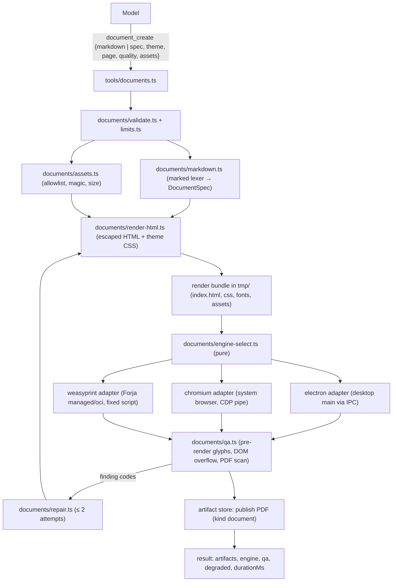

# Technical Specification: Document Engine — designed PDFs from structured content in `@alisio/core` (Chromium default, WeasyPrint optional editorial engine)

| Campo | Valor |
|---|---|
| Versión | 0.1 |
| Origen | Owner request and decisions of 2026-11-08 (O1-O9); research summary of 2026-11-08 (§1.5); code mapping of 2026-11-08 (§3) |
| Proyecto | Alisio |
| Estado | **Phase 1 implemented 2026-11-08 (uncommitted; Opus security review waived by the owner); Phases 2-4 pending.** Phase 0 partial (gate waived by owner 2026-11-08). Owner decisions O1-O9 confirmed (2026-11-08). Q1-Q9 (§11) closed on 2026-11-08: the owner accepted every recommendation as written. Phase 0 results in §8.1 and D-21..D-28; unmeasured items are marked "(no medido: skipped for speed)". Phase 1 notes in §12 |
| Fecha | 2026-11-08 |
| Paquetes afectados | `@alisio/core` (new domain folder `src/documents/`, new asset folder `assets/documents/`, tools `document_create` and `document_themes`, config keys `documents.*`, routing rule); `@alisio/sdk` (additive: `DocumentResultInfo` wire type; Phase 4: optional `attachments` on `CompletionRequest` messages); `@alisio/server` (additive `ServerOptions.documentEngines`; Phase 3 read-only status route); `apps/desktop` (new `print.ts`, additive host↔main print messages in `host-protocol.ts`); `@alisio/web` (Phase 3 only: read-only engine status card); `@alisio/alisio-code` (`alisio documents status`) |
| Paquetes nuevos | None. One new runtime dependency in core: `marked` (MIT, zero dependencies, same version as `@alisio/web`), used only as a lexer. Phase 4 MAY add `pdfjs-dist` (Q3) |
| Relación con otras especificaciones | Independent. Reuses Forja Python backends (`specs/archive/009-forja-v1.md`) for the WeasyPrint engine and the artifact store/viewer. Complements, never replaces, `python_run` |
| Superficies | Headless (`alisio run`), TUI, web (`alisio serve`), Alisio Desktop. HTTP: no new mutating route |
| Política de versión | Additive only. `schemaVersion`/`protocolVersion` unchanged. Ships in the next minor npm release (O8) through `alisio-publish` |

---

## 0. How to use this document (for coding agents)

1. Read `AGENTS.md` and `CONTRIBUTING.md`, then load `alisio-architecture`, `alisio-coding-standards`, `alisio-pkg-core`; load `alisio-pkg-sdk`, `alisio-pkg-server`, `alisio-pkg-web`, `alisio-pkg-cli-tui` or `alisio-docs-screenshots` when a phase touches that surface.
2. Language: this spec is written in English at the owner's request (2026-11-08), which overrides the Spanish-prose precedent of `specs/`. Identifiers, error codes and generated strings are English; UI text is EN and ES.
3. Labels: **(verificado 2026-11-08)** = read in the repo that day; **(no verificado)** = assumption to confirm, usually in Phase 0; **(nuevo)** = introduced by this spec.
4. RFC 2119 keywords (MUST, MUST NOT, SHOULD, SHOULD NOT, MAY) are used in capitals only where behavior matters for safety, interoperation or tests.
5. Strict TDD (Red → Green → Refactor, §6.1). Phases run in order; Phase 0 has a gate (§8). Each phase ends green: `pnpm typecheck`, `lint`, `test`, `build`, `test:cli`, `test:compiled`, `pack:check`, `docs:check`, `docs:build`.
6. Never break: pnpm only; Node ≥ 22.16 and Bun compatible, portable Node APIs only; no provider SDK or runtime-specific import in `@alisio/sdk` or the agent-core contracts; one permission gate (`permissions/decide.ts`); EN/ES docs parity; `docs/implementation-status.md` records limits and verification scope.
7. Do not commit or publish until the owner asks. Never revert or reformat files you did not create.
8. Model assignment: §7.
9. The owner's temporary reference documents are NOT part of the repository and MUST NOT be committed, copied or referenced by path.

---

## 1. Objective, guiding principle and scope

### 1.1 Objective

Give every Alisio surface a first-class, fast and reliable way to produce well-designed PDFs whenever the user asks for a PDF, a printable document, or "convert this Markdown to PDF", without the model writing HTML, CSS or Python.

### 1.2 Guiding principle

**The model writes content; Alisio owns presentation.** The model emits structured content (Markdown or a JSON `DocumentSpec`) and picks a catalog theme id. Deterministic, versioned themes turn it into print HTML+CSS; an engine adapter renders it with the network off; technical QA (and, in Phase 4, visual QA) checks the result; bounded deterministic repair fixes known layout faults.

**Output quality is driven mainly by the theme system** (grid, type scale, palette, bundled fonts and one component per block type) **and by the QA loop**, not by the engine. The theme work is sized accordingly (§5.4): it is the largest work item of Phase 1.

### 1.3 Scope (v1)

- Tools `document_create` and `document_themes` in core (§5.1).
- `DocumentSpec` v1 (§5.2) and a Markdown → `DocumentSpec` converter (§5.3).
- Theme catalog v1: three themes in Phase 1, three more in Phase 3 (§5.4), bundled licensed fonts (§5.5).
- Engines: Chromium in Alisio Desktop (Electron), Chromium through a system browser (CLI, TUI, `alisio serve`), WeasyPrint as optional editorial engine (§5.6).
- Security model (§5.7), technical QA and bounded repair (§5.8), visual QA (Phase 4, §5.9).
- Routing rule and plugin coexistence (§5.10), configuration (§5.11), surfaces (§5.12).
- Quality target: office, laser and copy-shop printing and digital PDF, **RGB** colour.

### 1.4 Out of scope (non-goals)

| Excluded | Reason |
|---|---|
| Model-authored HTML/CSS or raw HTML from Markdown | Untrusted, non-deterministic, unsafe (O5) |
| Certified print-shop output: CMYK, PDF/X, bleed and crop marks | Neither engine produces certified CMYK PDF/X; v1 targets office/laser/copy-shop and digital RGB (O9). Planned as optional Phase 5 (§8) |
| Claims of PDF/A or PDF/UA conformance | No validator in v1; WeasyPrint variants are not guaranteed valid. Tagged PDF MAY be emitted, never claimed conformant (D17) |
| DOCX, PPTX, XLSX output | `python_run` keeps these |
| Programmatic PDFs (reportlab, forms, PDF manipulation, merge/split) | Stay with `python_run` (D14) |
| Downloading a browser (Playwright/Puppeteer bundles) | Size and supply chain; system Chromium-family browsers only (D6) |
| Typst, Vivliostyle | Typst uses a different template language; Vivliostyle is AGPL and slow (§1.5) |
| Fetching remote images, fonts or CSS during render | Network is off during render (D9) |
| Bundled CJK fonts and colour emoji | Size; behavior defined by Q2 |
| PDF preview in the TUI | Existing limit: the TUI does not preview PDFs (§3) |
| A plugin API to call the document engine (`api.documents`) | Later version; plugins keep their own pipelines |
| User-authored custom themes and brand kits | Later version; v1 themes are a closed catalog |
| Replacing Evalua or Thesis Studio flows | Their plugin tools win when active (D15) |

### 1.5 Research summary (2026-11-08, external sources, not re-verified in the repo)

- Dominant pattern for agents: content → HTML+CSS template → renderer → PDF. Anthropic's public `pdf` skill uses reportlab/pypdf; community skills prefer headless Chrome with WeasyPrint as fallback.
- Chromium supports `@page` margin boxes with `counter(page)`/`counter(pages)` since Chrome 131. It does NOT support `string-set` running headers, `target-counter()` (TOC page numbers) or `float: footnote`. Electron `printToPDF` needs `preferCSSPageSize: true` (default `false`) and `printBackground: true`; `generateTaggedPDF` and `generateDocumentOutline` are experimental. Fonts MUST be awaited (`document.fonts.ready`).
- WeasyPrint 70.x implements CSS Paged Media L3 including `string-set`, `target-counter`, leaders, bookmarks, `pdf_tags` and PDF/A/UA variants (not guaranteed valid). It needs Pango; on Windows `pip` alone does not work (MSYS2 + Pango). Not viable in Pyodide. BSD-3. Security: MUST be ≥ 70.0 (CVE-2026-55073: fetcher bypass via `xmp_metadata`/stylesheets; CVE-2025-68616: redirect bypass, fixed in 68). `default_url_fetcher` was removed in 70; a restrictive `url_fetcher` is required.
- Paged.js (MIT, thin maintenance) can polyfill `target-counter` on Chromium; kept only as an optional guarded alternative (Q4).

---

## 2. Decisions

### 2.1 Owner decisions (confirmed 2026-11-08, applied exactly)

| ID | Decision |
|---|---|
| O1 | Add a first-class capability in Alisio **core** to produce sophisticated, well-designed PDFs whenever the user asks for a PDF or something for print, quickly and reliably, including "convert this Markdown to PDF" |
| O2 | **Chromium is the default engine.** WeasyPrint (Python) is an optional **editorial** engine, used when detected (host Python + Pango through Forja's managed backend, or an OCI image); otherwise Alisio falls back to Chromium and tells the user which features degrade |
| O3 | One set of print themes (HTML templates + CSS) MUST render correctly on both engines: stay within the CSS Paged Media subset both support; engine-specific enhancements are guarded |
| O4 | A new npm release follows this work |
| O5 | The model emits Markdown or a JSON `DocumentSpec` plus a catalog theme id, never free HTML/CSS. Deterministic templates; content/presentation separation; validate before render |
| O6 | Pipeline: render → technical QA → visual QA (rasterized pages the model can inspect) → bounded repair, at most 2 attempts |
| O7 | **Chromium TOC page numbers come from a two-pass render** (render, read each heading's page, inject numbers into the `toc` block, render again). This is the default on Chromium; Paged.js remains an optional, guarded alternative. Running chapter headers (`string-set`) and footnotes are WeasyPrint-only, with a degradation message on Chromium |
| O8 | The owner-provided reference files are temporary; they are not committed and not referenced by path |
| O9 | No certified print-shop output in v1 (no CMYK, no PDF/X). Quality target: office/laser/copy-shop printing and digital PDF (RGB). A later optional "print-shop output" phase covers bleed, crop marks, CMYK/PDF-X conversion and a mandatory validator |

### 2.2 Design decisions (binding unless the code contradicts them; deviations are recorded)

| ID | Context | Decision | Consequence |
|---|---|---|---|
| D1 | Core must keep no heavy dependencies and stay Bun-compatible | All logic lives in `packages/core/src/documents/` (domain folder), loaded lazily from `application.ts` like `tools/analysis.ts`. No new package. Only new runtime dependency: `marked` (lexer only) | Core install size grows by fonts/themes (budget Q1) and `marked` |
| D2 | Three engines with different capabilities | Hexagonal port `DocumentEngine` (`documents/ports.ts`) with adapters `electron`, `chromium` and `weasyprint`. Each adapter declares a static `EngineCapabilities` record (§5.6) | Pipeline code never branches on engine id, only on capabilities |
| D3 | Engine choice must be predictable | Pure selector `selectDocumentEngine(context)` (`documents/engine-select.ts`), a chain of rules like `forge/python/backend-selector.ts`: explicit `documents.engine` → `auto`: `electron` → `chromium` → `weasyprint`; WHERE the request needs a WeasyPrint-only feature and `quality: "professional"` and WeasyPrint is ready, `weasyprint` first. Decided once per call, before rendering; no silent switch after a render started except the D7 fallback | Each result reports `engine` and `degraded[]` |
| D4 | One input model | Markdown is converted to `DocumentSpec` (§5.3); everything renders from `DocumentSpec`. One renderer: `DocumentSpec` → escaped HTML + theme CSS (`documents/render-html.ts`) | One code path to test and secure |
| D5 | Themes must work on both engines (O3) | A theme = `manifest.json` (tokens, supported page sizes, block variants) + `theme.css` written in the common subset + optional `enhance.weasyprint.css` loaded only by the WeasyPrint adapter. No `@supports` tricks: the adapter chooses files | Common CSS is verifiable on both engines by the fixture corpus |
| D6 | No browser download | `chromium` adapter: dependency-free CDP driver over `--remote-debugging-pipe` (Node `child_process`), with browser detection by env override → known OS paths → `PATH`, following the approach of the external Evalua plugin's detector (§3). Code is written in this repo, never imported across repos | Works with Chrome, Chromium, Edge, Brave, Vivaldi; Bun pipe support verified in P0-3 |
| D7 | Desktop already ships Chromium | `electron` adapter: core defines the port; `apps/desktop` implements it in the main process (hidden offscreen `BrowserWindow`, dedicated session partition, `printToPDF`) and the host process forwards render jobs over the existing IPC channel (§5.6.2). It is passed to the server as `ServerOptions.documentEngines` | Desktop users need no system browser; the window stays sandboxed |
| D8 | WeasyPrint is Python | `weasyprint` adapter runs one Alisio-owned, fixed Python script (embedded generated source, like the Pyodide runner) through Forja's `managed` or `oci` backend; never `wasm`. Requires WeasyPrint ≥ 70.0, checked before every run | Model code never runs; installation uses the existing `analysis.install` approval |
| D9 | Untrusted content | Network is off during render on every engine; only the virtual origin `https://document.invalid/` is served from the per-render bundle (§5.7) | No SSRF, no `file://` reads, deterministic output |
| D10 | Machine-independent output | Themes use only bundled fonts via `@font-face` on the virtual origin; no `local()`, no system fallback family in theme CSS. Technical QA rejects PDFs whose embedded fonts are not bundled families (`font_not_bundled`) | Same PDF on every machine given the same engine version |
| D11 | Chromium lacks `target-counter` (O7) | Two-pass TOC: pass 1 renders TOC entries with fixed-width placeholders (`tabular-nums`, width of the max page count digits); the heading→page map is read from pass 1 (method chosen in P0-5); pass 2 injects numbers. IF pass 2 moves any heading to another page, THEN one more pass runs; IF it still differs, THEN the TOC is published without numbers and a `toc_page_numbers_unstable` warning | Max 3 renders for TOC; cost measured in P0 |
| D12 | Assets | Images are referenced only as `asset:<id>`; assets come from workspace files (inside the trusted workspace root, realpath-contained) or existing artifacts; copied into the render bundle after magic-byte and size checks (§5.7) | No absolute paths, no `file://`, no `http(s)` |
| D13 | Effects | `document_create`: `effect: "internal"` (writes only to Alisio's artifact store and runs a fixed renderer, like `dashboard_generate`); `document_themes`: `effect: "read"`. Installing WeasyPrint wheels is the existing `analysis.install` capability approval | No new permission path; `permissions/decide.ts` unchanged |
| D14 | Routing (`forge/routing-rule.ts` today routes "XLSX/DOCX/PDF" to `python_run`) | The Code-execution line becomes "XLSX/DOCX, programmatic PDF (forms, merge, reportlab)"; a new separate `# Documents` section (≤ 300 chars, `DOCUMENT_RULE_MAX_CHARS`) is emitted whenever `document_create` is registered, independent of Forja readiness | `ROUTING_RULE_MAX_CHARS = 900` still holds for the Code-execution section |
| D15 | Plugins Evalua (`evalua_*`) and Thesis Studio (`thesis_*`) | No name collision: external tools are prefixed `p_<hash>_…`; core names are `document_*`. The `# Documents` rule tells the model to prefer an active plugin tool specialized for the task (exams, theses). Core never names a plugin | Plugin flows win when active |
| D16 | No engine available | `document_create` returns `DOCUMENT_ENGINE_UNAVAILABLE` with the per-OS action (install a Chromium-family browser, set `documents.chromiumPath`, or set up WeasyPrint) AND publishes the print-ready HTML bundle as an `html` artifact the user can print from a browser (Q7) | The user never gets nothing |
| D17 | Accessibility/standards | Electron/Chromium: request outline and tagged PDF when supported; WeasyPrint: `pdf_tags=True`, bookmarks. Results report `tagged: boolean`; docs MUST NOT claim PDF/A or PDF/UA | Honest limits |
| D18 | Repair | Repair is deterministic and keyed by QA finding codes (§5.8), max 2 attempts (O6); the model is never re-invoked inside the tool. Visual QA findings (Phase 4) are returned to the agent as text, which may call the tool again | Bounded cost and time |
| D19 | Concurrency and reuse | At most 2 concurrent renders per process (queue, `DOCUMENT_BUSY` after 8 queued); the `chromium` adapter keeps one browser alive for 60 s idle, then closes it (values revisited in P0) | Warm renders avoid browser start-up |
| D20 | Temp files | Each render uses `<state home>/documents/tmp/<renderId>/` (0700), removed in `finally`; a startup janitor removes leftovers older than 1 h (pattern of `analysis/janitor.ts`) | No leaks across crashes |

### 2.3 Decisions closed by Phase 0 (verificado 2026-11-08; scratch scripts outside the repo)

| ID | Decision | Evidence |
|---|---|---|
| D-21 | **Fonts: bundle static instances (WOFF2 per weight and subset), not variable fonts.** Proposed static set: Inter 400/600/700/400i, Source Serif 4 400/600/700/400i/600i, JetBrains Mono 400/700; subsets latin, latin-ext, greek, cyrillic via `unicode-range`: 44 faces, **678 KB** total (Inter 299, Source Serif 4 303, JetBrains Mono 75). Variable set (wght) is 844 KB. Q1 budget (≤ 3 MB) holds. Coverage gap: the Google/fontsource subsets lack `≤ ≥ ≠ ‰ → ← ✓` and U+2010/U+2011 (Spanish accents, ñ, €, quotes, dashes are covered); themes MUST set `hyphenate-character: "-"` and use SVG icons; a custom symbols subset (pyftsubset of the OFL sources) is a Phase 1 option (no medido: whether the full upstream fonts contain these glyphs) | Chromium 154 embeds **variable** fonts as unnamed Type 3 fonts (24 per 10-page document, PDF 551 KB vs 340 KB static): `font_not_bundled` (D10) cannot read their names. Static fonts embed as named subset CID TrueType (`AAAAAA+Inter-Regular`). WeasyPrint embeds both as named CID TrueType. |
| D-22 | **CDP transport: `--remote-debugging-pipe` on Node (22 and 24); on Bun use the loopback fallback** (`--remote-debugging-port=0`, read `DevToolsActivePort`, global `WebSocket`, browser endpoint path is a random secret, bound to 127.0.0.1). One long-lived browser (D19) works on Bun | Node 22.19.0 and 24.16.0: 20 consecutive launches OK. Bun 1.2.10: pipe transport works for the first 8-9 browser launches in one process, then the next launch stalls (3 reproductions, also with stream destroy); 40 renders on one kept-alive browser OK; loopback fallback: 15 launches OK on Bun and Node (~150 ms each). Bun compiled binary + pipe: (no medido: skipped for speed) |
| D-23 | **TOC page map (D11): method (a1), named destinations of the TOC link annotations read from pass 1 by the minimal scanner (D-25).** Works untagged, no new dependency. Pass 2 injects numbers; the pass-2 map is compared with the injected one. `tabular-nums` + fixed `min-width` placeholders kept the TOC length identical | 40-page fixture: (a1) 54/54 headings correct; (a2) outline 53/54 (a `break-before: page` heading resolves one page early; titles are doubled; needs tagged PDF); (b) pdf.js text 54/54 but adds pdfjs + 279 ms; (c) DOM estimate 5/54. Two-pass on 10/40/50 pages: 2 renders, stable, printed numbers equal truth 12/12, 54/54, 69/69; 40 pages total 880 ms, 50 pages 957 ms. Q4 (Paged.js) stays closed |
| D-24 | **Tagged PDF and outline (D17):** pass `generateTaggedPDF` explicitly (CDP default is `true`, Electron default is `false`). `generateDocumentOutline` only works together with `generateTaggedPDF: true`, on both CDP (Chrome 154) and Electron 45; outline titles come out duplicated ("ContentsContents"), so the outline is not used for TOC and MAY be requested only for bookmarks. `qa.tagged` reports the scanner's `/StructTreeRoot` | 10 pages: tagged 340 KB vs 224 KB untagged (warm p50 138 vs 136 ms; 40 pages 314 vs 257 ms). Electron 45.2.3 = Chromium **156.0.8078.80**, Skia/PDF m156; system Chrome 154.0.8037.97 |
| D-25 | **`pdf-scan.ts` is feasible with no parser dependency** (`node:zlib` only, ~150 lines): classic xref + XRef streams + object streams + Flate with PNG predictor; page tree, `/BaseFont`, named destinations, Link annotations, outline, `/StructTreeRoot`, per-page text-operator counts. Font names need per-engine normalization (WeasyPrint: `Source-Serif-4,`, `Inter-Semi-Bold`, `JetBrains-Mono`). `blank_trailing_page`: margin-box-only pages have a constant text-operator count (Chromium 29, WeasyPrint 6 for the prototype theme), so the threshold MUST be calibrated per engine and theme in the env-flagged test; a trailing `break-after` alone never creates a blank page | Skia: PDF 1.4, classic xref, no object streams, no XRef streams. WeasyPrint 70.0 (pydyf 0.13): PDF 1.7 with XRef stream + ObjStm (regex scanning is not enough). Scanner agrees with `pdfinfo`/`pdffonts` on pages and font names for 30/30 sample PDFs; 12-14 ms per 40-page PDF |
| D-26 | **pdf.js for Phase 4: vendor a minimal build under `assets/documents/vendor/pdfjs` (Apache-2.0 + license file), not the `pdfjs-dist` dependency.** The full package fails Q3 (≤ 5 MB packed); the vendored subset passes. **Owner approved on 2026-11-08** (replaces the Q3 "dependency" wording) | `pdfjs-dist` 6.5.438 tarball 9.1 MB; `pdf.min.mjs` + `pdf.worker.min.mjs` 1.74 MB raw, 0.52 MB gzip (0.67 MB with the three wasm decoders, brotli of the two files 0.42 MB). Raster, 12 thumbnails (long side 1000 px): system Chrome 517 ms wall, Electron 434 ms; per page render 24/22 ms p50 + PNG encode 9/8 ms; all 40 pages 1.17 s / 1.07 s. Module worker is served through the virtual origin without extra config |
| D-27 | **Measurements run in an isolated world under a CSP without `script-src`**: `Page.createIsolatedWorld` + `Runtime.evaluate` (CDP) and `executeJavaScriptInIsolatedWorld` (Electron). Viewport MUST be set to the page content width before measuring: Electron under `--ozone-platform=headless` reports `innerWidth = 1` until `win.setContentSize(w, h)` is called (the constructor size is ignored); CDP needs the viewport emulation (not tested: `Emulation.setDeviceMetricsOverride`; default `innerWidth` was 780, content width 658) | `default-src 'none'` blocks the page's inline script (violation logged, `window.__pwned` undefined) while CDP/Electron evaluation works in main and isolated worlds; isolated world sees no page globals and the page sees none of the world's; `eval`/`new Function` work in the world (CDP is exempt); `fetch` to an outside URL is blocked; same result with the CSP as meta or as header; `addScriptToEvaluateOnNewDocument` with `worldName` works. Measurement script 1.5-2.6 ms; it detected the 12-column table (1756 px) and the 260-char unbreakable line, and 134-148 dpi images |
| D-28 | **Standalone Bun binary: embed fonts (Q5 holds).** `bun build --compile`: base 99.87 MB; +0.71 MB with the 44 faces as `with {type:"file"}`, +0.93 MB as a generated base64 TS module, +2.45 MB with fonts and the vendored pdfjs | Q5 threshold 4 MB |

---

## 3. Current state of the code (verificado 2026-11-08)

Branch `feat/electron-desktop`, HEAD `10bc847`, working tree with uncommitted owner changes (none in the areas below except `packages/core/src/index.ts`, `packages/sdk/src/index.ts`, `packages/server/src/index.ts`, which this spec only extends additively).

| Area | Reality |
|---|---|
| PDF engine | None in `packages/` or `apps/desktop` (`grep` for `playwright`, `puppeteer`, `weasyprint`, `pdfjs`, `pdf-lib` in every `package.json`: 0 matches) |
| Routing rule | `packages/core/src/forge/routing-rule.ts`: `ROUTING_RULE_MAX_CHARS = 900`; `buildRoutingRule` returns `""` unless `js_run` or `python_run` is registered; the Python line reads "Data analysis, statistics, ML, charts, XLSX/DOCX/PDF, special dashboards: `python_run`". Built in `application.ts:648-657`. Tests: `tests/forge-kernel-pure.test.ts`, `tests/forge-javascript-wiring.test.ts` |
| Python backends | `forge/python/backend-selector.ts`: `auto` order `oci → wasm → managed`; `managed` only with `analysis.isolation=preferred`. `managed-backend.ts`: `isolation: "none"`, env `ALISIO_INPUT_DIR`, `ALISIO_OUTPUT_DIR` (staging), `ALISIO_WORK_DIR`. The OCI image is user-configured (`analysis.oci.image`, `analysis/oci.ts`), no image ships with Alisio. Extras are hash-locked sets `analysis` and `science` (`analysis/requirements.ts`, `EXTRAS_LOCK`). Pyodide (`wasm`) has no Pango |
| Forja limits | `forge/limits.ts`: default `timeoutMs` 30 000, hard max 300 000 |
| `python_run` | `tools/analysis.ts:376`, `effect: "process"`; files in `$ALISIO_OUTPUT_DIR` are published as artifacts via `context.artifacts.publishOutputs` |
| Effects | `dashboard_generate` (`tools/dashboard.ts:178`) is `internal`; `permissions/decide.ts`: `read` and `internal` run without asking; no declared effect = `external`. `ToolContext.artifacts` is built-in-only |
| Artifacts | `artifacts/kinds.ts:41`: `pdf` → kind `document`, `application/pdf`, magic `pdf`, `previewMax` 50 MB. Server `routes/artifact-view.ts` serves the PDF entry with a signed view token; web `components/artifacts/PdfFrame.tsx` previews; TUI `tui/artifact-preview.ts` does not preview PDFs |
| Tool results with images | `ToolResult.content` allows `{type:"image"}` (`sdk/src/index.ts:242-248`), but `plugin-openai-compatible/src/provider.ts:88-89` sends tool results as `JSON.stringify(m.result)`: an image part reaches the model as base64 text, not a vision part. **Known gap**: visual QA cannot rely on image tool results (§5.9) |
| Model completion | `CompletionRequest` (`sdk/src/index.ts:1069`) carries text messages only (no attachments). User-message `Attachment` images are sent as vision parts (`provider.ts:85`, `:194`). `ModelInfo.inputModalities` exists (`:318`) |
| Markdown | Core has no Markdown parser (`turndown` is HTML→MD). `@alisio/web` uses `marked` 18.0.14 and `dompurify` 3.4.16. Core has `@mixmark-io/domino` 2.2.0 (DOM for SVG sanitizing) |
| Skills | No bundled skills ship with core (`resources/skills.ts`: project, configured, user and plugin roots only) |
| Desktop | `apps/desktop`: Electron 45.2.3 (`package.json:33`). `main.ts:71` window `contextIsolation: true, sandbox: true, nodeIntegration: false`. `host-process.ts:46` spawns the host with `stdio: [..., "ipc"]`. `host-protocol.ts`: `HostMessage` = `ready` \| `error`, validated by `parseHostMessage`. `host.ts` calls `startServer({host:"127.0.0.1", port:0, ...})`. Chromium version of Electron 45 is above 131 **(no verificado: exact version)** |
| Server options | `packages/server/src/index.ts:107` `ServerOptions`, `:213` `startServer` |
| Package assets | `@alisio/core` `files`: `dist`, `README.md`, `LICENSE` only. The standalone binary (`scripts/binary-build.ts`) is `bun build --compile` of `packages/cli/dist/main.js` and carries no loose files (embedded sources are generated TS modules) |
| Evalua reference (external repo `alisio-plugins`) | `plugin-evalua/src/chrome/detect.ts`: env overrides (`ALISIO_EVALUA_CHROME`, `PUPPETEER_EXECUTABLE_PATH`, `CHROME_PATH`), known paths per OS (Chrome, Chromium, Brave, Edge, Vivaldi, Opera, snap/flatpak), `PATH` lookup, `%VAR%` expansion, nothing downloaded. `chrome/cdp.ts`: dependency-free CDP over `--remote-debugging-pipe`, flags `--headless=new`, temp `--user-data-dir`, `--disable-extensions`, `--disable-background-networking`, `--host-resolver-rules=MAP * ~NOTFOUND` |
| Builtins | `packages/cli/src/builtin.ts`: `openai-compatible`, `memory`, `subagents`. Core tools are registered in `application.ts` (e.g. `:805` analysis, `:837` artifacts, `:841` dashboard) |

---

## 4. Architecture

### 4.1 Overview



### 4.2 Patterns

| Pattern | Where | Why |
|---|---|---|
| Ports and adapters | `documents/ports.ts` `DocumentEngine` | Three engines, one pipeline (D2) |
| Chain of pure rules | `documents/engine-select.ts` | Predictable, testable engine choice (D3) |
| Pipeline with pure stages | validate → convert → render → engine → QA → repair | Each stage tested at its boundary |
| Data-driven themes | `assets/documents/themes/<id>/manifest.json` | Themes are data + CSS, not code (D5) |
| Strategy table | `documents/repair.ts` finding code → repair | Bounded deterministic repair (D18) |

### 4.3 File layout (nuevo)

```
packages/core/src/documents/
  ports.ts            DocumentEngine, EngineCapabilities, RenderJob, RenderOutput
  spec.ts             DocumentSpec v1 types + validateDocumentSpec (zod)
  limits.ts           DOCUMENT_LIMITS (§5.7.4)
  markdown.ts         markdownToSpec (marked lexer, raw HTML → text)
  assets.ts           resolveAssets (workspace/artifact → bundle)
  svg-sanitize.ts     allowlist SVG sanitizer (domino) — Phase 2
  chart-svg.ts        data → SVG (bar, line, pie) — Phase 2
  themes.ts           theme catalog loader, token → CSS variables
  render-html.ts      DocumentSpec + theme → bundle files
  toc-two-pass.ts     D11 — Phase 2
  engine-select.ts    pure selector
  pdf-scan.ts         page count, embedded font names, outline (pure, bytes in)
  qa.ts / repair.ts   technical QA, repair strategies
  janitor.ts          D20
  engines/chromium/{detect.ts, cdp-pipe.ts, adapter.ts}
  engines/weasyprint/{adapter.ts, renderer-source.ts (generated)}  — Phase 3
packages/core/src/tools/documents.ts       document_create, document_themes
packages/core/src/documents/rule.ts         buildDocumentRule (D14)
packages/core/assets/documents/
  base/print-base.css   fonts/<family>/*.woff2 + OFL.txt   coverage.json (generated)
  themes/<id>/{manifest.json, theme.css, enhance.weasyprint.css?}
apps/desktop/src/print.ts                   electron adapter (main process)
scripts/document-fonts.ts                   generates coverage.json (and the embedded module if Q5 = embed)
scripts/weasyprint-renderer-source.ts       generates renderer-source.ts — Phase 3
```

`packages/core/package.json` `files` adds `assets`. Core resolves assets with `new URL("../assets/…", import.meta.url)` (works for `src` and `dist`); the standalone binary follows Q5.

---

## 5. Contracts and design

### 5.1 Tools (nuevo)

#### `document_themes` (`effect: "read"`)

Input: `{}`. Output (text, ≤ 4 000 chars): theme ids with one-line purpose and supported page sizes, the block list with required fields, the active engine and its degraded features, and the rules "content only, no HTML". It is the model's guide, so no bundled skill is needed.

#### `document_create` (`effect: "internal"`)

Input schema (JSON Schema, `additionalProperties: false`; exactly one of `markdown`, `markdownPath`, `spec`):

| Field | Type | Notes |
|---|---|---|
| `markdown` | string ≤ 400 KB | Inline Markdown |
| `markdownPath` | string | Workspace-relative `.md` file; relative image links inside it become assets (D12) |
| `spec` | `DocumentSpec` | §5.2 |
| `theme` | enum of catalog ids | Default `executive-clean` |
| `page` | `{ size?: "A4"\|"Letter"\|"Legal"\|"A5", orientation?: "portrait"\|"landscape" }` | Default from `documents.defaultPageSize` (default `A4`) |
| `quality` | `"fast"\|"professional"` | Default `professional`. `fast`: technical QA only, 0 repairs, no visual QA |
| `title` | string ≤ 200 | Document metadata; defaults to cover/first heading |
| `outputName` | string ≤ 80, `^[\w .-]+$` | File name without extension; default slug of the title |
| `assets` | array ≤ 50 of `{ id: ^[a-z0-9_-]{1,40}$, path?: string, artifactId?: string, alt?: string }` | Exactly one of `path`/`artifactId` |
| `lang` | BCP 47, ≤ 35 | `<html lang>`, hyphenation |
| `engine` | `"auto"\|"chromium"\|"weasyprint"` | Overrides config for this call when that engine is ready |

Result: a text summary for the model plus an `artifact` UI block, and this JSON (SDK wire type `DocumentResultInfo`, additive):

```ts
interface DocumentResultInfo {
  artifacts: Array<{ id: string; title: string; fileName: string; mimeType: string; bytes: number }>;
  engine: { id: "electron" | "chromium" | "weasyprint"; version?: string };
  theme: string;
  qa: {
    passed: boolean;
    pageCount: number;
    tagged: boolean;
    warnings: Array<{ code: string; message: string; blockIndex?: number }>;
    repairs: Array<{ code: string; action: string }>;   // ≤ 2 attempts
    visual?: { status: "passed" | "findings" | "skipped"; reason?: string; findings?: string[] };
  };
  degraded: Array<{ feature: string; reason: string }>;
  durationMs: number;
}
```

Error codes (`isError: true`, text starts with the code): `DOCUMENT_INPUT_INVALID`, `DOCUMENT_ASSET_DENIED`, `DOCUMENT_LIMIT_EXCEEDED`, `DOCUMENT_ENGINE_UNAVAILABLE` (D16), `DOCUMENT_RENDER_FAILED`, `DOCUMENT_RENDER_TIMEOUT`, `DOCUMENT_BUSY`. Validation errors list JSON pointers (max 20) so the model can fix its spec.

### 5.2 `DocumentSpec` v1 (nuevo)

```ts
interface DocumentSpec {
  version: 1;
  meta?: { title?: string; subtitle?: string; author?: string; date?: string; organization?: string };
  blocks: Block[];                       // discriminated union on `type`
}
type Inline = string;                    // Markdown-inline subset: **bold**, *italic*, `code`, [text](url), no HTML
```

| Block `type` | Fields | Phase |
|---|---|---|
| `cover` | `title`, `subtitle?`, `meta?` lines ≤ 6, `imageAsset?` | 1 |
| `heading` | `level: 1..3`, `text`, `id?` | 1 |
| `paragraph` | `text: Inline` | 1 |
| `bullets` | `ordered?: boolean`, `items: (Inline \| {text, items})[]` (≤ 2 levels) | 1 |
| `table` | `columns: {label, align?: "left"\|"right"\|"center", width?: "auto"\|"narrow"\|"wide"}[]` ≤ 12, `rows: Inline[][]` ≤ 500, `caption?`, `header?: boolean` (default true, repeated on each page) | 1 |
| `image` | `asset`, `caption?`, `size?: "small"\|"medium"\|"full"` | 1 |
| `quote` | `text`, `attribution?` | 1 |
| `callout` | `tone: "info"\|"success"\|"warning"\|"danger"`, `title?`, `text` | 1 |
| `code` | `text` ≤ 20 000 chars, `language?` (label only, no highlighting in v1) | 1 |
| `stat_grid` | `items: {label, value, delta?, tone?}[]` 2..8 | 1 |
| `page_break` | — | 1 |
| `toc` | `depth?: 1..3` (default 2). Links in Phase 1; page numbers Phase 2 (Chromium, D11) / Phase 3 (WeasyPrint `target-counter`) | 1 / 2 |
| `chart` | `kind: "bar"\|"line"\|"pie"`, `title?`, `series: {name, values: number[]}[]` ≤ 6, `labels: string[]` ≤ 50, `unit?`; rendered to SVG by `chart-svg.ts`, never model SVG | 2 |
| `svg` | `asset` (an `.svg` asset, sanitized per §5.7 item 3) | 2 |
| `appendix` | `title`, `blocks: Block[]` (no nested `appendix`/`cover`/`toc`) | 2 |
| `footnote` (inline marker `[^n]` + definitions) | Chromium: endnotes section with a degradation entry; WeasyPrint: `float: footnote` | 3 |

Validation (`validateDocumentSpec`, zod) MUST run before any render and MUST reject: unknown block types, unknown fields, `asset` ids not declared in `assets`, more than one `cover` or `toc`, `cover` not first, link URLs with schemes other than `http`, `https`, `mailto` (other schemes are rendered as plain text, not rejected).

### 5.3 Markdown → `DocumentSpec`

- `markdownToSpec` uses the `marked` **lexer only** (no HTML renderer). Mapping: `heading` (h1-h3; h4-h6 → level 3), `paragraph`, `list`, `table` (GFM), `blockquote` → `quote`, `code` → `code`, `hr` → `page_break` only when the line is `---pagebreak---` (otherwise ignored), `image` → `image` block with an auto-declared asset.
- Raw `html` tokens (block and inline) MUST become escaped plain text; they never reach the HTML output.
- A leading YAML front matter MAY set `title`, `subtitle`, `author`, `date`, `theme`, `toc: true`; when `title` is set, a `cover` block is generated.
- Relative image links of `markdownPath` resolve against the Markdown file's directory, through the same asset checks (D12); remote image URLs become a `remote_image_skipped` warning plus the alt text.

### 5.4 Theme system and catalog v1

A theme defines, as tokens in `manifest.json` turned into CSS custom properties:

- **Grid**: page margins per page size, column count (1-2), baseline unit (e.g. 4 pt), gutter.
- **Type scale**: body 9.5-11 pt with line height 1.35-1.5; H1 22-28 pt; H2 14-18 pt; H3 11-13 pt; captions/footers 8-9 pt; one display, one body and one mono family from the bundled set.
- **Palette**: ink, muted, accent, rule, paper, four callout tones; text contrast ≥ 4.5:1 against paper (checked by a test on tokens).
- **Components**: one style for every Phase 1 block, cover layout, page header/footer with `@page` margin boxes (`counter(page)`/`counter(pages)`), table rules (header repeat, zebra optional, `break-inside: avoid` on rows), `break-after: avoid` on headings, `orphans/widows: 3`.
- **Pages**: every theme MUST support A4 and Letter in portrait and landscape; Legal and A5 MAY be declared unsupported in the manifest (then `DOCUMENT_INPUT_INVALID` names the supported sizes).

| Theme id | Purpose | Phase |
|---|---|---|
| `executive-clean` | Reports, proposals, memos (default) | 1 |
| `data-report` | Tables, stat grids, charts-heavy reports | 1 |
| `technical-spec` | Specs, manuals, code blocks, numbered headings | 1 |
| `editorial-modern` | Long-form, magazine-like; uses WeasyPrint enhancements | 3 |
| `minimal-letter` | Letters, certificates, one-page documents | 3 |
| `brand-guide` | Visual-heavy guides with cover imagery | 3 |

**Sizing**: the three Phase 1 themes plus `print-base.css` and the fixture corpus (§6.2) are the largest Phase 1 work item. Each theme needs: token set, styles for all Phase 1 blocks, cover, header/footer, 4 page variants, and a pass over the corpus on the `chromium` adapter with zero technical-QA errors and an owner visual sign-off (contact sheet of rendered pages produced by the env-flagged test). Phase 3 repeats this for three themes on both engines.

### 5.5 Fonts (D10)

- Bundled WOFF2 fonts under SIL OFL 1.1 with their license files; subsets Latin, Latin Extended, Greek and Cyrillic. Proposed set (Q1): Inter (sans), Source Serif 4 (serif), JetBrains Mono (mono). Font versions are recorded in `docs/implementation-status.md` for reproducibility.
- `scripts/document-fonts.ts` generates `coverage.json` (Unicode ranges per family). Before rendering, `qa.ts` scans every text codepoint; WHEN a codepoint is not covered, the tool MUST add `glyphs_missing` (with up to 10 sample characters) and follow Q2 (CJK, emoji).
- Theme CSS MUST NOT use `local()` or generic families as fallback, except the final `sans-serif`/`serif`/`monospace` keyword required by CSS, which is never reached for covered text.

### 5.6 Engines

#### 5.6.1 Port

```ts
interface DocumentEngine {
  id: "electron" | "chromium" | "weasyprint";
  capabilities: EngineCapabilities;
  readiness(signal: AbortSignal): Promise<{ ready: true; version: string } | { ready: false; reason: string; fix?: string }>;
  render(job: RenderJob, signal: AbortSignal): Promise<RenderOutput>;   // RenderJob: bundleDir, entry, page, timeoutMs, wantOutline, wantTagged, measure: boolean
  dispose(): Promise<void>;
}
interface RenderOutput { pdf: Uint8Array; measurements?: DomMeasurements; engineVersion: string; log: string[] }
```

`DomMeasurements` (Chromium only, collected before printing in an isolated world): overflowing elements (block index, overflow px), images scaled below 150 effective dpi, heading block indexes. WeasyPrint returns none.

#### 5.6.2 Adapters

- **`chromium`** (D6): detect browser; launch `--headless=new`, temp profile under the render dir, Evalua-like flags, `--remote-debugging-pipe`; CDP `Fetch.enable` with pattern `*`: requests to `https://document.invalid/<path>` are fulfilled from the bundle (path normalized and contained), every other request is failed. `Emulation.setEmulatedMedia({media:"print"})`, wait for `document.fonts.ready` and all images, collect measurements, `Page.printToPDF({preferCSSPageSize:true, printBackground:true, generateTaggedPDF?, generateDocumentOutline?})` with the experimental flags only when P0-4 shows they work.
- **`electron`** (D7): new additive messages in `host-protocol.ts`: host → main `{type:"print", id, bundleDir, entry, options}`; main → host `{type:"print-result", id, ok, pdfPath?, measurements?, error?}`, both validated like `parseHostMessage` (`bundleDir` MUST be inside the host's documents tmp root). `apps/desktop/src/print.ts`: one hidden `BrowserWindow` (`show:false`, `offscreen:true`, `sandbox:true`, `contextIsolation:true`, no preload), session `persist:false` partition `alisio-print` whose `protocol.handle("https")` serves only `document.invalid` from `bundleDir` and whose `webRequest.onBeforeRequest` cancels everything else; `webContents.printToPDF({preferCSSPageSize:true, printBackground:true, generateTaggedPDF, generateDocumentOutline})`; writes `out.pdf` in `bundleDir`. Timeout 60 s per job. `host.ts` passes the IPC-backed `DocumentEngine` as `ServerOptions.documentEngines`.
- **`weasyprint`** (D8, Phase 3): readiness = selected Python backend (`managed` or `oci`) imports `weasyprint` with `__version__ ≥ 70.0` and Pango loads (one probe, cached per process). The fixed script calls `HTML(filename=…, base_url="https://document.invalid/", url_fetcher=<allowlist fetcher mapping only that origin to the bundle dir, rejecting redirects and every other URL>)`, `write_pdf(pdf_tags=True, …)`; it never sets `xmp_metadata` from user content. `oci` needs a user image with WeasyPrint + Pango; docs ship a reference `Containerfile`. `managed` installs a new hash-locked extras set `documents` (Q8) through `analysis.install`; Pango stays a documented OS prerequisite (Windows: MSYS2).

#### 5.6.3 Capability matrix and degradation messages

| Feature | `electron` / `chromium` | `weasyprint` | Message on Chromium (EN; ES in i18n) |
|---|---|---|---|
| `@page` size, margins, margin boxes, `counter(page/pages)` | Yes (≥ Chrome 131) | Yes | — |
| Running chapter headers (`string-set`) | No → static document title in header | Yes | "Running chapter headers need the editorial engine; the document title is shown instead." |
| TOC page numbers | Two-pass (D11) | `target-counter` | Only if unstable: "Table of contents page numbers could not be stabilized; entries are links." |
| Footnotes (`float: footnote`) | No → endnotes | Yes | "Footnotes are collected as endnotes; footnotes at page bottom need the editorial engine." |
| Leaders in TOC | Flex dotted rule | `leader()` | — (visual equivalent) |
| PDF bookmarks/outline | If P0-4 confirms `generateDocumentOutline` | Yes | "PDF bookmarks are not available with this engine." |
| Tagged PDF | If P0-4 confirms `generateTaggedPDF` | `pdf_tags` | Reported as `qa.tagged`, no claim |
| DOM measurements for QA (overflow, image dpi) | Yes | No | WeasyPrint run: `overflow_not_checked` info |
| Hyphenation | `hyphens:auto` with `lang` (no verificado per OS) | Pyphen | — |

`degraded[]` lists every feature requested by the spec or theme that the chosen engine lacks, with these messages. WHEN `auto` would pick Chromium although the spec needs a WeasyPrint-only feature, the result text MUST say how to enable the editorial engine.

### 5.7 Security model

1. **Input is untrusted** (model output, workspace Markdown, assets). All text is HTML-escaped by `render-html.ts`; no field is ever inserted as markup; the generated `index.html` contains no `<script>`, no inline event handlers, no `<iframe>`/`<object>`/`<embed>`/`<form>`, and a CSP `default-src 'none'; style-src https://document.invalid; font-src https://document.invalid; img-src https://document.invalid`.
2. **Assets** (D12): `path` is resolved against the trusted workspace root with `realpath`; IF the result escapes the root, is a symlink to outside, is absolute in the input, contains `..` after normalization, or the project is untrusted, THEN `DOCUMENT_ASSET_DENIED`. Allowed types by magic bytes: PNG, JPEG, WebP, GIF (first frame) and SVG (Phase 2, sanitized). Each asset ≤ 10 MB, total ≤ 50 MB. `artifactId` reads through the artifact store of the same session.
3. **SVG** (Phase 2): parsed with domino and rebuilt from an allowlist of elements (`svg, g, path, rect, circle, ellipse, line, polyline, polygon, text, tspan, defs, linearGradient, radialGradient, stop, clipPath, title, desc`) and presentation attributes; `href`/`xlink:href` only to `#id`; no `style` elements, no `foreignObject`, no event attributes, no external references; > 2 MB or > 20 000 nodes → `DOCUMENT_ASSET_DENIED`.
4. **Limits** (`documents/limits.ts`): spec JSON ≤ 1 MB, Markdown ≤ 400 KB, ≤ 2 000 blocks, ≤ 500 table rows per table and ≤ 5 000 rows total, ≤ 200 pages (checked after pass 1; over → `DOCUMENT_LIMIT_EXCEEDED`), render timeout 60 s per pass, whole call ≤ 180 s (and never above the Forja hard max of 300 s for WeasyPrint), PDF ≤ 50 MB (artifact `previewMax`).
5. **Network off** on all engines (D9). The `chromium` adapter also passes `--host-resolver-rules=MAP * ~NOTFOUND`. Links in the PDF are annotations only; nothing is fetched.
6. **Processes**: the browser profile and bundle live in the 0700 render dir (D20); the child browser gets a minimal env (no API keys: reuse the env whitelist approach of `managed-backend.ts`); the browser is killed on abort/timeout.
7. No absolute host path appears in tool results or warnings (paths shown workspace-relative).

### 5.8 Technical QA and bounded repair

| Check | When | Finding code | Severity | Repair (D18) |
|---|---|---|---|---|
| Codepoints covered by bundled fonts | Pre-render | `glyphs_missing` | error (Q2) | none |
| Element wider than its content box | Chromium measurements | `overflow` | error | table → compact density, then landscape (only if `page.orientation` unset); code → wrap; image → `size: medium` |
| Image below 150 effective dpi | Chromium measurements | `low_resolution_image` | warning | none |
| Heading last on page / orphan | Chromium measurements | `orphan_heading` | warning | add `break-before` to that heading |
| Page count (`pdf-scan.ts`) | Post-render | `page_limit` | error | none |
| Embedded fonts are bundled families only (subset prefix stripped) | Post-render | `font_not_bundled` | error | none |
| Empty last page | Post-render (page text length via scan, P0-6) | `blank_trailing_page` | warning | remove trailing `page_break` |

`qa.passed` is true when no error remains. With `quality: "professional"`, up to 2 repair attempts run, each a full re-render; `fast` runs none. Repairs never change content, only presentation hints. The PDF is published even with warnings; with an unrepaired error it is published and `qa.passed: false` explains why.

### 5.9 Visual QA (Phase 4)

- **Rasterization without Poppler** (works on Windows): render each PDF page to PNG inside the same headless Chromium (or the Electron offscreen window) with a bundled pdf.js build served from the virtual origin and captured by `Page.captureScreenshot` / `capturePage` (Q3). For WeasyPrint-only machines: `pypdfium2` from the `documents` extras set. Thumbnails: long side 1 000 px, at most 12 pages (cover, TOC, then evenly sampled).
- Because image tool results reach the model as text today (§3), visual review is an **internal model call**: additive `attachments?: Attachment[]` on `CompletionRequest` messages (SDK, optional; providers that ignore it keep working) and the core completion path forwards them as vision parts. The reviewer uses the session model WHEN its `inputModalities` includes `image`, otherwise `documents.qa.visualModel` (Q6), otherwise `visual.status: "skipped"` with the reason.
- The reviewer gets a fixed rubric (alignment, overlaps, clipped text, empty areas, broken tables, legibility) and returns JSON `{findings: [{page, code, note}]}` (≤ 10). Findings mapped to known codes trigger the §5.8 repairs within the same 2-attempt budget; others are returned to the agent as text.

### 5.10 Routing and plugin coexistence (D14, D15)

- `buildRoutingRule`: the Python line changes to "Data analysis, statistics, ML, charts, XLSX/DOCX, programmatic PDF (forms, merge, reportlab), special dashboards: `python_run`." The result MUST stay ≤ 900 chars (existing test updated).
- New `buildDocumentRule({ documents: boolean })` in `documents/rule.ts`, ≤ 300 chars, appended to the system prompt when `document_create` is registered:

  ```
  # Documents
  - Designed PDFs, printable documents, Markdown to PDF: `document_create` (call `document_themes` first). Write content only (Markdown or DocumentSpec), never HTML/CSS.
  - When an active plugin tool is made for the task (exams, theses), use it instead.
  ```
- Core never names Evalua or Thesis Studio. Their tools keep their prefixed names; their own context registrations steer the model for their domains.

### 5.11 Configuration (zod in `config.ts`; settings labels EN/ES)

| Key | Default | Meaning |
|---|---|---|
| `documents.enabled` | `true` | Register the tools |
| `documents.engine` | `"auto"` | `auto` \| `chromium` \| `weasyprint` (`electron` is implied by `auto`/`chromium` in Desktop) |
| `documents.chromiumPath` | unset | Explicit browser path (also env `ALISIO_CHROME_PATH`, then `CHROME_PATH`, `PUPPETEER_EXECUTABLE_PATH`) |
| `documents.defaultPageSize` | `"A4"` | `A4` \| `Letter` \| `Legal` \| `A5` |
| `documents.qa.visual` | `"auto"` | `off` \| `auto` (Phase 4) |
| `documents.qa.visualModel` | unset | Model reference for visual QA (Phase 4, Q6) |

### 5.12 Surfaces

- **Headless/TUI/web/Desktop**: same tool; the PDF is a `document` artifact (web previews with `PdfFrame.tsx`; TUI lists it without preview, existing limit).
- **CLI**: `alisio documents status` prints each engine's readiness, version, reason and fix (Phase 1: chromium; Phase 3: weasyprint).
- **Web** (Phase 3, Q7): read-only "Documents" card in Settings showing engine readiness; needs EN/ES screenshots (`alisio-docs-screenshots`). Server route `GET /api/documents/status` (read-only, existing guard).

---

## 6. Tests

### 6.1 Cycle and rules

Red → Green → Refactor per `alisio-coding-standards`. Tests live in root `tests/`, import from `packages/*/src/index.ts`, use temp dirs and stubbed `ALISIO_CONFIG_HOME`/`ALISIO_STATE_HOME`. Engines are exercised through the port with a **fake engine** in fast tests; real engines run behind env flags: `ALISIO_TEST_CHROMIUM=1` (optional `ALISIO_TEST_CHROMIUM_PATH`), `ALISIO_TEST_WEASYPRINT=1`, `ALISIO_TEST_ELECTRON_PRINT=1`.

### 6.2 Fixture corpus

`tests/fixtures/documents/`: 8 specs and 3 Markdown files covering every Phase 1 block, a 40-page report with a TOC, a wide table (12 columns), a long code block, a cover with image, a Spanish document with accents and `ñ`, a text with an uncovered CJK codepoint, and a malicious set (raw HTML, `javascript:` links, `file://` and `http://` image links, `..` asset paths, symlink escape). The env-flagged engine tests render the corpus on every theme and assert QA results, never PDF bytes.

### 6.3 Acceptance matrix (`DOC-AC-xx`)

| ID | Case | Required result |
|---|---|---|
| DOC-AC-01 | `validateDocumentSpec` with unknown block type, unknown field, undeclared asset, two covers | `DOCUMENT_INPUT_INVALID` listing JSON pointers; no render started |
| DOC-AC-02 | Markdown with `<script>`, ``, inline HTML | Output HTML contains the text escaped; no `<script>`, no `on*` attribute, no tag from input |
| DOC-AC-03 | Link with `javascript:` / `file:` / `data:` scheme | Rendered as plain text, not a link |
| DOC-AC-04 | Asset `path` absolute, with `..`, symlink outside root, or in untrusted project | `DOCUMENT_ASSET_DENIED`, path not echoed as absolute |
| DOC-AC-05 | Asset over 10 MB, total over 50 MB, wrong magic bytes | `DOCUMENT_ASSET_DENIED` / `DOCUMENT_LIMIT_EXCEEDED` |
| DOC-AC-06 | Markdown → spec: headings, lists (2 levels), GFM table, quote, code, image, front matter with title | Expected blocks and generated cover; h4+ mapped to level 3 |
| DOC-AC-07 | `markdownPath` with relative image | Image becomes an asset; remote image → `remote_image_skipped` + alt text |
| DOC-AC-08 | Render bundle | Only `https://document.invalid/` URLs; CSP present; fonts referenced are bundled files |
| DOC-AC-09 | Engine selector: each `documents.engine` value × readiness combinations × WeasyPrint-only feature | Expected engine or `DOCUMENT_ENGINE_UNAVAILABLE` with every reason and fix |
| DOC-AC-10 | No engine ready | `DOCUMENT_ENGINE_UNAVAILABLE` with per-OS action, and an `html` artifact of the bundle is published (Q7) |
| DOC-AC-11 | `chromium` adapter (env flag): corpus on 3 themes, A4/Letter × portrait/landscape | PDF artifact published, magic `%PDF-`, `pageCount` matches `pdf-scan`, `font_not_bundled` absent, no QA error on non-malicious fixtures |
| DOC-AC-12 | `chromium` adapter (env flag): page requests an external URL (injected via a test-only theme) | Request fails, render completes, no network connection attempted (local listener sees 0 hits) |
| DOC-AC-13 | `pdf-scan.ts` on fixed sample PDFs from each engine | Correct page count and embedded font names |
| DOC-AC-14 | Uncovered codepoint | `glyphs_missing` with sample characters; behavior per Q2 |
| DOC-AC-15 | Wide-table fixture, `quality: professional` | `overflow` detected, ≤ 2 repairs applied and listed, final `overflow` absent or `qa.passed:false` with reason |
| DOC-AC-16 | `quality: fast` | Zero repairs, no visual QA |
| DOC-AC-17 | Render exceeds timeout / abort signal | `DOCUMENT_RENDER_TIMEOUT` / cancelled; browser process gone; render dir removed |
| DOC-AC-18 | Startup janitor | Render dirs older than 1 h removed, newer kept |
| DOC-AC-19 | Concurrency | Third concurrent call waits; 9th queued call → `DOCUMENT_BUSY` |
| DOC-AC-20 | Tool registration | `document_create` effect `internal`, `document_themes` effect `read`; both pass through `decideEffect`; disabled by `documents.enabled:false` |
| DOC-AC-21 | Routing rule | Code-execution section ≤ 900 chars and no longer routes designed PDF to `python_run`; `# Documents` section ≤ 300 chars present iff `document_create` registered, also without Forja |
| DOC-AC-22 | Result contract | `DocumentResultInfo` fields present; `degraded[]` lists every requested unsupported feature with its message |
| DOC-AC-23 | Desktop protocol | `parseHostMessage` accepts valid `print`/`print-result`, rejects `bundleDir` outside the tmp root, oversize strings, unknown types |
| DOC-AC-24 | `electron` adapter (env flag) | Corpus subset renders; external request cancelled; window never shown |
| DOC-AC-25 | Two-pass TOC on Chromium (env flag) on the 40-page fixture | Every TOC number equals the page of its heading in the final PDF; ≤ 3 renders; unstable case → `toc_page_numbers_unstable` |
| DOC-AC-26 | `chart` block | SVG generated from data; no model SVG accepted in `chart`; values/labels limits enforced |
| DOC-AC-27 | SVG sanitizer | `script`, `foreignObject`, event attributes, external `href`, `style` elements removed or rejected; allowed shapes kept |
| DOC-AC-28 | WeasyPrint readiness | Version < 70.0 or missing Pango → not ready with reason and fix; `wasm` never selected |
| DOC-AC-29 | `weasyprint` adapter (env flag): corpus on all 6 themes | QA passes; running headers, `target-counter` TOC and footnotes present (checked through `pdf-scan` text of sample pages); fetcher rejects non-virtual URLs and redirects |
| DOC-AC-30 | Same corpus on Chromium for `editorial-modern` | Renders without QA errors; `degraded[]` lists running headers and footnotes with the §5.6.3 messages |
| DOC-AC-31 | `alisio documents status` | Lists each engine with ready/version or reason/fix; exit code 0 |
| DOC-AC-32 | Rasterization (env flag) | ≤ 12 PNG thumbnails, long side 1 000 px, on Linux and Windows CI runners without Poppler |
| DOC-AC-33 | Visual QA routing | Image-capable model → attachments sent; non-image model and no `visualModel` → `visual.status:"skipped"` with reason; provider ignoring attachments still works |
| DOC-AC-34 | Visual findings | Known codes consume the shared 2-attempt budget; unknown codes returned as text |
| DOC-AC-35 | i18n | New settings labels and degradation messages exist in EN and ES (`tests/web-i18n.test.ts`) |

### 6.4 Traceability

| Decision | AC |
|---|---|
| O1, O5, D4 | 01, 02, 06, 07, 20, 22 |
| O2, D2, D3, D16 | 09, 10, 22, 30 |
| O3, D5 | 11, 29, 30 |
| O6, D18 | 15, 16, 34 |
| O7, D11 | 25, 30 |
| D6 | 11, 12, 17 |
| D7 | 23, 24 |
| D8 | 28, 29 |
| D9, D12 | 03, 04, 05, 08, 12, 27 |
| D10 | 11, 13, 14 |
| D13 | 20 |
| D14, D15 | 21 |
| D19, D20 | 17, 18, 19 |
| Phase 4 | 32, 33, 34 |

Test files: `documents-spec.test.ts` (01), `documents-markdown.test.ts` (02, 03, 06, 07), `documents-assets.test.ts` (04, 05), `documents-render-html.test.ts` (08), `documents-engine-select.test.ts` (09), `documents-tool.test.ts` (10, 15, 16, 19, 20, 22 with fake engine), `documents-pdf-scan.test.ts` (13), `documents-qa.test.ts` (14), `documents-janitor.test.ts` (17, 18), `documents-rule.test.ts` + update of `forge-kernel-pure.test.ts` (21), `desktop-host-protocol.test.ts` extension (23), `documents-chromium.test.ts` (11, 12, 25; env flag), `desktop-print.test.ts` (24; env flag), `documents-chart.test.ts` (26), `documents-svg-sanitize.test.ts` (27), `documents-weasyprint.test.ts` (28 fast, 29 env flag), `documents-degradation.test.ts` (30), `cli-documents-status.test.ts` (31), `documents-raster.test.ts` (32; env flag), `documents-visual-qa.test.ts` (33, 34), `web-i18n.test.ts` (35).

### 6.5 Mutation testing lite

Stryker, `testRunner: "command"`, outside CI, ≤ 15 min: `documents/limits.ts`, `engine-select.ts`, `assets.ts` (path containment), `svg-sanitize.ts`, `pdf-scan.ts`. Add tests only for survivors that show a real gap.

### 6.6 What NOT to test

PDF bytes or rendered HTML snapshots; CSS values of themes (except the font-family and contrast contracts of D10/§5.4); `marked` or Chromium behavior itself; call order inside the pipeline; the same case at more than one layer.

---

## 7. Model assignment

| Step | Model |
|---|---|
| Phase 0 spikes and measurements, all phase implementation, tests, docs, screenshots | `sonnet` |
| **Opus invocation 1**: Phase 0 gate review (engine measurements, TOC method, rasterization, font budget) | `opus` |
| **Opus invocation 2**: adversarial security review of Phase 1 before its delivery (sanitization, assets, network-off, desktop protocol) | `opus` |
| Estado changes, moving the spec, fixing references, computing numbers | `haiku` |

---

## 8. Phases

### Phase 0: experiments and measurements (no production code), then gate

Scratch scripts outside `packages/`; results recorded in this spec as D-21+ with **(verificado)** dates.

| ID | Experiment | Output |
|---|---|---|
| P0-1 | Render a 10- and a 50-page fixture with a prototype theme on system Chrome (Linux, Windows, macOS) and Electron 45 | Cold/warm time, peak RSS, PDF size (targets below are **to measure**) |
| P0-2 | Same HTML on WeasyPrint 70.x (managed on Linux; MSYS2 on Windows; one OCI image) | Time, visual diff notes, common-subset CSS gaps |
| P0-3 | CDP over `--remote-debugging-pipe` on Node 22/24 and Bun (extra stdio fds) | Works / fallback needed (loopback `--remote-debugging-port` + `DevToolsActivePort` + global `WebSocket`) |
| P0-4 | `generateTaggedPDF`, `generateDocumentOutline` in CDP `printToPDF` and Electron 45 | Supported or not; exact Chromium version of Electron 45 |
| P0-5 | TOC page map methods: (a) parse the PDF outline/named destinations from pass 1, (b) pdf.js text positions, (c) DOM estimate | Accuracy on the 40-page fixture; chosen method for D11 (preferred: (a), no new dependency) |
| P0-6 | `pdf-scan` feasibility on Skia (Chromium) and pydyf (WeasyPrint) PDFs: object streams/compression | Minimal scanner design or need for a parser dependency |
| P0-7 | pdf.js rasterization in headless Chromium and Electron; package size of `pdfjs-dist` minimal build | Time per page, size (input to Q3) |
| P0-8 | Font set: WOFF2 sizes per subset; Bun `--compile` embedding cost | Size (input to Q1, Q5) |
| P0-9 | CSP + `Runtime.evaluate`/`executeJavaScript` in an isolated world for measurements | Works with `script-src` absent |

Performance targets (measured in P0-1, §8.1, all met with wide margin; kept as is): warm render of a 10-page `professional` document p50 ≤ 5 s, cold ≤ 10 s; 50 pages p50 ≤ 15 s; peak RSS of the browser ≤ 500 MB.

### 8.1 Phase 0 results (verificado 2026-11-08; for the Opus gate reviewer)

Linux x86_64 (20 cores), system Chrome 154.0.8037.97 (CDP pipe, Node 24.16), Electron 45.2.3 (Chromium 156, offscreen, `--ozone-platform=headless`), WeasyPrint 70.0 + pydyf 0.13 on Python 3.13. Prototype theme: A4, cover on a named page, grid, headings, tables with repeated header, callouts, stat grid, code, figures, `@page` margin boxes with `counter(page)/counter(pages)`, TOC with text leaders, static bundled fonts (D-21), rendered from `https://document.invalid/` with the network off. Fixtures: 10, 40 and 50 pages. Times are p50 of 7 runs (WeasyPrint 5). Peak memory is the process-tree **PSS** sum (RSS sum double-counts shared pages: Chrome 1.2 GB RSS-sum for ~0.26 GB PSS).

| ID | Result |
|---|---|
| P0-1 | Targets met by a wide margin (5 s warm / 10 s cold for 10 pages, 15 s for 50, 500 MB). Chrome 154, tagged (CDP default): 10 p cold 339 / warm 138 ms, 340 KB; 40 p 542 / 314 ms, 974 KB; 50 p 618 / 396 ms, 1190 KB; PSS 257-325 MB. Chrome untagged: 10 p 337 / 136 ms, 224 KB; 40 p 469 / 257 ms, 437 KB; 50 p 537 / 316 ms, 503 KB. Electron 45 (untagged default): 10 p 199 / 108 ms, 224 KB; 40 p 355 / 248 ms, 437 KB; 50 p 411 / 291 ms, 503 KB; PSS 174-249 MB (working set ~455-535 MB). Windows, macOS: (no verificado: needs Windows/macOS runner) |
| P0-2 | WeasyPrint 70.0, same HTML/CSS, 10 p: cold process 1925 ms, warm in-process 1211 ms, 73 KB; 40 p 3377 / 2697 ms, 181 KB (274 KB with `pdf_tags`); 50 p 3864 / 3153 ms, 213 KB; max RSS 82-179 MB. OCI image (python:3.13-slim + Pango, 213 MB, `--network none --read-only`): `docker run` 10 p 1.84 s, 40 p 3.3 s. Windows MSYS2: (no verificado: needs Windows runner). Page counts: 10 / 40 equal to Chromium, 50-page fixture gives 49 pages (hyphenation and line breaking differ). Common-subset gaps found: (1) TOC leader as an empty flex span with a dotted border draws as stray lines and bloats the PDF in WeasyPrint (206 KB vs 74 KB): use a text leader (`::after { content: ". . ." }` in an `overflow:hidden` span), works on both; (2) a flex/absolute cover with `height: 297mm` fragments in Chromium (content lands on the next page): use block layout and `height: 296mm`; (3) `hyphens: auto` inserts U+2010, missing from the font subsets (box glyph in WeasyPrint): set `hyphenate-character: "-"`; headless Linux Chrome did not hyphenate at all; (4) `h1,h2,h3 { color }` overrides inherited cover colour (theme bug, both engines); (5) `target-counter` does not resolve inside a flex item: the WeasyPrint enhancement must switch `.toc a` to `display:block` + `leader()`; then 54/54 TOC numbers correct, and `string-set` running chapter headers work. WeasyPrint visual parity with Chromium on grid, tables, callouts, stat grid, figures, margin boxes: matches on side-by-side rasters (contact sheet reviewed by the agent only, no owner sign-off) |
| P0-3 | See D-22 |
| P0-4 | See D-24 |
| P0-5 | See D-23 |
| P0-6 | See D-25 |
| P0-7 | See D-26 |
| P0-8 | See D-21 and D-28. WOFF2 size per subset (all weights of the static set): latin 240 KB, latin-ext 246 KB, cyrillic 112 KB, greek 80 KB. One weight, four subsets: Inter 72-77 KB, Source Serif 4 59-62 KB, JetBrains Mono 37-38 KB |
| P0-9 | See D-27. Network-off proof with a local listener for Chromium, Electron and WeasyPrint (DOC-AC-12), including whether `--host-resolver-rules` blocks IP literals: (no medido: skipped for speed) |

Not measured (skipped for speed or needs other hardware): Windows and macOS for P0-1/P0-2/P0-3; Bun compiled-binary CDP pipe; per-OS Chromium hyphenation; Electron on a real display (only headless ozone); custom symbols font subset; owner visual sign-off of the prototype theme.

Contradictions with the spec text: (a) §1.5/§5.6 call tagged PDF/outline "experimental, only when confirmed": in CDP the default is already tagged and costs ~50% size; outline requires tagged; (b) D10 `font_not_bundled` only works with static fonts (D-21); (c) Q3 wording "dependency" cannot be met by the full `pdfjs-dist` (D-26); (d) D6 says Bun pipe support "verified in P0-3": it is verified only with the loopback fallback for repeated launches (D-22).

**Gate**: waived by the owner on 2026-11-08 (Phase 0 partial, Phase 1 started); Opus invocation 1 was not run. Q1-Q9 closed.

### Phase 1: MVP on system Chromium (O1, O3, O5, O6, D1-D6, D9, D10, D12-D16, D18-D20)

Files: `documents/{ports,spec,limits,markdown,assets,themes,render-html,engine-select,pdf-scan,qa,repair,janitor,rule}.ts`, `documents/engines/chromium/*`, `tools/documents.ts`, `assets/documents/**` (base CSS, 3 themes, fonts, coverage), `scripts/document-fonts.ts`, `config.ts`, `forge/routing-rule.ts`, `application.ts` wiring, `sdk` `DocumentResultInfo`, CLI `alisio documents status`, `marked` dependency. TOC renders as links. Closes DOC-AC-01..22, 31, 35. Opus invocation 2 before delivery. Ends green.

### Phase 2: Desktop engine, Chromium TOC page numbers, charts and remaining blocks (O7, D7, D11)

Files: `apps/desktop/src/print.ts`, `host-protocol.ts`, `host.ts`, `ServerOptions.documentEngines`, `documents/{toc-two-pass,chart-svg,svg-sanitize}.ts`, blocks `chart`, `svg`, `appendix`. Closes DOC-AC-23..27. Ends green.

### Phase 3: WeasyPrint editorial engine and three more themes (O2, O3, D8, D17)

Files: `documents/engines/weasyprint/*`, `scripts/weasyprint-renderer-source.ts`, `documents` extras lock (Q8), `enhance.weasyprint.css` per theme, themes `editorial-modern`, `minimal-letter`, `brand-guide`, `footnote` support, reference `Containerfile` in docs, web status card + route (Q7). Closes DOC-AC-28..30 (and 31 for weasyprint). Ends green.

### Phase 4: visual QA (O6)

Files: `documents/raster.ts` (pdf.js in Chromium/Electron; pypdfium2 for WeasyPrint-only), `documents/visual-qa.ts`, additive `CompletionRequest` attachments in SDK + core completion path + `plugin-openai-compatible` mapping. Closes DOC-AC-32..34. Ends green.

### Phase 5 (optional, later, not part of v1): print-shop output (O9)

Bleed and crop marks via WeasyPrint (`@page { bleed; marks: crop cross }`), CMYK/PDF-X conversion (e.g. Ghostscript with ICC profiles, as an external optional tool with its own license review), and a PDF/X validator that MUST pass before any PDF/X claim. Requires a separate owner decision and spec revision.

### Release

Release notes (CHANGELOG + `packages/core/src/changelog/data.ts`) are drafted per phase; the npm release (O4) runs through `alisio-publish` after the phase chosen in Q9. Draft note: "New: `document_create` produces designed PDFs from Markdown or structured content with print themes, bundled fonts and automatic layout checks. Uses Alisio Desktop's built-in Chromium or your installed Chrome/Edge/Chromium; WeasyPrint is supported as an optional editorial engine."

---

## 9. Definition of done

- DOC-AC rows of each delivered phase pass (env-flagged rows run at least once on Linux and Windows and are recorded with date in `docs/implementation-status.md`).
- Docs EN/ES in parity: new `docs/documents.md` + `docs/es/documents.md` (themes, blocks, engines, capability matrix, security limits, setup per OS for Chromium and WeasyPrint/Pango), and updates to `tools.md`, `forja.md` (routing change), `analysis.md` (`documents` extras), `limitations.md`, `desktop.md`, `web.md` (Phase 3 card with EN/ES screenshots), `configuration.md`, plus `docs/.vitepress/config.ts` navigation.
- `docs/implementation-status.md`: engines verified per OS, font versions, degraded features, no PDF/A/UA/PDF-X claim, verification scope.
- Delivery checklist green; `pack:check` within the size budget of Q1.
- Phase 0 results recorded as D-21+; Opus invocations 1 and 2 recorded.

---

## 10. Risks and known limits

| Risk | Decision |
|---|---|
| No Chromium-family browser on a CLI/server machine | D16: actionable message + HTML artifact; WeasyPrint when ready |
| Chromium paged-media gaps (`string-set`, footnotes, `target-counter`) | O7/D11 two-pass TOC; other gaps reported in `degraded[]` |
| Two-pass TOC adds render time | Max 3 renders; cost measured in P0-1/P0-5; unstable case degrades with warning |
| Experimental Electron/CDP flags change between versions | Used only when P0-4 confirms; `qa.tagged` reports actual state |
| WeasyPrint installation is hard on Windows (MSYS2/Pango) | Optional engine; documented; Chromium fallback |
| WeasyPrint CVEs (fetcher bypasses) | Version ≥ 70.0 enforced; restrictive fetcher; no user content in `xmp_metadata`; network off at OS level only with OCI (managed backend is not a sandbox: accepted limit, stated in docs) |
| Browser CDP is a powerful channel | Pipe transport (no open port); temp profile; killed on abort; never exposed to the model |
| Font licensing | OFL fonts only, licenses shipped; no system fonts |
| CJK/emoji text | Q2; never silent: `glyphs_missing` |
| Core package size growth | Q1 budget enforced by `pack:check` |
| Standalone binary lacks loose assets | Q5 |
| Visual QA cost and provider support for image inputs | Off for `fast`; skipped with reason when no image-capable model; bounded to 12 thumbnails |
| Reviewer model hallucinated findings | Only known codes trigger repairs; repairs never change content |
| Hyphenation/locale differences across OS Chromium builds | Documented; `lang` set; verified per OS in P0 |
| Output is RGB, not print-shop CMYK | Non-goal v1 (O9); Phase 5 |

---

## 11. Owner questions (closed 2026-11-08: every recommendation accepted as written)

| ID | Question | Decision (accepted recommendation) |
|---|---|---|
| Q1 | Font set and size budget | Inter, Source Serif 4, JetBrains Mono (OFL), WOFF2, Latin/Latin-Ext/Greek/Cyrillic subsets, total ≤ 3 MB in `@alisio/core` (confirm with P0-8) |
| Q2 | CJK and emoji | No bundled CJK; uncovered text → `glyphs_missing` error that names the unsupported script, with an opt-in `documents.fonts.allowSystemFallback` (machine-dependent, flagged in `qa.warnings`). Emoji: removed from output with a warning; themes use SVG icons |
| Q3 | `pdfjs-dist` for rasterization (Phase 4) | Superseded by D-26 (owner approved 2026-11-08): vendored minimal pdf.js build (0.52 MB gzip) under `assets/documents/vendor/pdfjs`, lazily loaded; no `pdfjs-dist` dependency |
| Q4 | Paged.js on Chromium | Not in v1; two-pass is the default (O7). Revisit only if P0-5 shows two-pass is unreliable |
| Q5 | Fonts and themes in the standalone Bun binary | Generated embedded module only if binary growth ≤ 4 MB (P0-8); otherwise document "npm install or Desktop required for documents" |
| Q6 | Visual QA model | Session model when image-capable; optional `documents.qa.visualModel`; on by default only for `professional` |
| Q7 | Fallback HTML artifact when no engine (D16) and the Phase 3 web status card | Yes to both |
| Q8 | WeasyPrint via managed backend | New hash-locked extras set `documents` (`alisio analysis setup --documents`), installed through the `analysis.install` approval; Pango stays a documented OS prerequisite |
| Q9 | Which phase triggers the npm release (O4) | Release after Phase 2 (Desktop + system Chromium + TOC numbers); WeasyPrint and visual QA in a later minor |

---

## 12. Phase 1 implementation notes (2026-11-08)

Implemented: DOC-AC-01..10, 13..16, 18..22 and 31 (fast tests, fake engine), DOC-AC-11, 12 and 17 on system Chrome 154 behind `ALISIO_TEST_CHROMIUM=1`. DOC-AC-35 does not apply (no settings labels, see below). `pnpm typecheck`, `test` (full suite), `build`, `test:cli`, `test:compiled`, `pack:check`, `docs:check` and `docs:build` pass; `lint` passes except for the owner's untracked temporary folder. Real renders (Linux, Chrome 154, A4, 10-12 pages, three themes): cold first call about 400 ms, warm 120-140 ms per render, 0 QA errors, tagged PDF, `pdffonts` lists bundled families only. The same render also works with the loopback transport and under Bun 1.2.

Deviations from the spec text (all deliberate):

- **Fonts**: static instances (D-21), 44 faces, 816 KB, with `sources.json` and `coverage.json`; `fonts.css`/`coverage.json` are generated by `scripts/document-fonts.ts` (`--check` available). Symbols missing from the subsets (arrows, comparison signs, check marks, U+2010/2011) are substituted by plain text with a `symbols_substituted` info finding; emoji are removed (`emoji_removed`). No `documents.fonts.allowSystemFallback` yet.
- **Transport** (D-22): pipe on Node, loopback port + `DevToolsActivePort` + global `WebSocket` on Bun or when the pipe does not answer in 8 s. Tagged PDF is always requested (D-24); the outline is not requested.
- **Repair order**: an overflowing table first switches to landscape (when the call set no orientation), then to compact density (which also allows breaking inside words). Code blocks always wrap, so no code repair exists. `orphan_heading` detection is not implemented (`break-after: avoid` only). `blank_trailing_page` uses a text-operator threshold of 12 calibrated on Chromium 154 only.
- **Result**: `DocumentResultInfo` is exported by the SDK and returned by `createDocument()`; the tool returns a text summary plus the `artifact` UI block (no raw JSON block). `degraded[]` carries `toc_page_numbers` while the TOC has no numbers.
- **Config**: `documents.{enabled,engine,chromiumPath,defaultPageSize}` in `config.ts` (`chromiumPath` global-only); not in the web settings page, so no i18n labels yet. `engine: "weasyprint"` is accepted but never ready. Eval runs force `documents.enabled=false`; the bundled eval cassettes were re-recorded for the routing-rule wording change.
- **Binary** (Q5): fonts and themes are NOT embedded in `bun build --compile` yet; `document_create` answers `DOCUMENT_ENGINE_UNAVAILABLE` there with the npm/Desktop instruction (D-28 says embedding costs about 0.7-0.9 MB, so it is feasible).
- **Assets**: image `artifactId` reads the artifact store of the root session; `markdownPath` relative images resolve against the file's directory; the untrusted-project rule uses the project trust of the application.
- **Packaging**: `@alisio/core` `files` adds `assets`; `scripts/pack-check.ts` allows and requires the document assets (core packs to 1.7 MB).
- **Opus invocation 2** (security review) was waived by the owner; the security tests (DOC-AC-02..05, 08, 12) are the evidence.

- **Coordinator review fixes (2026-11-08)**: cover derived from the first H1 plus bold `Key: value` lines when there is no front matter (`cover: false` disables it); per-document heading auto-numbering (`NUMBERED` pattern); unusable images (missing, SVG, wrong type, oversize) are skipped with a placeholder and an `image_skipped` warning while security violations stay hard errors; `theme` accepts `{id, accent, ink}` (hex, darkened to 4.5:1 with `accent_adjusted`/`ink_adjusted`) through `--accent*` custom properties; richer covers, quotes, callouts and table headers in the three themes.

Left for Phase 2: Desktop `electron` adapter and print protocol, two-pass TOC with page numbers (D-23 method), `chart`/`svg`/`appendix` blocks, embedding assets in the standalone binary, web settings labels (EN/ES) for `documents.*`, Windows/macOS verification, orphan-heading detection and `blank_trailing_page` calibration per engine and theme.
