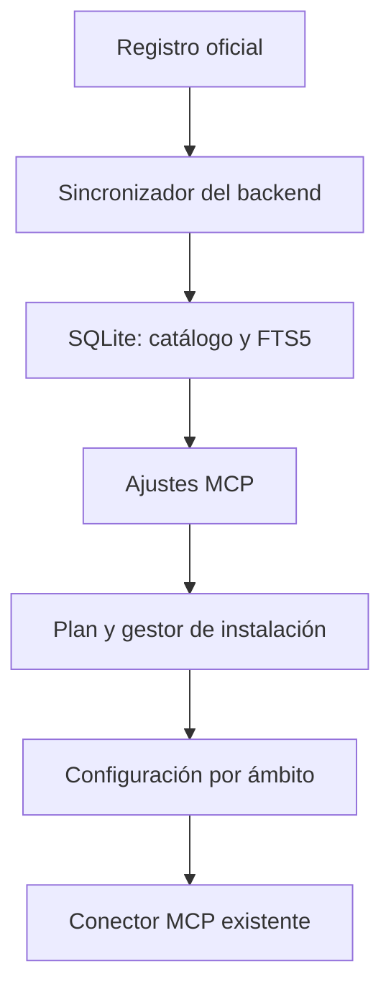

# Especificación técnica: Catálogo MCP de Alisio

| Campo | Valor |
|---|---|
| Versión | 1.5 |
| Fecha | 2026-11-13 UTC |
| Proyecto | GustavoGutierrez/alisio |
| Estado | **Aprobada por el propietario 2026-11-12 para ejecución; fase 0 completada 2026-11-12; fase 1 completada 2026-11-12; fase 2 completada 2026-11-12; fase 3 completada 2026-11-12** (ver §19, §19.9, §19.10 y §19.11). Fases 4–5 no implementadas. Q1–Q3 cerradas por el propietario (O8–O10, §19.9) |
| Base inspeccionada | Commit `179e68694163ea6b2f51013ea4b56a8fe193a64f`, paquete core 0.11.10 |
| Paquetes afectados | core, sdk, server, web; superficies CLI/TUI existentes para compatibilidad |
| Paquetes nuevos | Ninguno obligatorio |
| Ubicación propuesta | ~~`specs/backlog/030-catalogo-mcp-v1.md`; recalcular número si el repositorio avanzó~~ (sustituido 2026-11-12: la especificación está en ejecución en `specs/030-catalogo-mcp-v1.md`; el número 030 sigue siendo el siguiente libre verificado) |
| Relaciones | Complementa `specs/014-trust-boundaries-v1.md`, `specs/018-perimeter-v1.md` y `specs/029-semantic-ports-v1.md`; no depende de búsqueda vectorial |
| Política de versión | Cambios aditivos; preservar configuraciones y API existentes |

## 0. Instrucciones para el agente implementador

Leer AGENTS.md, CONTRIBUTING.md y las instrucciones locales de arquitectura, estándares y paquetes afectados. Reauditar la rama objetivo antes de editar: esta especificación describe el commit anterior, no futuros cambios. No reemplazar funcionalidades existentes con implementaciones paralelas. MUST y MUST NOT expresan obligaciones; SHOULD indica una preferencia cuya excepción debe documentarse. Los comportamientos nuevos se identifican como propuesta; los hechos de código se verificaron por lectura el 2026-11-13 UTC, sin ejecutar la suite ni la aplicación.

Usar TypeScript y APIs portables Node, pnpm y Preact/CSS Modules existentes. No introducir Bun globals ni dependencias internas de core en plugins. Las fases de código siguen pruebas de comportamiento Rojo–Verde–Refactor y terminan con los checks exigidos por el repositorio. Este encargo redacta la especificación, no autoriza publicación de paquetes ni commits. No exige modelos concretos ni delegación para ejecutarla.

## 1. Objetivo y alcance

Permitir que una persona abra Ajustes → MCP, explore un catálogo, busque, filtre, seleccione el ámbito global o de proyecto, instale o conecte un servidor y gestione su ciclo de vida sin editar JSON manualmente.

El catálogo MUST alimentar el cliente MCP actual. Instalar una integración MUST NOT conceder automáticamente permisos de ejecución ni modificar silenciosamente el consentimiento global.

| Fuera de alcance inicial | Motivo |
|---|---|
| Garantizar que cada servidor es seguro | El registro publica metadatos y acredita namespaces; no audita todo el código |
| Instalación automática de Node, Python o Docker | El instalador detecta prerrequisitos y explica faltantes |
| Instalación automática PyPI/OCI/MCPB y transportes heredados SSE | Fases posteriores; inicialmente npm/stdio y Streamable HTTP |
| Reescribir el protocolo o crear un cliente MCP propio | Reutilizar SDK y conector existentes |
| Revocar cuentas o suscripciones externas al desinstalar | La eliminación es local; revocación remota solo mediante soporte explícito |
| Actualizar servidores automáticamente a nuevas versiones | Cambia código y herramientas; requiere actualización explícita |

## 2. Decisiones

### Peticiones confirmadas del propietario

- O1: usar el registro oficial como fuente del catálogo.
- O2: ofrecer búsqueda, paginación y filtros, incluidas categorías.
- O3: facilitar instalación y desinstalación desde la UI.
- O4: admitir MCP globales y específicos de proyecto respetando MCP.
- O5: extender lo que Alisio ya implementa.
- O6: todo el ciclo de vida debe tener UI/UX para personas no técnicas, formularios mínimos validados, prueba de conexión y distintivos claros de instalación y ámbito.
- O7 (confirmada 2026-11-12): la fuente del catálogo MUST ser intercambiable. Si `registry.modelcontextprotocol.io` se sustituye por otro proveedor, solo cambia el adaptador de ese servicio; almacén, sincronización, planificador, instalador, rutas del servidor y UI web no requieren cambios. Diseño por puertos y adaptadores (D14, §19.4).

### Decisiones técnicas propuestas

| ID | Decisión | Consecuencia |
|---|---|---|
| D1 | Sincronizar registro mediante backend e índice SQLite/FTS5 global | Catálogo consultable sin red; no exponer la aplicación directamente a cambios upstream |
| D2 | Separar ficha de catálogo, artefacto descargado y vinculación por ámbito | Una descarga puede reutilizarse sin compartir configuración ni credenciales entre proyectos |
| D3 | Mantener precedencia proyecto > global para el mismo nombre interno | Preservar el comportamiento de config.ts y hacer visibles los elementos ocultos |
| D4 | Proyecto como selección inicial cuando hay proyecto activo; global explícito | Reduce cambios involuntarios en otros proyectos; es una política de Alisio, no del estándar |
| D5 | Reutilizar permisos y conector; instalación y ejecución son acciones distintas | No elevar privilegios al explorar o instalar |
| D6 | Identidad del registro separada del alias interno | Los nombres con `/` no invalidan el esquema actual |
| D7 | Secretos fuera de JSON compartible y del índice | Añadir almacenamiento protegido si no existe un contrato apropiado |
| D8 | Adaptadores solo para métodos soportados, con plan validado | Sin ejecutar comandos arbitrarios suministrados por fichas |
| D9 | OAuth HTTP como fase propia y conformidad por versión soportada | No anunciar soporte universal antes de comprobar interoperabilidad |
| D10 | Desinstalación por ámbito, con recuento de referencias | No borrar una integración global al quitarla de un proyecto |
| D11 | Interfaz completa y progresiva, sin JSON ni terminal para métodos soportados | La configuración avanzada es opcional, no un requisito del flujo común |
| D12 | Prueba de conexión y descubrimiento con resultado visible | “Instalado” no equivale a “funciona” ni a auditoría de seguridad |
| D13 | Indicadores separados de ejecución y disponibilidad | “En este equipo/Remoto” no se confunde con “Global/Proyecto” |
| D14 | (nuevo, O7) Puerto `CatalogSource` neutral respecto al proveedor, modelo de dominio propio de Alisio y adaptador anticorrupción por fuente; clasificación por estrategia `CategoryClassifier`; selección por fábrica según configuración | Cambiar de fuente solo añade o cambia un adaptador; filas con `sourceId` permiten resincronizar sin mezclar datos. Detalle en §19.4 |

Decisiones D15–D20 cerradas por la fase 0: ver §19.7 (D15 se cubre con MCP-CAT-04 y D20 con MCP-CAT-16).

## 3. Estado actual del repositorio (verificado por lectura)

| Área | Implementación existente y ajuste requerido |
|---|---|
| Configuración | `packages/core/src/config.ts`: `mcp.servers`, alias compatible `mcpServers`; esquema estricto. No añadir metadatos del catálogo dentro de ServerConfig sin ampliar deliberadamente el esquema |
| Ámbitos | `configHome()/config.json` global; `<workspace>/.alisio/config.json` proyecto; ALISIO_CONFIG_HOME/XDG_CONFIG_HOME respetados. Capa explícita y procedencias builtin/plugin también existen |
| Merge | `loadConfigWithProvenance`: combina servidores, proyecto sobrescribe mismo nombre global; `mcpSources` conserva origen efectivo |
| Consentimiento | `mcp.allow` solo global; la capa de proyecto no puede concederlo. Permiso runtime y modo read-only existentes |
| Escritura | `setMcpServerEnabled` preserva archivo y forma canonical/alias, usa temporal y rename. Extender este patrón a altas/bajas y concurrencia |
| Nombres | Regex interna `[A-Za-z0-9][A-Za-z0-9._-]*`; no admite `/` de los nombres completos del registro |
| Protocolo | `packages/core/src/mcp/connector.ts`: Client, StdioClientTransport y StreamableHTTPClientTransport de `@modelcontextprotocol/client` |
| Credenciales | stdio: env/envAllow con selección de entorno; HTTP: bearerTokenEnv. El flujo leído resuelve token de process.env; no demuestra OAuth interactivo completo |
| Procesos | stdio se lanza con cwd del workspace; no cambiarlo globalmente al directorio de instalación |
| Estados | disabled, disconnected, connecting, connected, failed, needs-authentication, restart-required |
| Herramientas | Conector registra herramientas/recursos/prompts, contempla desconexión y cambio de esquema; conservar semántica e IDs |
| UI | `packages/web/src/components/settings/McpPage.tsx`: listado del workspace, estado, consentimiento, switch y Conectar. No hay catálogo/instalador en esta pantalla |
| HTTP | `packages/server/src/routes/management.ts`: GET /api/mcp, PATCH /api/mcp/:name, POST /api/mcp/consent |
| Contratos | `packages/sdk/src/index.ts`: McpServerWire/McpOverview; el wire actual omite comandos, argumentos y URL por posible presencia de tokens |
| SQLite | `packages/core/src/runtime/sqlite.ts`: adaptador portable sobre node:sqlite, con FTS5 en baseline Node del proyecto |
| Pruebas | `tests/mcp.test.ts`, `mcp-runtime-consent.test.ts`, `mcp-close-timeout.test.ts`, `mcp-rich.test.ts`; extender sin sustituir |

No se afirma que no exista ninguna utilidad relacionada en todo el monorepo: antes de crear nuevos servicios, buscar secretos, trabajos, locks, configuración, trust y almacenamiento reutilizables.

## 4. Estándar MCP frente a configuración de Alisio

El alcance global/proyecto, los nombres locales, el formato de archivos y la desinstalación son decisiones del host Alisio. MCP define comunicación y capacidades; el Registry define metadatos de descubrimiento. `mcpServers` es una convención compatible del ecosistema, no un formato universal normativo de configuración MCP.

MUST conservar stdio y Streamable HTTP y las capacidades tools/resources/prompts que soporte el cliente instalado. En fase 0 verificar versión exacta del SDK y sus revisiones de protocolo soportadas; documentar matriz cliente/servidor. No actualizar el protocolo por copiar la documentación `/latest`: la revisión debe fijarse y probarse antes. Servidores incompatibles se muestran como no compatibles con razón concreta, sin falsos estados connected.

Para HTTP con OAuth, implementar la especificación de autorización de la revisión seleccionada mediante utilidades mantenidas del SDK: discovery de recurso y authorization server, PKCE, state, validación del issuer y del destino del token, refresh y almacenamiento protegido. No enviar tokens a endpoints distintos ni confundir autenticación de catálogo con autorización del MCP. stdio obtiene credenciales por entorno y no debe adoptar el flujo OAuth HTTP como transporte.

## 5. Arquitectura e integración



Propuesta de módulos nuevos bajo `packages/core/src/mcp/catalog/`: registry-client.ts, catalog-store.ts, sync.ts, categories.ts. Bajo `mcp/installation/`: planner.ts, npm-installer.ts, bindings.ts, lifecycle.ts, secrets.ts. Reutilizar infraestructura existente cuando corresponda; nombres propuestos, no rutas actuales. Extender config.ts, application.ts y reload.ts donde la auditoría de fase 0 confirme la responsabilidad. (Actualizado 2026-11-12: la disposición de módulos vigente, con el puerto `CatalogSource` de D14, está en §19.4 y prevalece sobre esta lista.) Nuevos DTO públicos aditivos en sdk; rutas en server y componentes bajo settings en web. No crear otro bucle de herramientas ni otro gestor de conexiones.

## 6. Consumo del registro

Base: `https://registry.modelcontextprotocol.io`.

| Acción | Endpoint |
|---|---|
| Listado inicial | GET /v0.1/servers?limit=100 |
| Últimas versiones | GET /v0.1/servers?version=latest&limit=100 |
| Búsqueda upstream | GET /v0.1/servers?search=github&version=latest&limit=50 |
| Detalle | GET /v0.1/servers/{encodeURIComponent(name)}/versions/{encodeURIComponent(version)} |
| Incremental | GET /v0.1/servers?updated_since={RFC3339}&limit=100 |

Lectura sin API key. API upstream paginada por cursor; mantener filtros al seguir metadata.nextCursor. Búsqueda upstream es substring del nombre, mínimo tres caracteres. Consultas locales pueden buscar también descripción y categorías y aceptar dos caracteres; entrada menor muestra recomendados sin rastrear upstream.

CAT-01: WHEN comienza una sincronización, el backend MUST usar una única tarea por fuente, timeout de 15 s/petición, máximo 2 reintentos con backoff y respeto de Retry-After. Intervalo automático mínimo de 1 h mientras la aplicación esté activa; refresco manual sujeto a ese mismo presupuesto por fuente. Sin promesa de sincronización con la app cerrada.

CAT-02: WHEN llega una página, MUST validar estructura, identidad y límites antes de transaccionar. Presupuesto propuesto: 100 resultados/página, 5 MiB descomprimidos por respuesta y 128 KiB por registro; excedentes se rechazan y se registran sin corromper datos válidos. Esquemas desconocidos quedan pendientes de compatibilidad, nunca ejecutables automáticamente.

CAT-03: WHEN termina todo el recorrido incremental, MUST guardar checkpoint; fallo intermedio conserva checkpoint anterior, aplica idempotencia por nombre+versión y solapamiento de 5 minutos. Procesar cambios deleted/deprecated. No sincronizar incremental solo con latest si eso impide aplicar eliminaciones de versiones instaladas.

CAT-04: WHILE no hay red, MUST servir último índice con fecha y aviso de datos almacenados. Sin índice, mostrar estado vacío recuperable. No sustituir por resultados inventados.

CAT-05: WHEN se selecciona la ficha pública, MUST elegir latest según metadatos oficiales, no orden lexicográfico/semver inferido. Comprobar status active separadamente. Versiones retiradas no son instalables; instalaciones existentes reciben aviso sin destrucción automática.

## 7. Persistencia y búsqueda

Base global propuesta `<stateHome>/mcp/catalog.sqlite`, independiente de bases por sesión. Añadir migraciones versionadas y transacciones; reutilizar el adaptador SQLite. Conservar JSON original para trazabilidad, sin secretos.

| Entidad | Campos mínimos |
|---|---|
| sources | id, baseUrl, adapterVersion, checkpoint, lastSuccess, lastError |
| catalog_versions | sourceId, registryName, version, status, isLatest, rawJson, fetchedAt |
| catalog_search | nombre/título/descripción en FTS5; tabla de proyección pública |
| categories | id estable, labels EN/ES, taxonomyVersion |
| category_assignments | identidad, categoryId, método curated/rule/user, confianza y versión |
| artifacts | id, método, paquete, versión exacta, integridad, ruta gestionada, estado |
| bindings | id UUID, alias interno, registryName, registryVersion, artifactId opcional, scope, workspaceId canónico opcional, revisión |
| installation_jobs | id, idempotencyKey, planDigest, estado, error seguro, timestamps, recuperación |

El config JSON permanece autoridad para conexiones efectivas; bindings es el registro de propiedad y procedencia del instalador. Reconciliar altas/ediciones manuales al iniciar, sin sobrescribirlas. Catálogo y settings no deben divergir después de un reinicio.

Resultados locales ordenados de forma estable por relevancia y nombre+identidad; páginas de 24 por defecto, máximo 100. Filtrar antes de paginar. Total y filtros activos reflejan la misma consulta. Categorías propuestas: desarrollo, productividad, archivos-documentos, datos, comunicación, investigación, diseño-multimedia y otros. No atribuir categorías propias al registro oficial. Sin coincidencia → otros; ninguna llamada LLM obligatoria para explorar. Etiquetas traducidas, identificadores estables.

## 8. Global y proyecto

SCP-01: WHEN se instala con proyecto activo, la UI MUST ofrecer «Solo este proyecto» y «Todos mis proyectos», con proyecto preseleccionado. Sin proyecto permite global y explica que no hay destino local seleccionado.

SCP-02: WHEN se confirma ámbito global, MUST escribir en configHome()/config.json; WHEN es proyecto, MUST escribir en el workspace autorizado/.alisio/config.json. El cliente nunca suministra una ruta arbitraria de archivo de configuración.

SCP-03: WHILE proyecto no es confiable, MUST poder explorar, pero MUST bloquear escritura/carga de configuración ejecutable de proyecto según política trust existente. Un proyecto MUST NOT asignarse mcp.allow ni ampliar autorización global.

SCP-04: WHEN coinciden alias global y proyecto, MUST conservar precedencia actual y mostrar ambos con origen y cuál es efectivo. Desactivar «en este proyecto» un global crea override mínimo compatible sin copiar secretos. Eliminar override revela el global y debe anunciarse antes de confirmar. No confundir desactivar, quitar override y desinstalar global.

SCP-05: WHEN se edita un archivo explícito, MUST preservar su precedencia y mostrar origen «Archivo explícito»; no escribir en global/proyecto esperando que sobrescriba esa capa. No eliminar entradas builtin/plugin desde el instalador: ofrecer control o instrucciones de su propietario.

SCP-06: WHEN dos proyectos usan un MCP global, MUST tener conexiones y cwd separados por workspace, reutilizando solo el artefacto; no compartir automáticamente procesos, sesiones HTTP ni credenciales de proyecto. Cambios globales invalidan/reconcilian todos los workspaces abiertos afectados.

El alias se genera de título/slug permitido más hash corto estable del nombre completo; almacenar registryName íntegro aparte. Comprobar colisiones y permitir alias manual válido; no renombrar entradas existentes ni usar alias como identidad de seguridad.

## 9. Plan, instalación y credenciales

Flujo visible: ficha → formulario mínimo solo si falta información → instalar/conectar y comprobar → listo. Ámbito preseleccionado y resumen dentro de la misma ficha; plan interno sin pantalla técnica obligatoria. El consentimiento existente se integra únicamente cuando falta autorización. Para un servidor sin parámetros, el clic inicial expresa intención y puede continuar si las autorizaciones aplicables ya existen; no añadir confirmaciones duplicadas.

INST-01: WHEN se pide instalar, backend MUST recuperar detalle fijado, comprobar estado, validar transport/package, evaluar compatibilidad y construir un plan no ejecutable. Campos: planId, digest, expiresAt (10 min), alias, scope, requiredInputs, method, package/version, publicOrigin, prerequisiteStatus, requiresConsent. Cambios de metadatos o configuración invalidan el plan con conflict.

INST-02: WHEN se ejecuta el plan aprobado, MUST usar versión exacta y argumentos estructurados, sin shell. Para npm, instalación privada bajo stateHome()/mcp/artifacts, lockfile e integridad, sin instalaciones globales npm. Resolver bin explícito; múltiples bins sin elección inequívoca requieren selección validada, no adivinación.

No ejecutar scripts de lifecycle de npm por defecto. Si un paquete depende de ellos, marcar instalación automática no compatible y ofrecer instrucciones; no quitar esa protección silenciosamente. Ni ignore-scripts ni el directorio privado son un sandbox para el código al ejecutarse. No usar npx latest como sustituto del instalador persistente.

INST-03: WHEN runtime o método no están disponibles, MUST mostrar «Requiere Node», «Método no compatible» o configuración manual; no habilitar una entrada que fallará inevitablemente. El gestor distingue descargar, registrar, autenticar y conectar.

INST-04: WHEN hay parámetros requeridos, MUST generar formulario desde metadatos validados. No convertir descripciones ni README en código. Secretos se envían por operación de escritura autenticada, jamás en query strings; campos secretos no tienen lectura de vuelta.

INST-05: WHEN guarda credenciales, MUST usar referencias protegidas por usuario+binding+ámbito; evaluar almacén existente en fase 0. Si no existe uno adecuado, implementar puerto con keyring de escritorio y alternativa servidor administrada explícita; si no está disponible, ofrecer desde la UI una referencia de variable de entorno como opción avanzada y explicar el bloqueo del guardado protegido. El flujo normal de escritorio MUST permitir introducir y guardar la clave desde formulario; una dependencia ausente del almacén no convierte instrucciones de terminal en experiencia terminada. Nunca fallback silencioso a texto plano. Resolver secretos solo al lanzar/conectar y adaptar bearerTokenEnv sin contaminar process.env global ni otras conexiones.

INST-06: WHEN falla descarga/configuración, MUST restaurar estado anterior y limpiar temporales. WHEN falla solo conexión tras instalación correcta, MUST conservar instalación con diagnóstico y Reintentar; no mostrarla como conectada. Jobs idempotentes y serializados por binding/archivo; tras cierre inesperado reconciliar journal, config y artefactos. Escrituras atómicas con comprobación de revisión preservan campos ajenos y formato canonical/alias.

Estados del job, separados de McpStatus: planned → awaiting-input/awaiting-consent → installing → configuring → connecting → completed; failed/cancelled terminales. Deadline instalación inicial 180 s, timeout configurable globalmente hasta 600 s; cancelación termina árbol de procesos y libera locks. Conexión conserva timeout actual de 15 s salvo cambio deliberado probado.

## 10. Gestión, actualización y desinstalación

LIFE-01: WHEN usuario desactiva, MUST usar el mecanismo existente y retirar herramientas de esa conexión. No eliminar configuración ni archivos.

LIFE-02: WHEN desinstala binding de proyecto, MUST detener conexión, retirar solo esa entrada del archivo autorizado y retirar credenciales exclusivas tras opción explícita. Global conserva otros bindings. Para global, informar proyectos abiertos afectados y reconciliarlos; no se requiere conocer proyectos cerrados para retirar la configuración global.

LIFE-03: WHEN queda artefacto sin referencias gestionadas, MAY borrarlo tras verificar ruta real, ausencia de symlink que escape y propiedad del instalador. Nunca borrar ejecutables manuales, Node, Docker, Python, npm cache general ni archivos del usuario. Ante duda conservar artefacto como huérfano y ofrecer limpieza.

LIFE-04: WHEN se actualiza, MUST construir nuevo plan fijado, mostrar diferencia de versión y configuración, instalar en paralelo, verificar y permitir rollback al artefacto anterior. No perder claves ni modificar scopes OAuth sin autorización. Manejar cambio de tools/schema con controles existentes.

LIFE-05: WHEN usuario modifica manualmente config, la siguiente operación MUST detectar revisión distinta y reconciliar o devolver conflict, nunca reponer la versión antigua. La desinstalación remota elimina vínculo local; revocación OAuth es best effort separado si el proveedor la soporta.

## 11. API de Alisio y contratos públicos propuestos

Preservar GET/PATCH actuales y POST /api/mcp/consent. Rutas nuevas propuestas, no existentes; aplicar auth/origin/CSRF/read-only y resolución autorizada de workspace existentes. Registrar rutas estáticas antes de :name donde aplique.

| Método/ruta | Resultado |
|---|---|
| GET /api/mcp/catalog | q, category, method, transport, installed, page, pageSize; items,total,facets,syncStatus |
| GET /api/mcp/catalog/detail?source=…&name=…&version=… | ficha y compatibilidad sin credenciales |
| POST /api/mcp/catalog/sync | job único o estado del sync existente |
| POST /api/mcp/install/plans | plan validado por identidad y destino |
| POST /api/mcp/install/jobs | planId, revisión, idempotencyKey y entradas secretas opcionales |
| GET /api/mcp/install/jobs/:id | progreso y diagnóstico redactado |
| POST /api/mcp/install/jobs/:id/cancel | cancelación idempotente |
| DELETE /api/mcp/bindings/:id | eliminación por ámbito y revisión explícitos |
| POST /api/mcp/bindings/:id/update-plan | plan de actualización |
| POST /api/mcp/bindings/:id/auth | iniciar autorización HTTP, sin secretos en respuesta |
| GET /api/mcp/bindings/:id/configuration | formulario tipado y valores públicos; secretos solo como configured/missing |
| PATCH /api/mcp/bindings/:id/configuration | validar y guardar campos por revisión, con secretos write-only |
| POST /api/mcp/bindings/:id/test | iniciar comprobación autorizada, sin llamadas a herramientas de negocio |
| GET /api/mcp/bindings/:id/test | último resultado, etapas, capacidades y fecha |

DTO aditivos en sdk: McpCatalogItem, McpCatalogPage, McpInstallPlan, McpInstallJob, McpBindingWire. No exponer tipos del SDK externo. Eventos se integran al mecanismo actual de actualización/invalidation; conservar anuncio de canal mcp del recycler. Las pantallas no reconstruyen decisiones de instalación.

Errores estables propuestos: mcp_catalog_unavailable, mcp_method_unsupported, mcp_runtime_missing, mcp_input_required, mcp_scope_untrusted, mcp_plan_expired, mcp_config_conflict, mcp_install_failed, mcp_secret_unavailable, mcp_auth_required. Reutilizar códigos equivalentes existentes cuando los haya. Contratos verifican límites y no incluyen comando/args/URL completos del runtime existente. Para revisión del plan solo mostrar paquete, versión, dominio y parámetros no secretos saneados.

## 12. UI y UX obligatorias para usuarios no técnicos

Esta sección es normativa para todas las fases y reemplaza cualquier interpretación de “instalación fácil” que termine pidiendo editar archivos, pegar comandos o conocer stdio, npm, variables de entorno o JSON. Los métodos soportados MUST completar su flujo desde la interfaz. Métodos no soportados se identifican antes de empezar; la alternativa técnica no cuenta como instalación sencilla completada.

### 12.1 Pantallas y cobertura de operaciones

Extender Ajustes → MCP, con encabezado «Conecta herramientas a Alisio» y explicación breve. Mantener consentimiento existente sin duplicarlo. Utilizar componentes y diseño de Alisio, Preact y CSS Modules. Etiquetas, ayudas y errores EN/ES.

| Superficie | Contenido y acciones obligatorios |
|---|---|
| Explorar | Lista de MCP disponibles, buscador, categorías, filtros, total, paginación y fecha de actualización |
| Ficha de MCP | Beneficio en lenguaje cotidiano, proveedor, origen, compatibilidad, requisitos, ámbito e Instalar/Conectar |
| Asistente integrado | Solo campos faltantes y autorización; pasos técnicos internos automáticos |
| Mis MCP | Todos los configurados, incluidos manuales/heredados; estado y ámbito visibles; buscar y filtrar |
| Configurar | Editar parámetros, elegir carpetas, sustituir claves, reconectar cuenta y guardar con validación |
| Comprobar conexión | Iniciar prueba, ver etapas, resultado, capacidades y acción de recuperación |
| Gestionar | Activar/desactivar, reconectar, actualizar, quitar y administrar uso por proyecto |
| Resultado de operación | Progreso, éxito parcial/completo, fallo, cancelar/reintentar y siguiente acción |

UX-01: WHEN usuario abre Explorar, MUST ver resultados sin escribir búsqueda ni abrir otra pantalla. Listado predeterminado muestra activos, con recomendados diferenciados; no oculta silenciosamente resultados incompatibles: filtro «Listos para usar» disponible y motivo visible en los demás. No ejecutar servidores para poblar el catálogo.

Buscador con debounce 300 ms sobre índice local, filtros antes de paginar, páginas de 24 y total visible. Mantener búsqueda y filtros al volver de una ficha; restablecer página al filtrar. Estados diferenciados: cargando, catálogo vacío, sin coincidencias, sin red con caché, error y sincronización parcial. Cada estado ofrece acción útil. Ninguna petición upstream por tecla.

### 12.2 Dos dimensiones visibles: ejecución y ámbito

UX-02: WHEN se muestra un MCP, MUST distinguir con texto e icono, sin depender solo del color:

| Dimensión | Etiquetas visibles | Significado |
|---|---|---|
| Ejecución | «En este equipo» / «Servicio remoto» | Dónde corre el servidor; no determina su ámbito |
| Disponibilidad | «Global · Todos mis proyectos» / «Proyecto · {nombre}» | Dónde queda configurado |
| Instalación/vínculo | «Sin añadir», «Instalado», «Conectado», «Configuración pendiente» | Estado local y de conexión, sin equipararlos |
| Funcionamiento | «Sin comprobar», «Comprobando», «Listo para usar», «Requiere atención» | Resultado y vigencia de la última comprobación |

Ejemplos: «En este equipo · Global» y «Servicio remoto · Proyecto: Contabilidad» son combinaciones válidas. El detalle muestra todas las vinculaciones conocidas si hay varias; las tarjetas resumen «Global y 2 proyectos» con acceso a la lista. En servicio web/headless, sustituir «En este equipo» por «En el equipo donde se ejecuta Alisio» cuando la ejecución está en el host servidor, no en el navegador. No llamar a proyecto “local” sin aclarar la ejecución.

UX-03: WHEN se agrega una integración, MUST ofrecer «Solo este proyecto» y «Todos mis proyectos» en una selección comprensible con proyecto activo y su nombre; preservar SCP-01. Detalles técnicos, alias, binario, transporte y versión avanzada se presentan en «Opciones avanzadas», nunca como campos obligatorios si pueden resolverse automáticamente. Global no comparte automáticamente archivos ni concede permisos nuevos en otros proyectos.

### 12.3 Instalación con mínimo esfuerzo

UX-04: WHEN no falta información y los permisos aplicables ya existen, un clic en Instalar/Conectar MUST iniciar preparación, configuración y comprobación, sin asistente vacío ni confirmación repetida. Mostrar progreso dentro de ficha/lista, permitir navegar sin perder tarea y evitar duplicados por doble clic. El plan sigue validándose en backend aunque no tenga pantalla propia.

UX-05: WHEN faltan datos, MUST abrir un único formulario compacto, solicitando solo campos requeridos sin valor seguro disponible. Valores automáticos no se preguntan; opcionales van colapsados. El botón final dice «Instalar y comprobar» o «Conectar y comprobar». Si faltan permisos, integrar el consentimiento existente en el mismo flujo, explicando qué se autoriza y sin preseleccionar consentimiento permanente.

Para OAuth preferir «Conectar mi cuenta» al ingreso de claves cuando el servicio lo soporte; el consentimiento externo legítimo puede abrirse en el navegador. Al volver, retomar ficha y comprobación. Cancelar no pierde campos no secretos. Nunca prometer un clic si el proveedor exige autorización o datos obligatorios.

Prerequisitos se detectan automáticamente y se explican en lenguaje sencillo con «Volver a comprobar» y acceso a ayuda oficial dentro de la UI. Reutilizar runtimes incluidos por Alisio cuando la auditoría confirme que son aptos; no asumir que un ejecutable interno de Electron sirve como runtime público. La instalación automática de runtimes sigue fuera de alcance y no se oculta este límite.

### 12.4 Formularios mínimos y validados

UX-06: Cada campo MUST tener etiqueta legible, tipo, ayuda breve solo si aporta, required, valor por defecto seguro y error asociado accesiblemente. Mapear enums a selects, booleanos a controles explícitos, números a input con rango, claves a password, rutas a selector de carpeta/archivo y URL a campo validado. No usar placeholder como única etiqueta.

Validar en cliente al salir del campo o al enviar y en servidor siempre; no anunciar errores mientras el usuario empieza a escribir. Al enviar inválido, enfocar primer error, conservar entradas y explicar cómo corregir. Detectar espacios accidentales según semántica del campo sin alterar secretos silenciosamente. No inventar patrones de claves que el proveedor no documenta.

| Campo/estado | Requisito de UX y validación |
|---|---|
| Clave de acceso | Oculta, pegar permitido, mostrar/ocultar, «Dónde obtenerla» a sitio oficial validado, error específico sin repetir el secreto |
| Clave ya guardada | «Clave guardada»; sustituir/eliminar explícitos. Vacío al editar significa conservar, nunca borrar implícitamente |
| Carpeta autorizada | Selector accesible; validar existencia, permisos y política backend; explicar para qué la usará |
| URL de servicio | Esquema/origen válido, sin credenciales embebidas y controles de red; no pedirla si catálogo ya la aporta |
| Nombre/alias | Autogenerado; cambiar solo en opciones avanzadas; validar colisión sin sobrescribir otra integración |
| Parámetros opcionales | Ocultos por defecto; revelar cuando realmente se necesitan |

Metadatos insuficientes requieren adaptador/formulario curado o entrada avanzada etiquetada como tal; no generar código desde descripciones ni fingir que el esquema conoce todos los requisitos. En navegador sin selector nativo, ofrecer selección mediante explorador de rutas autorizado de Alisio; nunca enumerar rutas arbitrarias del servidor. Móvil ofrece alternativa accesible.

### 12.5 Prueba de conexión desde la interfaz

UX-07: MUST ofrecer «Comprobar conexión» después de guardar y como acción de Mis MCP. La comprobación automática final de instalación reutiliza el mismo servicio. Emplear autorización runtime existente: una prueba de stdio ejecuta código y una prueba remota hace solicitudes; no son exploración pasiva ni exentas de consentimiento.

Etapas visibles según método: preparación del componente → conexión → autenticación si aplica → descubrimiento de capacidades. Comprobar establecimiento/sesión según revisión MCP soportada y listar herramientas/recursos/prompts solo si el servidor anuncia esas capacidades. No exigir al menos una herramienta: un servidor de recursos o prompts también puede ser válido. No llamar herramientas de negocio, leer contenido de archivos del usuario, enviar mensajes, escribir datos ni ejecutar acciones con efectos para probar.

La comprobación MUST usar conector existente o una sesión diagnóstica limitada que no duplique registros; si ya está conectado, reutilizar contexto cuando proceda. No desconectar una sesión activa del usuario para probarla. Limpiar conexiones temporales; un resultado correcto no habilita ni reactiva silenciosamente un binding desactivado. Timeout global de prueba 30 s, cancelable, con límites existentes de conexión; resultado explícito para timeout o cancelación.

Resultado tipado propuesto McpConnectionTestResult: testId, bindingId, configRevision, artifactVersion, status (passed/failed/cancelled), steps, startedAt, finishedAt, safeMessage, recoveryAction, capabilities, counts. Ningún secreto, salida cruda o URL con token. Añadir tabla connection_tests o registro equivalente con último resultado por binding; max. 20 resultados durante 30 días, sin payloads privados.

«Listo para usar» exige prueba exitosa para revisión/versión vigentes y estado runtime aplicable; mostrar «Comprobado hace…». Al cambiar configuración, credencial, versión o destino, marcar prueba anterior como desactualizada. Una prueba exitosa demuestra conexión y descubrimiento en ese momento, no auditoría de seguridad ni éxito de todas las herramientas. Una caída posterior reemplaza el estado actual sin ocultar la fecha histórica.

### 12.6 Errores y recuperación

UX-08: WHEN ocurre fallo, MUST mostrar causa comprensible y siguiente acción en la misma UI, preservando valores no secretos y permitiendo reingreso seguro de claves cuando sea necesario.

| Causa | Mensaje orientativo | Acción |
|---|---|---|
| Credencial inválida | «No pudimos acceder a tu cuenta» | Cambiar clave / Conectar cuenta |
| Permiso insuficiente | «Tu cuenta necesita permiso para este servicio» | Revisar permisos |
| Carpeta inaccesible | «Alisio no puede acceder a esta carpeta» | Elegir otra carpeta |
| Red/servicio caído | «No pudimos conectar con el servicio» | Reintentar |
| Runtime ausente | «Falta un componente para ejecutar esta herramienta» | Ver ayuda / Volver a comprobar |
| Instalación correcta, prueba fallida | «Añadido; falta completar la conexión» | Configurar / Comprobar conexión |
| Cambio externo de configuración | «La configuración cambió mientras la editabas» | Recargar cambios conservando borrador no secreto |

No mostrar stack traces como mensaje principal. «Detalles técnicos» opcionales, redactados, copiable sin tokens. Los toast son complementarios, no único registro de éxito/error. Progreso sin porcentajes falsos ni tiempo restante inventado.

### 12.7 Gestión visual completa

UX-09: Mis MCP MUST permitir configurar, probar, activar/desactivar, actualizar, elegir en qué proyecto usarlo y desinstalar/desconectar. Cambiar disponibilidad se implementa como creación/eliminación controlada de bindings, no cambia scope solo en memoria. Conservar secretos con aislamiento y no copiarlos de proyecto a global sin decisión explícita; transferencia muestra destino y consecuencias.

Quitar global: texto «Se quitará de todos los proyectos que usan esta configuración global». Quitar proyecto: «Se quitará solo de {nombre}». Si hay override, ofrecer «Volver a la configuración global» como acción distinta. Eliminación requiere confirmación breve contextual; no reiterarla en varios diálogos. No sugerir que quitar una integración borra cuenta o cancela suscripción. Para remotos usar «Desconectar servicio»; para locales «Desinstalar», aclarando si queda componente compartido.

Entradas heredadas/manuales MUST seguir siendo administrables desde UI con formulario compatible. Campos desconocidos se preservan; capa explícita/plugin no editable informa origen y ofrece navegación a su gestión cuando exista. No forzar migración que pierda datos ni enviar secretos del runtime para rellenar formulario.

### 12.8 Accesibilidad, aceptación de UX y componentes

UX-10: Controles con foco visible, nombres accesibles, iconos más texto, diálogos con foco inicial/restauración, errores enlazados y progreso anunciado con aria-live moderado. Navegación completa por teclado. Flujos usables a 360 px y zoom 200%, sin botones recortados; listas/tablas adaptables. Respetar reduced-motion. Áreas táctiles objetivo mínimo 44×44 CSS px para acciones principales.

Componentes propuestos reutilizables, ajustados al sistema existente: McpCatalogList, McpCatalogFilters, McpDetailPanel, McpScopePicker, McpSetupForm, McpStatusBadges, McpConnectionTestPanel y McpRemovalDialog. Implementar reglas en servicios/DTO, no duplicarlas en componentes.

Criterio transversal: una persona no técnica debe completar todos los casos soportados sin terminal, edición de JSON, documentación técnica obligatoria ni comprensión del protocolo. Pruebas de tareas con usuarios pueden complementar, pero no se afirma que hayan ocurrido al redactar esta especificación.

## 13. Seguridad y límites

Metadatos y descripciones son datos no confiables. Escapar texto, sanear Markdown, no renderizar HTML arbitrario ni incluir instrucciones de catálogo como mensajes privilegiados del agente. Iconos externos mediante política de URL y carga controlada; sin fuga de credenciales.

Catálogo remoto HTTPS por defecto. Resolver y validar destinos en backend, incluidos redirects y DNS, contra SSRF, credenciales URL y rangos internos para operaciones iniciadas por catálogo. MCP locales/intranet manuales continúan posibles bajo política explícita de usuario, sin bloquearlos como efecto secundario de esa protección. Separar tokens de registro, paquetes y servidor MCP. Límites de respuesta y redirecciones también aplican a discovery OAuth.

Persistir auditoría de fuente/versión, plan, ámbito, instalación y resultado sin valores secretos. No deshabilitar automáticamente un MCP ya instalado porque upstream desapareció; informar y bloquear instalaciones nuevas de registros retirados. Código local corre con privilegios del usuario salvo aislamiento adicional real, que debe describirse honestamente.

## 14. Matriz de aceptación y pruebas

Nombres de pruebas nuevos propuestos. Cada fila comprueba comportamiento en frontera pública; no snapshots de JSX ni pruebas que imiten funciones triviales.

| ID | Decisiones | Caso y resultado obligatorio | Prueba |
|---|---|---|---|
| MCP-CAT-01 | D1 | Sync de dos páginas conserva filtros/cursor, deduplica y persiste registros | tests/mcp-catalog.test.ts |
| MCP-CAT-02 | D1 | Fallo a mitad no avanza checkpoint; reintento aplica cambios/deleted sin pérdidas | tests/mcp-catalog.test.ts |
| MCP-CAT-03 | D1 | Sin red hay búsqueda local, fecha visible y paginación estable; sin índice, vacío recuperable | tests/mcp-catalog.test.ts |
| MCP-CAT-04 | D1 | Categorías propias, filtros combinados y total correctos; latest deprecated no instalable | tests/mcp-catalog.test.ts |
| MCP-CAT-05 | D6 | Dos nombres upstream con slash/slugs iguales generan identidades separadas y aliases válidos | tests/mcp-installation.test.ts |
| MCP-CAT-06 | D3,D4 | Global/proyecto escriben destino correcto; override gana; quitarlo revela global con aviso | tests/mcp-scopes.test.ts |
| MCP-CAT-07 | D5 | Sin trust/consent/read-only se bloquean operaciones correspondientes; explorar no ejecuta MCP | tests/mcp-runtime-consent.test.ts |
| MCP-CAT-08 | D2,D8 | npm fijado instala privado y resuelve bin; runtime ausente o lifecycle requerido da explicación | tests/mcp-installation.test.ts |
| MCP-CAT-09 | D7 | Credencial no aparece en config compartible, API de lectura, logs ni otro workspace | tests/mcp-secrets.test.ts |
| MCP-CAT-10 | D5,D9 | Conexión stdio/HTTP soportada conserva herramientas, recursos/prompts y desconexión | tests/mcp.test.ts |
| MCP-CAT-11 | D9 | OAuth: discovery/PKCE/refresh válido funciona; issuer/resource/redirect erróneos se rechazan | tests/mcp-auth.test.ts |
| MCP-CAT-12 | D2,D10 | Quitar un binding no elimina artefacto compartido ni binarios manuales; último libera solo lo propio | tests/mcp-installation.test.ts |
| MCP-CAT-13 | D2,D8 | Cancelación, cierre abrupto y dos peticiones concurrentes no dejan bindings duplicados/config corrupta | tests/mcp-installation.test.ts |
| MCP-CAT-14 | D3,D10 | Cambio global actualiza dos workspaces; misma integración mantiene cwd/conexiones separados | tests/mcp-scopes.test.ts |
| MCP-CAT-15 | D8,D10 | Edición externa provoca conflict; actualización fallida permite conservar/restaurar versión previa | tests/mcp-installation.test.ts |
| MCP-CAT-16 | D5,D8 | Rutas autorizadas rechazan workspace arbitrario, SSRF, shell injection y plan manipulado | tests/mcp-catalog-api.test.ts |
| MCP-CAT-17 | D4,D5,D11 | Usuario explora → configura → instala/conecta → desactiva → quita desde UI EN/ES, sin terminal/JSON | prueba E2E en ubicación Playwright existente |
| MCP-CAT-18 | D11 | Sin requisitos faltantes un clic instala y comprueba; no aparecen formularios vacíos ni tareas duplicadas | E2E de catálogo |
| MCP-CAT-19 | D7,D11 | Formulario mínimo rechaza inválidos en cliente y API, enfoca error, conserva borrador y nunca devuelve secreto | tests/mcp-catalog-api.test.ts + E2E de formulario |
| MCP-CAT-20 | D12 | Prueba lista capacidades anunciadas sin llamar herramientas; servidor solo de recursos también pasa | tests/mcp-connection-test.test.ts |
| MCP-CAT-21 | D5,D12 | Prueba requiere consentimiento, cancela/expira limpiamente, no reactiva desactivados ni duplica tools | tests/mcp-connection-test.test.ts |
| MCP-CAT-22 | D12 | Cambiar config/versión/credencial invalida prueba; error posterior muestra recuperación y fecha histórica | tests/mcp-connection-test.test.ts |
| MCP-CAT-23 | D13 | Cuatro combinaciones equipo/remoto × global/proyecto muestran etiquetas correctas; servidor web no se atribuye al navegador | E2E de catálogo |
| MCP-CAT-24 | D10,D11 | Editar, actualizar, cambiar disponibilidad y quitar desde UI preserva ámbitos, credenciales y override global | E2E de gestión |
| MCP-CAT-25 | D11 | Sin resultados/red, timeout, clave inválida y requisito ausente muestran siguiente acción; foco/teclado y 360px funcionan | E2E de accesibilidad y recuperación |
| MCP-CAT-26 | D14, O7 | (nuevo) Un segundo adaptador falso con otro `sourceId`, registrado solo en la fábrica, recorre sync → almacén → `GET /api/mcp/catalog` → modelo de vista web sin cambios en esos módulos; cambiar la fuente activa resincroniza sin mezclar filas de la fuente anterior | tests/mcp-catalog-source.test.ts |
| MCP-CAT-27 | D14 | (nuevo) Suite de contrato compartida: el adaptador oficial (con fixtures grabados) y el falso en memoria pasan los mismos casos de paginación, incremental, eliminados y esquema desconocido marcado no instalable | tests/mcp-catalog-source-contract.test.ts |
| MCP-CAT-28 | D16 | (nuevo) Escribir un binding en un proyecto confiable conserva la confianza al recargar; en proyecto no confiable la escritura se rechaza con `mcp_scope_untrusted` | tests/mcp-scopes.test.ts |
| MCP-CAT-29 | D17 | (nuevo) Servicio remoto con cabecera secreta: el secreto se guarda protegido, solo se envía al origen del binding y no aparece en config, wire ni logs | tests/mcp-secrets.test.ts |
| MCP-CAT-30 | D18 | (nuevo) Proceso stdio de un MCP queda registrado en el registro de procesos; cancelar o cerrar Alisio lo termina | tests/mcp-close-timeout.test.ts |
| MCP-CAT-31 | D8, D19 | (nuevo) Paquete sin versión exacta, con `hasInstallScript` en el lockfile o con bin ambiguo no se instala automáticamente y muestra el motivo | tests/mcp-installation.test.ts |

Fixtures de registro y MCP locales reproducibles por defecto; no depender de red ni de instalar código público desconocido en CI. Smoke contra registro real y proveedores OAuth solo opt-in por flag. Prueba npm con paquete fixture local y árbol de procesos para timeout/cancelación. Caracterizar merge y consentimiento antes de refactorizar. Mutation testing acotado a selección de ámbito, validación de plan y cálculo de referencias, presupuesto 5 min; no mutar SDK de terceros.

## 15. Fases de implementación

0. Auditoría (completada 2026-11-12; resultados y fases refinadas en §19): comparar commit, config/reload/DB/trust/secrets/router/SDK; probar lectura real de API, identificar estrategia bin npm y matriz MCP. Entregar conclusiones y decisiones actualizadas antes de cambios de producción. Bloqueos de conformidad no se ocultan como compatibilidad; si alteran el alcance solicitado, resolver con propietario.
1. Configuración por ámbito y contratos aditivos: MCP-CAT-05/06/07/14; preservar configuración manual y precedencias.
2. Catálogo, SQLite y sincronización: MCP-CAT-01/02/03/04. UI de explorar puede entregarse sin habilitar instalar todavía.
3. Planificador y npm/HTTP público o token referenciado: MCP-CAT-08/09/10/12/13/15/16; integrar UI Mis MCP y reciclado actual.
4. Autorización HTTP OAuth y completar experiencia: MCP-CAT-11/17–25; pruebas de conexión, formularios y badges son parte del alcance obligatorio; no declarar terminado el alcance OAuth si solo existe bearer estático.
5. Docs, accesibilidad y regresión: todos los criterios y UX-01–10; capturas reales EN/ES y actualización de docs/implementation-status.md. Métodos PyPI/OCI se presentan honestamente como manual/no soportado.

Cada fase de código MUST terminar con los checks del repositorio: pnpm typecheck, lint, test, build, test:cli, test:compiled, pack:check, docs:check y docs:build, utilizando los scripts exactos disponibles al implementar. Registrar checks ejecutados y limitaciones, no declarar ejecución por haber redactado esta lista.

## 16. Definición de terminado y riesgos

Terminado cuando los AC aplicables están verificados, no hay regresiones de MCP existentes, configuración global/proyecto y secretos sobreviven reinicio sin fugas, instalación/desinstalación respetan propiedad y ámbitos, UI EN/ES tiene documentación con capturas y los métodos no compatibles tienen salida explícita. Toda decisión D1–D13 tiene cobertura en la matriz. MUST existir UI para todas las operaciones soportadas, con formularios mínimos validados, prueba observable y badges separados de ejecución/ámbito. No se acepta entregar únicamente endpoints, CLI o instrucciones para completar estas tareas. Los estados de error y recuperación son parte de la entrega, no trabajo pendiente de pulido. Esta especificación no ejecuta esas pruebas.

| Riesgo | Mitigación/límite aceptado |
|---|---|
| Registro offline o cambia esquema | Caché, adaptador versionado, estado visible y sin SLA propio inventado |
| Paquete publicado malicioso | Procedencia/versiones/integridad, permisos y selección Alisio; no garantía absoluta |
| MCP global opera sobre archivos distintos por proyecto | cwd y consentimiento por workspace; no proceso global compartido |
| OAuth o transportes evolucionan | Matriz fijada y probada; latest documental no fuerza migración |
| Paquetes no ejecutables sin scripts/build | Configuración manual; no bajar controles automáticamente |
| Config JSON y binding se interrumpen entre escrituras | Journal de operaciones, revisión y reconciliación al reiniciar |
| Categorías imperfectas | Procedencia visible, taxonomía propia y categoría otros |
| Globales ocultos por overrides | Mostrar capas y avisar al retirar la capa efectiva |

## 17. Fuentes y trazabilidad

- Repositorio revisado: https://github.com/GustavoGutierrez/alisio/tree/179e68694163ea6b2f51013ea4b56a8fe193a64f
- Registro, API: https://github.com/modelcontextprotocol/registry/blob/main/docs/reference/api/official-registry-api.md
- Consumo por agregadores: https://github.com/modelcontextprotocol/registry/blob/main/docs/modelcontextprotocol-io/registry-aggregators.mdx
- Formato server.json: https://github.com/modelcontextprotocol/registry/blob/main/docs/reference/server-json/generic-server-json.md
- Confianza y límites: https://github.com/modelcontextprotocol/registry/blob/main/docs/modelcontextprotocol-io/about.mdx
- Transportes: https://modelcontextprotocol.io/specification/latest/basic/transports
- Autorización: https://modelcontextprotocol.io/specification/latest/basic/authorization

Los enlaces latest/main pueden cambiar. Al ejecutar la fase 0, registrar revisiones exactas de esquema Registry y protocolo MCP soportadas junto con la versión del SDK; no confundir la versión del paquete, la ficha Registry y la revisión del protocolo.

## 18. Historial de cambios

- 1.5 (2026-11-12): fase 3 completada (§19.11): planificador e instalador npm/stdio y HTTP con clave referenciada, trabajos con diario y reconciliación, almacén de secretos (O8), runtime `node` resuelto al conectar (O9), desinstalación por ámbito con recuento de referencias y UI de instalar y «Conectados».
- 1.4 (2026-11-12): fase 2 completada (§19.10): catálogo intercambiable (O7), índice SQLite/FTS5, sincronización y Explorar sin instalar.
- 1.3 (2026-11-12): fase 1 completada (§19.9) y Q1–Q3 cerradas como decisiones O8–O10.
- 1.2 (2026-11-12): aprobación del propietario para ejecución y fase 0 completada. Añade O7 (fuente de catálogo intercambiable), D14, D15–D20, MCP-CAT-26–31 y el addendum §19 (deriva del código, sondeo FTS5, matriz cliente/servidor MCP, hechos de la API Registry, estrategia npm, fases refinadas y preguntas abiertas). No implementa código de producción.
- 1.1: solicitud del propietario de UI/UX integral para personas no técnicas; formularios mínimos, validación cliente/servidor, prueba de conexión sin efectos, etiquetas de ejecución/ámbito, recuperación y criterios MCP-CAT-18–25. No modifica el estado de implementación verificado del repositorio.

## 19. Addendum de la fase 0 (2026-11-12)

Auditoría de solo lectura sobre `develop` en `179e686` (igual a «Base inspeccionada»). Sin cambios de código de producción. Las afirmaciones llevan etiqueta **(verificado 2026-11-12)** cuando se leyeron en el repositorio o se midieron ese día; las peticiones a la API Registry fueron GET anónimas de solo lectura (≤ 10 peticiones, páginas ≤ 100). Este addendum prevalece sobre §3, §5 y §15 donde los contradiga; el texto original se conserva.

### 19.1 Deriva frente a §3 (verificado 2026-11-12)

| Área | Hallazgo (archivo:línea) | Efecto en la especificación |
|---|---|---|
| Esquema | `config.ts:36-75`: stdio `{command,args,envAllow,env}`, http `{url,bearerTokenEnv}`, ambos `.strict()`; alias `mcpServers` (`config.ts:195`) y duplicado en ambas formas rechazado (`config.ts:779-786`). Regex de nombre `config.ts:77` confirmada | Confirmado. HTTP no admite cabeceras arbitrarias ni variables de URL (ver D17) |
| Secretos en JSON hoy | `env` de stdio admite valores literales (`config.ts:41`, aplicados en `connector.ts:310`): entradas manuales ya pueden contener secretos en un archivo de proyecto compartible | Riesgo existente, no introducido aquí. El instalador MUST NOT escribir secretos en `env`; usar referencias (D17) |
| Procedencia | `loadConfigWithProvenance` `config.ts:925-1200`; la capa de proyecto solo se carga con `trustProject` (`config.ts:933`); `mcp.allow` se descarta de la capa seleccionada (`config.ts:1175-1181`); tipos de origen `global/project/explicit/builtin/plugin` (`config.ts:794`) | Confirmado |
| Escritura | `setMcpServerEnabled` `config.ts:1229-1276`: temporal `wx` 0600 + fsync + rename. **Sin** comprobación de revisión ni lock. El mismo bloque está duplicado en `config.ts:1260/1302/1498/1566/1610`, `providers/settings.ts:58` y `plugins/install.ts:270` | Extraer un escritor compartido con revisión (D16) en vez de copiar el patrón otra vez |
| Confianza (defecto conocido) | La confianza del proyecto se ancla al sha256 de `.alisio/config.json` (`trust.ts:68-75`, `trust.ts:129-137`); `workspace-host.ts:146` la resuelve al abrir. `setMcpServerEnabled` sobre una entrada de proyecto cambia el hash sin re-sellar la confianza (`application.ts:1783-1795`): al siguiente arranque el proyecto pasa a `needsPrompt` y su configuración deja de cargarse (deducido por lectura; **no verificado** por prueba) | Toda escritura del instalador en un proyecto confiable MUST re-sellar la confianza en la misma operación (D16, MCP-CAT-28). Corregir también el conmutador existente en la fase 1 |
| Conector | `connector.ts:3-4` imports confirmados; connect/list con 15 s (`:337-350`), llamadas a herramientas 30 s (`:415`); `cwd: this.workspace` (`:314`); token HTTP leído de `process.env` vía `authProvider.token` (`:328-333`); reconexión HTTP `maxRetries: 0`. Un `McpConnector` por aplicación de workspace (`application.ts:416`) | SCP-06 ya se cumple por construcción (un conector y un cwd por workspace). `restart-required` está en el tipo (`connector.ts:18`) pero el conector nunca lo asigna |
| Procesos | Los hijos stdio los lanza el SDK (`cross-spawn`, sin `detached`) y **no** están en `runtime/process-registry.ts` (introducido en `59687ce`); `StdioClientTransport` expone `get pid()` | Registrar el pid con `trackProcess` (D18, MCP-CAT-30) |
| Recarga | `reload.ts:82-94`: el área `mcp` compara el valor de configuración por nombre | Reutilizable para invalidar tras instalar/quitar |
| API | `management.ts:305/310/340` confirmados; `mcpWire` (`:199`) omite command/args/url; código `mcp_not_permitted` ya existe (`sdk/src/index.ts:2661`) | Reutilizar `mcp_not_permitted` para consentimiento/read-only; los códigos nuevos de §11 solo para casos sin equivalente |
| SDK wire | `McpServerWire` `sdk/src/index.ts:3147`, `McpOverview` `:3214`; `source` es string libre | Ampliación aditiva (D6, D13) |
| UI | `McpPage.tsx` (183 líneas): consentimiento, lista, switch y Conectar | Confirmado |
| SQLite | `runtime/sqlite.ts` usa `process.getBuiltinModule("node:sqlite")`; ningún módulo de core usa FTS5 hoy (solo el comentario de `sqlite.ts:2`) | El catálogo será el primer usuario de FTS5 (ver 19.2) |
| Pruebas | Existen `tests/mcp.test.ts`, `mcp-runtime-consent.test.ts`, `mcp-close-timeout.test.ts`, `mcp-rich.test.ts`. **No existe arnés E2E Playwright** en el repositorio: las pruebas `web-*.test.ts` son lógicas (vitest, sin DOM) y Playwright solo se usa a mano para capturas (`alisio-docs-screenshots`) | Las filas «E2E» de §14 no tienen ubicación existente: pregunta Q3 (19.7) |
| Infra reutilizable | Credenciales: `ProviderSettingsStore` → `<configHome>/credentials.json` 0600 con `withFileLock` (`providers/oauth/lock.ts`) y `maskSecret`; **no** hay keyring ni `safeStorage` en ningún paquete. Loopback OAuth: `providers/oauth/loopback.ts` (`openLoopback`). npm: `plugins/npm-runner.ts` (`runNpm`, npm empaquetado vía `ALISIO_NPM_CLI` + `ELECTRON_RUN_AS_NODE`). Procesos: `trackProcess`, `killProcessTree`, `runProcess` (grupo POSIX, cancelación). SSRF: solo heurística por nombre de host `tools/search.ts:60` (sin DNS ni redirecciones). Jobs: no hay utilidad genérica (`analysis/jobs.ts` es específica de Python) | Reutilizar lock, loopback, npm-runner y registro de procesos. El guardia SSRF de §13 y el journal de jobs son nuevos |
| Escritorio | El host corre como hijo Electron-as-Node (`apps/desktop/src/spawn-plan.ts:65-76`); `safeStorage` solo existe en el proceso principal de Electron | Un keyring de escritorio exige IPC principal↔host: pregunta Q1 |

### 19.2 FTS5 en `node:sqlite` (medido 2026-11-12)

Sonda en el directorio temporal de la sesión (fuera del repo): tabla `fts5` con `tokenize='unicode61 remove_diacritics 2'`, consulta por prefijo, `bm25()` y tokenizador `trigram`.

| Runtime | SQLite | FTS5 | Diacríticos | Prefijo | trigram |
|---|---|---|---|---|---|
| Node 22.19.0 | 3.50.4 | sí | sí | sí | sí |
| Node 24.16.0 | 3.53.0 | sí | sí | sí | sí |
| Bun 1.4.2 (`devDependency` del repo) | 3.53.2 | sí | sí | sí | sí |
| Bun 1.2.10 (global de la máquina) | — | `node:sqlite` no existe | — | — | — |

Node 22.16 exacto no estaba instalado; 22.19 es la versión más baja medida (**no verificado** en 22.16). Bun < 1.4.2 queda fuera del `engines` del repo. Conclusión: D1 confirmado; la búsqueda local usa `unicode61 remove_diacritics 2` con prefijo, y `trigram` MAY usarse para subcadenas de 2 caracteres.

### 19.3 SDK MCP y matriz cliente/servidor (verificado 2026-11-12)

- Lockfile: `@modelcontextprotocol/client@2.1.0` (dependencia de core) y `@modelcontextprotocol/core@2.1.0`; `@modelcontextprotocol/server@2.1.0` solo como devDependency raíz (fixtures).
- Revisiones soportadas (`core/dist`, `SUPPORTED_PROTOCOL_VERSIONS`): `2025-11-25` (LATEST), `2025-06-18`, `2025-03-26`, `2024-11-05`, `2024-10-07`; `DEFAULT_NEGOTIATED_PROTOCOL_VERSION = 2025-03-26`. Aparecen claves `_meta` de la revisión `2026-07-28`, pero esa revisión **no** está en la lista soportada: no se anuncia.
- OAuth en el cliente: interfaz `OAuthClientProvider` (`tokens/saveTokens`, `redirectToAuthorization`, `saveCodeVerifier/codeVerifier`), `auth()`, `startAuthorization` (PKCE), `exchangeAuthorization`, `refreshAuthorization`, `discoverOAuthProtectedResourceMetadata` (RFC 9728), `discoverAuthorizationServerMetadata`, `validateAuthorizationResponseIssuer`, `extractWWWAuthenticateParams`, `UnauthorizedError`, `AuthorizationServerMismatchError`. Suficiente para la fase 4 sin cliente OAuth propio; el redirect reutiliza `openLoopback`.

| Transporte / capacidad | SDK 2.1.0 | Alisio hoy | Catálogo v1 |
|---|---|---|---|
| stdio | sí | sí (`StdioClientTransport`) | npm/stdio instalable |
| Streamable HTTP | sí | sí, `bearerTokenEnv` | remoto público, token o cabecera referenciados (D17) |
| SSE heredado | sí (`SSEClientTransport`) | no | «Método no compatible» (5/271 remotos de la muestra) |
| OAuth HTTP | utilidades completas | no | fase 4 |
| tools/resources/prompts | sí | sí | sin cambios |
| Revisión negociada | 2024-10-07 … 2025-11-25 | la que negocie el SDK | servidor fuera de ese rango → «no compatible» con la versión recibida |

### 19.4 Diseño de la fuente intercambiable (D14, O7)

| Pieza | Responsabilidad |
|---|---|
| `mcp/catalog/source.ts` | Puerto `CatalogSource { sourceId; capabilities: { supportsIncremental, supportsSearch, supportsCategories, schemaVersions }; listPage({cursor, updatedSince, limit, signal}) → { entries: CatalogEntry[], rejected: RejectedEntry[], nextCursor? }; get(id, version?, signal) }` y el modelo de dominio: `CatalogEntry` (id de fuente, nombre, título, descripción, versión, `status` active/deprecated/deleted, `isLatest`, fechas, `packages[]`, `remotes[]`, `inputs[]` con `isRequired`/`isSecret`/`format`/`choices`/`default`, `transport`, `provenance { sourceId, schemaVersion, rawDigest }`, `publisherHints` opcional). Ningún tipo upstream cruza el puerto |
| `mcp/catalog/sources/official-registry.ts` | `OfficialRegistrySource`: capa anticorrupción. Mapea `server.json` 2025-07-09, 2025-09-29 y 2025-12-11 al dominio; otra versión de `$schema` → `rejected` con razón `schema_unsupported` (visible, nunca instalable); aplica límites CAT-02 |
| `mcp/catalog/source-factory.ts` | Registro `{ id → (config) => CatalogSource }`; por defecto `official` con `baseUrl` configurable (clave global `mcp.catalog.source` / `mcp.catalog.baseUrl`, solo capa global). Un adaptador aportado por plugin queda como extensión futura, no en v1 |
| `mcp/catalog/classifier.ts` | Estrategia `CategoryClassifier { taxonomyVersion; classify(entry) → { categoryId, method: curated/rule/source, confidence } }`. Implementación v1: reglas de palabras clave EN/ES sobre nombre/título/descripción + mapa curado opcional; si la fuente aporta categorías (`supportsCategories`) se usan como señal `source`, nunca como taxonomía |
| `mcp/catalog/store.ts`, `sync.ts` | Consumen solo el puerto y el dominio. Toda fila lleva `sourceId`; cambiar la fuente activa ejecuta una resincronización completa y oculta las filas de la fuente anterior (las borra tras éxito), sin mezclar |
| Pruebas | `tests/mcp-catalog-source-contract.test.ts` (suite compartida que todo adaptador pasa: oficial con fixtures grabados y `FakeCatalogSource` en memoria); todas las demás pruebas usan el falso; sin red en CI (MCP-CAT-26, MCP-CAT-27) |

Instalación: `mcp/installation/{planner.ts, npm-installer.ts, bin-resolver.ts, bindings.ts, jobs.ts, secrets.ts, lifecycle.ts}`; configuración: `mcp/config-writer.ts` (D16); conexión: `mcp/connection-test.ts`; autorización: `mcp/auth/oauth-provider.ts`.

### 19.5 Hechos de la API Registry (medido 2026-11-12, registro 1.8.9 `ba94f65`)

- Endpoints: `GET /v0.1/servers` (también responde `/v0`; usar `/v0.1`), `GET /v0.1/servers/{nombre-url-encoded}/versions/{versión|latest}`, `GET /v0.1/servers/{nombre}/versions`. Parámetros: `cursor`, `limit` (≤ 100; 101 → 422), `search` (subcadena del nombre, ≥ 3 caracteres; menos → 422), `version=latest|x.y.z`, `updated_since` (RFC 3339; activa `include_deleted=true` automáticamente), `include_deleted`.
- Paginación: `metadata.nextCursor` con forma `nombre:versión` y `metadata.count`. Sin cabeceras de rate limit ni `Retry-After` en respuestas 200; cabecera `x-registry-cache`. CAT-01 se mantiene (respetar `Retry-After` si aparece en 429/503).
- Envoltorio: `{ server: <server.json>, _meta: { "io.modelcontextprotocol.registry/official": { status, statusChangedAt, publishedAt, updatedAt, isLatest } } }`. Estados: `active`, `deprecated`, `deleted` (oculto salvo `include_deleted`).
- Muestra de 300 últimas versiones: `$schema` 2025-12-11 (290), 2025-09-29 (8), 2025-07-09 (2); 263 con `remotes`, 48 con `packages`, 1 sin ninguno. Paquetes: npm 43, pypi 3, oci 2, mcpb 1, todos stdio; 3 paquetes **sin** `version`. Remotos: streamable-http 266, sse 5; 40 con `headers` (`name`, `description`, `isSecret`, `isRequired`, `placeholder`, `value`, `variables`); 1 con `variables` de URL (`https://{api_host}/mcp` con `choices`). Variables de entorno: `name`, `description`, `isRequired`, `isSecret`, `format`, `default`. Argumentos: `type` positional/named, `value`, `isRequired`. `runtimeHint` npx/uvx (ignorado: D8). Registro más grande 4,9 KB (presupuesto de 128 KiB holgado).
- Categorías: **no existe campo oficial**. 13/300 traen `_meta["io.modelcontextprotocol.registry/publisher-provided"]` libre; solo 1 con `categories`/`keywords`. Decisión: taxonomía propia de Alisio (lista de §7) con `CategoryClassifier`; las pistas del publicador son señal de baja confianza y se muestran como tales.

Muestra recortada (stdio npm):

```json
{"server":{"$schema":"https://static.modelcontextprotocol.io/schemas/2025-12-11/server.schema.json",
 "name":"io.github.Digital-Defiance/mcp-filesystem","version":"0.1.9",
 "packages":[{"registryType":"npm","identifier":"@ai-capabilities-suite/mcp-filesystem","version":"0.1.9",
   "transport":{"type":"stdio"},
   "environmentVariables":[{"name":"WORKSPACE_ROOT","isRequired":true,"format":"string","description":"…"}]}]},
 "_meta":{"io.modelcontextprotocol.registry/official":{"status":"active","isLatest":true,"updatedAt":"2025-12-20T19:25:57Z"}}}
```

Muestra recortada (remoto con cabecera secreta): `{"remotes":[{"type":"streamable-http","url":"https://…","headers":[{"name":"Authorization","isSecret":true,"description":"Bearer <key>…"}]}]}`.

### 19.6 Estrategia npm (D8, INST-02)

1. Plan: solo `registryType: npm`, `transport: stdio`, `version` exacta presente (si falta → «Método no compatible», sin resolver `latest`), `registryBaseUrl` ausente o `https://registry.npmjs.org`.
2. Instalación en `<stateHome>/mcp/artifacts/<artifactId>/` con un `package.json` generado (`private: true`, dependencia `name: version` exacta) y `runNpm("npm", ["install", "--prefix", dir, "--ignore-scripts", "--no-audit", "--no-fund", "--save-exact", "--omit=dev", "--package-lock=true", spec])` — reutiliza `npm-runner.ts` (npm empaquetado en escritorio, entorno filtrado, `runProcess` cancelable por grupo). Nunca `-g`, nunca `npx`.
3. Verificación: leer `package-lock.json` v3; la `integrity` del paquete raíz se registra en `artifacts`; si cualquier entrada tiene `hasInstallScript: true` → estado «requiere scripts», instalación automática no compatible, artefacto eliminado, instrucciones manuales (no se relaja `--ignore-scripts`).
4. Bin: leer `node_modules/<name>/package.json` `bin` (string o mapa). Un solo bin → ese; varios → el que coincide con el nombre sin scope; si no hay coincidencia inequívoca → selección validada en «Opciones avanzadas». La ruta resuelta MUST quedar dentro del artefacto tras `realpath`.
5. Lanzamiento: la entrada de configuración gestionada es `command: "node"`, `args: [<ruta bin absoluta>, ...argumentos estructurados]`. El runtime real se resuelve al conectar (Q2): Node del sistema o el runtime incluido por Alisio. La ruta de `process.execPath` no se persiste.
6. Cancelación: `runProcess` mata el grupo; el job borra el directorio temporal del artefacto (INST-06).

### 19.7 Decisiones D1–D13 revisadas y nuevas

| ID | Resultado | Motivo |
|---|---|---|
| D1 | Confirmada | FTS5 medido en Node y Bun (19.2). Base propia `<stateHome>/mcp/catalog.sqlite` con su `schema_migrations`, independiente del store de sesiones |
| D2 | Confirmada | — |
| D3 | Ajustada | Precedencia sin cambios; toda escritura de proyecto re-sella la confianza (D16) |
| D4 | Confirmada | — |
| D5 | Confirmada | Reutilizar `mcp_not_permitted` |
| D6 | Confirmada | Regex sin cambios; alias = slug + hash corto |
| D7 | **Pendiente de Q1** | No existe keyring; el único almacén protegido es un archivo 0600 (`credentials.json`, spec 025) |
| D8 | Ajustada | Estrategia 19.6; versión exacta obligatoria; `hasInstallScript` bloquea; runtime según Q2 |
| D9 | Confirmada | Utilidades OAuth del SDK 2.1.0 + `openLoopback` |
| D10 | Confirmada | — |
| D11 | Ajustada | Sin arnés E2E existente (Q3) |
| D12 | Confirmada | La prueba usa un `Client` diagnóstico que no registra herramientas; reutiliza la conexión si ya está conectada |
| D13 | Confirmada | — |
| D14 | Nueva (O7) | 19.4 |
| D15 | Nueva | Taxonomía propia + `CategoryClassifier`; el registro no tiene categorías (19.5) |
| D16 | Nueva | `mcp/config-writer.ts`: escritura atómica compartida con revisión (sha256 del contenido leído → `mcp_config_conflict` si cambió), `withFileLock` por archivo, preservación de forma canonical/alias y re-sellado de confianza cuando el proyecto era confiable (MCP-CAT-28) |
| D17 | Nueva | Ampliación aditiva del esquema: http `headers` (nombre → referencia de secreto o de variable de entorno), stdio `secretEnv` (variable → referencia), plantilla de URL resuelta en el plan. Los secretos se resuelven solo al conectar y solo hacia el origen del binding (MCP-CAT-29) |
| D18 | Nueva | Registrar el pid de cada transporte stdio con `trackProcess` (MCP-CAT-30) |
| D19 | Nueva | Paquetes no fijados, con scripts o bin ambiguo → no instalables automáticamente (MCP-CAT-31) |
| D20 | Nueva | SSRF: guardia nuevo con resolución DNS y validación de redirecciones para destinos de catálogo y discovery OAuth; la heurística de `search.ts:60` no basta |

Preguntas del propietario (cerradas el 2026-11-12: ver O8–O10 en §19.9; el texto original se conserva):

- **Q1 (D7, INST-05, bloquea fase 3).** ¿Qué almacén protegido usan los secretos MCP? (a) Archivo dedicado 0600 bajo `configHome`, mismo patrón y lock que `credentials.json` de la spec 025, detrás de un puerto `SecretStore`, y documentado como «protegido por permisos de usuario, no cifrado»: rápido y coherente con los tokens de proveedor actuales, pero en claro en disco, en tensión con «keyring». (b) Keyring real: `safeStorage` de Electron por IPC principal↔host en escritorio + archivo 0600 explícito para `alisio serve`/CLI: cifrado en escritorio, pero exige protocolo IPC nuevo y en Linux sin secret service `safeStorage` degrada a texto básico. (c) Addon nativo de keyring: cubre todas las superficies, pero añade dependencia nativa que complica Bun y el binario compilado. Recomendación: (a) ahora con el puerto preparado para (b).
- **Q2 (D8, O6, bloquea fase 3).** En escritorio no hay Node en el PATH. ¿Se permite lanzar MCP npm con el runtime incluido (`process.execPath` + `ELECTRON_RUN_AS_NODE=1`, el mismo mecanismo que ya usan el host y npm)? (a) Sí: instalación de un clic sin Node; riesgo de diferencias de versión de Node/ABI de Electron (los addons nativos ya quedan excluidos por D19). (b) No, exigir Node del sistema: honesto pero bloquea a usuarios no técnicos en escritorio (contradice O6). Recomendación: (a) con Node del sistema preferido cuando exista.
- **Q3 (D11, MCP-CAT-17/18/23/24/25, afecta fases 4–5).** No hay arnés E2E. (a) Añadir `@playwright/test` como devDependency y un script `test:e2e` opt-in (fuera del checklist por defecto) contra `alisio serve` con fuente falsa y MCP fixture: prueba real de recorridos, a costa de dependencia nueva, descarga de navegador y tiempo. (b) Cubrir con pruebas de modelos de vista web + rutas del servidor y verificar los recorridos manualmente con Playwright durante las capturas: más barato, sin navegador en CI, pero los recorridos no quedan automatizados. Recomendación: (a).

### 19.8 Fases refinadas

| Fase | Archivos principales | AC |
|---|---|---|
| 1. Ámbitos y escritura segura | `mcp/config-writer.ts` (nuevo), `config.ts` (esquema aditivo D17 solo tipos, sin uso aún), `trust.ts` (re-sellado), `application.ts` (`setMcpEnabled` usa el escritor), `mcp/alias.ts`, `connector.ts` (D18), `sdk` (`McpServerWire` aditivo: origen, efectivo/oculto), `routes/management.ts` | MCP-CAT-05/06/07/14/28/30 |
| 2. Catálogo intercambiable | `mcp/catalog/{source,source-factory,classifier,categories,store,sync}.ts`, `mcp/catalog/sources/official-registry.ts`, fixtures grabados, rutas `GET /api/mcp/catalog`, `GET …/detail`, `POST …/sync`, Explorar en web (sin instalar) | MCP-CAT-01/02/03/04/26/27 |
| 3. Instalación npm y HTTP referenciado | `mcp/installation/*`, `SecretStore` según Q1, runtime según Q2, guardia SSRF D20, rutas de planes/jobs/bindings, Mis MCP | MCP-CAT-08/09/10/12/13/15/16/29/31 |
| 4. OAuth y experiencia completa | `mcp/auth/oauth-provider.ts` (SDK + `openLoopback`), `mcp/connection-test.ts`, formularios, badges, recuperación | MCP-CAT-11/17–25 (E2E según Q3) |
| 5. Docs y regresión | Docs EN/ES con capturas, `docs/implementation-status.md`, PyPI/OCI/MCPB/SSE como no compatibles | todas |

Las fases 1 y 2 no dependen de Q1–Q3 y pueden empezar ya; la fase 3 espera Q1 y Q2.

### 19.9 Fase 1 completada (2026-11-12) y decisiones del propietario

**Decisiones del propietario (cierran Q1–Q3; no cambian el alcance de la fase 1):**

- **O8 (Q1 → a).** Los secretos MCP viven en un archivo 0600 (patrón y lock de `credentials.json`) detrás de un puerto `SecretStore`, diseñado para añadir después un adaptador `safeStorage` de Electron. Las referencias de la fase 1 (`{ "secret": "<id>" }` / `{ "env": "<NAME>" }`) se diseñaron contra ese puerto: el esquema solo guarda la referencia.
- **O9 (Q2 → a).** Los MCP npm se lanzan en escritorio con el runtime de Alisio (Electron con `ELECTRON_RUN_AS_NODE`, como el host y npm), prefiriendo el Node del sistema cuando exista.
- **O10 (Q3 → a).** Se añade `@playwright/test` opcional con un script `test:e2e` fuera del checklist por defecto (fases 4–5).

**Entregado en la fase 1** (solo core, sdk y server; sin cambios en web):

| Pieza | Archivo |
|---|---|
| Escritor compartido D16: bloqueo `<archivo>.lock`, revisión sha256, `mcp_config_conflict`, forma canonical/alias, re-sellado de confianza, `mcp_scope_untrusted` | `packages/core/src/mcp/config-writer.ts` (`setMcpServerEnabled` se movió aquí; el interruptor de `application.ts` lo usa y re-sella la confianza, lo que corrige el defecto de §19.1) |
| Alias `slug-hash` separados del nombre del registro (D6) | `mcp/alias.ts` |
| Override de proyecto mínimo y vista previa de eliminación (SCP-04) | `mcp/scopes.ts` |
| Esquema aditivo D17 (`headers`, `secretEnv`, solo referencias), `mcpShadowed`, `parseMcpServerEntry` | `config.ts`; el conector deja `failed` a un servidor con referencias sin resolver |
| D18: pid stdio en el registro de procesos | `mcp/connector.ts` (`TrackedStdioTransport`) |
| Wire aditivo `effective`, `editable`, `shadows`; códigos `mcp_config_conflict` (409) y `mcp_scope_untrusted` (403); un cambio global recicla los demás workspaces abiertos | `sdk`, `server/src/routes/management.ts`, `http/errors.ts` |

**Cobertura de AC:** MCP-CAT-05 (`tests/mcp-installation.test.ts`, 4 pruebas); MCP-CAT-06 (`mcp-scopes.test.ts`: «writes a global entry…», «lets a project override win…», «does not announce a reveal…»); MCP-CAT-07 («enabling and listing never starts a server; read-only blocks every change», «a project layer can never grant mcp.allow»); MCP-CAT-14 («reconciles two open workspaces…», «keeps one connection and one cwd per workspace…», «shows both layers on the wire…»); MCP-CAT-28 («keeps a trusted project trusted…», «rejects a write to an untrusted project…», «does not seal trust for a one-run trusted project…»); MCP-CAT-30 (`mcp-close-timeout.test.ts`, 2 pruebas); escritor D16 (conflicto, concurrencia, preservación de formas, validación); referencias D17 (`mcp.test.ts`). Nuevo fixture `fixtures/mcp-cwd-server.ts`.

**Desviaciones:**
- MCP-CAT-07 se prueba a nivel de aplicación y escritor; el consentimiento de conexión ya tenía prueba de ruta en `server-management.test.ts`. No hay ruta HTTP nueva de escritura de bindings (llega con las fases 2–3), por lo que `mcp_scope_untrusted` solo es alcanzable hoy desde el escritor y el interruptor.
- Los servidores con referencias de secreto se rechazan al conectar en lugar de ignorarse (no existe resolutor hasta la fase 3).
- La cancelación (`close`) y el barrido de cierre se prueban con el pid real del hijo; la liberación depende de un campo privado del SDK (`_process`) con respaldo en `close()`.
- No se migraron las demás copias del bloque «temporal + rename» (`setGlobalMcpAllow`, ajustes de proveedor, plugins): fuera del alcance de la fase 1.
- Sin cambios en docs EN/ES ni en web: no hay comportamiento nuevo visible para el usuario más allá del arreglo de confianza (registrado en `docs/implementation-status.md`).

### 19.10 Fase 2 completada (2026-11-12)

Catálogo intercambiable, índice local y pestaña Explorar sin instalación. Alcance: core, sdk, server y web.

| Pieza | Archivo |
|---|---|
| Puerto `CatalogSource`, modelo de dominio (`CatalogEntry`, `CatalogPackage`, `CatalogRemote`, `CatalogInput`, `RejectedEntry`) y `CatalogSourceError` | `packages/core/src/mcp/catalog/source.ts` |
| Adaptador anticorrupción del registro oficial (esquemas 2025-07-09/09-29/12-11, `/v0.1`, `limit` ≤ 100, `updated_since`, 15 s, 2 reintentos con `Retry-After`, 5 MiB/respuesta, 128 KiB/ficha, sin redirecciones) | `mcp/catalog/sources/official-registry.ts` |
| Fábrica por configuración (`official` por defecto, `baseUrl` configurable, `sourceId` distinto por URL) | `mcp/catalog/source-factory.ts`, `mcp/catalog/config.ts`, clave global `mcp.catalog.{source,baseUrl}` en `config.ts` |
| Taxonomía y `CategoryClassifier` (reglas EN/ES, mapa curado, pista del publicador como señal débil, `other`) | `mcp/catalog/categories.ts`, `classifier.ts` |
| Disponibilidad honesta (listo, obsoleto/eliminado, método no compatible) | `mcp/catalog/availability.ts` |
| Almacén SQLite + FTS5 propio con `schema_migrations`, filas por `sourceId`, purga de la fuente anterior tras el primer éxito | `mcp/catalog/store.ts` |
| Sincronización acotada y cancelable, checkpoint solo al terminar, solape de 5 min | `mcp/catalog/sync.ts` |
| Servicio (apertura perezosa, un recorrido a la vez, presupuesto 1 h / 60 s tras fallo, `setSource`) y DTO | `mcp/catalog/service.ts`, `view.ts`; DTO aditivos en `sdk` (`McpCatalogItem`, `McpCatalogPage`, `McpCatalogSyncStatus`, `McpCatalogDetail`), código `mcp_catalog_unavailable` |
| Rutas `GET /api/mcp/catalog`, `GET /api/mcp/catalog/detail`, `POST /api/mcp/catalog/sync` | `packages/server/src/routes/mcp-catalog.ts` |
| Explorar (lazy): modelo puro, textos EN/ES, vista y pestañas | `packages/web/src/components/settings/mcp-explore/`, `McpPage.tsx` |

**Cobertura de AC (`tests/`):** MCP-CAT-01 (`mcp-catalog.test.ts`: «walks two pages with the same filters and the cursor…», «is idempotent…», «serves the official adapter's stub registry…», «stops at the page cap…», «is cancellable…»); MCP-CAT-02 («keeps the checkpoint, then applies updates and deletions on retry without losses», «an older record redelivered by the overlap…», «a new latest version demotes…»); MCP-CAT-03 («serves the last index with its date and a stable, gap-free pagination», «with no index at all returns a recoverable empty list…», «answers queries from the local index without any upstream request», «applies the sync budget…», más `server-mcp-catalog.test.ts`); MCP-CAT-04 («assigns Alisio's own categories with visible provenance…», «combines text, category, execution and ready filters…», «marks a deprecated latest as not installable…», «searches names, descriptions and category labels…»); MCP-CAT-26 (`mcp-catalog-source.test.ts`: «flows through sync, store, the HTTP route and the web view model unchanged», «switching the active source resyncs and never mixes…», «keeps the previous rows out of view if the new source fails…»); MCP-CAT-27 (`mcp-catalog-source-contract.test.ts`: la misma suite para el adaptador oficial con `fetch` simulado y para `FakeCatalogSource`). Web: `web-mcp-explore.test.ts` (estados, filtros, paginación, debounce de 300 ms, paridad EN/ES, vista sin DOM, carga perezosa).

**Desviaciones:**
- Las fichas del adaptador oficial en las pruebas están construidas a mano a partir de las formas de §19.5, no grabadas; el esquema 2025-07-09 se lee con claves `snake_case` heredadas de forma tolerante (no verificado contra una ficha real de esa revisión). Humo opcional contra el registro real: `ALISIO_LIVE_MCP_REGISTRY=1` (`tests/mcp-catalog-live.test.ts`, ejecutado una vez con éxito).
- No hay tabla `categories` ni `category_assignments` separadas: la asignación vive en columnas de `catalog_versions` con `taxonomy_version`, y las etiquetas EN/ES están en código; se recalcula al cambiar la versión de taxonomía.
- «Recomendados diferenciados» (UX-01): el mecanismo (mapa curado del clasificador) existe, pero no se publica ninguna lista; queda para el propietario.
- No se admite el parámetro `installed` de §11 (no existen bindings hasta la fase 3); se añade `ready` y `status`. El rechazo `schema_unsupported` queda visible como recuento y aviso, no como ficha por entrada.
- La UI de Explorar no tiene ficha de detalle (la ruta existe); el botón Instalar se muestra desactivado. Sin capturas de pantalla (fase 5).
- La sincronización automática se dispara con la primera consulta del catálogo (no hay temporizador horario) y se desactiva con `--read-only`, que además rechaza `POST …/sync`.
- Cambiar la fuente en la configuración exige reiniciar `alisio serve`; `setSource` del servicio cubre el cambio en caliente que usan las pruebas.

### 19.11 Fase 3 completada (2026-11-12)

Planificador e instalador para npm/stdio y Streamable HTTP público o con clave referenciada, trabajos con
diario, almacén de secretos, desinstalación por ámbito y UI de instalar en Explorar y de «Conectados».
Alcance: core, sdk, server y web. OAuth HTTP sigue siendo la fase 4.

| Pieza | Archivo |
|---|---|
| Plan no ejecutable (alias, ámbito, entradas requeridas sin valor seguro, prerrequisitos, consentimiento, digest, 10 min) y almacén de planes | `packages/core/src/mcp/installation/planner.ts`, `entry.ts` (validación de respuestas y construcción de la entrada) |
| Instalación npm privada (`--ignore-scripts --save-exact`, lockfile, bin sin adivinar, ruta dentro del artefacto) | `installation/npm-installer.ts`, `bin-resolver.ts` |
| Servicio: jobs y estados del §9, plazo, cancelación, idempotencia, diario, reconciliación, desinstalación, actualización | `installation/installer.ts`, `lifecycle.ts` (limpieza segura, recuento de referencias), `store.ts` (`<stateHome>/mcp/installations.sqlite`), `config.ts` (`mcp.install.timeoutSeconds`) |
| `SecretStore` y adaptador de archivo 0600 (`<configHome>/mcp-secrets.json`, O8) | `installation/secrets.ts` |
| Resolución de referencias al conectar; cabeceras solo al origen del vínculo; `node` → runtime real (O9); `needs-authentication` ante 401/403; `addServer`/`removeServer` en caliente | `mcp/connector.ts`, `mcp/runtime.ts`, `application.ts` (`mcpSecretStore`, `mcpWriteContext`, `mcpAttach`, `mcpDetach`) |
| Guardia SSRF (D20) | `mcp/net-guard.ts` |
| Escritura «solo crear» y `assertProjectWritable` | `mcp/config-writer.ts` |
| Rutas `POST /api/mcp/install/plans`, `POST /api/mcp/install/jobs`, `GET …/jobs/:id`, `POST …/jobs/:id/{consent,cancel}`, `DELETE /api/mcp/bindings/:id`, `POST /api/mcp/bindings/:id/{update-plan,test}`; `GET /api/mcp` añade `execution` y `binding` | `packages/server/src/routes/mcp-install.ts`, `management.ts` |
| DTO aditivos (`McpInstallPlan`, `McpInstallJob`, `McpBindingInfo`, `McpUninstallResult`, códigos `mcp_method_unsupported`, `mcp_runtime_missing`, `mcp_input_required`, `mcp_plan_expired`, `mcp_secret_unavailable`) | `packages/sdk/src/index.ts` |
| UI: modelo puro, textos EN/ES, formulario y progreso (`InstallPanel`, chunk perezoso), filas de «Conectados» e insignias, diálogo de quitar | `packages/web/src/components/settings/mcp-install/*`, `mcp-explore/ExploreView.tsx`, `McpPage.tsx` |

**Cobertura de AC (`tests/`):** MCP-CAT-08 (`mcp-installation.test.ts`: «installs the exact version privately, resolves the bin and writes a node command», «explains a missing npm and writes nothing», «refuses unsupported methods with an honest reason before anything starts», «never runs a command a catalog card supplies»); MCP-CAT-09 (`mcp-secrets.test.ts`, bloque MCP-CAT-09; `mcp-installation.test.ts` «stores a header value as a protected reference and keeps it out of every shareable place»; `mcp-catalog-api.test.ts` «asks for the key, stores it protected, sends it only to its service and never returns it»); MCP-CAT-10 (`mcp.test.ts`, bloque MCP-CAT-10; `mcp-catalog-api.test.ts` «plans, consents in the same flow, installs, connects and lists the integration, then uninstalls», con un servidor MCP stdio real lanzado como `node <bin>`); MCP-CAT-12 («shares one artifact between scopes and deletes it only with the last binding», «removes only in the scope asked for…», «keeps an artifact it cannot prove is its own…»); MCP-CAT-13 («cancelling a download stops the whole process tree and leaves nothing behind», «stops a download that exceeds the deadline», «answers the same idempotency key with the same job…», «two requests for the same integration leave one binding…», «undoes a job that a crash interrupted, from its journal, on the next start»); MCP-CAT-15 («returns a conflict, writing nothing…», «an edit that lands while the job runs is never reverted…», «updates to a newer version in parallel…», «restores the previous version when the new one does not connect»); MCP-CAT-16 (`mcp-catalog-api.test.ts`, bloque «authorization and workspace resolution»: workspace ajeno, validación por campos, plan manipulado/caducado, SSRF, metacaracteres de shell); MCP-CAT-29 (`mcp-secrets.test.ts`, bloque MCP-CAT-29, incluida la negativa a seguir redirecciones); MCP-CAT-31 (bloque «MCP-CAT-31»: versión no fijada, otro registro, `hasInstallScript`, bin ambiguo). D5: «downloads and writes nothing until the caller has obtained MCP consent». MCP-CAT-28 con instalaciones: «writes a project entry to the workspace and keeps the project trusted». Parciales para la fase 4: MCP-CAT-19 (validación servidor + modelo web; falta E2E), MCP-CAT-23 (insignias por combinación en `web-mcp-install.test.ts`; falta E2E y la variante servidor/navegador), MCP-CAT-24 (quitar y ámbito; faltan editar y actualizar desde la UI).

**Desviaciones:**
- `awaiting-input` no es un estado de job observable: las entradas se piden en el plan (`requiredInputs`) y el job solo se crea con ellas completas (`mcp_input_required` en caso contrario). `awaiting-consent` sí existe y precede a la descarga.
- La actualización (`update-plan` + job `update`, con restauración automática de la versión anterior si la nueva no conecta) existe en core y API pero la UI no la ofrece todavía. Un fallo del proceso entre escribir la entrada actualizada y anotarla en el diario no restaura la versión anterior.
- «Comprobar conexión» reutiliza el conector existente (conecta si no estaba conectado, no reconecta uno vivo ni activa uno desactivado); la sesión diagnóstica aislada de 30 s y el resultado tipado `McpConnectionTestResult` (MCP-CAT-20–22) siguen en la fase 4. El último resultado se guarda en el vínculo.
- El planificador lee la ficha del índice local (`McpCatalogService.entry`) en lugar de volver a pedir el detalle al registro; el digest de la ficha detecta cambios entre plan y job. Una cabecera `Authorization` sin esquema se envía como `Bearer`.
- El diario conserva los últimos 200 trabajos terminados (se poda al crear uno nuevo; no hay purga por antigüedad). Los artefactos huérfanos se listan en la reconciliación y se borran solo con `cleanupOrphans()`, que la UI no expone.
- Un job cancelado deja el sistema como antes de empezar, también durante la conexión (no conserva una instalación a medias). Un fallo solo de conexión deja el job `completed` con `result.connected: false` y la instalación conservada (INST-06).
- `UX-02` en web/headless: las insignias dicen «En este equipo» sin distinguir el equipo donde corre el servidor. No hay E2E de navegador, capturas ni documentación visual (fase 5).
- El reemplazo de la copia «temporal + rename» fuera de MCP sigue sin migrarse; `mcp-secrets.json` repite el patrón (fuera del alcance de la fase 3).
- Honestidad sobre las pruebas: el instalador se escribió y se probó en el mismo ciclo de trabajo (las pruebas se escribieron junto al código, no antes); el único rojo previo verificado fue el de secretos/conector, los de rutas y web, y los fallos que las pruebas destaparon (reversión de una entrada idéntica de otro job concurrente, 401 sin estado `needs-authentication`).
