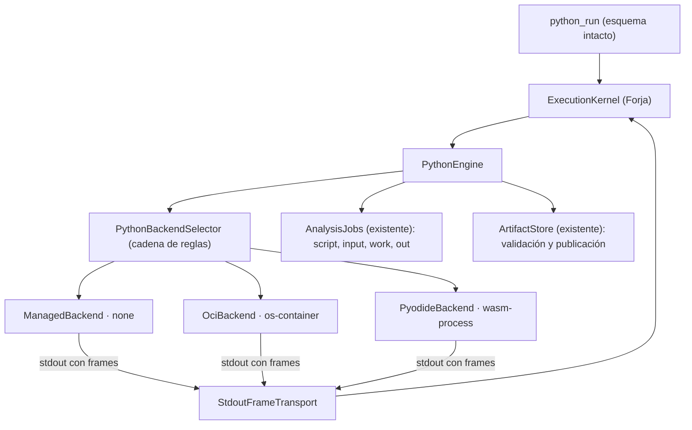

# Especificación Técnica: Forja — motor Python aislado para análisis de datos, IA y dashboards

| Campo | Valor |
|---|---|
| Versión | 1.0 |
| Proyecto | Alisio |
| Estado | **Propuesta, no implementada.** Depende de los contratos de `specs/alisio-forja-v1.md` (Fases 1-2) |
| Fecha | 2026-10-12 |
| Paquetes afectados | `@alisio/core`: `packages/core/src/forge/python/*`, `tools/analysis.ts` (`python_run` delega en el núcleo), `analysis/runtime-manager.ts`, `analysis/oci.ts`, `config.ts`, `alisio_runtime` (módulo `forge.py`); `@alisio/server` (`GET /api/analysis` y `GET /api/forge`); `@alisio/web` (sección Python de la página Forja, insignia en `python_run`, procedencia); `@alisio/alisio-code` (`alisio analysis setup --wasm`, `status`) |
| Paquetes nuevos | Ninguno. **Ninguna dependencia npm nueva**: la distribución de Pyodide se descarga con `alisio analysis setup --wasm` desde una lista fijada con hashes, igual que los extras actuales |
| Relación con otras especificaciones | `specs/alisio-forja-v1.md` es la dueña de `ExecutionKernel`, `ExecutionEngine`, el protocolo, `ForgeResult`, el estado, el journal, la configuración `forge`, la estrategia de pruebas (§12) y la asignación de modelos (§13). Esta especificación los usa y no los redefine |
| Superficies | Web, TUI, headless y API, con paridad |
| Política de versión | Se entrega con la misma minor que Forja JavaScript o con la siguiente. `alisio_runtime.__version__` pasa de `"3"` a `"4"` (aditivo) |

## 0. Cómo usar este documento

Aplican íntegras las reglas de §0 de `specs/alisio-forja-v1.md`: TDD Rojo → Verde → Refactor, etiquetas (verificado)/(no verificado)/(nuevo), repo verde al final de cada fase, sin commit hasta que lo pida el propietario, Sonnet 5.5 por defecto y Opus 5.5 solo en sus tres invocaciones.

**Regla adicional de esta especificación**: antes de tocar `python_run`, `runtime-manager.ts` u `oci.ts`, se escriben **pruebas de caracterización** que fijan el comportamiento actual (§10.1). La adaptación se hace en el paso Refactor con esas pruebas en verde. Sin ellas no se mueve código.

---

## 1. Objetivo

1. **Conservar sin pérdida** todo lo que hoy hace Python en Alisio: `python_run` con `code`, `inputs`, `extras`, `publishOnError`, `timeoutMs`, `title` y `rerunOf`; publicación de artefactos; dashboards HTML con `alisio_runtime` (Chart.js embebido); XLSX, DOCX y PDF; la ruta `/rerun`; concesiones `analysis.run` y `analysis.install`; `alisio analysis setup`.
2. **Aislar** la ejecución Python por defecto cuando haya un backend aislado disponible, con una política explícita y visible. El backend `managed` (sin sandbox) queda como opción etiquetada, nunca oculta.
3. **Añadir un backend WebAssembly** (Pyodide en un proceso hijo restringido) que funciona sin Docker y cubre pandas, NumPy, SciPy, statsmodels, scikit-learn y Matplotlib.
4. **Integrar Python en el núcleo Forja**: mismo ciclo, protocolo, estado JSON compartido con JavaScript, journal, progreso y presentación. Lo que cambia es el motor.
5. Python es el lenguaje para análisis de datos, estadística, IA/ML y dashboards complejos o especiales. JavaScript queda para el resto de tareas con código (decisión O3 de la especificación de Forja).

---

## 2. Decisiones

### 2.1 Del propietario

Las mismas O1-O10 de `specs/alisio-forja-v1.md` §2.1. Aquí aplican sobre todo O3, O4 y O5.

### 2.2 De diseño (vinculantes)

| ID | Decisión |
|---|---|
| PD1 | Un único `PythonEngine` (implementa `ExecutionEngine`) sobre una estrategia `PythonBackend` con tres implementaciones: `ManagedBackend`, `OciBackend` y `PyodideBackend` (patrón Bridge) |
| PD2 | `python_run` mantiene su esquema de entrada actual; el único cambio es un campo opcional nuevo, `codePath` (§5). El modelo no elige backend: lo decide `PythonBackendSelector` de forma determinista (§6) |
| PD3 | `analysis.runtime` amplía su enumeración a `auto \| managed \| oci \| wasm`, con defecto nuevo `auto`. Quien fijó `managed` u `oci` sigue igual |
| PD4 | Nueva clave global `analysis.isolation: "preferred" \| "required" \| "strict"`, con defecto `preferred`. Con `preferred`, `auto` usa `managed` solo si no hay backend aislado apto, y lo muestra. Con `required`, nunca usa `managed` (admite `oci` y `wasm`). Con `strict`, solo admite backends con red bloqueada: `oci`, y `wasm` únicamente si se ejecuta en Node ≥ 25 con el Permission Model bloqueando la red |
| PD5 | Nunca hay fallback tras empezar: una ejecución iniciada que falla no se repite en otro backend. La selección ocurre una vez, antes de preparar |
| PD6 | Pyodide se ejecuta en un **proceso hijo Node** con el Permission Model (`--permission`), con el sistema de archivos limitado al job y sin procesos hijos, workers ni addons. No es una frontera de seguridad equivalente a OCI y se declara como `wasm-process` |
| PD7 | La distribución de Pyodide y sus wheels se descargan solo con `alisio analysis setup --wasm`: versión fijada, SHA-256 por archivo, sin red durante la ejecución. Cargar paquetes desde ese directorio local no es una «instalación» y no pide `analysis.install` |
| PD8 | El canal de Python hacia el núcleo es el protocolo común (Forja §5.4) sin `call` ni `catalog`. Python **no** invoca herramientas, JavaScript, subagentes ni otro `python_run` |
| PD9 | Transporte de Python: líneas de stdout con prefijo de control y nonce por ejecución (§7). El nonce no es una credencial: los mensajes se validan como no confiables y solo pueden emitir progreso, salida, resultado y delta de estado |
| PD10 | El estado JSON llega como archivo snapshot de solo lectura y vuelve como delta en mensajes. Es el mismo `forge_state` que usa JavaScript |
| PD11 | La salida de texto actual de `python_run` hacia el modelo se conserva y solo gana una línea final con motor, aislamiento y motivo |
| PD12 | La procedencia de cada artefacto añade `engine`, `isolation` y `selectionReason` (campos opcionales). `rerunOf` prefiere el backend original si está listo y si la política lo permite |
| PD13 | Pyodide no admite cancelación cooperativa en esta entrega. Cancelación y timeout se aplican por terminación del proceso hijo (`hardTermination`); su memoria se acota con un vigilante de RSS (límite blando, declarado) |

---

## 3. Estado actual del código (verificado 2026-10-12)

| Área | Realidad |
|---|---|
| Herramienta | `python_run` en `packages/core/src/tools/analysis.ts` (`registerAnalysisTools`). Efecto `process`, capacidad `analysis.run`. Input: `code` (≤ 200 000 caracteres) o `rerunOf`, `title`, `inputs[]` (≤ 20, `{path \| datasetId}`), `timeoutMs`, `publishOnError` y `extras[]` (`analysis` \| `science`) |
| Runtime | `AnalysisRuntimeManager` (`analysis/runtime-manager.ts`). `analysis.runtime: managed \| oci` (defecto `managed`), solo global. `managed` descubre el intérprete en este orden: `--python`, `uv python find`, `py -3`, `python3`, `python`, con mínimo 3.10 |
| Extras | `analysis/requirements.ts`, wheels con hash. `analysis` = pandas, numpy, matplotlib, openpyxl, python-docx, reportlab, plotly, jinja2. `science` = `analysis` + scipy, statsmodels, scikit-learn. Se instalan en un venv gestionado tras aprobar `analysis.install`; headless nunca instala |
| `managed` | **No es un sandbox** (`NOT_SANDBOXED`). Se lanza con `-E -s -B -u -X utf8`, entorno filtrado, `HOME`/`TMPDIR` dentro del job y variables `ALISIO_INPUT_DIR`, `ALISIO_OUTPUT_DIR`, `ALISIO_WORK_DIR`, `ALISIO_EXECUTION_ID` y `MPLBACKEND=Agg`. Puede leer archivos del usuario y usar la red |
| `oci` | `analysis/oci.ts` (`ociRunArgs`) lanza Docker o Podman con `--network=none`, `--read-only`, `--cap-drop=ALL`, `no-new-privileges`, `--pids-limit=256`, tmpfs de 256m, memoria y CPU de `analysis.oci.memoryMb` (2048) y `analysis.oci.cpus` (2), y montajes `/job/{script,input,work,out}`. La imagen va fijada por digest y se prepara con `alisio analysis setup --oci` |
| Runtime Python | `alisio_runtime` (`analysis/python/alisio_runtime/`): `outputs.py`, `html.py`, `svg.py`, `charts.py` (con Chart.js embebido), `datasets.py` y `xlsx_to_sqlite.py`. `__version__ = "3"` |
| Publicación | Los archivos de `$ALISIO_OUTPUT_DIR` se publican como artefactos (copia, no en sitio) si el código de salida es 0, o también ante error con `publishOnError`. Los dashboards son artefactos `dashboard` HTML que se ven en un iframe aislado con URL firmada |
| Límites | `analysis.limits.timeoutMs` (120 s por defecto, 900 s máximo), `maxFiles` 200, `maxFileBytes` 100 MB, `maxOutputBytes` 500 MB, `maxLogBytes` 10 MB; salida de terminal hasta 256 KB |
| Persistencia | `analysis_executions`, `artifacts` (`provenance`, `execution_id`), `capability_grants` y `datasets` (migración v6 en `runtime/store.ts`) |
| Rutas | `/api/artifacts/:aid/rerun` (encola la llamada sin modelo y con los mismos gates), artefactos, datasets, capacidades, `GET /api/analysis` |
| Web | `components/settings/AnalysisPage.tsx` (versión de Python, extras, OCI), `components/artifacts/*` (`HtmlFrame` con `sandbox="allow-scripts allow-downloads"`) y la tarjeta de herramienta genérica |

**Hechos externos** (comprobados en esta máquina el 2026-10-12 salvo que se indique):

- `pyodide` 314.0.7 corresponde a Python 3.14, con etiqueta de plataforma `pyemscripten_2026_0`. El paquete npm trae el runtime (`pyodide.asm.wasm`, unos 9,6 MB, más la stdlib) y `pyodide-lock.json`, pero **no** las wheels.
- El lock de 314.0.7 incluye numpy 2.4.6, pandas 3.0.2, scikit-learn 1.8.0, scipy 1.18.0, statsmodels 0.14.6, matplotlib 3.10.8, jinja2, pillow y lxml. **No** incluye openpyxl, plotly, python-docx ni reportlab.
- En Node 22.19, el arranque en vacío tarda unos 1,2 s (RSS unos 155 MB). Cargar e importar pandas, scikit-learn y matplotlib lleva unos 10 s en frío, con RSS de unos 1,3 GB (una sola medición, con descarga de red).
- Pyodide en Bun: sin soporte declarado ni probado. Se usa siempre un proceso hijo **Node**.
- Node Permission Model: estable desde 22.13. Restringe sistema de archivos, procesos hijos, workers, addons y WASI. **En Node 22 y 24 no restringe la red**; `--allow-net` aparece en Node 25. Su documentación advierte que **no protege frente a código malicioso**. Bun no tiene equivalente.
- `setInterruptBuffer` de Pyodide necesita memoria compartida dentro del mismo proceso y no interrumpe una llamada nativa atascada (motivo de PD13).

**Resultados de la Fase P0** (ejecutada el 2026-10-12 con Pyodide 314.0.7 en Node 22.19, Linux). **Puerta superada.**

- **Carga sin red**: funciona desde un directorio local con `indexURL`, `lockFileURL` y `packageCacheDir`, aun habiendo eliminado antes `fetch`, `WebSocket`, `XMLHttpRequest`, `EventSource` y `navigator`. Pyodide usa `node:fs` para rutas y URLs `file://`. Bajo `strace` se registraron 0 llamadas `connect()`.
- **Wheels**: las 24 del lock para el perfil `science` ocupan 46,9 MB, y todas coinciden con el SHA-256 del lock. `sqlite3` viene en la stdlib.
- **Wheels puras de PyPI**: funcionan sin red, cargadas desde archivos locales: openpyxl 3.1.5 + et_xmlfile 2.0.0, python-docx 1.2.0, plotly 7.1.0 + narwhals 2.27.1, y reportlab 5.0.1 + charset_normalizer 3.5.2 (probado solo con un PDF de texto). Al cargarlas desde una URL no se resuelven dependencias, así que el manifiesto lista el cierre completo.
- **Fixtures**: pasan pandas (groupby y merge con nulos), NumPy, scikit-learn (accuracy 0,792), statsmodels OLS, SciPy, jinja2, sqlite3 y un PNG de Matplotlib en `Agg`. Pasan también con el Permission Model activo.
- **`alisio_runtime`**: el dashboard de la prueba de no regresión sale **idéntico byte a byte** al de CPython 3.10 (mismo SHA-256, 223 752 B). `xlsx_to_sqlite` también funciona.
- **Permission Model**:
  - Los flags `--allow-fs-*` se **repiten** por cada ruta; separar rutas por comas no es válido en 22.19.
  - Pyodide no arranca bajo `--permission` sin un shim de `process.binding("constants")`.
  - Bloquea: lecturas fuera del job (`~/.ssh`, el repositorio, `/etc/passwd`), escrituras fuera de `work/` y `out/`, `child_process`, `Worker`, `dlopen` y `subprocess`.
  - `os.system` es denegado y **hace caer** el proceso hijo con salida 2.
  - **No bloquea la red**: un GET con `node:http` desde Python a un servidor en 127.0.0.1 tuvo éxito.
  - **`jsglobals={}` no es una frontera**: `pyodide_js._module.constructor.constructor("return process")` alcanza `process`.
- **Arranque y RSS**, mediana de 5 ejecuciones con la caché de disco caliente:

  | Perfil | Listo | RSS pico |
  |---|---|---|
  | `base` | 1,19 s | 173 MB |
  | `analysis` | 5,37 s | ~500 MB |
  | `science` | 12,3 s | ~1,36 GB |

- **Terminación**: con `while True: pass`, el proceso muere 6-7 ms después de `SIGKILL` y no deja huérfanos.
- **Vigilante RSS** (muestreo cada 250 ms): con límite de 3072 MB se excede entre 5 y 276 MB antes de matar, y el kill tarda ~80 ms en hacer efecto. Un solo array de más de 2 GB falla dentro de Python con `ValueError`.

---

## 4. Arquitectura

### 4.1 Componentes



### 4.2 Contratos (nuevo, `forge/python/`)

```typescript
export type PythonBackendId = "managed" | "oci" | "wasm";

export interface PythonBackend {
  readonly id: PythonBackendId;
  describe(): Promise<EngineDescriptor>;               // tipo de Forja §5.1
  supports(req: PythonRequirements): SupportVerdict;   // puro, sin E/S
  launch(job: PreparedJob, sink: ProcessSink): Promise<RunningProcess>;
  terminate(proc: RunningProcess, reason: TerminationReason): Promise<TerminationReport>;
}

export interface PythonRequirements {
  extras: Array<"analysis" | "science">;    // del input de python_run
  importedModules: string[];                // análisis estático de imports (§6.2)
  inputBytes: number;                       // suma de tamaños de inputs
  rerunOfBackend?: PythonBackendId;         // backend de la ejecución original
}

export type SupportVerdict =
  | { ok: true }
  | { ok: false; reason: string; code: "PROFILE_UNSUPPORTED" | "PACKAGE_UNAVAILABLE" | "INPUT_TOO_LARGE" | "NOT_READY" };
```

`PythonEngine.prepare` reutiliza `AnalysisJobs` para crear `script/`, `input/`, `work/` y `out/`, copia los inputs autorizados y escribe `work/.forge/state.json`. `run` delega en el backend elegido. `collect` reutiliza el publicador de artefactos existente, sin cambiar sus validaciones. Las tres implementaciones comparten `PreparedJob`, `ProcessSink` y el transporte, de modo que solo cambia cómo se lanza y se termina el proceso.

### 4.3 Garantías por backend

| Capacidad | `managed` | `oci` | `wasm` |
|---|---|---|---|
| `isolation` | `none` | `os-container` | `wasm-process` |
| Sistema de archivos del host | Accesible | Solo montajes del job | Solo lectura de la distribución y del job, escritura en `work/` y `out/` (Permission Model) |
| Red | Accesible | `--network=none` | **Accesible en Node 22/24** (verificado: `node:http` alcanzable desde Python vía FFI). Bloqueada por el Permission Model solo en Node ≥ 25 sin `--allow-net` (no verificado). `networkDeniedByOS: false` |
| `hardTermination` | Sí (kill del proceso) | Sí (kill del contenedor) | Sí (kill del proceso hijo) |
| `hardMemoryLimit` | No | Sí (cgroup) | No (vigilante RSS, límite blando) |
| `cooperativeInterrupt` | No (comportamiento actual) | No | No (PD13) |
| Paquetes | Extras instalados en el venv | Los de la imagen | Perfiles descargados por setup |

La UI y `forge_guide("python.environment")` muestran esta tabla según el backend efectivo, nunca una garantía mayor.

---

## 5. `python_run`: compatibilidad

- Los campos de entrada existentes no cambian (PD2). Las peticiones antiguas funcionan igual.
- El efecto `process` y la capacidad `analysis.run` no cambian, y las concesiones por sesión se reutilizan sin preguntar de nuevo: cambiar de backend con el mismo alcance no pide aprobación nueva.
- `extras` sigue pidiendo `analysis.install` **solo** en `managed`, cuando hay que instalarlos en el venv (comportamiento actual). En `oci` y `wasm` los paquetes vienen de la imagen o de la distribución local.
- La salida de texto al modelo es la actual más una línea final (PD11):

  ```text
  engine: python-oci (os-container) · reason: isolation=preferred, oci ready
  ```

- `rerunOf`: mismo control de hash del script que hoy. Si el backend original está listo y lo permite `analysis.isolation`, se usa. Si no, se selecciona de nuevo y el motivo lo dice (`rerun: original backend wasm not ready`).
- La ruta `/api/artifacts/:aid/rerun` no cambia.
- **Aditivo**: `python_run` acepta el campo opcional `codePath`, ruta a un `.py` dentro del scratchpad de la sesión (Forja §9.4). Es excluyente con `code` y con `rerunOf`. El host lee el archivo, lo copia a `script/main.py` y registra su hash igual que con `code`. Así el modelo puede editar un script largo con las herramientas de edición en lugar de reenviarlo entero. Las peticiones sin `codePath` no cambian.
- El código Python existente no necesita cambios: el contrato de archivos (`ALISIO_INPUT_DIR`, `ALISIO_OUTPUT_DIR`, etc.) es el mismo en los tres backends. En `wasm`, esas rutas apuntan al directorio virtual del job.

---

## 6. Selección determinista del backend

### 6.1 Cadena de reglas (`PythonBackendSelector`)

Cada regla es una función pura `(requirements, descriptors, config) → Decision | next`, probada por separado.

1. **Runtime explícito** (`managed`, `oci` o `wasm`): usar ese backend. Si `supports` falla o no está listo, `RUNTIME_UNAVAILABLE` con el motivo y la alternativa (`run "alisio analysis setup --oci"`, `set analysis.runtime=auto`). Nunca hay cambio silencioso.
2. **`rerunOf`**: si el backend original está listo, lo soporta y la política lo permite, usarlo.
3. **`auto`**: recorrer los candidatos en orden `oci` → `wasm` → `managed` y elegir el primero que esté `ready` y cuyo `supports` sea `ok`.
   - `managed` solo es candidato si `analysis.isolation = "preferred"`.
   - Con `analysis.isolation = "strict"`, solo es candidato un backend con `networkDeniedByOS: true`.
   - `wasm` no es candidato si `inputBytes` supera `analysis.wasm.maxInputBytes`, si algún módulo importado no está en los perfiles descargados, o si algún extra pedido no tiene perfil.
4. **Sin candidato**: `RUNTIME_UNAVAILABLE` con la lista de motivos por backend y el comando de preparación más corto.

La decisión (`backend`, `reason`, motivos de los descartados) se guarda en `forge_executions.selection_reason` y en la procedencia.

### 6.2 Análisis estático de imports

Un escáner sin intérprete extrae los nombres de primer nivel de `import x` y `from x import y`, ignorando comentarios y cadenas triples. Una tabla los traduce a paquetes (`sklearn` → `scikit-learn`, `docx` → `python-docx`). **No es un control de seguridad**: solo orienta la selección. Si se equivoca, la ejecución falla con `PACKAGE_UNAVAILABLE` y el error incluye la pista `python.environment`. No hay reintento automático en otro backend (PD5).

---

## 7. Protocolo y transporte

- **`StdoutFrameTransport`**:
  - Una línea de stdout que empieza por `\u001eALISIO-FORGE:<nonce>:` seguida de JSON es un mensaje del protocolo común. El resto de la salida es salida normal del script y conserva sus límites actuales (`maxLogBytes`, 256 KB de terminal).
  - El nonce son 128 bits aleatorios por ejecución, pasados en `ALISIO_FORGE_NONCE`. Solo separa los mensajes de la salida, no autoriza nada.
  - Funciona igual en `managed`, en `oci` (a través de `docker run`) y en `wasm` (por la redirección de `stdout` de Pyodide).
- **Mensajes permitidos** (Forja §5.4): `ready`, `progress`, `output`, `state.set`, `state.delete`, `complete` (con `value` → `ForgeResult.value`) y `fatal`. `call` y `catalog` dan `PROTOCOL_VIOLATION`.
  - Aplican los mismos límites: 256 KiB por mensaje, profundidad 32 y `seq` monotónica.
  - Además, como máximo 1 000 mensajes por ejecución; el exceso se ignora con un aviso, sin abortar.
- **Módulo nuevo `alisio_runtime/forge.py`** (aditivo, `__version__ = "4"`):

  ```python
  from alisio_runtime import forge

  forge.progress("Training model", completed=1, total=3)
  forge.text({"rows": 1200, "accuracy": 0.91})   # salida explícita al modelo
  forge.result({"best_params": {...}})           # valor final (ForgeResult.value)
  last = forge.state.get("last_dataset")         # snapshot de work/.forge/state.json
  forge.state.set("last_dataset", "ds_123")      # delta, se confirma solo si el job termina bien
  ```

  - Sin dependencias, compatible con CPython 3.10+ y Pyodide.
  - Si `ALISIO_FORGE_NONCE` no existe (script ejecutado fuera de Alisio), las funciones degradan a `print` normal.
- **Estado**: se confirma con las reglas de Forja §9.2, después de publicar los artefactos con éxito.

---

## 8. Backend `wasm` (Pyodide)

### 8.1 Preparación: `alisio analysis setup --wasm [--profile analysis|science]`

1. Descarga la distribución de Pyodide de la versión fijada en `forge/python/pyodide-manifest.json` (versión, URL base y SHA-256 por archivo) a `<analysis dir>/pyodide/<version>/`.
2. Descarga las wheels del perfil. Las del lock de Pyodide se toman de su repositorio oficial de paquetes de esa versión. Las puras que faltan (openpyxl, et-xmlfile, python-docx, plotly y, si pasa la Fase P0, reportlab) se toman de PyPI. Todas van fijadas por versión y SHA-256 en el manifiesto.
3. Verifica todos los hashes. Un fallo borra lo descargado y deja el backend no listo.
4. Muestra el tamaño estimado antes de descargar y pide confirmación en modo interactivo.
5. No toca el venv de `managed` ni la imagen OCI.

Perfiles (alineados con los extras actuales para no crear un vocabulario nuevo):

| Perfil | Paquetes |
|---|---|
| `base` | stdlib + `alisio_runtime` (siempre) |
| `analysis` | numpy, pandas, matplotlib, jinja2, openpyxl, python-docx, plotly, reportlab (todos verificados en P0) |
| `science` | `analysis` + scipy, statsmodels y scikit-learn |

Un paquete del perfil que no supere los fixtures de la Fase P0 se retira del manifiesto. Entonces el selector manda los scripts que lo importan a `oci` o `managed`.

### 8.2 Lanzamiento

- **Ejecutable**: `process.execPath` si Alisio corre en Node. En Bun (binario compilado), el primer `node` del `PATH`, solo entre entradas absolutas. En ambos casos el `node` elegido debe incluir la corrección de CVE-2025-55130 (escape de symlinks del Permission Model): ≥ 22.22.0, ≥ 24.13.0 o ≥ 25.3.0, y la línea 23.x se rechaza. Si no hay ninguno válido, el backend no está listo y el motivo nombra la CVE. Esta restricción es solo para `wasm`; el resto de Alisio sigue requiriendo Node ≥ 22.16.
- **Flags**: `--permission`, con un flag por ruta: `--allow-fs-read=<dist>`, `--allow-fs-read=<job>`, `--allow-fs-write=<job>/work` y `--allow-fs-write=<job>/out`. La forma con comas no es válida en 22.19. Sin `--allow-child-process`, `--allow-worker`, `--allow-addons` ni `--allow-wasi`. Con Node ≥ 25, sin `--allow-net`.
- **Shim obligatorio**: antes de cargar Pyodide, `process.binding = (n) => n === "constants" ? { fs: fs.constants } : throwDenied()`. Emscripten lo necesita bajo `--permission`.
- **Salida**: cualquier código de salida distinto de 0 es un fallo (`RUNTIME_CRASH`), incluida la caída por `os.system` denegado.
- **`process.kill`**: el Permission Model lo permite, y desde el FFI un script podría matar al padre (`process.ppid`) o a otros procesos del usuario. El runner sustituye y congela `process.kill`/`process._kill` antes de cargar Pyodide. Es una mitigación, no una frontera, y `wasm-process` lo declara (Forja D-32).
- **Red**: `networkDeniedByOS` sale de una **autoprueba** al preparar el backend: el `node` hijo real, con los mismos flags, intenta conectar a un puerto local de prueba. No se deduce del número de versión (Forja D-32).
- **Entorno vacío** salvo las variables `ALISIO_*` del job. El `cwd` es el job y no se heredan descriptores.
- **Runner** (`forge/python/pyodide-runner.mjs`, código de Alisio):
  1. Antes de cargar Pyodide, elimina `fetch`, `WebSocket`, `XMLHttpRequest`, `EventSource` y `navigator` de `globalThis`.
  2. Llama a `loadPyodide` con `indexURL` y `lockFileURL` locales, `packageCacheDir` en la distribución, `jsglobals` mínimo, `env` del job y `stdout`/`stderr` redirigidos.
  3. Carga solo los paquetes que el análisis de imports y los `extras` requieren, nunca el perfil completo.
  4. Copia inputs y script al sistema de archivos virtual (`/job/...`) y ejecuta el script. Al terminar, copia `/job/out` al `out/` real.
  5. No hay `mountNodeFS` del host salvo los directorios del job.
- **Modelo de amenaza**: el código Python **alcanza** el JavaScript del runner y `process` a través del FFI (verificado en P0: `jsglobals={}` y eliminar globals no lo impiden). En Node 22/24 puede abrir conexiones de red con `node:http`. Por eso el runner no tiene secretos ni capacidades más allá de las que conceden los flags. Todo lo que produce se valida en el host como no confiable: el publicador existente revisa rutas, tamaños y tipos.
- **Memoria**: el padre muestrea el RSS del hijo cada 250 ms y lo mata con `MEMORY_LIMIT` si supera `analysis.wasm.memoryMb` (3072 por defecto). Es un límite blando y se declara `hardMemoryLimit: false`.
- **Tiempo**: aplica el plazo de `python_run`. A ese plazo se le suma un margen de arranque `analysis.wasm.startupMs` (30 000 por defecto; `science` tarda 12,3 s en caliente en P0) que no cuenta como cómputo y se informa por separado en las métricas.

### 8.3 Dashboards y gráficos en `wasm`

`alisio_runtime` (HTML, SVG, Chart.js embebido, `datasets.py`) es Python puro con activos estáticos, así que debe producir los mismos dashboards que en `managed`. Matplotlib usa `Agg` (`MPLBACKEND=Agg`, igual que hoy). Plotly funciona (P0: HTML de 4,8 MB). `xlsx_to_sqlite.py` funciona con `sqlite3` de la stdlib (P0). El dashboard de la prueba de no regresión sale idéntico byte a byte al de CPython.

---

## 9. Superficies

### 9.1 Configuración (en `config.ts`, todo global salvo lo indicado)

```json
{
  "analysis": {
    "runtime": "auto",
    "isolation": "preferred",
    "wasm": {
      "memoryMb": 3072,
      "startupMs": 30000,
      "maxInputBytes": 104857600,
      "nodePath": null
    }
  }
}
```

- `isolation` admite `preferred`, `required` y `strict` (PD4).
- `runtime`, `isolation` y `wasm` son solo globales, como hoy `runtime` y `oci`. Un proyecto no puede cambiarlos; se ignora con un diagnóstico.
- No se pueden cambiar en vivo. La web los muestra con el comando o la clave para cambiarlos.
- `analysis.runtime: "managed"` u `"oci"` explícitos siguen funcionando igual (PD3).
- Migración de comportamiento con `auto` y sin backend aislado listo: se usa `managed`, igual que hoy, ahora con la insignia «host (not sandboxed)».

### 9.2 CLI

- `alisio analysis setup --wasm [--profile analysis|science]` (nuevo); `--extras` y `--oci` no cambian.
- `alisio analysis status` añade una tabla de backends con `ready`, aislamiento, perfiles y motivo.
- `alisio forge status` (definido en Forja) incluye los tres descriptores Python.

### 9.3 API

- `GET /api/analysis`: añade el campo opcional `backends: EngineDescriptor[]` y `isolation`. Los campos actuales no cambian.
- `GET /api/forge`: incluye los descriptores Python.
- Rutas de artefactos, datasets, capacidades y `/rerun`: sin cambios. `GET /api/artifacts/:aid` devuelve la procedencia con los campos nuevos opcionales.

### 9.4 Web

- **Página Forja, sección Python** (sustituye la vista actual de `AnalysisPage.tsx`, conservando toda su información: versión, ruta, extras, sugerencias de instalación y estado OCI):
  - una tarjeta por backend con estado, aislamiento con texto e icono (nunca solo color), perfiles o paquetes, motivo si no está listo y el comando de preparación con botón de copiar;
  - la política `analysis.isolation` y el `runtime` efectivo en solo lectura, con la clave para cambiarlos.
- **Tarjeta `python_run`**: insignia de motor y aislamiento y la línea `selectionReason` (Forja §11.2). Progreso desde `forge.progress` en la barra existente.
- **Panel de artefacto** (`ArtifactDetails`): la procedencia muestra motor, aislamiento y motivo.
- **Dashboards**: sin cambios de visor (`HtmlFrame`, iframe aislado y URL firmada). Prueba de regresión: un dashboard generado en cada backend se abre en el panel.
- **i18n** EN/ES con paridad.
- **Capturas** con Playwright contra `alisio serve` y un proveedor falso guionizado, sin datos reales:
  - `docs/assets/web-ui/forge_python_backends_web_ui.webp` (sección Python con los tres backends);
  - `docs/assets/web-ui/forge_python_run_badge_web_ui.webp` (tarjeta con insignia y motivo).

### 9.5 TUI y headless

- TUI: la línea de `python_run` añade `· oci` / `· wasm` / `· host!` y el progreso de `forge.progress`.
- Headless: igual que hoy, más `ForgeProgress` en `tool_progress`. `setup --wasm` en modo no interactivo exige `--yes`.

---

## 10. Pruebas

Aplica íntegra la estrategia de Forja §12: Rojo → Verde → Refactor, sin instantáneas y mutation testing **lite**. El único módulo de esta especificación que entra en `mutate` es `forge/python/backend-selector.ts`, junto con la tabla de imports si es lógica pura.

### 10.1 Caracterización primero (Fase P1, antes de mover código)

Se fija el comportamiento actual con las fixtures existentes (`fixtures/fake-python.mjs`, `fixtures/fake-container.mjs` y `tests/analysis-run-helpers.ts`):

- La salida de texto de `python_run` en éxito, error, timeout y `publishOnError`.
- Los artefactos publicados (nombres, tipos, procedencia actual).
- `rerunOf` con hash correcto e incorrecto.
- La aprobación de `analysis.install` con `extras` en `managed`, y en headless (que no instala).
- Los argumentos de `ociRunArgs`.
- La ruta `/rerun` con sesión ocupada (`409 runs_active`).

Las pruebas existentes `analysis-python-run`, `analysis-oci`, `analysis-rerun`, `analysis-capabilities`, `server-artifacts`, `dashboard-*` y `web-artifact-panel` siguen en verde **sin modificarse**. La única excepción es la línea final de PD11, que se añade a las expectativas de forma explícita.

### 10.2 Matriz de aceptación

| ID | Caso | Resultado exigido |
|---|---|---|
| FP-AC-01 | Petición antigua de `python_run` sin cambios de config | Mismo resultado y artefactos que antes, más la línea PD11 |
| FP-AC-02 | `analysis.runtime: managed` explícito | Usa `managed`, nunca otro |
| FP-AC-03 | `auto` + OCI listo | Usa `oci`; motivo registrado |
| FP-AC-04 | `auto` + OCI no listo + `wasm` listo + script pandas | Usa `wasm` |
| FP-AC-05 | `auto` + `wasm` listo + script con un paquete fuera del perfil | Descarta `wasm` con motivo; usa el siguiente apto |
| FP-AC-06 | `isolation: required` y solo `managed` disponible | `RUNTIME_UNAVAILABLE` con comandos de preparación; nunca ejecuta en el host |
| FP-AC-07 | `runtime: wasm` explícito e incompatible | Error con alternativa; sin cambio silencioso |
| FP-AC-08 | Falla tras empezar en `wasm` | No se reintenta en otro backend |
| FP-AC-09 | Concesión `analysis.run` por sesión y cambio de backend | No se pregunta de nuevo |
| FP-AC-10 | Dashboard con `alisio_runtime.charts` en `managed`, `oci` y `wasm` | Artefacto `dashboard` publicado y visible en `HtmlFrame` en los tres |
| FP-AC-11 | Entrenar y evaluar un modelo scikit-learn (perfil `science`) en `wasm` y `oci` | Métricas equivalentes dentro de la tolerancia del fixture |
| FP-AC-12 | XLSX → SQLite (`xlsx_to_sqlite`) en `wasm` | Mismo resultado que en `managed`, o el selector excluye `wasm` si la Fase P0 lo descartó |
| FP-AC-13 | `wasm`: conexión de red desde Python (FFI → `node:http`) | En Node 22/24: el descriptor declara `networkDeniedByOS: false`, la UI lo muestra y `isolation: strict` excluye `wasm`. En Node ≥ 25: conexión denegada |
| FP-AC-14 | `wasm`: leer `~/.ssh` o el repositorio | Denegado por el Permission Model |
| FP-AC-15 | `wasm`: `subprocess`, `os.system` o workers | Denegado |
| FP-AC-16 | `while True: pass` en cada backend | `TIMEOUT`; proceso o contenedor terminado y confirmado; núcleo responsivo |
| FP-AC-17 | `wasm`: reservar memoria sin límite | `MEMORY_LIMIT` por el vigilante; el núcleo sigue |
| FP-AC-18 | Frames falsos (otro nonce, `call`, gigantes, 10 000 mensajes) | Ignorados o `PROTOCOL_VIOLATION`; ninguna autorización extra |
| FP-AC-19 | `forge.state.set` en Python y `state.get` en `js_run` posterior | El valor llega a JavaScript |
| FP-AC-20 | Python falla tras `forge.state.set` | Delta descartado |
| FP-AC-21 | `rerunOf` con el backend original no listo | Selección nueva con motivo `rerun: …` |
| FP-AC-22 | `setup --wasm` con un hash incorrecto | Descarga descartada; backend no listo |
| FP-AC-23 | Ejecución `wasm` sin red (`fetch` eliminado y sin descargas) | Carga paquetes solo del directorio local |
| FP-AC-24 | Procedencia del artefacto | Contiene `engine`, `isolation` y `selectionReason` |
| FP-AC-25 | Web: sección Python con los tres estados y tarjeta con insignia | Visible, operable por teclado, EN/ES |
| FP-AC-27 | `wasm`: `process.kill(process.ppid)` desde el FFI | Denegado por el shim; el padre sigue vivo |
| FP-AC-28 | `wasm`: la autoprueba de red detecta conexión | `networkDeniedByOS: false`; `strict` excluye `wasm` |
| FP-AC-26 | Binario compilado (Bun) sin `node` en `PATH` | `wasm` no listo con motivo; `oci`/`managed` siguen |

Las pruebas con Pyodide real (FP-AC-04, 10-17 y 23 en `wasm`) se activan con `ALISIO_TEST_PYODIDE=1` porque son lentas (≈ 10 s por arranque en frío). Se ejecutan al cerrar las Fases P3 y P4 y antes del release, no en cada `pnpm test`. Su lógica de selección y transporte tiene pruebas rápidas con un backend falso que siempre corren.

---

## 11. Fases (se encajan en las Fases 0, 4 y 5 de Forja)

**P0 (dentro de la Fase 0 de Forja): experimentos de Pyodide**

1. Carga offline real desde un directorio local con `indexURL`/`lockFileURL`.
2. Fixtures de pandas, NumPy, scikit-learn, statsmodels y Matplotlib (PNG).
3. `alisio_runtime` completo, incluido un dashboard y `xlsx_to_sqlite`.
4. micropip/wheel local para openpyxl, python-docx, plotly y reportlab.
5. Permission Model: lecturas fuera del job y `subprocess`.
6. Ausencia de `fetch` tras limpiar `globalThis`.
7. Medición de arranque y RSS por perfil.
8. Vigilante RSS y kill.

Resultados en `docs/implementation-status.md`; la revisión Opus de la Fase 0 de Forja los incluye. **Puerta**: si Pyodide no supera los fixtures `base` + `analysis` mínimos (pandas, NumPy, Matplotlib, dashboard con `alisio_runtime`), se entrega P1-P2 y `wasm` queda documentado como bloqueado, sin anunciarlo.

**P1 (Fase 4 de Forja): caracterización**

Las pruebas de §10.1, todas en verde contra el código actual.

**P2 (Fase 4 de Forja): adaptación sin cambio de comportamiento**

`PythonEngine`, `ManagedBackend` y `OciBackend` envuelven `AnalysisRuntimeManager` y `ociRunArgs` sin alterar su salida. `python_run` delega en `ExecutionKernel`. Se añaden `StdoutFrameTransport`, `alisio_runtime/forge.py`, procedencia, journal y estado compartido. Aceptación: FP-AC-01, 02, 03, 09, 10 (`managed`/`oci`), 18-21 y 24.

**P3 (Fase 5 de Forja): backend `wasm`**

Manifiesto, `setup --wasm`, runner, flags, vigilante, `PyodideBackend` y estado de preparación. Aceptación: FP-AC-04, 10-17, 22, 23 y 26 (con `ALISIO_TEST_PYODIDE=1`).

**P4 (Fase 5 de Forja): selección y superficies**

- `PythonBackendSelector`, análisis de imports, `analysis.runtime: auto` y `analysis.isolation`.
- CLI, API, web, TUI y temas `python.*` de `forge_guide` (Forja §8.3).
- Aceptación: FP-AC-05..08, 25. Cierra con `pnpm test:mutation`.

---

## 12. Definición de terminado

- Toda la funcionalidad Python previa sigue funcionando: las pruebas existentes pasan sin cambios, salvo la línea PD11, y FP-AC-01/02/10 están en verde.
- `python_run` corre en `managed`, `oci` y, si P0 lo permitió, `wasm`, con selección determinista, motivo visible y sin fallback tras empezar.
- Con `analysis.isolation: required`, ningún script Python corre en el host.
- Python y JavaScript comparten núcleo, protocolo, estado, journal y presentación. Python no puede invocar herramientas ni JavaScript.
- La web muestra los backends, el aislamiento efectivo y la procedencia. Hay capturas EN/ES.
- `docs/implementation-status.md` documenta los límites de §13 sin presentarlos como garantías.

## 13. Riesgos y límites conocidos

| Riesgo | Decisión |
|---|---|
| El FFI de Pyodide alcanza el JavaScript del runner | El runner no tiene secretos; flags del Permission Model; validación en el host. Se declara `wasm-process`, no `os-container` |
| El Permission Model no es una frontera frente a código malicioso y no restringe la red en Node 22/24 (verificado en P0: `node:http` alcanzable) | Se declara en la UI y en la documentación. `oci` es el primer candidato de `auto`. `required` excluye el host. `strict` excluye además `wasm` mientras la red no esté bloqueada |
| Memoria de `wasm` sin límite duro | Vigilante RSS con kill; `hardMemoryLimit: false` visible; datos grandes → `oci`/`managed` por `maxInputBytes` |
| Arranque lento de Pyodide (≈ 10 s con el stack científico) | Carga solo los paquetes importados; margen de arranque separado del plazo de cómputo; `oci` sigue primero en `auto` |
| Paquetes ausentes del lock de Pyodide | Wheels puras fijadas por hash; las que no pasan P0 se retiran y el selector las enruta a otro backend |
| Bun sin Pyodide | Siempre proceso hijo Node; sin Node, `wasm` no está listo y se explica |
| Resultados numéricos distintos entre backends | Fixtures con tolerancias versionadas; se muestran motor y versión en la procedencia |
| Cambiar el defecto a `auto` altera dónde se ejecuta | Solo cambia si hay un backend aislado listo; `managed`/`oci` explícitos se respetan; motivo siempre visible |
| El análisis de imports se equivoca | No es seguridad; error `PACKAGE_UNAVAILABLE` con pista; sin reintento automático |
