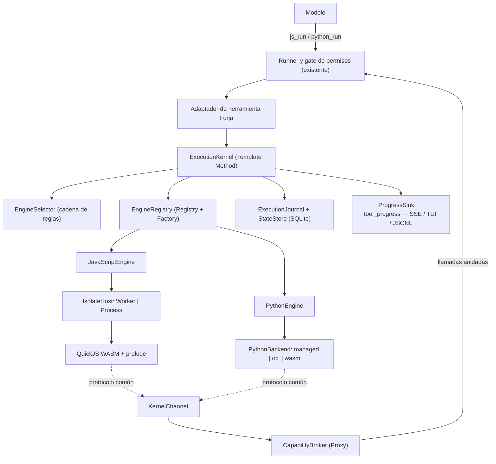
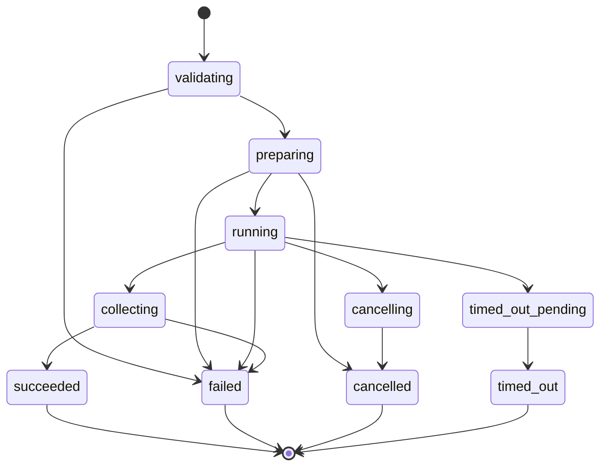

# Especificación Técnica: Forja — ejecución aislada de código (núcleo común y motor JavaScript)

| Campo | Valor |
|---|---|
| Versión | 1.0 |
| Proyecto | Alisio |
| Estado | **Implementada (fases 0-8a)**. Ver `docs/implementation-status.md` |
| Fecha | 2026-10-12 |
| Paquetes afectados | `@alisio/sdk` (tipos aditivos: `ForgeProgress`, `EngineDescriptor`, campos opcionales de procedencia), `@alisio/core` (nuevo `packages/core/src/forge/*`, herramientas `js_run` y `forge_guide`, adaptación de `python_run`, migración SQLite, configuración `forge`), `@alisio/server` (ruta `GET /api/forge`, carga útil de progreso por SSE), `@alisio/web` (privado: tarjeta de `js_run`, insignia de motor, página de ajustes), `@alisio/alisio-code` (TUI: progreso; CLI: `alisio forge status`) |
| Paquetes nuevos | Ninguno. Una dependencia de producción nueva en `@alisio/core`: `quickjs-wasi` (versión exacta). Dependencia de desarrollo: `@stryker-mutator/core` (§12.3, D-27) |
| Relación con otras especificaciones | Se complementa con `specs/archive/008-forja-python-v1.md`, que define el motor Python sobre este mismo núcleo. Esta especificación es la dueña de los contratos comunes; la de Python no los redefine. Es independiente de `specs/019-capability-routing-v1.md` (pausada): si esta se reanuda, `js_run`, `python_run` y `forge_guide` forman la familia `forge` |
| Superficies | Web, TUI y headless (`alisio run`) con paridad funcional; API HTTP de `alisio serve` |
| Política de versión | Funcionalidad nueva: **la siguiente minor al ejecutar**. Aditiva, salvo que `js_run` reemplaza a `execute` (D6) |

## 0. Cómo usar este documento (para agentes de código)

1. Lee primero `AGENTS.md` y `CONTRIBUTING.md`; prevalecen sobre este documento.
2. Etiquetas: **(verificado)** = comprobado leyendo el repositorio o ejecutando una prueba el 2026-10-12; **(no verificado)** = deducido o externo sin prueba ejecutada en este repositorio; **(nuevo)** = no existe.
3. **TDD estricto Rojo → Verde → Refactor** (§12). Ninguna línea de producción sin una prueba que falle antes. Pruebas en `tests/*.test.ts`, sobre comportamiento en límites de módulo. Sin pruebas de instantánea.
4. **Orden obligatorio**: Fase 0 (experimentos y mediciones) → el propietario revisa el informe → Fases 1-8. Cada fase deja el repo verde con `pnpm typecheck`, `pnpm lint`, `pnpm test`, `pnpm build`, `pnpm test:cli`, `pnpm test:compiled`, `pnpm pack:check`, `pnpm docs:check` y `pnpm docs:build`. No hagas commit hasta que lo pida el propietario.
5. **Asignación de modelos**: §13. Por defecto Sonnet 5.5; Opus 5.5 solo en los tres puntos listados.
6. Reglas del repo que no se rompen: solo pnpm; Node >=22.16 y debe funcionar en Bun; solo APIs portables de Node en los paquetes; ningún SDK de proveedor ni import específico de runtime en `@alisio/sdk` ni en los contratos del core; los plugins dependen solo de `@alisio/sdk`; preservar IDs de llamadas a herramientas, datos de continuación del proveedor y consistencia de sesión persistida; **un manifiesto de plugin o un subproceso no es un sandbox**.
7. Los contratos son aditivos: ninguna ruta, evento ni columna existente cambia de semántica, salvo lo indicado en D6.
8. Idioma: identificadores, claves, mensajes de error y textos generados en inglés; textos de UI en inglés y español (`src/i18n/en.ts` y `es.ts`); esta especificación en español.

---

## 1. Objetivo, alcance y principio rector

### 1.1 Objetivo

Que el agente pueda **resolver con código** una parte de una tarea, en un entorno aislado, eligiendo el lenguaje que mejor encaja:

- **JavaScript** (motor nuevo, QuickJS compilado a WebAssembly) para componer herramientas, paginar, filtrar y resumir resultados, transformar JSON y texto, inspeccionar el repositorio con varias lecturas y hacer cálculos ligeros. Es rápido de arrancar (milisegundos) y no tiene más capacidades que las herramientas que el núcleo le presta.
- **Python** (motor existente, ampliado en `specs/archive/008-forja-python-v1.md`) para análisis de datos, estadística, aprendizaje automático (scikit-learn, SciPy, statsmodels), gráficos y la construcción de dashboards complejos o especiales con `alisio_runtime`.

Los dos lenguajes conviven bajo un **núcleo común**: identidad de ejecución, ciclo de vida, límites, protocolo de mensajes, estado, eventos, persistencia y presentación. Lo que cambia es el **motor** y el **lenguaje** que escribe el modelo.

### 1.2 Principio rector

**El script es una entrada no confiable; el núcleo de Alisio es la única autoridad.** Ningún motor obtiene red, sistema de archivos, procesos ni credenciales salvo a través de herramientas del núcleo que ya pasan por el gate de permisos. El contexto del modelo crece por capas, solo cuando hace falta (§8).

### 1.3 Nombre de la funcionalidad

«Modo código» se llamará **Forja** (identificador `forge`): el lugar donde se da forma a algo con herramientas. Alternativas evaluadas, con el mismo significado:

| Nombre | Identificador | Comentario |
|---|---|---|
| **Forja** (elegido) | `forge` | Corto, evoca «construir con herramientas», sin colisión en el repo |
| Taller | `workshop` | Claro en español; identificador largo |
| Crisol | `crucible` | Evoca mezcla y contención; menos evidente |
| Laboratorio | `lab` | Encaja con datos; sugiere experimentación más que composición |
| Modo Script | `script` | Literal; choca con «script» de Python y de artefactos |

Ningún nombre de herramienta pública contiene `forge` salvo `forge_guide`, así que renombrar la funcionalidad cuesta poco: módulo `packages/core/src/forge/`, clave de configuración `forge`, ruta `GET /api/forge`, textos i18n y documentación.

### 1.4 Alcance

Núcleo de ejecución común (`ExecutionKernel`), registro y selección de motores, protocolo común, motor JavaScript (`quickjs-wasi` en un host aislado), herramienta `js_run` que reemplaza a `execute`, herramienta `forge_guide` para contexto incremental, regla de enrutamiento en el prompt, estado JSON compartido entre lenguajes, persistencia del journal, eventos de progreso, API, UI web, TUI, headless, documentación EN/ES y pruebas.

### 1.5 Fuera de alcance

| Excluido | Motivo |
|---|---|
| Ejecutar código del agente en el navegador | La web es un cliente; el código se ejecuta en `alisio serve` o en la CLI |
| Imports, `require`, npm o módulos dentro de la VM | Semántica mínima; las capacidades llegan por herramientas |
| TypeScript dentro de `js_run` | Una entrega posterior podrá transpilar fuera de la VM; no es frontera de seguridad |
| Recetas reutilizables, caché de lecturas, checkpoints y replay | Posteriores; requieren evidencia de uso |
| Subagentes desde la VM | Ya existen como herramientas; si se exponen, pasan por el gate como cualquier llamada |
| Snapshots de la VM | `quickjs-wasi` los ofrece, pero no se exponen ni se usan (D9) |
| Sandbox de herramientas del host (shell, MCP, plugins) | Siguen con su política actual; Forja no las vuelve aisladas |

---

## 2. Decisiones

### 2.1 Decisiones del propietario (confirmadas, se aplican exactamente)

| ID | Decisión |
|---|---|
| O1 | La funcionalidad tiene un nombre distinto de «modo código»; se adopta **Forja** (§1.3), renombrable |
| O2 | Dos lenguajes conviven: JavaScript y Python. Comparten un mecanismo de comunicación común; cambian el motor y el lenguaje |
| O3 | Python se usa cuando se requiere análisis de datos, IA/ML (scikit-learn y similares), estadística o dashboards complejos. JavaScript se usa para el resto de tareas en las que resolver con código es más rápido, eficiente o simple |
| O4 | Ambos motores se ejecutan de forma aislada |
| O5 | No se pierde ninguna funcionalidad existente de Python: `python_run`, `rerunOf`, artefactos, dashboards HTML, extras `analysis`/`science`, `alisio analysis setup` y la ruta `/rerun` |
| O6 | Diseño con polimorfismo, abstracciones y patrones de diseño explícitos (§4) |
| O7 | El contexto para cada lenguaje se carga de forma incremental y adaptativa, nunca todo de una vez (§8) |
| O8 | TDD Rojo → Verde → Refactor; mutation testing **lite**: barato, acotado y sin pruebas irrelevantes (§12.3) |
| O9 | Sonnet 5.5 para codificación y tareas sin análisis profundo; Opus 5.5 solo donde se requiere razonamiento complejo, en el mínimo de invocaciones (§13) |
| O10 | Se cubre la web, no solo la API |

### 2.2 Decisiones de diseño (vinculantes)

| ID | Decisión |
|---|---|
| D1 | Un `ExecutionKernel` común ejecuta cualquier motor mediante un ciclo de vida fijo (Template Method). Los motores son estrategias intercambiables (`ExecutionEngine`) |
| D2 | El motor JavaScript usa `quickjs-wasi` (MIT, 0 dependencias). La versión 3.6.2 se fija exacta tras la Fase 0 |
| D3 | Una VM nueva por ejecución. El `WebAssembly.Module` se compila una vez por proceso y se reutiliza; no se reutilizan memoria ni globals |
| D4 | La VM corre fuera del hilo principal, en un `IsolateHost` con dos implementaciones: `WorkerIsolateHost` (`node:worker_threads`) y `ProcessIsolateHost` (proceso hijo del mismo ejecutable). La selección es determinista según el runtime (§6.3) |
| D5 | La cancelación nunca depende de que el aislado atienda un mensaje: `interruptHandler` con plazo local y bandera compartida, más terminación externa verificada |
| D6 | `js_run` reemplaza a `execute`. `execute` deja de registrarse cuando Forja JavaScript está habilitada. Las sesiones persistidas con llamadas `execute` se siguen mostrando sin cambios. No hay fallback a `node:vm` |
| D7 | Las llamadas anidadas pasan por el **mismo gate** del runner que una llamada directa y **nunca abren una aprobación nueva**: si la requieren, fallan con `APPROVAL_REQUIRED`. `execute` hoy **no** cumple del todo esta regla (ver D-28): usa la política global y no aplica `toolFilter`. `js_run` sí la cumple (D-24) |
| D8 | Desde `js_run`, `python_run` solo es alcanzable con `--allow-analysis` o `--allow-process`, nunca con una concesión almacenada. Es la regla actual de `execute` (verificado). Una aprobación de sesión que concede `process` habilita `python_run` igual en llamadas directas y anidadas (equivalencia de política). Python nunca llama a JavaScript. Las concesiones almacenadas no se aplican a llamadas anidadas; una llamada directa con concesión puede ejecutarse mientras la anidada recibe APPROVAL_REQUIRED — decisión deliberada |
| D9 | No se exponen al script `snapshot`, `restore`, extensiones de `quickjs-wasi`, temporizadores, `Atomics`, `SharedArrayBuffer` ni `WebAssembly`. No se cargan extensiones (`url`, `encoding`, `headers`, `crypto`, `structured-clone`) |
| D10 | El protocolo es un único esquema lógico de mensajes (§5.4) con varios transportes: puerto de worker, framing por stdio del proceso hijo y framing por stdout de Python. El transporte es un adaptador; el esquema no cambia |
| D11 | El estado entre ejecuciones es JSON pequeño con semántica «snapshot de entrada, delta de salida»: se confirma solo si la ejecución termina bien, con comparación de revisión. Es común a ambos lenguajes |
| D12 | El contexto llega en tres capas: regla de enrutamiento siempre presente si hay algún motor (≤ 900 caracteres), descripciones cortas de herramientas, y guías bajo demanda con `forge_guide` generadas desde el estado real del motor |
| D13 | El catálogo de herramientas no se incrusta en el prompt de `js_run`: la VM lo descubre con `catalog.search` y `catalog.describe` |
| D14 | Los eventos de progreso viajan dentro de `tool_progress` existentes con una carga `forge` tipada. No se crea un `RunEvent` nuevo |
| D15 | Persistencia en tablas nuevas `forge_executions`, `forge_calls` y `forge_state` (migración aditiva). `analysis_executions` no cambia; se enlaza por columna |
| D16 | Configuración global `forge` (§10). Los proyectos solo pueden **reducir** límites, nunca ampliarlos |
| D17 | Fallo cerrado: si `quickjs-wasi` no carga, el WASM no coincide con su hash o el host no pasa la autoverificación, `js_run` no se registra y `alisio forge status` muestra el motivo |
| D18 | Mutation testing con Stryker en configuración lite (§12.3), fuera de `pnpm check` y de CI |
| D19 | Cada sesión raíz tiene un **directorio de sesión volátil** con `scratchpad/` y `tasks/` bajo el directorio temporal del sistema, privado del usuario (§9.4). Ahí el modelo escribe `.js`, `.py` y archivos intermedios; lo durable sigue en el directorio de estado |

### 2.3 Decisiones de la Fase 0 (cerradas por la revisión Opus 1/3, 2026-10-12)

Precisan o corrigen D1-D19. Donde haya conflicto, prevalecen estas.

| ID | Decisión |
|---|---|
| D-20 | **Host por runtime.** Node: siempre `WorkerIsolateHost`. Bun (directo o binario): `ProcessIsolateHost`. `host:"process"` en Node solo para diagnóstico. Medido: en Node `terminate()` cierra en ~1 ms (10/10); en Bun tarda entre 20 y 3 702 ms. Arranque ~28 ms (worker Node) y ~27 ms (proceso Bun) |
| D-21 | **Cancelación.** El padre decide plazo y terminal con su propio reloj. Worker: bandera, y si no hay `exit` en 50 ms, `terminate()`; se confirma con el evento `exit`. Proceso: cancelación del usuario → `SIGKILL` inmediato; plazo → `interruptHandler` local más `SIGKILL` de respaldo en plazo + 500 ms. Al vencer el plazo se aborta la señal de las llamadas anidadas: mientras el invitado espera una llamada no ejecuta bytecode y el handler no corre. `__forge-isolate` se despacha antes de cargar configuración o SQLite, exige `ALISIO_FORGE_ISOLATE=1` y lee `argv.slice(2)` (en el binario `argv[1]` es `/$bunfs/...`) |
| D-22 | **Carga del WASM.** Asset de Bun con import dinámico protegido por `process.versions.bun`. En Node, `createRequire(import.meta.url).resolve("quickjs-wasi/quickjs.wasm")`. El manifiesto es una constante TS (`runtime-manifest.ts`, no JSON, porque `tsc` no copia JSON a `dist`). SHA-256 `d4c9375f2b1ca4dc95f72c8aa2982a7a9951ac8011490d79c6582df732b4bbd9` (637 405 B), verificado sobre los bytes leídos antes de compilar, en el padre (D17) y en el proceso hijo. La Fase 3 empieza comprobando que `tsc` 7 conserva `with {type:"file"}`; si no, embebido generado solo dentro de `binary-build.ts` |
| D-23 | **Efecto de `js_run`: `read`, con tres cambios en el runner**, cada uno con caracterización previa. (a) `runner.ts` ~1546: el lote paralelo de lecturas respeta `concurrent:false` (`concurrent !== false && (read \|\| concurrent === true)`). (b) La ejecución lleva una marca `effectful` que se activa al **empezar** cualquier llamada anidada que no sea `read`/`internal`. `runner.ts` ~911 solo cierra como no pendiente una lectura cancelada si `!effectful`, de modo que un `js_run` cancelado tras escribir queda pendiente para la recuperación normal. En `forge_calls` esas llamadas quedan `started` y la fila de `forge_executions` queda `cancelled`. (c) Cada llamada anidada pasa por `scope.guard(efecto anidado)`. `amend` no cambia. Se descarta `internal` |
| D-24 | **Contexto de una llamada anidada** (puerto interno del core, sin cambios en el SDK). Aplica el `toolFilter` y `optInAllows` del run. Usa la política **viva del run** (`options.policy ?? o.policy`). Usa `decideEffect` con `approvals:false` y `capabilityGranted:false`. Resuelve `tool.paths` con `interactive:false` antes del gate. Incluye `decisions` y `artifacts` ligados al `callId` padre. `approveInstall` es siempre `"deny"`. Tiene fila en `forge_calls` con ID `${callId}:forge:${n}`, que nunca entra en `tool_calls`. Limitación documentada: no carga instrucciones con ámbito (`beforePaths`) |
| D-25 | **Gate extraído.** `decideEffect(policy, tool, {approvals, capabilityGranted}) → {kind:"allow", via:"effect"\|"flag"\|"grant"} \| {kind:"ask"} \| {kind:"deny"}`, extraído de `runner.ts` ~259-264, ~394-404 y ~717-737, y de `execute.ts` ~46-49 y ~70-80. Cuidados: la política se pasa por referencia, porque una concesión de sesión la amplía; el efecto por defecto es `external`; `ask` solo existe para `write`/`process`/`external`; `catalog.search` filtra con `approvals:false` |
| D-26 | **Prelude.** Borrar `SharedArrayBuffer`, que existe en la VM. Quitar el callback del puente de `globalThis` tras capturarlo. Capturar las intrínsecas que usa el prelude (`Promise.prototype.then`, `JSON.*`, `Array.prototype.*`). Los invariantes de seguridad (créditos, concurrencia, tamaños) se comprueban **en el host**; en el prelude solo mejoran la experiencia. `host_module_load` rechaza siempre. `queueMicrotask` se mantiene, con el plazo comprobado entre trabajos. `Date`, `Math.random` y `performance.now` quedan reales, sin promesa de determinismo |
| D-27 | **Mutation testing lite: Stryker con `testRunner:"command"`** (incluido en `@stryker-mutator/core`), `commandRunner.command: "vitest run --config vitest.mutation.config.ts"` y `coverageAnalysis:"off"`. Sin `@stryker-mutator/vitest-runner`, sin `ignoreStatic`, sin `vitest.related` y sin checker de TypeScript (incompatible con TS 7). Motivo: el runner de Vitest ejecuta 0 pruebas por mutante con Vitest 5.0.1 y da un 0 % falso. Validez: el dry run en verde y dos mutantes de control `killed`. Presupuesto: el paso completo de Stryker dura ≤ 5 min y cada ejecución de `pnpm test:mutation` ≤ 2 min; si se pasa o falla el control, se quita y se documenta, sin iterar |
| D-28 | **Defecto actual de `execute`**: usa la política global (`application.ts` ~562, `runner.policy`) y no aplica `toolFilter`, así que un subagente con `write` denegado lo esquiva. La caracterización de `execute` lo fija como **fallo conocido**, no como comportamiento a conservar. `js_run` lo corrige (D-24). FJ-AC-05/06 añaden el caso de sesión hija |
| D-29 | **Interbloqueo con subagentes.** `task`, `task_wait` y `send_message` (`internal`, plugin integrado) se excluyen de la VM en v1 (`FORGE_EXCLUDED_TOOLS`). El slot de `js_run` es **1 por sesión** (no por sesión raíz); 4 por proceso |
| D-30 | **Esquema de `js_run`**: `code` y `codePath` son propiedades opcionales sin `oneOf`; la exclusión mutua se valida en `execute` con `INVALID_INPUT` |
| D-31 | **Panel de cambios.** `forge_calls` gana `paths_json` (solo para el efecto `write`) y `/api/sessions/:sid/changes` lo incorpora en la Fase 7, porque las escrituras anidadas no aparecen en `effectCalls("write")` |
| D-32 | **Python `wasm`** (detalle en su especificación): `networkDeniedByOS` sale de una **autoprueba de red** con el `node` hijo real, no del número de versión. El runner sustituye y congela `process.kill`/`_kill` (mitigación, no frontera) |
| D-33 | **Entrada del worker con `alisio-source`.** Resuelve `entry.ts`, y Node 22.16 no quita tipos por defecto (lo hace desde 22.18). La entrada usa solo sintaxis TS borrable. Las pruebas del host worker corren con Node ≥ 22.18; si no es posible, se usa el host de proceso sobre `dist` |

---

## 3. Estado actual del código (verificado 2026-10-12)

| Área | Realidad |
|---|---|
| JavaScript actual | Herramienta `execute` en `packages/core/src/tools/execute.ts` (`runExecute`), registrada en `tools/standard.ts`. Usa `node:vm` y declara que **no** es una frontera de seguridad. Límites constantes `EXECUTE_TIMEOUT_MS = 10_000` y `MAX_NESTED_CALLS = 20`. Expone `callTool(name, input)`. No puede llamarse a sí misma ni llamar herramientas opt-in. Sin configuración |
| Python actual | `python_run` en `packages/core/src/tools/analysis.ts`, efecto `process`, capacidad `analysis.run`. Backends `managed` (sin sandbox) y `oci` (Docker/Podman endurecido). Detalle en la especificación de Python |
| Registro | `ToolRegistry` (`core/registry.ts`). Nombres `^[a-zA-Z0-9_-]{1,64}$`. Esquemas de entrada objeto compilados con Ajv (`strict: true`), sin `$ref`/`$id`/`$async` |
| Contrato de herramienta | `ToolDefinition` en `packages/sdk/src/index.ts`: `name`, `description`, `inputSchema`, `effect?`, `concurrent?`, `paths?`, `capability?`, `execute(input, ctx)`. `ToolContext` aporta `emit`, `signal`, `session`, `workspace`, `approveInstall`, `artifacts`, `decisions` |
| Efectos y modos | `Effect = read \| write \| process \| external \| internal`. Modos `ask`, `auto`, `full` en `PERMISSION_MODE_TABLE` (`permissions/modes.ts`): `ask` no permite `write`/`process`/`external` sin preguntar; `auto` permite `write`; `full` permite `write`, `process` y `external` |
| Gate | `core/runner.ts`: filtro de herramientas ofrecidas y gate por llamada (rutas externas, capacidad/efecto y `approve()`). Concesiones `session` en `capability_grants` |
| Prompt | `ProjectContext.instructions()` (`resources/context.ts`) une preámbulo, cadena de `AGENTS.md` (32 KB) y `extras`. `DASHBOARD_PROMPT_RULE` se añade por `extras` solo si la herramienta está registrada |
| Skills | Carga diferida con `skill_load`, `skill_search` y `skill_resource`: solo nombre y descripción por adelantado |
| Eventos | SSE `GET /api/events?session=…` (`SseHub`). `RunEvent` con `schemaVersion: 1`; `tool_started`, `tool_progress` (efímero), `tool_completed`, `approval_*`, `artifact_published` |
| Web | Preact 10 + `@preact/signals`, Vite, CSS Modules. Tarjetas en `src/components/transcript/ToolRow.tsx` y `src/util/tools.ts`; progreso en `src/store/progress.ts`; bloques ricos en `src/renderers/`; ajustes de análisis en `src/components/settings/AnalysisPage.tsx` |
| Pruebas | `vitest.config.ts` en la raíz, solo `tests/**/*.test.ts`, `testTimeout` 30 s, condición `alisio-source`. Vitest 5.0.1. No hay mutation testing |
| Runtime | Node 22.19.0 local; el binario independiente se construye con Bun (`scripts/binary-build.ts`) |

**Hechos externos verificados en esta máquina** (Node 22.19.0, Bun 1.4.2):

- `quickjs-wasi` 3.6.2 crea VMs desde un `WebAssembly.Module`. Ofrece `memoryLimit`, `maxStackSize` (la recursión desbocada da un error capturable), `interruptHandler` (≈ una vez por bytecode), `newFunction`, `newPromise`, `executePendingJobs`, `resolvePromise` y `dispose`. Su shim WASI solo implementa reloj, aleatoriedad y escritura de log, sin sistema de archivos ni red.
- Un `WebAssembly.Module` compilado se transfiere a un worker por `workerData` en Node y en Bun.
- `SharedArrayBuffer` + `Atomics` funcionan entre hilos en ambos.
- **`worker.terminate()` detiene un bucle WASM en Node (~1 ms, 10/10) pero NO de forma fiable en Bun 1.4.2** (20-3 702 ms; incidencia abierta de Bun). `SharedArrayBuffer` y `queueMicrotask` existen dentro de la VM. `resourceLimits` de worker no existe en Bun.
- Bun `--compile` admite workers si se listan como entrypoints adicionales (no verificado en este repo).

---

## 4. Arquitectura y patrones

### 4.1 Vista general



### 4.2 Patrones y su lugar

| Patrón | Dónde | Por qué |
|---|---|---|
| Hexagonal (puertos y adaptadores) | `forge/ports.ts` define puertos; motores, hosts, transportes y almacenes son adaptadores | El núcleo no depende de QuickJS, Pyodide, Docker ni SQLite |
| Strategy | `ExecutionEngine`, `PythonBackend`, `IsolateHost` | El lenguaje, el backend y el host varían de forma independiente |
| Bridge | `PythonEngine` × `PythonBackend` | Un solo motor Python sobre tres mecanismos de aislamiento |
| Template Method | `ExecutionKernel.execute()` | Ciclo fijo: validar → admitir → preparar → ejecutar → recoger → confirmar → limpiar |
| Registry + Factory | `EngineRegistry` | Alta de motores solo si su autoverificación pasa (D17) |
| Chain of Responsibility | `EngineSelector` y `PythonBackendSelector` | Reglas deterministas, ordenadas y probables una a una, cada una con su motivo |
| State | `ExecutionStateMachine` | Transiciones válidas explícitas; un terminal solo una vez |
| Proxy | `CapabilityBroker` | El script ve funciones proxy; la autorización real ocurre en el runner |
| Adapter | `Transport` (`WorkerPortTransport`, `StdioFrameTransport`, `StdoutFrameTransport`) | Mismo esquema lógico sobre transportes distintos |
| Observer | `ProgressSink` | Desacopla la ejecución de la presentación (web, TUI, headless) |
| Builder | `TrustedContextBuilder` | El contexto confiable solo se construye en el núcleo, nunca desde el input |
| Lazy Load / Virtual Proxy | `GuideProvider` y `catalog.*` | El contexto y el catálogo se cargan bajo demanda |
| Null Object | `UnavailableEngine` | Un motor no listo responde `describe()` con el motivo; nunca ejecuta |

### 4.3 Organización de archivos (nuevo)

```text
packages/core/src/forge/
  ports.ts               # ExecutionEngine, IsolateHost, Transport, ExecutionJournal, StateStore, GuideProvider
  kernel.ts              # ExecutionKernel (Template Method)
  state-machine.ts       # ExecutionStateMachine
  limits.ts              # fusión de límites: global ∩ proyecto ∩ solicitud
  errors.ts              # ForgeError y códigos
  protocol.ts            # esquema lógico + validadores Ajv
  budget.ts              # BudgetLedger (llamadas, bytes, concurrencia)
  selector.ts            # EngineSelector (reglas)
  registry.ts            # EngineRegistry
  broker.ts              # CapabilityBroker
  journal.ts             # ExecutionJournal (SQLite)
  state-store.ts         # StateStore con revisión
  progress.ts            # ProgressSink → ToolContext.emit
  session-dir.ts         # directorio de sesión: scratchpad/ y tasks/ (§9.4)
  guides/                # GuideProvider + temas js.* y python.*
  routing-rule.ts        # FORGE_ROUTING_RULE
  javascript/
    engine.ts            # JavaScriptEngine
    wasm.ts              # carga, hash y caché del Module
    prelude.ts           # globals de la VM (fuente JS congelada)
    vm-runner.ts         # corre dentro del aislado: QuickJS + puente
    hosts/worker-host.ts
    hosts/process-host.ts
    hosts/entry.ts       # punto de entrada del aislado (worker y proceso)
packages/core/src/tools/js-run.ts
packages/core/src/tools/forge-guide.ts
```

El motor Python vive en `packages/core/src/forge/python/` y se especifica en `specs/archive/008-forja-python-v1.md`.

---

## 5. Contratos

### 5.1 Puertos del núcleo (nuevo, `forge/ports.ts`)

```typescript
export type EngineLanguage = "javascript" | "python";
export type EngineId = "javascript-quickjs" | "python-managed" | "python-oci" | "python-wasm";

/** Nivel de aislamiento declarado y verificado por el motor. Ordenado de mayor a menor garantía. */
export type IsolationLevel =
  | "os-container"   // proceso en contenedor OCI endurecido
  | "wasm-isolate"   // VM WASM sin capacidades, en un hilo o proceso aparte
  | "wasm-process"   // intérprete WASM en proceso hijo con restricciones parciales
  | "none";          // proceso del host con privilegios del usuario

export interface EngineDescriptor {
  id: EngineId;
  language: EngineLanguage;
  version: string;                 // p. ej. "quickjs-wasi@3.6.2" o "cpython-3.12.4"
  isolation: IsolationLevel;
  ready: boolean;
  reason?: string;                 // por qué no está listo, accionable
  capabilities: {
    cooperativeInterrupt: boolean;
    hardTermination: boolean;      // el host puede terminarlo sin su cooperación
    hardMemoryLimit: boolean;
    networkDeniedByOS: boolean;
    toolCalls: boolean;            // puede invocar herramientas del núcleo
  };
  profiles?: string[];             // perfiles de paquetes disponibles (Python)
}

export interface ExecutionRequest {
  language: EngineLanguage;
  source: string;
  title?: string;
  requestedLimits?: Partial<ForgeLimits>;   // solo pueden reducir
  engineHint?: EngineId;                    // configurado o forzado por el usuario
  payload?: Record<string, unknown>;        // extensiones por motor (inputs, extras, rerunOf…)
}

export interface ExecutionEngine {
  readonly id: EngineId;
  describe(): Promise<EngineDescriptor>;
  prepare(request: ExecutionRequest, ctx: TrustedExecutionContext): Promise<PreparedExecution>;
  run(prepared: PreparedExecution, channel: KernelChannel): Promise<EngineOutcome>;
  terminate(prepared: PreparedExecution, reason: TerminationReason): Promise<TerminationReport>;
  dispose(prepared: PreparedExecution): Promise<void>;
}

export interface KernelChannel {
  /** Mensajes del invitado, ya validados contra el esquema y los límites. */
  onMessage(handler: (message: GuestMessage) => Promise<HostMessage | void>): void;
  readonly signal: AbortSignal;
}

export interface TerminationReport {
  confirmed: boolean;             // el host comprobó que el invitado ya no corre
  method: "interrupt" | "terminate" | "kill" | "container-kill";
  elapsedMs: number;
}
```

`TrustedExecutionContext` lo construye exclusivamente `TrustedContextBuilder` a partir del `ToolContext` del runner: sesión raíz, workspace, modo de permisos, flags `--allow-*`, señal de cancelación, `executionId`, `toolCallId` y límites efectivos. Ningún campo del input del modelo puede sobrescribirlo.

### 5.2 Ciclo de vida (Template Method + State)



`ExecutionKernel.execute(request, ctx)`:

1. `validate`: esquema del input, tamaño de la fuente y lenguaje soportado.
2. `admit`: fusionar límites (`limits.ts`: global ∩ proyecto ∩ solicitud), reservar slot de concurrencia por sesión raíz y por proceso, abrir la fila del journal.
3. `select`: `EngineSelector` decide el motor (§7) y registra el motivo.
4. `prepare` del motor.
5. `run` con plazo. El plazo empieza en `running` y comprende cómputo y llamadas anidadas.
6. `collect`: normalizar la salida a `ForgeResult`, recortar la salida al modelo y confirmar el delta de estado (D11).
7. `cleanup` en `finally`: `dispose`, liberar slots, cerrar el journal. Siempre se ejecuta, incluso tras OOM, timeout o cancelación.

El terminal se emite una sola vez. Un estado terminal sin `TerminationReport.confirmed` registra `terminationUnconfirmed: true` en el journal y conserva el slot hasta confirmarse o hasta reiniciar el proceso.

### 5.3 Resultado común

```typescript
export interface ForgeResult {
  schemaVersion: 1;
  executionId: string;
  engine: EngineId;
  isolation: IsolationLevel;
  selectionReason: string;         // p. ej. "language=javascript" o "isolation=preferred: oci ready"
  status: "succeeded" | "failed" | "cancelled" | "timed_out";
  output: ForgeOutputItem[];       // texto y JSON emitidos explícitamente
  value?: unknown;                 // valor de `return` (JS) o de `forge.result(...)` (Python)
  error?: { code: ForgeErrorCode; message: string; hint?: GuideHint };
  calls: { total: number; failed: number; denied: number };
  truncated: boolean;
  metrics: { wallMs: number; queueMs: number; outputBytes: number };
}
export type ForgeOutputItem =
  | { type: "text"; text: string }
  | { type: "json"; value: unknown };
export interface GuideHint { topic: string; reason: string }
```

`status: "succeeded"` significa que el programa terminó, no que todas las llamadas anidadas tuvieran éxito. `calls.failed` y `calls.denied` evitan ocultarlo. El texto que recibe el modelo es un render compacto de `ForgeResult`. `python_run` conserva además su texto actual (especificación de Python, §5).

Códigos (`ForgeErrorCode`): `INVALID_INPUT`, `ENGINE_UNAVAILABLE`, `SCRIPT_SYNTAX`, `SCRIPT_RUNTIME`, `PERMISSION_DENIED`, `APPROVAL_REQUIRED`, `TOOL_UNAVAILABLE`, `TOOL_INPUT_INVALID`, `TOOL_FAILED`, `BUDGET_EXCEEDED`, `OUTPUT_LIMIT`, `MEMORY_LIMIT`, `STACK_LIMIT`, `TIMEOUT`, `CANCELLED`, `STATE_CONFLICT`, `PROTOCOL_VIOLATION`, `UNRESOLVABLE_PROMISE`, `ISOLATE_FAILURE`. La especificación de Python añade sus propios códigos con el mismo tipo.

Los errores de herramientas anidadas se pueden capturar con `try/catch` dentro del script. Los límites globales, la cancelación y el timeout son terminales y no se pueden neutralizar con `catch`: el host no reanuda la VM tras una interrupción.

### 5.4 Protocolo común (D10)

Un único esquema lógico, validado con Ajv (dependencia existente) en el lado del host:

```typescript
export interface Envelope<T extends string, P> {
  protocol: 1;
  type: T;
  seq: number;          // monotónica por dirección
  payload: P;
}

// Invitado → host
export type GuestMessage =
  | Envelope<"ready", { engine: EngineId; preludeHash: string }>
  | Envelope<"progress", { message: string; completed?: number; total?: number }>
  | Envelope<"output", ForgeOutputItem>
  | Envelope<"state.set", { key: string; value: unknown }>
  | Envelope<"state.delete", { key: string }>
  | Envelope<"call", { callId: number; tool: string; input: unknown }>          // solo si capabilities.toolCalls
  | Envelope<"catalog", { requestId: number; op: "search" | "describe"; query: string; limit?: number }>
  | Envelope<"complete", { value?: unknown }>
  | Envelope<"fatal", { code: ForgeErrorCode; message: string }>;

// Host → invitado
export type HostMessage =
  | Envelope<"start", { source: string; state: Record<string, unknown>; limits: GuestLimits; catalogSize: number }>
  | Envelope<"result", { callId: number; ok: true; value: unknown } | { callId: number; ok: false; error: { code: ForgeErrorCode; message: string } }>
  | Envelope<"catalog.result", { requestId: number; entries: unknown[] }>
  | Envelope<"grant", { calls: number; bytes: number }>;   // créditos de backpressure
```

Reglas:

- El canal queda vinculado a **una** ejecución al crearse. Cualquier `executionId`, identidad o concesión que aparezca en un payload se ignora.
- El host rechaza con `PROTOCOL_VIOLATION`, y termina la ejecución, ante: tipo desconocido, `seq` repetida o regresiva, `callId` desconocido o ya resuelto, mensaje mayor de 256 KiB, profundidad JSON mayor de 32, claves `__proto__`/`constructor`/`prototype`, valores no JSON y mensajes posteriores al terminal.
- **Backpressure por créditos**: el invitado no emite más `call` que los concedidos en `grant`. Si supera el límite, el prelude falla localmente con `BUDGET_EXCEEDED` sin enviar el mensaje. El host vuelve a comprobarlo.
- `progress` se coalesce a un máximo de 4 eventos/s hacia la UI; los terminales nunca se descartan.
- Python usa el mismo esquema sin `call` ni `catalog` (`capabilities.toolCalls = false`). Su transporte se define en la especificación de Python.

### 5.5 Extensiones aditivas del SDK

```typescript
// packages/sdk/src/index.ts (aditivo)
export interface ForgeProgress {
  kind: "forge";
  executionId: string;
  engine: EngineId;
  phase: "preparing" | "running" | "call" | "collecting";
  message?: string;
  completed?: number;
  total?: number;
  call?: { callId: number; tool: string; status: "started" | "succeeded" | "failed" | "denied"; durationMs?: number };
}
```

`ForgeProgress` viaja como datos de `tool_progress` (D14). `EngineDescriptor`, `EngineId` e `IsolationLevel` se exportan desde el SDK como tipos puros, sin dependencias. La procedencia de artefactos gana los campos opcionales `engine`, `isolation` y `selectionReason`.

---

## 6. Motor JavaScript

### 6.1 Herramienta `js_run` (nuevo)

```json
{
  "type": "object",
  "additionalProperties": false,
  "properties": {
    "code": { "type": "string", "minLength": 1, "maxLength": 65536 },
    "title": { "type": "string", "maxLength": 120 },
    "timeoutMs": { "type": "integer", "minimum": 100 },
    "codePath": { "type": "string", "maxLength": 1024 }
  }
}
```

Del esquema anterior se quita `required: ["code"]`, de modo que `code` y `codePath` son opcionales (D-30). Exactamente uno de los dos debe estar presente; si faltan ambos o vienen los dos, la respuesta es `INVALID_INPUT`. `codePath` es una ruta a un `.js` **dentro del scratchpad** de la sesión (§9.4); cualquier otra ruta da `INVALID_INPUT`. El host lee el archivo (≤ 64 KiB), registra su hash y lo ejecuta igual que `code`.

- `timeoutMs` se recorta al límite efectivo; nunca lo amplía.
- **Efecto declarado**: `read`. El script no tiene efectos propios: cualquier efecto ocurre en una llamada anidada, que el gate evalúa con su propio efecto y capacidad (D7). En la Fase 0 se confirma en `runner.ts` que `read` no pide aprobación en `ask`. Si la pidiera, se documenta y se mantiene `read` igualmente: una pregunta para ejecutar cálculo puro es aceptable y no amplía permisos.
- `concurrent: false`: como mucho una ejecución JS activa **por sesión** (D-29), y el lote paralelo de lecturas lo respeta (D-23a).
- Se registra también en `--read-only`: allí es útil para componer lecturas, y el gate ya deniega cualquier llamada anidada que no sea de lectura.
- La descripción ocupa ≤ 400 caracteres y apunta a `forge_guide("js.api")`.

### 6.2 Globals de la VM (prelude)

```typescript
type Json = null | boolean | number | string | Json[] | { [key: string]: Json };

declare const tools: {
  call<T = Json>(name: string, input?: Json): Promise<T>;
};
declare const catalog: {
  search(query: string, options?: { limit?: number }): Promise<Array<{ name: string; effect: string; summary: string }>>;
  describe(name: string): Promise<{ name: string; effect: string; description: string; inputSchema: Json }>;
};
declare const state: {
  get(key: string): Json | undefined;
  set(key: string, value: Json): void;
  delete(key: string): void;
};
declare function text(value: Json): void;
declare function progress(event: { message: string; completed?: number; total?: number }): void;
declare const parallel: {
  map<T, R>(items: T[], fn: (item: T, index: number) => Promise<R>, options?: { concurrency?: number }): Promise<R[]>;
  settle<T, R>(items: T[], fn: (item: T, index: number) => Promise<R>, options?: { concurrency?: number }):
    Promise<Array<{ ok: true; value: R } | { ok: false; error: { code: string; message: string } }>>;
};
declare const console: { log(...v: Json[]): void; warn(...v: Json[]): void; error(...v: Json[]): void };
declare function callTool(name: string, input?: Json): Promise<Json>;  // alias de tools.call (compatibilidad con execute)
```

- El cuerpo es una función `async`: admite `await` y `return`. El valor de `return` es `ForgeResult.value`.
- `parallel.map` conserva el orden de entrada, deja de lanzar elementos nuevos tras el primer fallo y rechaza con ese error. `parallel.settle` recoge todos los resultados. La concurrencia efectiva es `min(options.concurrency, limits.maxConcurrency)`.
- `Promise.all` no evita el límite: todas las llamadas pasan por créditos y por el scheduler del host.
- `console.*` se redirige a `output` con su propia cuota.
- Los objetos del prelude están congelados (`Object.freeze`). El callback privado del puente queda en una clausura; el script no puede alcanzarlo por reflexión.
- No existen `fetch`, `process`, `require`, `import()`, `setTimeout`, `setInterval`, `Atomics`, `SharedArrayBuffer` ni `WebAssembly`. Si `eval` o `Function` existen, permanecen dentro de la VM sin capacidades nuevas. La seguridad no se basa en listas de palabras prohibidas.
- Llamadas excluidas desde la VM (`FORGE_EXCLUDED_TOOLS`): `js_run` (recursión), herramientas opt-in (`exit_plan`, herramientas de objetivo), `forge_guide`, `ask_user_question` (abre un prompt interactivo; ningún script puede preguntar al usuario) y `task`, `task_wait` y `send_message` (D-29). `python_run` solo con D8.
- Una promesa raíz pendiente sin llamadas activas ni trabajos pendientes termina con `UNRESOLVABLE_PROMISE`.

### 6.3 Host aislado (D4, D5)

| Runtime | Host | Cancelación firme | Motivo |
|---|---|---|---|
| Node (CLI npm, `alisio serve`) | `WorkerIsolateHost` | `interruptHandler` + `worker.terminate()` verificado | Arranque barato; `terminate()` detiene WASM en Node (verificado) |
| Bun (binario compilado, `bun` directo) | `ProcessIsolateHost` | `interruptHandler` + `SIGKILL` al hijo | `terminate()` no detiene WASM en Bun 1.4.2 (verificado) |

Selección: `IsolateHostFactory.for(runtime)` con detección por `process.versions.bun`, encapsulada en un único módulo. Esa detección no es un global de Bun. Configurable con `forge.javascript.host: "auto" | "worker" | "process"` para diagnóstico.

**Interrupción en el invitado**: `interruptHandler: () => Atomics.load(flag, 0) !== 0 || performance.now() >= deadline`. En `ProcessIsolateHost` no hay memoria compartida con el padre, así que el handler usa solo el plazo local y el padre aplica `SIGKILL` si vence el plazo más un periodo de gracia de 500 ms.

**`ProcessIsolateHost`**: lanza `process.execPath` con un subcomando oculto `__forge-isolate` (o el script de entrada equivalente en ejecución desde fuentes). Usa `node:child_process` con entorno vacío salvo `ALISIO_FORGE_ISOLATE=1`, `cwd` en un directorio temporal gestionado, stdio en pipes, framing por longitud (u32 BE + JSON) y sin heredar descriptores.

**Carga del WASM**: `wasm.ts` lee los bytes de `quickjs-wasi/quickjs.wasm`, verifica su SHA-256 contra `forge/javascript/runtime-manifest.json` y compila el `Module` una vez. Para el binario compilado, la Fase 0 decide entre (a) embeber el archivo como asset de Bun leído con `node:fs` y (b) generar en build un módulo con los bytes. La opción elegida debe funcionar en npm, en el binario y en rutas con espacios. No hay descarga en tiempo de ejecución.

**Límites dentro de la VM**: `memoryLimit` (heap QuickJS) y `maxStackSize`. No se usa `resourceLimits` (no existe en Bun). El RSS del host se acota con los límites de transporte y salida.

### 6.4 Puente de llamadas anidadas

Flujo por llamada:

1. En la VM: validar tamaño y forma JSON, consumir un crédito y registrar la promesa con un `callId` monotónico.
2. Enviar `call`.
3. En el host, `CapabilityBroker`:
   - comprueba que la herramienta existe y no está excluida;
   - valida el input con el esquema Ajv del registro;
   - consulta el **gate actual del runner** con el efecto y la capacidad de la herramienta, sin abrir aprobaciones (D7);
   - reserva presupuesto y ejecuta la herramienta con `signal` combinada.
4. Normalizar el resultado: un error de herramienta da `ok:false`; un proceso con código distinto de cero no es un éxito silencioso.
5. Responder `result`, resolver la promesa una sola vez y bombear `executePendingJobs`.
6. Emitir `ForgeProgress` con `phase: "call"`.

El broker reutiliza la lógica de gate de `runner.ts` extrayéndola a una función pura compartida (Refactor con pruebas de caracterización primero). No se crea un segundo sistema de permisos. Cada llamada anidada se registra en `forge_calls` y conserva un ID propio derivado del `toolCallId` padre, para no romper la consistencia de la sesión persistida.

### 6.5 Límites por defecto

| Recurso | Defecto | Máximo global |
|---|---|---|
| Fuente | 64 KiB | 64 KiB |
| Plazo | 30 s | 300 s |
| Heap QuickJS (`memoryLimit`) | 32 MiB | 128 MiB |
| Pila (`maxStackSize`) | 256 KiB | 512 KiB |
| Llamadas anidadas totales | 50 | 500 |
| Llamadas simultáneas | 4 | 16 |
| Input por llamada | 256 KiB | 1 MiB |
| Respuesta inline por llamada | 512 KiB | 2 MiB |
| Salida retenida | 1 MiB | 4 MiB |
| Salida al modelo | 16 000 caracteres | 48 000 |
| Ejecuciones JS activas | 1 por sesión; 4 por proceso (D-29) | 2 / 8 |

Si una respuesta anidada supera el límite inline, la llamada falla con `OUTPUT_LIMIT` e indica cómo paginar. Una entrega posterior podrá introducir referencias a resultados grandes; esta no las promete.

---

## 7. Selección de lenguaje y motor

### 7.1 Quién decide qué

| Decisión | Quién | Cómo |
|---|---|---|
| Código o herramientas directas | Modelo | Regla de enrutamiento (§8.1) |
| JavaScript o Python | Modelo | Regla de enrutamiento + guías; cada lenguaje es una herramienta distinta (`js_run`, `python_run`) |
| Motor concreto dentro del lenguaje | **Núcleo, de forma determinista** | `EngineSelector` / `PythonBackendSelector`; nunca el LLM |

Tener una herramienta por lenguaje es deliberado: el modelo elige mejor entre dos herramientas con descripciones claras que con un parámetro `language`, y `python_run` conserva su identidad, su capacidad `analysis.run` y su historial (O5).

### 7.2 `EngineSelector` (cadena de reglas)

Cada regla devuelve `{ engine, reason }` o pasa a la siguiente. JavaScript tiene un solo motor; la cadena es relevante sobre todo para Python y se define en su especificación. Para JavaScript:

1. Si `forge.javascript.enabled` es `false`: `ENGINE_UNAVAILABLE` («disabled by config»).
2. Si el descriptor no está `ready`: `ENGINE_UNAVAILABLE` con `reason`.
3. En otro caso: `javascript-quickjs`, con el motivo `language=javascript`.

El motivo se guarda en el journal, en `ForgeResult.selectionReason` y en la procedencia de artefactos, y se muestra en la UI.

### 7.3 Guía de elección para el modelo

| Situación | Usar |
|---|---|
| Una sola llamada de herramienta | Herramienta directa |
| Varias lecturas, paginar, filtrar o agregar resultados de herramientas, transformar JSON o texto, cálculo ligero | `js_run` |
| Consulta SQL sobre un dataset cargado | `data_query` |
| Dashboard estándar a partir de un dataset | `dashboard_generate` |
| pandas, NumPy, estadística, scikit-learn, gráficos, XLSX/DOCX/PDF, dashboards especiales | `python_run` |
| Preparar con herramientas y luego analizar en Python | `js_run` compone y, si D8 lo permite, llama a `python_run`; si no, el modelo encadena ambas herramientas |

---

## 8. Contexto incremental y adaptativo (O7, D12)

### 8.1 Capa 0: regla de enrutamiento

`FORGE_ROUTING_RULE` (≤ 900 caracteres, inglés) se añade por `ProjectContext.extras` **solo** si hay al menos un motor Forja registrado y listo. Con todo deshabilitado, el prompt queda idéntico byte a byte (prueba). Contenido: la tabla de §7.3 en forma compacta y la instrucción «call `forge_guide` before writing non-trivial code».

### 8.2 Capa 1: descripciones de herramienta

`js_run` y `python_run` tienen descripciones ≤ 400 caracteres: qué hacen, aislamiento efectivo y `forge_guide(topic)`. `python_run` conserva la información crítica actual, como la advertencia de que `managed` no tiene sandbox. La API completa no va en la descripción.

### 8.3 Capa 2: `forge_guide` (nuevo)

```json
{
  "type": "object",
  "additionalProperties": false,
  "required": ["topic"],
  "properties": {
    "topic": { "type": "string", "enum": ["js.api", "js.patterns", "js.tools", "python.runtime", "python.data", "python.ml", "python.dashboards", "python.environment"] },
    "ifNoneMatch": { "type": "string", "maxLength": 64 }
  }
}
```

- Efecto `read`, `concurrent: true`. Se registra si su lenguaje tiene un motor listo. Los temas `python.*` solo existen si `python_run` está registrado.
- **Adaptativo**: `GuideProvider` genera cada tema a partir del `EngineDescriptor` vigente: límites efectivos, aislamiento, backend activo, perfiles y paquetes realmente disponibles. `python.environment` lista solo lo instalable o instalado en el backend que se seleccionaría.
- Cada tema ≤ 4 KB, con `etag` (SHA-256 truncado del contenido). Si `ifNoneMatch` coincide, responde `{ "unchanged": true, "etag": "…" }`, unos 40 caracteres.
- `js.tools` incluye un **resumen** del catálogo filtrado por permisos (nombre y efecto), con un máximo de 40 entradas. El detalle se obtiene con `catalog.describe` dentro de la VM (D13).
- Alternativa descartada: guías como skills. Las skills son estáticas; las guías dependen del estado real del motor.

### 8.4 Adaptación por error

Los errores con causa conocida añaden `hint` (§5.3):

- `SCRIPT_SYNTAX` con `import` → `js.api` («no imports; use tools.call»).
- `TOOL_UNAVAILABLE` → `js.tools`.
- `PACKAGE_UNAVAILABLE` en Python → `python.environment`.
- `OUTPUT_LIMIT` → `js.patterns#filtering`.

El modelo recibe el puntero, no la guía completa.

### 8.5 Presupuesto medible

Prueba de módulo: con Forja habilitada, el prompt del sistema crece ≤ 1 200 caracteres sobre la línea base (regla de enrutamiento más descripciones). Las guías solo se cargan cuando el modelo las pide.

---

## 9. Persistencia y estado

### 9.1 Migración SQLite (nueva versión siguiente a la vigente en `runtime/store.ts`)

| Tabla | Columnas principales |
|---|---|
| `forge_executions` | `id`, `root_session_id`, `session_id`, `tool_call_id`, `engine`, `isolation`, `selection_reason`, `status`, `code_sha256`, `started_at`, `ended_at`, `metrics_json`, `error_code`, `termination_unconfirmed`, `analysis_execution_id` (nullable, enlaza con `analysis_executions`) |
| `forge_calls` | `execution_id`, `call_id` (`${callId}:forge:${n}`), `tool_name`, `effect`, `status`, `duration_ms`, `input_sha256`, `error_code`, `paths_json` (solo para el efecto `write`, D-31) |
| `forge_state` | `root_session_id`, `key`, `value_json`, `revision`, `updated_at` |

Índices por `(root_session_id, started_at)` y `(execution_id, call_id)`. No se guardan inputs ni resultados completos de llamadas, solo hashes. El retenido sigue la política de `analysis.retention` existente mediante el janitor.

### 9.2 Estado (D11)

- Clave ≤ 128 caracteres, valor ≤ 64 KiB y total por sesión raíz ≤ 512 KiB.
- Al empezar, el host envía un snapshot (`start.state`). `state.get` lee la copia local. `state.set` y `state.delete` acumulan un delta. Al terminar con éxito, el host aplica el delta en una transacción con comparación de revisión. Si otra ejecución confirmó antes, el resultado es `STATE_CONFLICT`: el delta no se aplica y nada se reintenta en silencio.
- Un fallo descarta el delta, **no** los efectos ya hechos por llamadas anidadas.
- El estado es común a JS y Python: un script JS puede dejar `state.set("lastDatasetId", …)` y uno Python leerlo.

### 9.3 Reinicio

Al arrancar, las filas no terminales pasan a `failed` con `error_code = ISOLATE_FAILURE` y razón `interrupted`. No se relanza ningún script.

### 9.4 Directorio de sesión: `scratchpad/` y `tasks/` (D19)

**Problema.** Hoy el código del modelo viaja entero en cada llamada (`code`). Los intermedios de Python viven en el `work/` de cada job y desaparecen entre ejecuciones. Además, `plan/exit-plan.ts` usa `mkdtemp` directamente en el temporal compartido del sistema. Falta un lugar privado y estable **dentro de una sesión** para escribir scripts `.js`/`.py`, editarlos de forma incremental y dejar archivos intermedios.

**Diseño.** Se sigue el patrón de directorio temporal por usuario, proyecto y sesión, con permisos privados. Se corrigen dos debilidades conocidas de ese patrón: directorios de tareas con permisos amplios y crecimiento sin limpieza.

```text
<raíz-temporal>/alisio-<uid>/                  0700, dueño = uid (Windows: %TEMP%\alisio\)
└─ <slug-del-workspace>/                       0700
   └─ <rootSessionId>/                         0700  (ID con prefijo y ULID, no predecible)
      ├─ scratchpad/                           0700  .js, .py, CSV intermedios y borradores
      ├─ tasks/                                0700  salida en vivo de ejecuciones Forja (<executionId>.log)
      └─ .alisio-session                       marca: sessionId, workspaceKey y creación (JSON)
```

- **Raíz temporal**:
  - `ALISIO_TMPDIR` si existe; si no, `forge.scratch.root` (configuración global); si no, `os.tmpdir()`.
  - En macOS se resuelve con `realpath`, por el symlink `/tmp` → `/private/tmp`.
  - En Windows no hay `uid`, porque `%TEMP%` ya es por usuario: `alisio\` sin sufijo.
- **Slug**: la ruta absoluta del workspace con todo carácter que no sea `[A-Za-z0-9]` reemplazado por `-`. Si pasa de 80 caracteres, se recorta y se le añade `-` más los 8 primeros caracteres hex de `workspaceKey`. Así se evitan colisiones y límites de longitud de ruta en Windows.
- **Creación segura** (`forge/session-dir.ts`):
  1. `mkdir` con `mode: 0o700` en cada nivel.
  2. `lstat` de la raíz `alisio-<uid>`: debe ser un directorio, no un symlink, con dueño igual al `uid` del proceso y sin permisos para grupo ni otros.
  3. Si la verificación falla (otro usuario la creó primero, es un symlink o tiene permisos amplios), **no se usa**. Se recurre a `<stateHome>/scratch/<workspaceKey>/<rootSessionId>/` y se registra un diagnóstico. Nunca se hace `chmod` ni se sigue un directorio ajeno.
  4. Los archivos se crean con `0o600`.
  5. En Windows se omiten las comprobaciones POSIX; `%TEMP%` ya es privado por usuario.
- **Exposición al modelo**:
  - Si Forja está habilitada, `FORGE_ROUTING_RULE` añade una línea con la ruta absoluta del scratchpad e indica que se use en lugar del temporal del sistema. La línea entra en el presupuesto de §8.5.
  - **Escribir en el scratchpad no pide aprobación** en ningún modo salvo `--read-only`. El gate de rutas externas de `runner.ts` lo trata como raíz autorizada con efecto `write`, igual que el workspace en `auto`. Ejecutar lo escrito sigue pasando por `js_run`, `python_run` o el shell con su propio gate. Escribir no amplía la capacidad de ejecutar.
- **Uso por los motores**:
  - **JavaScript**: la VM **no** obtiene acceso a archivos. `js_run` admite `codePath` (§6.1). Leer o escribir el scratchpad desde un script se hace con `tools.call` a las herramientas de archivo existentes, con el gate habitual.
  - **Python**: `python_run` admite `codePath` (especificación de Python §5). El scratchpad se expone **en solo lectura** al job como `ALISIO_SCRATCH_DIR`: variable de entorno en `managed`, montaje `:ro` en `/job/scratch` en `oci` y `--allow-fs-read` adicional en `wasm`. Las salidas siguen yendo a `staging/` o `work/`. Python **no** escribe en el scratchpad, para que un script no pueda reescribir el código de otro.
  - **Tareas**: mientras corre una ejecución Forja, su stdout/stderr acotado se escribe en vivo en `tasks/<executionId>.log` (útil para `tail`). El log durable de Python sigue en el `logs/` del job.
- **Retención y limpieza**:
  - Es volátil: el sistema operativo puede borrarlo al reiniciar y nada durable vive ahí.
  - El janitor existente (`analysis/janitor.ts`) gana una clase: borra los directorios de sesión cuya sesión raíz fue eliminada o cuya última actividad supera `forge.scratch.retentionDays` (7 por defecto; `0` desactiva).
  - Antes de borrar comprueba que `.alisio-session` coincide y que la ruta está bajo la raíz verificada. Nunca sigue symlinks al borrar.
  - Cuota: `forge.scratch.maxBytes` (256 MiB por sesión). Si se supera, las escrituras nuevas en el scratchpad se deniegan con un error claro. No se borra nada en silencio.
- **Fuera de alcance**: mover `exit-plan.ts` al directorio de sesión. Se registra como mejora posterior.

---

## 10. Configuración (nueva clave global `forge`)

```json
{
  "forge": {
    "javascript": {
      "enabled": true,
      "host": "auto",
      "timeoutMs": 30000,
      "memoryBytes": 33554432,
      "stackBytes": 262144,
      "maxToolCalls": 50,
      "maxConcurrency": 4,
      "maxOutputChars": 16000
    },
    "state": { "enabled": true, "maxTotalBytes": 524288 },
    "scratch": { "enabled": true, "root": null, "retentionDays": 7, "maxBytes": 268435456 },
    "guides": { "enabled": true }
  }
}
```

- `forge.scratch.*` es solo global. `ALISIO_TMPDIR` tiene prioridad sobre `forge.scratch.root`.
- `forge.javascript.host`, los máximos y `forge.state.maxTotalBytes` son **solo globales**, como `analysis.runtime`. Los proyectos solo pueden bajar `timeoutMs`, `maxToolCalls`, `maxConcurrency` y `maxOutputChars`.
- Se pueden cambiar en vivo por `PATCH /api/settings`: `forge.javascript.enabled` y `forge.guides.enabled`. Ambas reconstruyen la app del workspace, como `analysis.enabled`.
- Las claves desconocidas se rechazan, como en el resto de `config.ts`.
- `enabled: true` por defecto **después** de superar la puerta de la Fase 3. Hasta entonces, `false`.

---

## 11. Superficies

### 11.1 API HTTP (`@alisio/server`)

| Método | Ruta | Comportamiento |
|---|---|---|
| GET | `/api/forge` | **Nuevo.** Descriptores de todos los motores (`EngineDescriptor[]`), límites efectivos y política de aislamiento de Python. Sin datos de sesión |
| GET | `/api/analysis` | Sin cambios de semántica; añade el campo opcional `forge` con los descriptores Python |
| GET | `/api/events?session=…` | Sin cambios; `tool_progress` lleva `ForgeProgress` |
| GET | `/api/sessions/:sid/scratch` | **Nuevo.** Lista el scratchpad: nombre, tamaño, fecha de modificación, uso y cuota. Solo nombres relativos, nunca la ruta absoluta del host |
| GET | `/api/sessions/:sid/scratch/files/*` | **Nuevo.** Descarga un archivo, con `Content-Disposition: attachment`, sin seguir symlinks y confinado a la raíz verificada |
| DELETE | `/api/sessions/:sid/scratch` | **Nuevo.** Vacía el scratchpad de la sesión. Si hay una ejecución Forja activa responde `409 runs_active`, como `/rerun` |

La cancelación usa la cancelación de run existente (la señal llega a `ToolContext.signal`). No hay ruta de ejecución directa de código: Forja solo se ejecuta a través de llamadas de herramienta dentro de runs, igual que hoy `python_run`. Así no aparece una superficie remota nueva de ejecución.

### 11.2 Web (`@alisio/web`)

- **Tarjeta de `js_run`** (`ToolRow.tsx` + `util/tools.ts`):
  - Cabecera con título, estado, duración e insignia de motor (`JavaScript · WASM isolate`).
  - Cuerpo expandible con el código resaltado (shiki, `javascript`) y la lista de llamadas anidadas en vivo desde `ForgeProgress.call` (herramienta, estado, duración).
  - Barra de progreso si hay `completed`/`total`, salida (`text`/`json` con los renderers existentes) y error con su `hint`.
  - Acción «copiar código». No hay «repetir» automático.
- **Tarjeta de `python_run`**:
  - Conserva su diseño actual.
  - Añade una insignia de motor y aislamiento (`Python · OCI container`, `Python · WASM process`, `Python · host (not sandboxed)` con color de advertencia y texto, nunca solo color) y una línea con `selectionReason`.
- **Progreso**: `store/progress.ts` mapea `js_run` → `"javascript"` y consume `ForgeProgress`. La coalescencia es de 4/s y los terminales nunca se descartan.
- **Sesiones antiguas**: las llamadas `execute` se siguen mostrando con la tarjeta actual. No se borra su mapeo.
- **Ajustes**: `AnalysisPage.tsx` pasa a ser la página **Forja** (ruta y entrada de menú nuevas; la ruta antigua redirige). Secciones:
  - JavaScript: estado, versión, hash del WASM, host efectivo, límites e interruptor `enabled`.
  - Python: lo que hoy muestra, más los backends, la política de aislamiento y los perfiles, definidos en su especificación.
  - Guías: interruptor.
- **Scratchpad**: pestaña «Scratch» en el panel lateral de la sesión, junto a los artefactos. Lista los archivos con su tamaño, muestra la barra de cuota, permite previsualizar texto y código (`.js`, `.py`, `.csv`, `.json`) con los visores existentes (`TextPreview`) y descargar, y tiene el botón «Vaciar» con confirmación. No permite editar desde la web.
- **i18n**: todas las cadenas en `en.ts` y `es.ts` (paridad forzada por `MessageKey`).
- **Accesibilidad**: los controles de la tarjeta se manejan por teclado; los cambios de estado se anuncian con `aria-live="polite"`.
- **Capturas** (regla de `AGENTS.md`):
  - `docs/assets/web-ui/forge_js_run_web_ui.webp` (tarjeta con llamadas anidadas);
  - `docs/assets/web-ui/forge_settings_web_ui.webp` (página Forja);
  - `docs/assets/web-ui/forge_scratchpad_web_ui.webp` (pestaña Scratch);
  - las de Python en su especificación.

### 11.3 TUI y headless

- TUI: línea compacta `js_run · 3/7 calls · 1.2s`, expandible con el mismo atajo que el resto de herramientas. La cancelación es la existente.
- Headless (`alisio run`): sin cambios de protocolo. JSONL con `tool_progress` que incluye `ForgeProgress`. Sin canal de aprobación, una llamada anidada que la requiera falla con `APPROVAL_REQUIRED` (ya ocurre así).
- CLI: `alisio forge status`, que imprime los descriptores (equivalente a `GET /api/forge`); `alisio analysis status` se mantiene.

---

## 12. Estrategia de pruebas

### 12.1 Ciclo Rojo → Verde → Refactor

Cada tarea de §14:

1. **Rojo**: una prueba en `tests/forge-*.test.ts` describe el comportamiento observable en el límite de módulo y falla por la razón correcta (no por un error de import).
2. **Verde**: el mínimo código que la hace pasar.
3. **Refactor**: limpiar con todas las pruebas en verde. Sin comportamiento nuevo en este paso.

Reglas:

- Pruebas de **caracterización antes de mover lógica existente**: gate del runner, `execute` y `python_run`. Fijan el comportamiento actual antes de extraerlo.
- Se prueba comportamiento, no implementación: no hay asserts sobre llamadas internas ni mocks de lo que se puede ejecutar real a bajo coste.
- **QuickJS real** en las pruebas del motor JS: arranca en milisegundos. Solo se simulan el runner y las herramientas cuando el objeto de la prueba es el motor.
- Las pruebas que pueden bloquear un hilo (`while(true)`) corren con el host real y un plazo corto. Verifican que el núcleo sigue respondiendo.
- Sin instantáneas. Las pruebas golden existentes de dashboards no se tocan.

### 12.2 Matriz de aceptación (motor JS y núcleo)

| ID | Caso | Resultado exigido |
|---|---|---|
| FJ-AC-01 | Script calcula y hace `return` de JSON | `succeeded`, `value` correcto, 0 llamadas |
| FJ-AC-02 | `parallel.map` sobre 10 lecturas con `maxConcurrency` 4 | Nunca más de 4 activas; orden conservado |
| FJ-AC-03 | 60 llamadas con `maxToolCalls` 50 | La 51.ª falla con `BUDGET_EXCEEDED`, terminal |
| FJ-AC-04 | Acceso a `process`, `require`, `import()`, `fetch`, `setTimeout`, `SharedArrayBuffer`, `print`, `std`, `os`, `scriptArgs`, `gc` | No existen; `import()` rechaza; nada alcanza el host |
| FJ-AC-05 | Llamada anidada a herramienta `write` en modo `ask`, y en una sesión hija con `write` denegado o con lista `allow` | `APPROVAL_REQUIRED` o `PERMISSION_DENIED`, sin abrir aprobación, con la misma decisión que una llamada directa en esa sesión (D-24, D-28) |
| FJ-AC-06 | Llamada anidada en modo `full` | Misma decisión que la llamada directa equivalente |
| FJ-AC-07 | `while(true){}` en Node y en Bun | `TIMEOUT` dentro de plazo + 1 s; núcleo responsivo; host limpiado |
| FJ-AC-08 | Bucle de microtareas infinito | `TIMEOUT` o `CANCELLED`, sin colgar |
| FJ-AC-09 | Agotar el heap y recursión infinita | `MEMORY_LIMIT` / `STACK_LIMIT`, limpieza completa |
| FJ-AC-10 | Cancelar el run durante cómputo | `CANCELLED`, `TerminationReport.confirmed` |
| FJ-AC-11 | Input anidado fuera de esquema | `TOOL_INPUT_INVALID` antes de ejecutar la herramienta |
| FJ-AC-12 | Mensaje del invitado gigante, duplicado, con `__proto__` o tras terminal | `PROTOCOL_VIOLATION`, ninguna herramienta ejecutada |
| FJ-AC-13 | `js_run` llama a `js_run`, `exit_plan` o `forge_guide` | `TOOL_UNAVAILABLE` |
| FJ-AC-14 | `js_run` llama a `python_run` con y sin `--allow-analysis` | Permitido solo con el flag (D8) |
| FJ-AC-15 | Promesa raíz sin trabajos ni llamadas pendientes | `UNRESOLVABLE_PROMISE` |
| FJ-AC-16 | Dos ejecuciones confirman estado con la misma revisión | Una confirma; la otra `STATE_CONFLICT` |
| FJ-AC-17 | Script falla tras `state.set` | Delta descartado |
| FJ-AC-18 | Hash del WASM distinto del manifiesto | `js_run` no se registra; `forge status` muestra el motivo |
| FJ-AC-19 | Forja deshabilitada | Prompt idéntico byte a byte; `js_run` y `forge_guide` ausentes; `execute` tampoco |
| FJ-AC-20 | Forja habilitada | Prompt +≤ 1 200 caracteres sobre la línea base |
| FJ-AC-21 | `forge_guide` con `ifNoneMatch` igual al etag | Respuesta `unchanged` |
| FJ-AC-22 | `forge_guide("python.environment")` | Lista solo paquetes del backend que se seleccionaría |
| FJ-AC-23 | Sesión persistida con llamadas `execute` | Se renderiza en web y TUI sin errores |
| FJ-AC-24 | Binario compilado, ruta con espacios | `js_run` funciona y cancela (`pnpm test:compiled`) |
| FJ-AC-25 | Reinicio con ejecución activa | Fila a `failed`/`interrupted`; no se relanza |
| FJ-AC-26 | Web: tarjeta `js_run` con llamadas anidadas en vivo | Se ven llamadas y estado; operable por teclado (prueba `web-*` existente como modelo) |
| FJ-AC-27a | `js_run` cancelado después de una escritura anidada | `tool_calls` queda pendiente para la recuperación; `forge_executions` queda `cancelled` (D-23b) |
| FJ-AC-27b | Un `js_run` seguido de una lectura en el mismo turno | No corren en paralelo (D-23a) |
| FJ-AC-27 | 100 ejecuciones seguidas | Sin workers ni procesos hijos vivos al final; sin slots retenidos |
| FJ-AC-28 | Crear directorio de sesión | Raíz `alisio-<uid>` y subdirectorios con `0700` y archivos con `0600` (POSIX) |
| FJ-AC-29 | La raíz ya existe como symlink, con otro dueño o con permisos de grupo u otros | No se usa; recurre a `<stateHome>/scratch/...` con diagnóstico; no hace `chmod` ni sigue el enlace |
| FJ-AC-30 | `js_run`/`python_run` con `codePath` fuera del scratchpad (incluido `../` o un symlink que escapa) | `INVALID_INPUT` |
| FJ-AC-31 | Escritura de archivo en el scratchpad en modo `ask` | Sin aprobación; en `--read-only`, denegada |
| FJ-AC-32 | Python intenta escribir en `ALISIO_SCRATCH_DIR` | Denegado (montaje o permiso de solo lectura); en `managed` se documenta como no garantizado |
| FJ-AC-33 | Janitor con una sesión borrada o inactiva más de `retentionDays` | Directorio eliminado; nunca fuera de la raíz verificada |
| FJ-AC-34 | Scratchpad por encima de `maxBytes` | Escritura nueva denegada con error claro; nada se borra |
| FJ-AC-35 | Web: pestaña Scratch lista, previsualiza, descarga y vacía | Funciona; las rutas absolutas no aparecen en la API |

Métricas de rendimiento (se miden en la Fase 0 y se fijan como objetivo en la Fase 3; no son garantías):

- Ejecución vacía con `Module` en caché: p95 ≤ 150 ms (worker) y ≤ 400 ms (proceso).
- Detención de un bucle infinito tras cancelar: p95 ≤ 1 s.
- Latencia añadida por llamada anidada pequeña: p95 ≤ 20 ms.

### 12.3 Mutation testing lite (O8, D18)

Objetivo: comprobar que las pruebas de la **lógica de decisión** detectan cambios reales, sin coste alto ni pruebas irrelevantes.

**Alcance (`mutate`)**: solo módulos puros de decisión, como máximo 9 archivos y siempre con una pasada en frío ≤ 2 min (en la práctica, 5 archivos de seguridad):

```text
packages/core/src/forge/limits.ts
packages/core/src/forge/state-machine.ts
packages/core/src/forge/protocol.ts
packages/core/src/forge/budget.ts
packages/core/src/forge/selector.ts
packages/core/src/forge/python/backend-selector.ts
packages/core/src/forge/state-store.ts        # solo la lógica de revisión/delta
packages/core/src/forge/guides/etag.ts
packages/core/src/forge/session-dir.ts      # solo la validación de ruta/slug (función pura)
```

Quedan **fuera**: hosts, worker, proceso hijo, QuickJS, Pyodide, OCI, servidor, web, i18n, prelude y cualquier archivo de E/S. Son caros de mutar y sus pruebas son de integración.

**Configuración** (`stryker.config.mjs` en la raíz, D-27):

```js
export default {
  testRunner: "command",
  commandRunner: { command: "pnpm exec vitest run --config vitest.mutation.config.ts" },
  coverageAnalysis: "off",
  mutate: [/* lista de arriba */],
  incremental: true,
  incrementalFile: ".stryker-tmp/incremental.json",
  concurrency: 2,
  timeoutMS: 5000,
  thresholds: { high: 80, low: 65, break: 60 },
  mutator: { excludedMutations: ["StringLiteral", "Regex", "ObjectLiteral", "ArrayDeclaration"] },
  disableTypeChecks: false,
  checkers: [],
  reporters: ["clear-text", "progress"],
  tempDirName: ".stryker-tmp",
};
```

Solo se añade la dependencia de desarrollo `@stryker-mutator/core`. **Validez obligatoria** antes de fiarse de una puntuación: el dry run pasa en verde y dos mutantes de control conocidos acaban `killed`. Si el control falla, el informe no vale: se documenta y se continúa sin mutation testing.

- `vitest.mutation.config.ts` incluye **solo** las pruebas unitarias de esos módulos (`tests/forge-limits.test.ts`, `forge-state-machine`, `forge-protocol`, `forge-budget`, `forge-selector`, `forge-backend-selector`, `forge-state-store`, `forge-guide-etag`). No incluye pruebas de integración ni con motores reales. Conserva la condición `alisio-source`.
- `.stryker-tmp/` va en `.gitignore`.
- Script `pnpm test:mutation` (`stryker run`). **No** forma parte de `pnpm check` ni de CI. Se ejecuta una vez al final de las Fases 1, 3 y 5, y antes del release.
- **Presupuesto**: ≤ 2 minutos por ejecución en la máquina de referencia. Si se supera, se reduce `mutate`; no se suben recursos.
- **Mutantes supervivientes**: se añade una prueba solo si el mutante revela un comportamiento relevante sin cubrir (una regla de selección, un límite o una transición inválida aceptada). Los equivalentes o irrelevantes se aceptan, o se marcan con `// Stryker disable next-line <mutator>: <motivo>`. **Prohibido** escribir pruebas cuyo único fin sea matar un mutante trivial.
- Resultado de la Fase 0: el runner de Vitest de Stryker 10 **no sirve** con Vitest 5.0.1 y TypeScript 7.0.2 (ejecuta 0 pruebas por mutante y da un 0 % falso). Por eso se usa el command runner (D-27). Al cerrar la Fase 1 hay una verificación de ≤ 5 min con los mutantes de control. No se cambian versiones de Vitest ni de TypeScript por esta razón.

---

## 13. Asignación de modelos (O9)

| Trabajo | Modelo |
|---|---|
| Spikes de la Fase 0 (scripts de medición, prototipos de host, carga de WASM) | Sonnet 5.5 |
| **Revisión del informe de la Fase 0 y cierre de las decisiones dependientes (host, embebido del WASM, efecto de `js_run`)** | **Opus 5.5 (invocación 1 de 3)** |
| Contratos, máquina de estados, límites, protocolo, selector, journal, estado y migración (Fases 1-2) | Sonnet 5.5 |
| Motor JS, prelude, puente y `js_run` (Fase 3) | Sonnet 5.5 |
| **Revisión adversarial de seguridad del puente, el prelude y el protocolo al cerrar la Fase 3** | **Opus 5.5 (invocación 2 de 3)** |
| Adaptación de Python, Pyodide y selección (Fases 4-5, ver su especificación) | Sonnet 5.5 |
| Guías, regla de enrutamiento, servidor, web, TUI, documentación y capturas (Fases 6-8) | Sonnet 5.5 |
| **Revisión final de seguridad antes del release (aislamiento de ambos motores, D7/D8, fallos cerrados)** | **Opus 5.5 (invocación 3 de 3)** |
| Correcciones derivadas de las revisiones | Sonnet 5.5 |

Reglas:

- Un solo escritor por fase.
- Las revisiones Opus son de solo lectura y entregan hallazgos priorizados.
- Si una tarea Sonnet se atasca dos veces en el mismo problema de diseño, se escala **esa pregunta concreta** a Opus. Cuenta dentro del máximo de tres invocaciones; superarlo requiere aprobación del propietario.

---

## 14. Fases

Cada fase termina en verde (§0.4) y con sus pruebas de aceptación.

**Fase 0: experimentos y puerta** (sin código de producción)

1. Fijar `quickjs-wasi` 3.6.2, auditar sus imports WASM y su licencia, y registrar SHA-256 del WASM.
2. Medir arranque, latencia por llamada y cancelación con `WorkerIsolateHost` (Node) y `ProcessIsolateHost` (Node y Bun).
3. Construir el binario con el worker o el subcomando y el WASM embebidos (opciones de §6.3), y probarlo desde una ruta con espacios.
4. Confirmar el efecto `read` de `js_run` frente al gate en `ask`, `auto` y `full`.
5. Verificar Stryker 10 + Vitest 5.0.1 en un módulo trivial.
6. Los experimentos de Python de su especificación (§11 de la especificación de Python).

Informe en `docs/implementation-status.md`. **Puerta**: revisión Opus (invocación 1) y confirmación del propietario.

**Fase 1: contratos puros**

`ports.ts`, `errors.ts`, `limits.ts`, `state-machine.ts`, `protocol.ts`, `budget.ts`, `selector.ts`, `registry.ts`, con su TDD. Al terminar, verificación de Stryker de ≤ 5 min con el command runner y los mutantes de control (D-27), con `mutate` en `limits.ts`, `state-machine.ts` y `protocol.ts`; si pasa, `pnpm test:mutation` (≤ 2 min).

**Fase 2: journal, estado y migración**

`journal.ts`, `state-store.ts`, migración, reinicio (FJ-AC-16/17/25). Directorio de sesión (`session-dir.ts`), raíz autorizada en el gate de rutas y clase nueva del janitor (FJ-AC-28/29/31/33/34).

**Fase 3: motor JavaScript**

1. Pruebas de caracterización de `execute` y del gate.
   Incluye `codePath` en `js_run` (FJ-AC-30).
2. Extraer `decideEffect` (D-25), aplicar los cambios del runner de D-23 y construir el contexto anidado de D-24, cada uno con caracterización previa.
3. Comprobar que `tsc` 7 conserva `with {type:"file"}` (D-22). Después `wasm.ts`, hosts (D-20, D-21, D-33), prelude (D-26), `vm-runner.ts`, broker y `js_run`.
4. Retirar el registro de `execute` (D6) y configurar `forge.javascript`.

Aceptación: FJ-AC-01..15, 18, 19, 23, 24 y 27. Revisión Opus (invocación 2), correcciones y `pnpm test:mutation`. **Puerta**: `forge.javascript.enabled` pasa a `true` por defecto.

**Fase 4: motor Python sobre el núcleo**

Adaptación sin cambio de comportamiento (especificación de Python, Fase P1-P2).

**Fase 5: backend Pyodide y selección por aislamiento**

Especificación de Python, Fases P3-P4. Termina con `pnpm test:mutation`.

**Fase 6: contexto incremental**

`FORGE_ROUTING_RULE`, `forge_guide`, temas adaptativos, pistas por error (FJ-AC-19..22). Pequeño benchmark manual con 5 tareas fijas (3 JS, 2 Python): registrar si el modelo elige la herramienta esperada y cuántos caracteres de guía carga. Es informativo, no una puerta.

**Fase 7: superficies**

`GET /api/forge`, rutas del scratchpad, `ForgeProgress` por SSE, web (§11.2) con la pestaña Scratch, TUI y headless, `alisio forge status` (FJ-AC-26/35).

**Fase 8: documentación y cierre**

- Páginas EN/ES con paridad, capturas reales con Playwright contra `alisio serve` y un proveedor falso guionizado.
- `docs/implementation-status.md` con limitaciones y alcance verificado.
- `CHANGELOG.md`.
- Revisión Opus final (invocación 3).
- `pnpm test:mutation` final.
- Publicar solo cuando el propietario lo pida, con el skill `alisio-publish`.

---

## 15. Definición de terminado

- `js_run` ejecuta JavaScript aislado en QuickJS-WASM en Node, Bun y el binario compilado, con cancelación verificada. `execute` ya no se registra.
- Las llamadas anidadas reciben la misma decisión de permisos que las directas y nunca abren aprobaciones.
- El núcleo común ejecuta ambos lenguajes con el mismo ciclo, protocolo, estado, journal y eventos.
- Toda la funcionalidad Python previa sigue funcionando (aceptación de la especificación de Python).
- El contexto crece ≤ 1 200 caracteres y el resto se carga bajo demanda.
- Web, TUI, headless y API muestran motor, aislamiento y motivo de selección.
- Cada sesión tiene un scratchpad privado (`0700`) y verificado, utilizable con `codePath`, visible en la web y limpiado por el janitor.
- FJ-AC-01..27 en verde; mutation testing lite ejecutado en las fases indicadas, sin pruebas triviales añadidas.
- Documentación EN/ES con capturas y `docs/implementation-status.md` actualizado con las limitaciones de §16.

## 16. Riesgos y límites conocidos

| Riesgo | Decisión |
|---|---|
| Escape de la VM QuickJS o fallo del runtime | No se promete aislamiento absoluto. Versión fijada, auditoría de imports, sin extensiones; las herramientas siguen bajo el gate |
| `terminate()` no detiene WASM en Bun | `ProcessIsolateHost` con `SIGKILL` en Bun (D4); prueba FJ-AC-07 en ambos runtimes |
| Embebido del WASM y del worker en el binario | Decisión en la Fase 0 con prueba real; fallo cerrado si no carga (D17) |
| Paralelismo que multiplica efectos | Créditos, scheduler del host y límite de concurrencia; el gate decide por llamada |
| El modelo elige el lenguaje equivocado | Regla de enrutamiento, guías y pistas por error. Es una cuestión de calidad, no de seguridad: ambos motores están aislados y bajo el gate |
| Las guías crecen sin control | Cada tema ≤ 4 KB con prueba; etag para no repetir |
| Retirar `execute` cambia el comportamiento del modelo | `callTool` sigue como alias; la regla de enrutamiento menciona `js_run` |
| Coste del mutation testing | Alcance ≤ 9 archivos puros, incremental, fuera de CI, ≤ 2 min por ejecución |
| Directorio temporal compartido (symlinks, otro usuario, borrado por el SO) | Raíz por `uid` con `0700` verificada con `lstat`; recurre al directorio de estado si falla; nada durable en tmp; el janitor limpia |
| Doble sistema de permisos | El broker reutiliza el gate extraído del runner; pruebas de equivalencia FJ-AC-05/06 |
