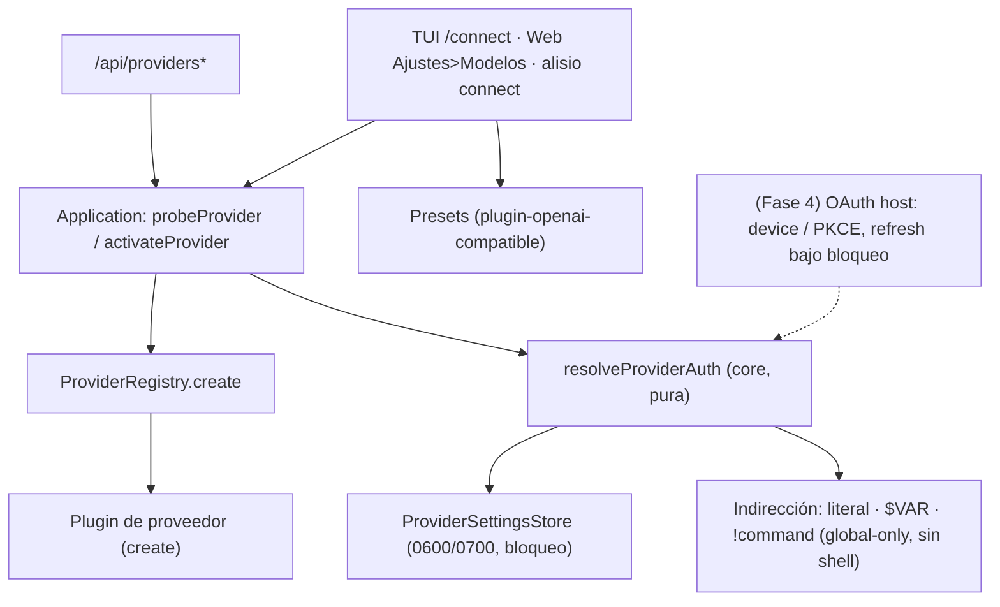

# Especificación Técnica: Provider Connect — conectar proveedores de modelos con buenos valores por defecto y sin degradar la seguridad

| Campo | Valor |
|---|---|
| Versión | 0.1 |
| Origen | Análisis local (estático) de `pi` y `opencode` el 2026-10-14; ver apéndice A |
| Proyecto | Alisio |
| Estado | **Aprobada por el propietario (2026-10-14). NO implementada.** Decisiones del propietario O1-O8 confirmadas el 2026-10-14 (§2.1) y decisiones de diseño D1-D13 aprobadas con la spec. Sin preguntas abiertas. Vive en `specs/backlog/` (aprobada pero sin programar): no se ejecuta hasta que el propietario la mueva a `specs/`. La Fase 0 y su compuerta aplican al ejecutarla |
| Fecha | 2026-10-14 |
| Paquetes afectados | `@alisio/sdk` (tipos aditivos opcionales: `LocalProviderSuggestion` (D13), `ProviderAuthMethod`, `ProviderRegistration.authMethods?`, `ProviderAuthHooks`, `CredentialStatus.shadowedEnv?`; solo Fase 4 para OAuth) · `@alisio/core` (nuevo `packages/core/src/providers/auth.ts`, `providers/indirection.ts` y `providers/local-detect.ts` (D13); cambios en `providers/settings.ts`, `application.ts`, `config.ts` solo si D5 lo exige) · `@alisio/plugin-openai-compatible` (nuevo `src/presets.ts`, campo `preset`, campo `headers`, ajuste de `create`/`provider.ts`) · `@alisio/server` (`routes/providers.ts`: sonda antes de guardar, estado de origen de la credencial, borrado de perfil) · `@alisio/web` (privado: `components/settings/ModelsPage.tsx`, i18n EN/ES) · `@alisio/alisio-code` (`packages/cli`: `/disconnect` en la TUI, subcomando `alisio connect`, `doctor`) |
| Paquetes nuevos | Ninguno. Sin dependencias nuevas de producción (el bloqueo de archivo de Fase 4 se implementa con `node:fs`, ver D10) |
| Relación con otras especificaciones | Complementa `specs/014-trust-boundaries-v1.md` (D5 reutiliza su regla «configuración global-only» y su principio «política, no aislamiento»; no depende de su implementación). Independiente de `specs/backlog/019-capability-routing-v1.md` y `specs/backlog/020-model-tier-router-v1.md` (enrutado de modelos queda fuera). Independiente de `specs/archive/009-forja-v1.md` |
| Superficies | TUI (`/connect`, `/disconnect`), Web UI (Ajustes > Modelos), headless (`alisio connect`, `alisio run`; sin autodetección), API HTTP de `alisio serve` (incluye `GET /api/providers/local-detect`) |
| Política de versión | Funcionalidad nueva: **la siguiente minor al ejecutar**. Aditiva: `RunEvent.schemaVersion`, `apiVersion` de plugins y el esquema de `providers.json` no cambian; `credentials.json` solo cambia en Fase 4 y con migración hacia adelante (D11) |

## 0. Cómo usar este documento (para agentes de código)

1. Lee primero `AGENTS.md` y `CONTRIBUTING.md`; prevalecen sobre este documento. Carga los skills `alisio-architecture`, `alisio-coding-standards`, `alisio-plugins`, `alisio-pkg-sdk`, `alisio-pkg-core`, `alisio-pkg-server`, `alisio-pkg-web`, `alisio-pkg-cli-tui` y `alisio-docs-screenshots` según la fase.
2. Etiquetas: **(verificado 2026-10-14)** = leído en el repositorio ese día (`main`, `4619bae` más cambios sin commit del árbol de trabajo en archivos que esta spec no toca, salvo `packages/core/src/eval/secrets.ts` y `packages/core/src/index.ts`, ver §3); **(no verificado)** = deducido o externo sin prueba ejecutada aquí; **(nuevo)** = no existe.
3. Palabras clave **MUST, MUST NOT, SHOULD, SHOULD NOT, MAY** en mayúsculas según RFC 2119 (aclarado por RFC 8174), usadas solo donde importan para seguridad, interoperabilidad o pruebas. Todo SHOULD indica su condición de excepción. Los requisitos de comportamiento usan forma EARS (`WHEN <disparador>, el <sistema> MUST <respuesta>`).
4. **TDD estricto Rojo → Verde → Refactor** (§9). Ninguna línea de producción sin una prueba que falle antes. Pruebas en `tests/*.test.ts`, sobre comportamiento en límites de módulo; sin pruebas de instantánea.
5. **Orden obligatorio**: Fase 0 (solo mediciones) → compuerta del propietario → Fases 1-3 → Fase 4 (condicionada, §11). Cada fase deja el repo verde con `pnpm typecheck`, `pnpm lint`, `pnpm test`, `pnpm build`, `pnpm test:cli`, `pnpm test:compiled`, `pnpm pack:check`, `pnpm docs:check` y `pnpm docs:build`. No hagas commit hasta que el propietario lo pida.
6. **Asignación de modelos**: §10. Sonnet implementa; Opus solo en la compuerta de la Fase 4 y la revisión adversarial de las partes de seguridad; Haiku para trámites.
7. Reglas del repo que no se rompen: solo pnpm; Node >=22.16 y debe funcionar en Bun; solo APIs portables de Node, sin globals de Bun; ningún SDK de proveedor ni import de runtime en `@alisio/sdk` ni en los contratos del core; los plugins dependen solo de `@alisio/sdk` y no importan internos de `@alisio/core`; preservar IDs de llamadas a herramientas, datos de continuación del proveedor y consistencia de sesión; **un manifiesto de plugin o un subproceso no es un sandbox**; nunca imprimir ni copiar valores de secretos (ni en pruebas, ni en logs, ni en esta spec).
8. Idioma: identificadores, claves, códigos de error y textos generados en inglés; textos de UI en inglés y español (`packages/web/src/i18n/en.ts` y `es.ts`; TUI en inglés como hoy); esta especificación en español; documentación EN/ES en paridad (`docs/<página>.md` y `docs/es/<página>.md`).
9. **Esto es comodidad y política de resolución, no cifrado ni aislamiento.** Ninguna sección puede presentarse en docs, UI o mensajes como almacén seguro de secretos, sandbox o garantía contra un atacante local.

---

## 1. Objetivo, alcance y principio rector

### 1.1 Objetivo

Que un usuario conecte un proveedor de modelos **en un paso**, en TUI, Web UI o headless, con la URL base, la variable de entorno, el modo de API y el parámetro de tokens correctos ya rellenados, y que **nunca quede conectado de forma insegura en silencio**: la clave que se usa y su origen son siempre visibles, un fallo de credencial es un error explícito, y los secretos no viajan por argumentos de línea de comandos ni por respuestas HTTP.

### 1.2 Principio rector

> **Conectar un proveedor en un paso, con los valores correctos, y nunca de forma insegura en silencio.**

Reglas derivadas:

- Una sola función pura (`resolveProviderAuth`, D2) decide qué credencial se usa y por qué; nadie más reimplementa la precedencia.
- Una credencial guardada **posee** al proveedor: no cae en silencio a una variable de entorno cuando falla (D2, D4).
- Un valor de configuración que ejecuta un comando (`!command`) solo existe donde el usuario lo escribió en configuración global de confianza (D5).
- Los valores de secretos no se registran, no se devuelven por la API y no se aceptan por `argv` (D7, D8).

### 1.3 Alcance

Resolución de credenciales con precedencia documentada y origen visible; indirección `$VAR`/`${VAR}` y, bajo compuerta de confianza, `!command`; endurecimiento del almacenamiento (permisos, bloqueo de escritura); presets de proveedores OpenAI-compatibles como datos; cabeceras personalizadas; UX de conexión (`/disconnect`, sonda antes de guardar en la web, `alisio connect` no interactivo, `doctor` con mapa de variables por proveedor, varios perfiles etiquetados por proveedor); autodetección acotada de Ollama, LM Studio y llama.cpp en loopback como sugerencia (D13); extensión aditiva del SDK para métodos de autenticación y, en la última fase condicionada, OAuth por device code y PKCE con almacenamiento y renovación a cargo del host.

### 1.4 Fuera de alcance

| Excluido | Motivo |
|---|---|
| Llavero del sistema operativo o cifrado en reposo de `credentials.json` | Cambia el modelo de amenaza y la portabilidad Node/Bun; spec futura separada. La documentación sigue diciendo «texto plano, `0600`» (`docs/limitations.md:181`) |
| Reutilizar el ID de cliente OAuth de otro producto (de `pi`, `opencode` o de CLIs oficiales de proveedores) o hacerse pasar por otro cliente | Incumple los términos de uso de los proveedores y es suplantación; ver D9 y apéndice A |
| Enrutado de modelos por capacidad o nivel | Cubierto por `specs/backlog/019-capability-routing-v1.md` y `specs/backlog/020-model-tier-router-v1.md` |
| Migrar, deprecar o reemplazar los plugins externos dedicados (`alisio-plugins`: DeepSeek, OpenCode, OpenCode Go) | Presets y plugins coexisten (D1, O1) |
| Telemetría o reporte de qué proveedores usa la gente | Sin telemetría (política del proyecto) |
| Descarga por defecto de un catálogo remoto de modelos (estilo `models.opencode.ai`) | Alisio es offline-first; los presets viajan en el paquete. Decisión confirmada O6: **no** hay catálogo remoto en v1 |
| Sondeo de red en segundo plano, al arrancar o fuera de abrir `/connect` o la página Modelos; sondeo de hosts distintos de loopback, de puertos distintos de los por defecto o de proveedores no locales | La autodetección de D13 (O7) es solo una sugerencia puntual, acotada y sin efectos |
| Autoconexión, o guardar o activar algo a partir de una detección | La detección solo preselecciona un preset; conectar exige la acción del usuario y la sonda de D8 |
| Detección de otros servidores locales (vLLM, KoboldCpp, etc.) | Sin puerto por defecto verificado; el usuario usa el preset `custom` |
| Que un plugin escriba `credentials.json` o gestione tokens por su cuenta | Los tokens los gestiona el host (D10) |
| Convertir un plugin o su manifiesto en sandbox | Un plugin es código de confianza plena en proceso (`alisio-plugins`) |

---

## 2. Decisiones

### 2.1 Decisiones del propietario (confirmadas 2026-10-14, se aplican exactamente)

No quedan preguntas abiertas.

| ID | Tema | Respuesta confirmada | Se aplica en |
|---|---|---|---|
| O1 | Presets frente a plugins dedicados | Los presets **coexisten** con los plugins dedicados; los externos no se tocan | D1, §1.4, AC-18 |
| O2 | `!command` | **Sí** se publica, bajo la compuerta de confianza: solo configuración global de confianza, apagado por defecto (`providers.allowCommandValues: false`), sin shell, 10 s, desactivado con `--read-only` | D5, AC-07..10 |
| O3 | Dónde viven las referencias | `$VAR` y `!command` viven **solo** en `credentials.json` (más el campo ya existente `apiKeyEnv`); `providers.json` sigue sin secretos ni comandos | D5, §5.3 |
| O4 | Nombre del subcomando | `alisio connect` | D8c, §6.1 |
| O5 | OAuth | Se **separa** en su propia spec `NNN-provider-oauth-v1` si la compuerta de Fase 0 no confirma al menos un proveedor con cliente registrable para terceros; la Fase 4 queda como marcador condicionado | D9-D12, Fase 4 |
| O6 | Catálogo remoto | **No** en v1 | §1.4 |
| O7 | Autodetección de servidores locales | **Distinta de la recomendación inicial: SÍ**, en loopback, al abrir `/connect` (TUI) o la página Modelos (web), para Ollama y LM Studio; el 2026-10-14 el propietario añadió llama.cpp (`llama-server`), sujeto a la verificación de D13 (puerto real 9931/8080) | D13, AC-38..50 |
| O8 | Sonda antes de guardar en la web | **Bloquea** el guardado, con la opción explícita «guardar de todos modos» | D8b, §5.6, AC-21..23 |

### 2.2 Decisiones de diseño (aprobadas, D1..D13)

Aprobadas por el propietario el 2026-10-14 junto con la spec; las contestadas llevan su `O#`. La Fase 0 puede corregir valores medidos (puertos, `apiMode`, `tokenParameter`), no el diseño.

| ID | Decisión (contexto → decisión → consecuencia) |
|---|---|
| D1 | **Presets como datos dentro de `@alisio/plugin-openai-compatible`** (O1). Una tabla tipada `PRESETS` en `src/presets.ts` (id, nombre, `baseURL`, `apiKeyEnv`, `apiMode`, `tokenParameter`, `auth`, enlace a la documentación oficial). Un campo `preset` (select; O1: coexisten con los plugins dedicados, confirmado) en `ProviderRegistration.fields` rellena los demás; el usuario puede sobrescribir cualquiera. Consecuencia: cero instalación para los proveedores conocidos; los plugins externos siguen funcionando; añadir un preset es un cambio de datos con una prueba de forma, no de lógica |
| D2 | **`resolveProviderAuth` pura** en `packages/core/src/providers/auth.ts` (nuevo). Precedencia documentada única: `override` (argumento explícito del llamador, p. ej. `alisio connect --api-key-env`) > credencial `file` guardada > `env` (`process.env[apiKeyEnv]`) > nada. Devuelve `{ value, source: "override" \| "file" \| "env" \| "command" } \| { error }`. Una credencial guardada **posee** al proveedor: si existe y su resolución falla (p. ej. `!command` vacío o refresco OAuth fallido) el resultado es un error `CREDENTIAL_UNRESOLVED`, **sin** caída silenciosa a `env`. Consecuencia: hoy la precedencia ya es archivo > env pero está repartida entre `plugin-openai-compatible/src/index.ts:104-113` y `provider.ts:44-46`; se centraliza sin cambiar el orden. Rojo para el cambio de comportamiento: el fallo de una referencia guardada deja de caer a `env` |
| D3 | **El origen de la credencial siempre es visible y un `env` nunca queda tapado en silencio.** `CredentialStatus` gana el campo opcional `shadowedEnv?: string` (nombre de la variable que también está definida y NO se usa). TUI y web muestran «usando clave guardada; la variable X también está definida». Nunca se muestra el valor |
| D4 | **Un fallo de credencial es un error duro con código estable** (`CREDENTIAL_UNRESOLVED`, `CREDENTIAL_COMMAND_FAILED`, `CREDENTIAL_COMMAND_TIMEOUT`, `CREDENTIAL_COMMAND_DISABLED`), con mensaje que nombra el perfil y la fuente, nunca el valor |
| D5 | **Indirección de valores de credencial** (O2 y O3, confirmadas: `!command` se publica bajo la compuerta; las referencias viven solo en `credentials.json` y `providers.json` no contiene secretos ni comandos). Un valor guardado puede ser literal, `$VAR` o `${VAR}` (lee `process.env`; variable sin definir = sin clave), o `!command`. `!command`: MUST estar habilitado por `providers.allowCommandValues: true` en configuración **global-only** (mismo criterio que `trust.*` de `specs/014-trust-boundaries-v1.md` D5); MUST NOT ejecutarse si la configuración proviene de una capa de proyecto no confiable; MUST NOT ejecutarse con `--read-only`; MUST ejecutarse sin shell (`argv` troceado de forma explícita, sin concatenar cadenas en `sh -c`), con límite de 10 s, salida recortada (`trim`), salida vacía o código distinto de 0 = error (D4), salida y `stderr` nunca registradas y pasadas por redacción. Consecuencia: reduce secretos en disco, pero un `!command` es ejecución de código del usuario: se documenta como tal |
| D6 | **Endurecimiento de almacenamiento**. Los permisos `0600`/`0700` ya se aplican en cada escritura y `credentials.json` se corrige al cargarlo (`settings.ts:69`, silencioso si falla); `providers.json` no se corrige al leer y no hay aviso. Propuesta: corregir también `providers.json` al cargar, avisar **una vez por proceso** si `chmod` falla (sin valores), y añadir un bloqueo de escritura entre procesos para el ciclo leer-modificar-escribir (hoy ausente, ver §3), de modo que la TUI y `alisio serve` no pierdan actualizaciones. Se mantiene texto plano y la documentación honesta; sin llavero (§1.4) |
| D7 | **Cabeceras personalizadas** en `plugin-openai-compatible`: campo `headers` (no secreto, JSON `{nombre: valor}` en el perfil) y `secretHeaders` (nombres en el perfil, valores en `credentials.json`). Nombres validados `^[A-Za-z0-9-]{1,64}$`; lista de cabeceras prohibidas (`authorization`, `host`, `content-length`, `transfer-encoding`, `connection`, `cookie`, `proxy-*`); valores sin saltos de línea, ≤ 2 000 caracteres, ≤ 16 cabeceras. Los valores secretos nunca viajan en `GET /api/providers` |
| D8 | **UX de conexión**. (a) TUI: `/disconnect` (borra credencial y, a elección, el perfil; **nuevo**). (b) Web: sonda antes de guardar (misma lógica y mismo plazo de 20 s que `probeProvider`) que **bloquea** el guardado si falla y ofrece «guardar de todos modos» explícito (O8, confirmada). (c) subcomando no interactivo (O4, confirmada) `alisio connect <provider> [--preset <id>] [--profile <nombre>] [--api-key-env VAR] [--base-url URL] [--model ID]` no interactivo: el secreto SOLO se lee de `ALISIO_API_KEY` (o del entorno nombrado) o de `stdin` con `--api-key-stdin`; **no existe** `--api-key` por `argv` (los argumentos son visibles en `ps` y en el historial del shell). (d) `doctor` usa el mapa de variables por proveedor (preset o registro) en lugar de `DEEPSEEK_API_KEY` fijo (`packages/cli/src/main.ts:449`). (e) `/connect` y la página Modelos sugieren el preset local detectado por D13 (solo sugerencia); (f) varios perfiles etiquetados por tipo de proveedor en TUI (hoy el nombre del perfil es el id del proveedor, `app.ts:1954-1975`; la web ya admite nombres libres) |
| D9 | **Regla legal de OAuth**. Alisio MUST NOT reutilizar un ID de cliente OAuth ajeno ni suplantar a otro cliente. OAuth solo se habilita para un proveedor que ofrezca un cliente registrable/público para aplicaciones de terceros o un flujo device code, con **registro propio de Alisio**; el propietario lo confirma por proveedor (compuerta de Fase 4). Sin esa confirmación, ese proveedor solo ofrece `key`/`env`/`command` |
| D10 | **SDK aditivo para autenticación** (solo Fase 4 salvo `shadowedEnv`). `ProviderRegistration.authMethods?: ProviderAuthMethod[]` con tipos `key \| env \| command \| oauth-device \| oauth-pkce`; `ProviderAuthHooks` (`authorize`/`poll` o `callback`, `refresh`) opcionales. El **host** es dueño del almacenamiento de tokens, el bloqueo, el margen de renovación (por defecto 5 min), la renovación bajo bloqueo de archivo con doble comprobación y plazo de 15 s, y el error duro sin caída a `env` si el refresco falla (D2). Los plugins MUST NOT escribir `credentials.json`. Un plugin viejo sin `authMethods` sigue funcionando por la vía `key`/`env` actual. `ProviderCreateRequest` no cambia de forma; un plugin que usa OAuth recibe un token vigente en `credentials` |
| D11 | **Migración de `credentials.json` solo hacia adelante** (Fase 4). Hoy `schemaVersion: 1` y `read()` no valida la versión (`settings.ts:12-21`, `:24-31`). Fase 4 añade `schemaVersion: 2` con entradas tipificadas `{ type: "key" \| "oauth", ... }`; la lectura de una versión desconocida MUST fallar con error claro en lugar de interpretarla; la escritura conserva una copia `credentials.json.bak-v1` `0600` en la primera migración; nota de «bajada de versión» en `docs/implementation-status.md` (una versión anterior de Alisio no lee el formato 2). Las Fases 1-3 NO cambian el formato |
| D12 | **OAuth tras todo lo demás**. Orden: device code (sin puerto local) primero y PKCE con *loopback* después. Los servidores de *callback* se enlazan solo a `127.0.0.1`/`::1`, con puerto efímero configurable, con *state* y verificador PKCE de un solo uso y plazo de 5 min; las rutas del servidor mantienen las comprobaciones de token de lanzamiento, `Host` y `Origin` (`packages/server/src/auth/guard.ts`). Los plugins son código de confianza que puede ver los tokens (no es un sandbox: se dice así en la documentación). **Por O5 (confirmada)**, D9-D12 se trasladan a una spec propia `NNN-provider-oauth-v1` si la compuerta de Fase 0 no confirma al menos un proveedor con cliente registrable para terceros; aquí quedan como diseño de referencia |
| D13 | **Autodetección de Ollama, LM Studio y llama.cpp (`llama-server`) en loopback** (O7: el propietario eligió SÍ, contra la recomendación inicial de «no en v1», que se retira; el 2026-10-14 añadió llama.cpp). Contexto: el usuario de un servidor local hoy debe saber elegir el preset y la URL; sondear puertos conocidos lo evita. Decisión: sugerencia puntual, acotada y sin efectos, con estas reglas. **(1) Cuándo**: solo WHEN el usuario abre `/connect` (TUI) o la página Modelos (web); MUST NOT ejecutarse al arrancar, en segundo plano, periódicamente ni al abrir otra pantalla; sin caché entre aperturas. **(2) A dónde**: solo `GET http://127.0.0.1:<puerto>/v1/models` con estos cuatro objetivos: Ollama `11434`, LM Studio `1234` y llama.cpp `9931` y `8080`. **Corrección de la creencia inicial**: el puerto por defecto de `llama-server` **ya no es 8080 en el código actual**: pasó a `9931` el 2026-10-09 (PR #30159, aviso previo en #26508); `8080` es el valor de las versiones anteriores y de los ejemplos de Docker. Como ambos pueden estar en uso según la versión instalada, se sondean los dos (fuentes y etiquetas en §6.2). `::1` NO se sondea en v1 porque duplicaría los sondeos sin ganancia verificada (el usuario cuyo servidor escuche solo en `::1` elige `custom`); ningún otro host ni puerto. **(3) Cómo**: solo `GET`, sin cuerpo, sin `Authorization`, cookies ni credenciales, sin datos del espacio de trabajo, sin sesiones ni identificadores; MUST NOT seguir redirecciones (`redirect: "error"`); respuesta leída hasta 64 KiB como máximo. **(4) Plazos**: ≤ 500 ms por sondeo, los cuatro en paralelo, ≤ 1 s en total (señal de aborto externa); un puerto cerrado en loopback debería responder rechazo inmediato (no verificado, se mide en Fase 0), así que el límite de 500 ms solo se agota ante un oyente que no responde. **(5) Validación**: una respuesta solo cuenta si es HTTP 200 con JSON `{ "object": "list", "data": [...] }` donde `data` es un arreglo y cada uno de los primeros 100 elementos tiene `id` de tipo cadena (forma de `GET /v1/models` de OpenAI). **Regla estricta para llama.cpp**: además, el primer elemento MUST tener `"owned_by": "llamacpp"` (verificado en el ejemplo oficial de su README, §6.2); sin eso, la respuesta en `9931` u `8080` no se sugiere. Motivo: `8080` es un puerto muy usado por otros servicios (no verificado con fuente; conocimiento general), y la forma OpenAI sola daría falsos positivos; `owned_by` distingue a llama.cpp de otros servicios compatibles. Para Ollama y LM Studio solo se exige la forma genérica; si existe un discriminante equivalente se decide en Fase 0 (no verificado). Cualquier otra cosa (HTML, otro JSON, error, `401`, cuerpo mayor de 64 KiB) = no detectado. **(6) Resultado**: una sugerencia `{ preset: "ollama" \| "lmstudio" \| "llamacpp", baseURL }` que preselecciona el preset local en el selector y lo etiqueta «servidor local en :PUERTO» para que el usuario lo confirme (una etiqueta única por sugerencia); con varios detectados se marcan todos y se preselecciona el primero en orden fijo (Ollama, LM Studio, llama.cpp `9931`, llama.cpp `8080`). NUNCA conecta, guarda, activa ni escribe en disco. **(7) Fallos**: silenciosos; sin aviso al usuario ni mensaje de error; sin registro de contenido. Un `llama-server` con `--api-key` responde `401` en `/v1/models` (solo `/health` es público, verificado en `server-http.cpp`): no se detecta y el usuario usa el preset a mano. **(8) Interruptor**: `providers.autodetectLocal` (booleano, por defecto `true`, **global-only**: una capa de proyecto no puede cambiarlo), el propietario puede desactivarlo y con `false` no se emite ninguna petición a ninguno de los cuatro objetivos. Está desactivada siempre con `--read-only` y en headless (`alisio connect`, `alisio run`), donde no hay selector que preseleccionar. **(9) Web**: la hace el servidor (`GET /api/providers/local-detect`, sin parámetros, detrás del token de lanzamiento y las comprobaciones de `Host`/`Origin`); IF el servidor está enlazado a un host que no es loopback (`isLoopbackHost` de `guard.ts`), THEN responde lista vacía sin sondear, porque loopback del servidor no es el del navegador del usuario. Consecuencia: se añade una excepción acotada a «Alisio no hace red sin que se le pida»; es una petición GET a la propia máquina del usuario, sin salida a Internet, que no pasa por el modelo ni por el gate de herramientas |

---

## 3. Estado actual del código (verificado 2026-10-14)

| Área | Realidad |
|---|---|
| Comando de conexión | **No existe** `alisio connect`. `/connect` es un comando de la TUI: función `connect` en `packages/cli/src/tui/app.ts:1954`, entrada de menú `id: "connect"` en `:3051`, despacho en `:3133` y `:3394` (verificado 2026-10-14). En la web, `packages/web/src/components/settings/ModelsPage.tsx` (445 líneas) |
| Subcomandos CLI | `run`, `resume`, `serve`, `setup`, `doctor`, `analysis`, `forge`, `eval`, `trust`, `sessions`, `skills`, `plugins` (`packages/cli/src/main.ts:339-797`). Opciones globales de proveedor: solo `--model`, `--base-url`, `--api-mode` (`main.ts:36-38`) (verificado 2026-10-14) |
| Plugin integrado | `packages/plugin-openai-compatible/src/index.ts`: id `openai-compatible`, `api.providers.register` con campos `baseURL`, `apiKey` (secret), `apiKeyEnv` (defecto `OPENAI_API_KEY`), `apiMode`, `auth` (`bearer`\|`none`), `tokenParameter`, `streamUsage` (`:39-101`). Sin campo de cabeceras ni lista de modelos declarada; `listModels` hace `GET /models` (`provider.ts:59`) (verificado 2026-10-14) |
| Plugins dedicados | DeepSeek, OpenCode y OpenCode Go viven en el repo externo `alisio-plugins` (`alisio install npm:@alisio/plugin-...`); cada uno registra su `ProviderRegistration` y su variable por defecto (no verificado: repo externo no leído aquí; ver `.claude/skills/alisio-architecture/SKILL.md` y `docs/configuration.md:20-26`). `main.ts:449` fija `DEEPSEEK_API_KEY` en `doctor` (verificado 2026-10-14) |
| Almacenamiento | `packages/core/src/providers/settings.ts`: perfil sin secretos en `<configHome>/providers.json` y credenciales en `credentials.json`; escritura atómica (`atomicJson`, `:33-47`: directorio `0700`, archivo temporal con `wx`, `fsync`, `rename`, `chmod 0600`). Ambos archivos con `schemaVersion: 1` y mapa `profiles` con un `active` (`:6-18`). Nombre de perfil por defecto = id del proveedor (`application.ts:1876` `profileName = id`). No hay método para borrar un perfil (solo `deleteCredentials`, `:125`). Texto plano (`docs/limitations.md:181`) (verificado 2026-10-14) |
| Permisos en archivos existentes | `credentials()` ejecuta `chmod(credentialsPath, 0o600)` en cada lectura y **ignora el error** (`settings.ts:67-72`); `load()` de `providers.json` no corrige permisos; no hay aviso si `chmod` falla. `atomicJson` aplica `0700` al directorio de configuración en cada escritura (`:35`) (verificado 2026-10-14). Comportamiento real sobre archivos preexistentes laxos: (no verificado), se mide en Fase 0 |
| Bloqueo entre procesos | **Ausente**: `settings.ts` lee-modifica-escribe sin bloqueo (solo `rename` atómico); `grep` de `lockfile`/`flock` en `packages/core/src` solo encuentra `analysis/janitor.ts` (verificado 2026-10-14). Dos procesos (TUI y `alisio serve`) pueden perder una actualización |
| Resolución de clave | Credencial guardada → `process.env[apiKeyEnv]` del perfil → variable por defecto del plugin (`docs/configuration.md:20-26`; `plugin-openai-compatible/src/index.ts:104-113`, `provider.ts:44-46`). El mensaje de clave ausente está en `index.ts:110-113`. Una clave guardada tapa en silencio a la variable de entorno y no hay señal en la UI (verificado 2026-10-14) |
| Arranque | `application.ts:897-960`: `ProviderSettingsStore().active()`, anulación por `--base-url`/`--api-mode`/`OPENAI_BASE_URL`/`ALISIO_API_MODE` (`:900-907`), creación del proveedor guardado dentro de `try` cuyo error se conserva en `providerError` (verificado 2026-10-14) |
| Sonda | `probeProvider(id, profile, credentials, signal)` (`application.ts:1811-1822`) crea el proveedor, llama `listModels` y lo libera. La TUI la usa con `AbortSignal.timeout(20_000)` (`app.ts:2029-2034`). **La web no la usa** (verificado 2026-10-14) |
| Activación | `activateProvider` (`application.ts:1871`) crea el candidato antes de guardar (`saveActive`) y solo entonces reemplaza al proveedor activo; `activateProviderProfile` (`:1905`) la usa desde la web |
| API del servidor | `packages/server/src/routes/providers.ts`: `GET /api/providers` (`:147`), `PUT /api/providers/:profile` (`:174`, rechaza campos `secret`), `PUT .../credentials` (`:210`, solo `apiKey`\|`bearerToken`, validado `/^\S{1,4096}$/`, `:26-28`), `DELETE .../credentials` (`:231`), `POST .../activate` (`:238`), `GET /api/models` (`:266`). Nunca devuelve el secreto: `CredentialStatus {configured, source: "file"\|"env", tail?}` (`packages/sdk/src/index.ts`, bloque `CredentialStatus`). **Defecto conocido**: `PUT .../credentials` guarda **sin sondear** la clave (verificado 2026-10-14) |
| Web | `ModelsPage.tsx`: guardar/borrar credencial (`:48`, `:61`), guardar perfil con nombre libre (`:141`), activar (`:259`). La web permite varios perfiles por proveedor; la TUI no (verificado 2026-10-14) |
| Contrato SDK | `ModelProvider` (`sdk/src/index.ts:348`, `listModels?`, `dispose?`), `ProviderConfigurationField` (`:381`, `kind: text\|secret\|url\|select\|boolean`), `ProviderCreateRequest` (`:393`, `profile`, `credentials`, `legacy?`), `ProviderRegistration` (`:402`, `id`, `name`, `description?`, `fields`, `capabilities?`, `create`). **No hay** tipos de método de autenticación, inicio de sesión, renovación ni OAuth (verificado 2026-10-14) |
| Ausente (grep en `packages/*/src`) | Llavero del SO, OAuth/device code/`refresh_token`, indirección `$VAR`/`${VAR}`/`!command` de claves, `/logout`/`/disconnect`/`/login` en la TUI, mapa de variables por proveedor en el core, cabeceras personalizadas en `openai-compatible`, conexión no interactiva (sin `--api-key`/`--provider`). Las únicas coincidencias de «disconnect» son MCP (`app.ts:2238-2297`) y un observador DOM (verificado 2026-10-14) |
| Confianza de proyecto | `packages/core/src/trust.ts` decide si `.alisio/config.json` (que puede redirigir endpoint y clave) y `.alisio/plugins` se cargan; `configFile()` solo usa la capa de proyecto con `--trust-project`/`--config` (`config.ts:792-805`). Hay claves **global-only** documentadas en `config.ts` (p. ej. `options` de plugin, `:950`). `--read-only` desactiva plugins externos y cambios de ajustes (`application.ts:386`, `:737`) (verificado 2026-10-14) |
| Redacción | `findSecrets`/`redactSecrets` exportadas desde `packages/core/src/index.ts:415` (`eval/secrets.ts`); ese archivo tiene cambios sin commit en el árbol de trabajo (verificado 2026-10-14, estado inestable) |
| Servidor: autenticación | Token de lanzamiento + comprobaciones de `Host` y `Origin` (`packages/server/src/auth/guard.ts`) (verificado 2026-10-14) |
| Pruebas existentes | `tests/connect-input.test.ts` (entrada de la TUI), `tests/provider-credentials-store.test.ts`, `tests/providers-registry.test.ts`, `tests/provider.test.ts`, `tests/server-secrets.test.ts` (T-14: secretos write-only en la API y en logs). **No hay** prueba dedicada de `plugin-openai-compatible`. `docs/limitations.md:267`: la entrada de `/connect` se verifica «por tipos y manualmente» (verificado 2026-10-14) |
| Autodetección de servidores locales | **(nuevo)**: no existe sondeo de puertos locales; `/connect` solo lista los plugins registrados (`app.ts:1954-1965`) (verificado 2026-10-14). Puertos por defecto y forma de `/v1/models` de Ollama y LM Studio: (no verificado), Fase 0. llama.cpp: verificado contra su repositorio oficial el 2026-10-14 (§6.2) |
| Presets de proveedores | **(nuevo)**. Valores candidatos verificados contra documentación oficial el 2026-10-14: ver §6.2 |

---

## 4. Arquitectura

### 4.1 Vista general



### 4.2 Patrones y su lugar

| Patrón | Dónde | Por qué |
|---|---|---|
| Función de decisión pura compartida | `providers/auth.ts` | Una precedencia, probable por casos, sin E/S; igual que `permissions/decide.ts` |
| Datos como configuración (tabla de presets) | `plugin-openai-compatible/src/presets.ts` | Añadir un proveedor no toca lógica; fácil de revisar y de probar por forma |
| Estrategia por método de autenticación | `ProviderAuthMethod` (Fase 4) | `key`, `env`, `command`, `oauth-*` varían de forma independiente |
| Puerto de almacenamiento | `ProviderSettingsStore` | El resto del core no conoce el formato en disco ni el bloqueo |
| Fallo cerrado | D2, D4, D5 | Ante credencial no resoluble no se degrada a otra fuente |

### 4.3 Organización de archivos (nuevo)

```text
packages/core/src/providers/
  auth.ts            # resolveProviderAuth, tipos AuthSource/AuthResult
  indirection.ts     # parseCredentialValue, resolveReference, runCredentialCommand
  file-lock.ts       # bloqueo de escritura de providers.json/credentials.json
  local-detect.ts    # detectLocalProviders (D13): GET a 127.0.0.1, validación de forma, plazos
packages/plugin-openai-compatible/src/
  presets.ts         # PRESETS tipado
  headers.ts         # validación de cabeceras (D7)
packages/cli/src/connect.ts   # alisio connect (no interactivo)
tests/provider-auth.test.ts · provider-indirection.test.ts · provider-store-hardening.test.ts ·
tests/openai-compatible-presets.test.ts · openai-compatible-headers.test.ts ·
tests/provider-local-detect.test.ts · connect-command.test.ts · server-provider-probe.test.ts · provider-sdk-compat.test.ts
```

---

## 5. Contratos

### 5.1 `resolveProviderAuth` (nuevo, D2)

```ts
export type AuthSource = "override" | "file" | "env" | "command";
export type AuthResult =
  | { ok: true; value: string; source: AuthSource; shadowedEnv?: string }
  | { ok: false; code: "CREDENTIAL_UNRESOLVED" | "CREDENTIAL_COMMAND_FAILED"
      | "CREDENTIAL_COMMAND_TIMEOUT" | "CREDENTIAL_COMMAND_DISABLED"; profile: string };
```

Requisitos:

- WHEN existe un `override` explícito, el resolvedor MUST devolverlo con `source: "override"` sin consultar otras fuentes.
- WHEN existe una credencial guardada, el resolvedor MUST usarla y MUST NOT consultar `env` para el valor; si además `process.env[apiKeyEnv]` está definida, MUST informar `shadowedEnv: <nombre>` (D3).
- IF una credencial guardada es una referencia que no se resuelve (variable sin definir, comando fallido, vacío, con tiempo agotado o deshabilitado), THEN el resolvedor MUST devolver el error de D4 y MUST NOT caer a `env`.
- WHEN no hay credencial guardada, el resolvedor MUST consultar `process.env[apiKeyEnv]` y, si el perfil no registra nombre, la variable por defecto del preset o del plugin.
- WHERE `auth: "none"`, el resolvedor MUST NOT exigir clave.
- El resolvedor MUST NOT escribir en disco ni registrar valores.

### 5.2 Indirección (D5)

| Valor guardado | Resultado |
|---|---|
| `sk-...` literal | Se usa tal cual |
| `$NAME` o `${NAME}` (`^[A-Z_][A-Z0-9_]*$`, insensible a mayúsculas solo si el usuario lo escribe así) | `process.env.NAME`; sin definir o vacío = sin clave (`CREDENTIAL_UNRESOLVED`) |
| `!argv...` | Solo con `providers.allowCommandValues: true` global y sin `--read-only`; si no, `CREDENTIAL_COMMAND_DISABLED`. Plazo 10 s; `trim` de la salida; vacío o código ≠ 0 = `CREDENTIAL_COMMAND_FAILED` |

El comando se divide en argumentos con una función de troceado explícita y se lanza con `execFile`-equivalente de `node:child_process` sin shell. Un literal que empiece por `$` o `!` y se desee tal cual se escapa con `\` al inicio (decisión de formato, probada en AC).

### 5.3 Almacenamiento (D6, D11)

- Fases 1-3: `providers.json` y `credentials.json` conservan `schemaVersion: 1`. Se añaden solo el bloqueo (`<archivo>.lock`, creación exclusiva con `wx`, considerado obsoleto a los 30 s, reintentos acotados a 5 s) y la corrección de permisos al leer `providers.json`.
- Fase 4: `credentials.json` `schemaVersion: 2` según D11, con migración hacia adelante.

### 5.4 Presets y cabeceras (D1, D7)

```ts
export interface ProviderPreset {
  id: string;            // ^[a-z0-9][a-z0-9-]{0,31}$
  name: string;
  baseURL: string;       // http(s), sin credenciales
  apiKeyEnv?: string;    // ausente en proveedores locales sin clave
  apiMode: "chat" | "responses";
  tokenParameter: "max_tokens" | "max_completion_tokens" | "omit";
  auth: "bearer" | "none";
  docsUrl: string;
}
```

El campo `preset` es un `select` (`kind: "select"`) cuyas opciones salen de `PRESETS` más `custom`. La lógica de relleno vive en la capa de cada superficie (TUI, web, `alisio connect`) leyendo `PRESETS` exportados del plugin vía el campo `options` y un valor por defecto por campo; el plugin no importa nada del core.

### 5.5 Extensión del SDK (aditiva, D3, D10)

```ts
// Fase 1 (D3)
export interface CredentialStatus { /* ...existente... */ shadowedEnv?: string }

// Fase 4 (D10)
export type ProviderAuthMethod =
  | { kind: "key" | "env" | "command"; label: string }
  | { kind: "oauth-device" | "oauth-pkce"; label: string; scopes?: string[] };
export interface ProviderRegistration { /* ...existente... */ authMethods?: ProviderAuthMethod[] }
export interface ProviderAuthHooks {
  authorize?(ctx: { signal: AbortSignal }): Promise<{ verificationUri: string; userCode?: string; expiresIn: number; poll(): Promise<OAuthTokens> }>;
  refresh?(tokens: OAuthTokens, ctx: { signal: AbortSignal }): Promise<OAuthTokens>;
}
export interface OAuthTokens { accessToken: string; refreshToken?: string; expiresAt?: number }
```

Los consumidores MUST ignorar campos desconocidos (comentario en el tipo). `schemaVersion`, `protocolVersion` y `apiVersion` no cambian: **no hay justificación para subirlos**, porque todo es opcional.

### 5.6 Rutas del servidor (aditivas)

- `PUT /api/providers/:profile/credentials`: WHEN el cuerpo incluye `{ verify: true }` (por defecto `true` desde la web), el servidor MUST sondear con el mismo mecanismo y plazo de 20 s que `probeProvider` antes de persistir; IF la sonda falla, THEN responde 422 `credential_rejected` (sin texto del proveedor que pueda contener la clave) y no guarda, salvo `{ force: true }` (O8).
- `DELETE /api/providers/:profile` (**nuevo**): borra perfil y credenciales; 409 `runs_active` si es el perfil activo del espacio con ejecuciones.
- `GET /api/providers`: `CredentialStatus` gana `shadowedEnv?` (D3).
- Todas mantienen token de lanzamiento, `Host` y `Origin`; ninguna respuesta ni registro contiene un valor de secreto.

---

## 6. Diseño de las fases funcionales

### 6.1 Conexión no interactiva (`alisio connect`, D8c)

```text
alisio connect <provider> [--preset <id>] [--profile <name>] [--api-key-env VAR]
                          [--base-url URL] [--model ID] [--api-key-stdin] [--no-probe] [--activate]
```

- WHEN el proveedor requiere clave y no se pasa `--api-key-env` ni `--api-key-stdin`, el comando MUST leerla de `ALISIO_API_KEY`; si no existe, MUST fallar con `CONNECT_KEY_MISSING` y código de salida distinto de 0, sin pedirla por argumento.
- El comando MUST NOT aceptar el valor de la clave como argumento ni volcarlo en `stdout`/`stderr`.
- WHEN no hay `--no-probe`, el comando MUST sondear con plazo de 20 s antes de guardar; IF falla, THEN `CONNECT_PROBE_FAILED` y no guarda nada.
- Salida: nombre del perfil, proveedor, modelo, origen de la credencial (`file`/`env`) y, si aplica, `shadowedEnv`; nunca valores.

### 6.2 Presets candidatos (D1)

Valores comprobados contra documentación oficial el 2026-10-14 (solo lectura web); cada fila MUST volver a comprobarse en Fase 0 antes de entrar en `PRESETS`.

| Preset | `baseURL` | `apiKeyEnv` | Estado |
|---|---|---|---|
| `openrouter` | `https://openrouter.ai/api/v1` | `OPENROUTER_API_KEY` | (verificado 2026-10-14, docs oficiales) |
| `groq` | `https://api.groq.com/openai/v1` | `GROQ_API_KEY` | (verificado 2026-10-14, docs oficiales) |
| `deepseek` | `https://api.deepseek.com` | `DEEPSEEK_API_KEY` | (verificado 2026-10-14, docs oficiales; el plugin dedicado sigue siendo la vía con soporte de `reasoning_effort`) |
| `mistral` | `https://api.mistral.ai/v1` | `MISTRAL_API_KEY` | (verificado 2026-10-14: la documentación da `https://api.mistral.ai/v1/chat/completions`; la base `/v1` se deduce) |
| `together` | `https://api.together.ai/v1` | `TOGETHER_API_KEY` | (verificado 2026-10-14, docs oficiales) |
| `ollama` (local) | `http://localhost:11434/v1` | ninguna (`auth: none`) | (verificado 2026-10-14, docs oficiales) |
| `ollama-cloud` | `https://ollama.com/v1` | `OLLAMA_API_KEY` | (verificado 2026-10-14, docs oficiales); decidir en Fase 0 si se lista |
| `lmstudio` (local) | `http://localhost:1234/v1` | ninguna | (verificado 2026-10-14: URL y puerto; si exige clave: no verificado) |
| `llamacpp` (local, `llama-server`) | `http://127.0.0.1:9931/v1` (valor actual del código; versiones anteriores: `http://127.0.0.1:8080/v1`) | ninguna por defecto (`auth: none`); con `--api-key` el servidor exige `Authorization: Bearer` (variable propia del servidor: `LLAMA_API_KEY`, no verificada como convención de cliente) | (verificado 2026-10-14, repositorio oficial; ver fuentes abajo). La URL real la aporta la autodetección o el usuario; `apiMode: chat` y `tokenParameter`: no verificado, Fase 0 |
| `opencode` (OpenCode Console/Zen) | `https://opencode.ai/inference/v1` | `OPENCODE_API_KEY` | (no verificado): la documentación consultada no nombra Zen ni Go ni da una base separada; no entra sin confirmación |

**Fuentes de llama.cpp (verificado 2026-10-14)**:

- Puerto por defecto `9931`, host `127.0.0.1`, `--api-key` por defecto «none» (env `LLAMA_API_KEY`), `GET /v1/models` existe y devuelve `{"object":"list","data":[{"id", "object":"model", "owned_by":"llamacpp", "meta":{...}}]}` con un único elemento (el `id` es la ruta del modelo o el valor de `--alias`; `meta` puede ser `null` mientras carga): https://github.com/ggml-org/llama.cpp/blob/master/tools/server/README.md y https://github.com/ggml-org/llama.cpp/blob/master/common/common.h (`port = 9931`, `hostnames = {"127.0.0.1"}`).
- `8080` como valor por defecto anterior («by default listens on `127.0.0.1:8080`»): https://github.com/ggml-org/llama.cpp/blob/b6000/tools/server/README.md (etiqueta `b6000`); el cambio a `9931` es el commit «server: use port 9931 by default (#30159)» del 2026-10-09, precedido por el aviso «#26508» del 2026-08-03 (hallados con la búsqueda de commits de la API de GitHub; el README actual conserva `8080` solo en ejemplos de Docker con `--port 8080` explícito).
- Autenticación: con `--api-key`, solo `/health` y `/v1/health` son públicos; `/v1/models` responde `401` sin clave: https://github.com/ggml-org/llama.cpp/blob/master/tools/server/server-http.cpp.
- Lo que no pude comprobar: en qué versión publicada (etiqueta de lanzamiento) cayó el cambio de puerto y cuál es la más instalada (no verificado, Fase 0); y el uso de `8080` por otros servicios (no verificado con fuente; riesgo tratado en D13.5 y §13).

`apiMode` y `tokenParameter` por preset: (no verificado), se miden en Fase 0 con una conexión real o un doble programado; el valor por defecto es `chat` y `max_tokens` hasta que la medición diga otra cosa.

---

## 7. Superficies

- **TUI**: al abrir `/connect` se ejecuta la autodetección de D13 (≤ 1 s) y se preselecciona el preset local detectado; `/connect` ofrece primero el preset (o `custom`), rellena los campos, muestra el origen de la clave y `shadowedEnv`; `/disconnect` (D8a). Entrada de menú en `app.ts:3051` y despacho en `:3133`/`:3394`. Textos en inglés.
- **Web (Ajustes > Modelos)**: al abrir la página se llama a `GET /api/providers/local-detect` (D13) y se destaca el preset local detectado; selector de preset, sonda antes de guardar con «guardar de todos modos», indicador de origen y de variable tapada, borrar perfil. Cadenas en `en.ts` y `es.ts`. Captura real en `docs/assets/web-ui/provider_connect_web_ui.webp` (EN y ES) según `alisio-docs-screenshots`.
- **Headless**: `alisio connect` (§6.1; sin autodetección); `alisio run` usa `resolveProviderAuth`; errores con códigos estables.
- **API HTTP**: §5.6.

---

## 8. Seguridad y límites honestos

- Los secretos siguen en **texto plano** en `credentials.json` con permisos `0600`; cualquier proceso del mismo usuario puede leerlos. La spec no promete más.
- `!command` ejecuta código del usuario con sus privilegios; no es un sandbox. Solo desde configuración global, apagado por defecto (O2).
- Un plugin de proveedor es código de confianza en proceso: ve la clave que recibe en `ProviderCreateRequest.credentials` (hoy) y los tokens (Fase 4).
- La redacción (`redactSecrets`) es de mejor esfuerzo y no sustituye no registrar el valor.
- La autodetección (D13) es una sugerencia local: no envía credenciales ni datos del espacio, no sale de loopback, no sigue redirecciones y no puede ser reconfigurada por un proyecto (`providers.autodetectLocal` es global-only). Un proceso local cualquiera puede ocupar el puerto y provocar una sugerencia falsa; la sonda de D8 y la acción del usuario siguen siendo obligatorias antes de guardar.
- Una configuración de proyecto no confiable no puede añadir ni cambiar referencias `!command` ni redirigir una clave guardada a otro endpoint (consistente con `config.ts:792-805` y `specs/014-trust-boundaries-v1.md` D5).

---

## 9. Pruebas

### 9.1 Ciclo y reglas

Rojo → Verde → Refactor según `alisio-specs` §8. Pruebas de caracterización primero para la precedencia actual (clave guardada > `env` > defecto del plugin), fijando como «fallo conocido» que hoy una referencia no resoluble podría caer a `env`. Sin pruebas que reafirmen la forma de `PRESETS` valor a valor (solo invariantes: URLs válidas HTTP(S) sin credenciales, `apiKeyEnv` con formato de variable, ids únicos). Pruebas lentas con bandera de entorno: no existe una bandera genérica de pruebas lentas (verificado 2026-10-14: `grep` solo encuentra banderas por área, p. ej. `ALISIO_TEST_OCI_IMAGE`, `ALISIO_TEST_PYODIDE_DIST`). Cualquier prueba contra un servidor real o que supere 2 s MUST ir tras una bandera propia `ALISIO_TEST_PROVIDER_REAL=1` (nuevo) y no ejecutarse en `pnpm test` por defecto; las pruebas de esta spec usan dobles programados y no la necesitan.

### 9.2 Matriz de aceptación

| ID | Caso | Resultado requerido | Cierra | Prueba |
|---|---|---|---|---|
| CON-AC-01 | Override explícito y credencial guardada presentes | `source: "override"`; no se leen otras fuentes | D2 | `tests/provider-auth.test.ts` |
| CON-AC-02 | Credencial guardada literal y variable de entorno definida | `source: "file"`, `shadowedEnv` = nombre de la variable; el valor no aparece en el resultado serializado | D2, D3 | `tests/provider-auth.test.ts` |
| CON-AC-03 | Sin credencial guardada, variable del perfil definida | `source: "env"` con el nombre del perfil; si el perfil no registra nombre, usa el defecto del preset/plugin | D2 | `tests/provider-auth.test.ts` |
| CON-AC-04 | Credencial guardada `!command` con salida vacía y `env` definida | Error `CREDENTIAL_COMMAND_FAILED`; **no** se usa `env` | D2, D4 | `tests/provider-auth.test.ts` |
| CON-AC-05 | Credencial guardada `$VAR` con `VAR` sin definir y `env` definida | `CREDENTIAL_UNRESOLVED`; no cae a `env` | D2, D5 | `tests/provider-indirection.test.ts` |
| CON-AC-06 | `$VAR` y `${VAR}` con `VAR` definida; literal con `\$` inicial | Resuelve la variable; el literal escapado se usa tal cual | D5 | `tests/provider-indirection.test.ts` |
| CON-AC-07 | `!command` con `allowCommandValues` ausente o falso | `CREDENTIAL_COMMAND_DISABLED`; no se lanza ningún proceso (el doble de `spawn` registra 0 llamadas) | D5 | `tests/provider-indirection.test.ts` |
| CON-AC-08 | `!command` desde capa de proyecto no confiable, y con `--read-only` | No se ejecuta; error `CREDENTIAL_COMMAND_DISABLED` | D5 | `tests/provider-indirection.test.ts` |
| CON-AC-09 | `!command` que supera 10 s | `CREDENTIAL_COMMAND_TIMEOUT`; el proceso hijo queda terminado | D5 | `tests/provider-indirection.test.ts` |
| CON-AC-10 | `!command` con comillas, `;` y `$(...)` en sus argumentos | Se pasan como argumentos literales; no hay expansión de shell (se comprueba con un script de prueba que imprime su `argv`) | D5 | `tests/provider-indirection.test.ts` |
| CON-AC-11 | Salida y `stderr` de un `!command` fallido que contiene un valor parecido a una clave | Ni el error, ni los registros, ni la respuesta HTTP lo contienen | D4, D5 | `tests/provider-indirection.test.ts`, `tests/server-secrets.test.ts` |
| CON-AC-12 | `credentials.json` y `providers.json` preexistentes con modo `0644` | Tras cargar, ambos quedan en `0600`; el directorio en `0700` (Linux/macOS; en Windows se omite) | D6 | `tests/provider-store-hardening.test.ts` |
| CON-AC-13 | `chmod` falla (archivo de otro usuario simulado) | Una sola advertencia por proceso, sin valores; la carga no falla | D6 | `tests/provider-store-hardening.test.ts` |
| CON-AC-14 | Dos escrituras concurrentes de credenciales de perfiles distintos desde procesos distintos | Ambas persisten; ninguna se pierde; el bloqueo obsoleto de 30 s se recupera | D6 | `tests/provider-store-hardening.test.ts` |
| CON-AC-15 | `GET /api/providers` y todos los registros de una conexión | Ningún valor de secreto; solo `{configured, source, tail?, shadowedEnv?}` | D3, D7 | `tests/server-secrets.test.ts` |
| CON-AC-16 | Preset seleccionado | Se rellenan `baseURL`, `apiKeyEnv`, `apiMode`, `tokenParameter`, `auth`; cualquier campo editado por el usuario prevalece | D1 | `tests/openai-compatible-presets.test.ts` |
| CON-AC-17 | Tabla `PRESETS` | Ids únicos con formato válido; URLs HTTP(S) sin credenciales; variables con formato `^[A-Z][A-Z0-9_]*$` | D1 | `tests/openai-compatible-presets.test.ts` |
| CON-AC-18 | Plugin externo dedicado ya instalado y preset del mismo proveedor | Ambos listados; el perfil guardado de cada uno sigue funcionando sin cambios | D1 | `tests/providers-registry.test.ts` |
| CON-AC-19 | Cabeceras: nombre inválido, prohibido (`Authorization`), valor con salto de línea, más de 16 | Rechazo con `validation_failed`; ninguna cabecera inválida llega a la petición | D7 | `tests/openai-compatible-headers.test.ts` |
| CON-AC-20 | Cabecera secreta | El valor sale de `credentials.json` y nunca aparece en `GET /api/providers` | D7 | `tests/openai-compatible-headers.test.ts`, `tests/server-secrets.test.ts` |
| CON-AC-21 | Web: clave rechazada por el proveedor (sonda falla) | 422 `credential_rejected`; nada se persiste; el mensaje no contiene la clave | D8b | `tests/server-provider-probe.test.ts` |
| CON-AC-22 | Web: sonda falla y `force: true` | Se guarda; la respuesta indica `verified: false` | D8b, O8 | `tests/server-provider-probe.test.ts` |
| CON-AC-23 | Web: sonda supera 20 s | Aborta y responde `credential_rejected`/`provider_unavailable` según el caso, sin colgar la petición | D8b | `tests/server-provider-probe.test.ts` |
| CON-AC-24 | `/disconnect` en la TUI | Borra credencial y (a elección) el perfil; si era el activo, el proveedor activo queda `Unconfigured` y la sesión actual se informa; sin valores en el texto | D8a | `tests/connect-command.test.ts` |
| CON-AC-25 | Dos perfiles etiquetados del mismo proveedor | Ambos persisten, se listan y se activan por separado; las credenciales no se mezclan | D8e | `tests/provider-credentials-store.test.ts` |
| CON-AC-26 | `alisio connect` con la clave en `ALISIO_API_KEY` | Perfil guardado y credencial persistida; la salida no contiene el valor | D8c | `tests/connect-command.test.ts` |
| CON-AC-27 | `alisio connect --api-key <valor>` | Opción desconocida; la clave jamás se acepta por `argv` | D8c | `tests/connect-command.test.ts` |
| CON-AC-28 | `alisio connect --api-key-stdin` | Lee la clave de `stdin`; no queda en el entorno del proceso hijo ni en la salida | D8c | `tests/connect-command.test.ts` |
| CON-AC-29 | `alisio connect` con sonda fallida | `CONNECT_PROBE_FAILED`, salida ≠ 0, nada persistido | D8c | `tests/connect-command.test.ts` |
| CON-AC-30 | `alisio doctor` con perfil de `deepseek`, `openrouter` o personalizado | Usa la variable del perfil o del mapa del preset, no `DEEPSEEK_API_KEY` fijo | D8d | `tests/connect-command.test.ts` |
| CON-AC-31 | Plugin antiguo sin `authMethods` y sin conocer tipos nuevos | Se registra, crea y funciona igual; typecheck de un plugin de ejemplo contra el SDK nuevo sin cambios | D10 | `tests/provider-sdk-compat.test.ts`, `tests/plugin-boundaries.test.ts` |
| CON-AC-32 | Migración `credentials.json` v1 → v2 (Fase 4) | Contenido equivalente, `.bak-v1` `0600`, y una lectura de versión desconocida falla con error claro sin modificar el archivo | D11 | `tests/provider-store-hardening.test.ts` |
| CON-AC-33 | OAuth: refresco fallido (Fase 4) | Error duro `CREDENTIAL_UNRESOLVED`; no se usa `env`; la credencial guardada no se borra | D2, D10 | `tests/provider-oauth.test.ts` |
| CON-AC-34 | OAuth: dos procesos refrescan a la vez (Fase 4) | Uno refresca, el otro relee tras el bloqueo y reutiliza el token; una sola llamada al endpoint de refresco; plazo de 15 s | D10 | `tests/provider-oauth.test.ts` |
| CON-AC-35 | OAuth device code: `slow_down`, `authorization_pending`, vencimiento (Fase 4) | Se respeta el intervalo; vence sin guardar nada; cancelación limpia | D12 | `tests/provider-oauth.test.ts` |
| CON-AC-36 | OAuth PKCE: *callback* con `state` incorrecto o dirección no loopback (Fase 4) | Rechazado; el servidor de *callback* solo escucha en loopback y se cierra tras un uso o a los 5 min | D12 | `tests/provider-oauth.test.ts` |
| CON-AC-37 | Cualquier flujo OAuth sin registro propio de Alisio confirmado para ese proveedor | El método OAuth no se ofrece; no existe ningún ID de cliente de terceros en el código | D9 | `tests/provider-oauth.test.ts` (revisión del propietario en la compuerta) |

| CON-AC-38 | Servidores falsos en `127.0.0.1` con la forma `{object:"list", data:[{id}]}` en 11434 y 1234, y con `owned_by:"llamacpp"` en 9931 | `detectLocalProviders` devuelve los tres; el selector preselecciona Ollama (orden fijo), marca los demás y etiqueta cada uno «servidor local en :PUERTO» | D13 | `tests/provider-local-detect.test.ts` |
| CON-AC-39 | Un servicio en el puerto responde 200 con HTML, con otro JSON, con `object` distinto de `list`, con `data` no arreglo, con elementos sin `id` cadena, o con cuerpo > 64 KiB | No se sugiere nada | D13 | `tests/provider-local-detect.test.ts` |
| CON-AC-40 | Un oyente acepta la conexión y nunca responde | La detección termina en ≤ 1 s en total (≤ 500 ms por sondeo, cuatro en paralelo), sin sugerencia y sin error visible | D13 | `tests/provider-local-detect.test.ts` |
| CON-AC-41 | Puertos cerrados (conexión rechazada) | Resultado vacío, ningún mensaje al usuario, ninguna excepción hacia el llamador | D13 | `tests/provider-local-detect.test.ts` |
| CON-AC-42 | Inspección de las peticiones emitidas | Solo `GET`; host exactamente `127.0.0.1` y puertos 11434, 1234, 9931 y 8080 (ninguno más); sin cabeceras `Authorization`/`Cookie`; sin cuerpo; una respuesta 302 a otro host no se sigue | D13 | `tests/provider-local-detect.test.ts` |
| CON-AC-43 | Detección con éxito y luego inspección de disco y estado | `providers.json` y `credentials.json` idénticos byte a byte (o inexistentes); el proveedor activo no cambia; no se crea ningún perfil | D13 | `tests/provider-local-detect.test.ts` |
| CON-AC-44 | `createApplication`, arranque de `alisio serve` y apertura de otras pantallas | Cero peticiones de detección; solo `/connect` (TUI) o la llamada de la página Modelos las provocan; sin temporizadores pendientes tras cerrarse | D13 | `tests/provider-local-detect.test.ts`, `tests/connect-command.test.ts` |
| CON-AC-45 | `providers.autodetectLocal: false`; clave escrita en una capa de proyecto; `--read-only`; `alisio connect` y `alisio run` | Cero peticiones en todos los casos; la capa de proyecto no puede reactivarla ni desactivarla | D13 | `tests/provider-local-detect.test.ts` |
| CON-AC-46 | `GET /api/providers/local-detect` con servidor enlazado a un host no loopback; sin token de lanzamiento; con `Origin` ajeno | Lista vacía sin sondear; 401/403 según `guard.ts`; la respuesta solo contiene `{preset, baseURL}` | D13 | `tests/server-provider-probe.test.ts` |
| CON-AC-47 | Detección seguida de «Conectar» en `/connect` | El preset local queda preseleccionado pero la sonda de D8 y la confirmación del usuario siguen siendo necesarias antes de guardar | D13, D8 | `tests/connect-command.test.ts` |
| CON-AC-48 | Servicio ajeno en `8080` o `9931` con forma OpenAI válida (`{object:"list", data:[{id}]}`) pero sin `owned_by:"llamacpp"` (ausente o con otro valor) | No se sugiere llama.cpp (regla estricta de D13.5) | D13 | `tests/provider-local-detect.test.ts` |
| CON-AC-49 | `llama-server` falso solo en `8080` (versión anterior), solo en `9931` (actual) y en ambos | Se sugiere cada uno con su `baseURL` real y la etiqueta «servidor local en :PUERTO»; nunca se deduce el puerto de la versión | D13 | `tests/provider-local-detect.test.ts` |
| CON-AC-50 | `llama-server` falso con `--api-key` que responde `401` a `GET /v1/models` sin credenciales | No se detecta, sin error visible y sin reintentar con credenciales | D13 | `tests/provider-local-detect.test.ts` |

Trazabilidad: D1 → AC-16..18; D2 → AC-01..05, 33; D3 → AC-02, 15; D4 → AC-04, 11; D5 → AC-05..11; D6 → AC-12..14; D7 → AC-15, 19, 20; D8 → AC-21..30; D9 → AC-37; D10 → AC-31, 33, 34; D11 → AC-32; D12 → AC-35, 36; D13 → AC-38..50. Si la Fase 4 se separa (O5), AC-32..37 se trasladan a la spec nueva.

### 9.3 Mutation testing lite (alcance)

Stryker con `testRunner: "command"`, fuera de `pnpm check` y de CI, presupuesto acotado, **solo** sobre `packages/core/src/providers/auth.ts` e `indirection.ts` (lógica pura de precedencia e indirección). Se añaden pruebas solo para supervivientes que revelen una laguna real de comportamiento, nunca para matar mutantes triviales. Sin mutación sobre presets, UI ni rutas.

---

## 10. Asignación de modelos

| Paso | Modelo |
|---|---|
| Implementación de las Fases 1-3, pruebas, documentación, capturas | Sonnet |
| Compuerta de Fase 4 y revisión adversarial de las partes sensibles (indirección `!command`, almacenamiento y migración, flujos OAuth, redacción) | **Opus** (única invocación nombrada; una revisión al cerrar el diseño de Fase 4 y otra al terminar su implementación) |
| Mover la spec de carpeta, cambiar `Estado`, corregir referencias, calcular numeración | Haiku |

---

## 11. Fases

Cada fase termina con el repo verde: `pnpm typecheck`, `pnpm lint`, `pnpm test`, `pnpm build`, `pnpm test:cli`, `pnpm test:compiled`, `pnpm pack:check`, `pnpm docs:check`, `pnpm docs:build`. Cada fase añade un changeset y actualiza `docs/implementation-status.md`. No hay commit hasta que el propietario lo pida.

### Fase 0 — Mediciones (sin código de producción) y compuerta

Entregable: un informe en `specs/research/` solo si el propietario lo pide; si no, las cifras se anotan en esta spec como una sección «2.3 Decisiones cerradas por la Fase 0».

1. Comportamiento de `chmod` y de `0600`/`0700` sobre archivos y directorios preexistentes con modo laxo (Linux; macOS si está disponible; Windows: documentar que no aplica).
2. Latencia y comportamiento de `probeProvider` con un proveedor programado: éxito, 401, tiempo agotado a 20 s, catálogo vacío, catálogo enorme (límite 1 000 de `provider.ts`).
3. Reconfirmar cada fila de §6.2 contra documentación oficial; determinar `apiMode` y `tokenParameter` correctos por preset; decidir `opencode`/`ollama-cloud`.
4. Confirmar la convención de banderas de pruebas lentas en `alisio-coding-standards` (el `grep` no halló una genérica).
5. **Autodetección (D13)**: verificar con instalaciones reales o documentación oficial los puertos por defecto de los **tres** servidores (Ollama 11434, LM Studio 1234, llama.cpp 9931 desde 2026-10-09 y 8080 antes: confirmar con una compilación real a partir de qué versión cambió y cuál es la más extendida), la forma exacta de la respuesta de `GET /v1/models` de los tres (con y sin modelos cargados; con el servidor de LM Studio apagado, que es su estado por defecto: no verificado; `owned_by:"llamacpp"` con `--alias` y sin él; si Ollama y LM Studio ofrecen un discriminante equivalente a `owned_by`), si escuchan solo en `127.0.0.1`, en `::1` o en ambos, y medir el tiempo de rechazo en un puerto cerrado y el comportamiento ante un oyente mudo (confirmar los plazos de 500 ms y 1 s).
6. Para OAuth (solo investigación): listar, por proveedor candidato, si ofrece cliente registrable para terceros o device flow, con enlace a su documentación; **sin** copiar ningún ID de cliente de terceros.

**Compuerta del propietario**: revisa las mediciones (la spec ya está aprobada y O1..O8 confirmadas, §2.1), confirma los valores corregidos por la Fase 0 y decide si la Fase 4 se separa en `NNN-provider-oauth-v1` (O5: se separa si no hay al menos un proveedor con cliente registrable para terceros). Sin esa confirmación no se pasa a la Fase 1.

### Fase 1 — Núcleo de autenticación y almacenamiento (D2-D6)

Archivos: `providers/auth.ts`, `providers/indirection.ts`, `providers/file-lock.ts` (nuevos); `providers/settings.ts`, `application.ts` (usa el resolvedor en arranque, sonda y activación), `plugin-openai-compatible/src/index.ts` y `provider.ts` (reciben la clave ya resuelta; dejan de leer `process.env` por su cuenta), `config.ts` (clave `providers.allowCommandValues`, global-only), `sdk/src/index.ts` (`CredentialStatus.shadowedEnv?`), `server/src/routes/providers.ts` (devuelve `shadowedEnv`). Pruebas: `provider-auth`, `provider-indirection`, `provider-store-hardening`, caracterización previa de la precedencia actual. Cierra AC-01..15. Mutation-lite sobre `auth.ts` e `indirection.ts`.

### Fase 2 — Presets y cabeceras (D1, D7)

Archivos: `plugin-openai-compatible/src/presets.ts`, `headers.ts`, `index.ts`, `provider.ts`; TUI y web consumen el campo `preset`. Pruebas: `openai-compatible-presets`, `openai-compatible-headers`, `providers-registry`. Cierra AC-16..20. Docs EN/ES (`docs/configuration.md`, `docs/plugins.md`) actualizadas.

### Fase 3 — UX de conexión y autodetección local (D8, D13)

Archivos: `packages/cli/src/tui/app.ts` (`/disconnect`, varios perfiles, origen y `shadowedEnv`), `packages/cli/src/connect.ts` y `main.ts` (`alisio connect`, `doctor`), `server/src/routes/providers.ts` (sonda antes de guardar, `DELETE /api/providers/:profile`), `core/src/providers/settings.ts` (`deleteProfile`), `core/src/providers/local-detect.ts` (nuevo), `core/src/config.ts` (clave global-only `providers.autodetectLocal`), `server/src/routes/providers.ts` (`GET /api/providers/local-detect`), `sdk/src/index.ts` (`LocalProviderSuggestion`), `web/.../ModelsPage.tsx` y i18n. Pruebas: `provider-local-detect`, `server-provider-probe`, `connect-command`, `provider-credentials-store`, `server-secrets`. Cierra AC-21..30 y AC-38..50. Captura real en la Web UI (EN y ES) en `docs/assets/web-ui/` y entrada en `docs/tui.md`, `docs/web.md`, `docs/configuration.md` (y sus pares en `docs/es/`).

### Fase 4 — OAuth y device code (MARCADOR CONDICIONADO)

Por O5 (confirmada), esta fase **no se ejecuta en esta spec** salvo que la compuerta de Fase 0 confirme al menos un proveedor con cliente registrable para terceros; en otro caso se separa en una spec propia `NNN-provider-oauth-v1` (número por calcular al crearla) y aquí solo queda este marcador. Si se ejecuta aquí: solo si el propietario lo aprueba en la compuerta de Fase 0 y confirma, por proveedor, un registro propio de Alisio (D9). Opus revisa el diseño antes de implementar y de nuevo al terminar.

Archivos: `sdk/src/index.ts` (§5.5), `core/src/providers/oauth/*` (device, pkce, refresh bajo bloqueo), `settings.ts` (v2, D11), rutas del servidor de inicio/estado/cancelación (con las comprobaciones de `guard.ts`), TUI y web (flujo y estado), docs. Orden: device code primero, PKCE *loopback* después (D12). Pruebas con un servidor de autorización falso programado; ninguna con red real. Cierra AC-31..37.

---

## 12. Definición de terminado

- AC-01..AC-30 y AC-38..AC-47 en verde para la entrega de Fases 1-3 (AC-32..37 solo si la Fase 4 se ejecuta aquí; si se separa, pasan a su spec; AC-31 se cumple desde la Fase 1 por no tocar tipos obligatorios).
- Paridad de docs EN/ES (`docs/configuration.md`, `docs/plugins.md`, `docs/tui.md`, `docs/web.md`, `docs/limitations.md` y pares en `docs/es/`), `pnpm docs:check` y `pnpm docs:build` en verde.
- Captura real de la Web UI en EN y ES (`alisio-docs-screenshots`).
- `docs/implementation-status.md` actualizado: límites (texto plano, `!command` como ejecución de código, sin llavero, bloqueo de escritura no distribuido), alcance de la verificación (la sonda real no se prueba contra proveedores reales) y nota de bajada de versión si hubo migración.
- Changeset por cada paquete publicado afectado; los 9 comandos del checklist en verde.
- Sin cambios en `schemaVersion`/`protocolVersion`/`apiVersion`; sin dependencias nuevas de producción; la autodetección usa `fetch` de Node/Bun, sin librerías.
- Esta spec movida de `specs/backlog/` solo cuando el propietario la apruebe, conservando el número 024.

---

## 13. Riesgos y límites conocidos

| Riesgo | Decisión |
|---|---|
| Un `!command` ejecuta código arbitrario del usuario | Global-only, apagado por defecto, sin shell, plazo de 10 s, desactivado con `--read-only` y en capas no confiables (D5); documentado como ejecución de código, no como sandbox |
| Texto plano en disco legible por cualquier proceso del usuario | Límite aceptado; permisos `0600`; sin llavero (§1.4); documentación honesta |
| Presets con URL o variable desactualizadas por cambios del proveedor | Cada preset enlaza su documentación; verificación en Fase 0; un error de preset se corrige como dato; el usuario siempre puede sobrescribir los campos |
| Presets que se solapan con plugins dedicados y confunden | Coexisten (O1); la TUI/web muestran el origen («preset» frente a «plugin»); los dedicados siguen siendo la vía con funciones propias |
| Cambiar «sin caída a `env`» rompe a quien dependía de ella | Hoy ya gana la clave guardada; el cambio solo afecta a referencias guardadas no resolubles; caracterización previa y nota de cambio en el changeset |
| El bloqueo de archivo entre procesos puede dejar un `.lock` obsoleto | Se considera obsoleto a los 30 s y se recupera; reintentos acotados; error claro si no se obtiene |
| Sondear en la web envía la clave al endpoint del usuario antes de guardar | Es lo mismo que hará cualquier uso posterior; solo a la URL del perfil; un perfil de proyecto no confiable no puede redirigirla (§8) |
| Argumentos de `alisio connect` visibles en `ps` | La clave nunca va por `argv` (D8c, AC-27) |
| OAuth: términos de uso del proveedor y suplantación de clientes | D9; Fase 4 condicionada y por proveedor; sin IDs de cliente de terceros (AC-37) |
| OAuth: un plugin puede ver los tokens | Plugin = código de confianza plena; se dice en la documentación; el host custodia el almacenamiento y la renovación, pero no puede impedir que un plugin malicioso en proceso lea memoria |
| Migración v2 sin retorno | Copia `.bak-v1`, error claro ante versión desconocida, nota de bajada de versión (D11) |
| La autodetección rompe la expectativa «sin red sin pedirlo» o ralentiza `/connect` | Solo al abrir `/connect`/Modelos, solo loopback, 4 GET en paralelo, ≤ 500 ms cada uno y ≤ 1 s en total, interruptor `providers.autodetectLocal`, apagada en `--read-only` y headless (D13); el rechazo inmediato en loopback es (no verificado), Fase 0 |
| Falso positivo: otro servicio ocupa 11434, 1234, 9931 u 8080 (este último es un puerto muy usado, no verificado con fuente), o un proceso local malicioso imita `/v1/models` | Validación de forma estricta (D13.5) y, para llama.cpp, exigencia de `owned_by:"llamacpp"` (verificado en su README); etiqueta «servidor local en :PUERTO» para que el usuario confirme; solo sugerencia, la sonda de D8 y la acción del usuario siguen siendo necesarias; límite aceptado: un proceso local puede ocupar el puerto e imitar la forma, incluido `owned_by` |
| El puerto de `llama-server` depende de la versión (9931 actual, 8080 anterior) y una versión intermedia podría usar otro | Se sondean ambos; un `--port` personalizado no se detecta (fallo silencioso; el usuario usa `custom`); Fase 0 confirma la fecha del cambio en una versión publicada |
| `llama-server` con `--api-key` no se detecta | Aceptado: `/v1/models` exige clave (verificado en `server-http.cpp`) y la detección nunca envía credenciales |
| Servidor de LM Studio apagado, Ollama o llama.cpp en otro puerto o solo en `::1` | No se detecta (fallo silencioso); el usuario usa el preset `custom` o la URL a mano; `::1` queda fuera de v1 por decisión de D13 |
| Windows: `chmod` no aplica igual | Límite aceptado; AC-12/13 se omiten en Windows y se documenta |
| Cambios sin commit del árbol de trabajo en `eval/secrets.ts` | La redacción reutilizada puede cambiar; Fase 1 empieza releyéndola y fijando la API que use |

---

## Apéndice A. Hallazgos de investigación (análisis local de `pi` y `opencode`, 2026-10-14)

Comportamientos observados por **análisis estático** de software instalado en la máquina del propietario. Se registran solo comportamientos; no se copia código, secretos ni IDs de cliente OAuth de terceros. Todo está **(no verificado)** en el sentido de esta spec: es información externa sin prueba ejecutada en este repositorio.

### A.1 `pi` (v1.1.0, paquete Node)

- Función central pura de resolución con precedencia explícita: **anulación en ejecución > credencial guardada > variable de entorno**. Una credencial guardada **posee** al proveedor y un refresco OAuth fallido es un **error duro sin caída silenciosa a `env`**.
- Los valores de credencial pueden ser literal, `$VAR`/`${VAR}` o `!command` (ejecutado, plazo de 10 s, recortado; vacío o fallo = sin clave).
- Archivo de autenticación `0600` y directorio `0700`, pero el modo se aplica **solo al crear**: un archivo existente más permisivo no se corrige.
- Bloqueo con `proper-lockfile` sobre `<archivo>.lock`, obsolescencia de 30 s y reintentos acotados.
- OAuth: PKCE con *callback* en loopback (puerto fijo, anfitrión sobrescribible por variable de entorno) con alternativa de pegar el código a mano; y device code con tratamiento de `slow_down`.
- Margen de renovación variable por proveedor (de 0 a 5 min); la renovación se hace bajo el bloqueo, con doble comprobación y plazo de 15 s.
- Comandos `/login` y `/logout`; mapa de variables de entorno por proveedor; catálogo de modelos cacheado a partir de un catálogo remoto; endpoints OpenAI-compatibles personalizados declarados con `baseUrl` + `api` + `apiKey` + `models`.

### A.2 `opencode` (v2.0.12, binario ELF de Bun)

- **Un único catálogo** (`models.opencode.ai/api.json`, cacheado, con refresco en segundo plano y *snapshot* embebido de respaldo) que lista cada proveedor con sus variables de entorno, modelos y adaptador npm: el usuario elige por nombre y llegan rellenados `baseURL`, variable y modelos.
- Métodos de autenticación tipificados por proveedor: `key | env | oauth | command`.
- Las variables de entorno definidas se detectan automáticamente como conexiones «conectadas».
- Varias cuentas etiquetadas por proveedor («OpenAI», «OpenAI 2»).
- OAuth de dispositivo y de navegador.
- Sustitución de valores de configuración `{env:VAR}` y `{file:ruta}`.
- Proveedores locales (Ollama, LM Studio) autodetectados en loopback.
- La configuración puede declarar un proveedor personalizado con el adaptador `@ai-sdk/openai-compatible` y una `baseURL`.

**Debilidades que esta spec evita**: credenciales en texto plano dentro de una base SQLite legible por todos (modo 644); una credencial guardada que tapa en silencio a la variable de entorno (aquí D3 lo hace visible); un token de Copilot guardado con `expires 0` y nunca renovado (aquí el host gestiona expiración y renovación, D10).

### A.3 Precaución legal y de términos de uso

`pi` y `opencode` usan registros de cliente OAuth que pertenecen a esos productos o a las CLIs oficiales de los proveedores de modelos. **Alisio no debe reutilizar el ID de cliente de otro producto ni hacerse pasar por otro cliente.** OAuth en Alisio solo se permite para proveedores que ofrezcan un cliente registrado/público para aplicaciones de terceros o un flujo device code, con **registro propio de Alisio**, y el propietario lo confirma por proveedor (D9, AC-37).

### A.4 Lo que se adopta, lo que se adapta y lo que no

| Aprendizaje | Tratamiento en esta spec |
|---|---|
| Resolución pura con precedencia y «guardada posee» | Adoptado (D2) |
| `$VAR`, `${VAR}`, `!command` | Adoptado con compuerta de confianza (D5) |
| Catálogo único con valores rellenados | Adaptado: tabla local en el paquete (D1); no hay catálogo remoto en v1 (O6 confirmada) |
| Detección automática de variables como conexiones | No adoptado en v1; se muestra el origen de la clave (D3) |
| Autodetección de servidores locales | Adoptado, acotado y solo como sugerencia (D13, O7 confirmada) |
| Varias cuentas etiquetadas | Adoptado (D8e) |
| OAuth device/PKCE, renovación bajo bloqueo | Adoptado en la Fase 4 condicionada (D9, D10, D12) |
| Almacenamiento en texto plano legible por todos | Rechazado; se endurece (D6) |
