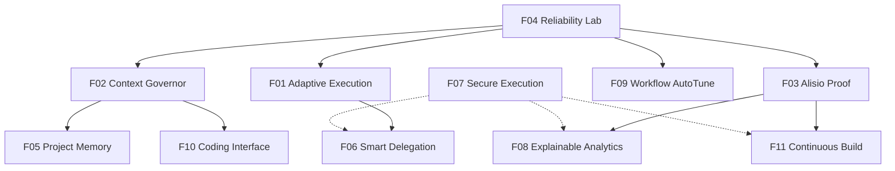

# Alisio — Investigación científica para funcionalidades diferenciadoras

> **Propósito de este documento:** transformar la investigación de arXiv en grupos de funcionalidades autocontenidos que puedan evolucionar, cada uno, hacia una especificación técnica independiente. El contenido propone capacidades, no afirma que ya estén implementadas.

**Fecha:** 13 de octubre de 2026
**Proyecto:** [Alisio](https://gustavogutierrez.github.io/alisio/) · [Repositorio](https://github.com/GustavoGutierrez/alisio) · [Documentación](https://github.com/GustavoGutierrez/alisio/tree/main/docs)

## 1. Visión y criterio de investigación

**Hipótesis central:** Alisio puede diferenciarse como un entorno agéntico, proveedor-agnóstico y extensible que convierte solicitudes en **resultados verificables**, optimiza el costo y el contexto, conserva conocimiento útil y ofrece supervisión y trazabilidad coherentes entre TUI, Web UI y headless.

En lugar de competir por la cantidad de agentes o herramientas, las capacidades se evalúan según cinco preguntas: ¿mejora el éxito real?, ¿reduce costo o esfuerzo?, ¿aumenta verificabilidad?, ¿respeta las decisiones del usuario?, ¿se puede medir frente al sistema actual?

**Límites epistemológicos:** las fuentes de arXiv pueden ser preprints sin revisión por pares; una técnica validada en un benchmark no garantiza el mismo efecto en Alisio. Las prioridades y las propuestas son inferencias de producto. Las referencias bibliográficas y sus enlaces arXiv fueron comprobados para esta recopilación; las características actuales de Alisio se basan en la investigación anterior y deben confirmarse frente al código vigente antes de escribir cada especificación.

## 2. Índice de grupos candidatos a especificaciones independientes

| ID | Funcionalidad | Prioridad | Encaje principal | Artículos |
|---|---|---|---|---:|
| [F01 — Adaptive Execution & Model Router](#f01-adaptive-execution) | P0 | Núcleo / política de ejecución | 5 |
| [F02 — Context Governor & Context Explorer](#f02-context-governor) | P0 | Núcleo / gestión de contexto | 3 |
| [F03 — Alisio Proof — evidencias verificables](#f03-alisio-proof) | P0 | Núcleo + UI + contratos de verificación | 2 |
| [F04 — Reliability Lab — evaluación de agentes y regresiones](#f04-reliability-lab) | P0 | Infraestructura de evaluación / opt-in | 2 |
| [F05 — Project Intelligence Memory](#f05-project-intelligence-memory) | P1 | Memoria local extensible | 3 |
| [F06 — Smart Delegation & Parallel Tool Scheduler](#f06-smart-delegation) | P1 | Planificador / subagentes | 3 |
| [F07 — Secure Execution & Tool Trust](#f07-secure-code-execution) | P1 — fundamento de seguridad | Ejecución aislada + políticas | 4 |
| [F08 — Explainable Analytics & Reproducible Dashboard](#f08-explainable-analytics) | P1 | Web UI + plugins de datos | 3 |
| [F09 — Workflow AutoTune & Declarative Contracts](#f09-workflow-autotune) | P2 | Investigación / optimización fuera de línea | 2 |
| [F10 — Coding Agent Interface & Repository Intelligence](#f10-coding-agent-interface) | P1 | Herramientas de ingeniería de software | 1 |
| [F11 — Continuous Build & Long-Horizon Recovery](#f11-continuous-build) | P2 (piloto después de Proof) | Orquestación de tareas prolongadas | 2 |

**Nota de lectura:** cada grupo contiene motivación, diseño inicial, MVP, límites, criterios de aceptación y las investigaciones correspondientes. Al separar en archivos de especificación, conviene mantener un solo propietario por contrato transversal y referenciarlo desde los demás grupos.

## 3. Estado inicial considerado para Alisio

La investigación anterior identificó como punto de partida: núcleo TypeScript, proveedores compatibles con APIs OpenAI, TUI, Web UI `alisio serve`, headless JSONL, herramientas con permisos explícitos, sesiones, subagentes, worktrees, checkpoints de contexto, memoria SQLite + FTS5, plugins tipados y capacidades de datos / dashboards. Este es un **inventario de contexto, no una nueva auditoría de implementación**.

No se debe confundir el control por permisos con un sandbox de ejecución; tampoco debe suponerse que la existencia de memoria local equivale a memoria semántica y temporal validada.

## 4. Dependencias de alto nivel



Las flechas expresan **dependencias recomendadas de madurez**, no dependencias obligatorias de paquetes. F07 es una preocupación transversal: sus protecciones mínimas deben acompañar cualquier ampliación de autonomía o ejecución de código.

## 5. Fichas de investigación por funcionalidad

<a id="f01-adaptive-execution"></a>

### F01 — Adaptive Execution & Model Router

**Identificador propuesto:** `f01-adaptive-execution`
**Prioridad:** P0
**Naturaleza:** Núcleo / política de ejecución
**Archivo futuro sugerido:** `specs/f01-adaptive-execution.md`

#### Problema
Los agentes pueden sobredimensionar tareas sencillas, elegir herramientas innecesarias o agotar tokens antes de producir resultados. Aumentar agentes, planes y pasos no garantiza más calidad.

#### Objetivo de la funcionalidad
Seleccionar y adaptar la estrategia de ejecución más simple capaz de cumplir las exigencias de calidad, riesgo y presupuesto de una tarea.

#### Aporte diferencial a Alisio
Menos latencia y costo; decisiones explicables; experiencia rápida en tareas simples y más rigurosa en tareas complejas.

#### Integración con capacidades existentes
Reutiliza ciclo de herramientas, modo plan, proveedores configurables, contabilidad de tokens y el componente opcional de Decision Intelligence.

#### Capacidades propuestas
- Clasificar la solicitud mediante señales observables: alcance de archivos, dependencia entre pasos, riesgo de efectos, incertidumbre y costo esperado.
- Ofrecer estrategias `direct`, `planned` y `delegated`; elegir una con heurísticas deterministas y permitir override manual.
- Configurar presupuestos de pasos, tokens, latencia y costo; definir puntos de escalamiento cuando fallen validaciones.
- Permitir enrutamiento entre modelos **solo** si el usuario ha configurado modelos alternativos; mantener compatibilidad con un único modelo.
- Registrar la estrategia elegida y su justificación estructurada, sin solicitar cadenas de razonamiento privadas.
- Comparar estrategias sobre un benchmark de tareas representativas.

#### Alcance recomendado para primera versión (MVP)
Selector determinista `direct`/`planned`, límites por tarea, telemetría y override. Router multimodelo y aprendizaje quedan para después.

#### Fuera de alcance / precauciones
No entrenar un clasificador inicialmente; no imponer nuevos modelos ni alterar la aprobación de acciones sensibles.

#### Criterios de aceptación iniciales
1. La ejecución de una tarea pequeña no inicia subagentes automáticamente.
2. Las decisiones y escaladas quedan registradas con versión de política.
3. Sin modelo alternativo, el sistema funciona con el único modelo disponible.
4. Los benchmarks permiten comparar costo y éxito frente a la política actual.

#### Métricas a instrumentar
Éxito verificado por tipo de tarea; costo por tarea resuelta; tokens/latencia; escaladas correctas; regresiones.

#### Dependencias y relación con otros grupos
F04 para medir efecto; F02 para presupuesto de contexto; F06 para delegación avanzada.

#### Artículos científicos asociados

**[2609.20804] An Empirical Study of Harness Design for Coding Agents**

- **Qué estudia:** Compara experimentalmente planificación, herramientas y gestión de contexto en un arnés de código; evalúa 176 configuraciones.
- **Qué aprovechar en Alisio:** Aplicar decisiones condicionadas al modelo y al presupuesto; eliminar contexto redundante antes de resumirlo.
- **Acceso:** [Resumen en arXiv](https://arxiv.org/abs/2609.20804) · [PDF](https://arxiv.org/pdf/2609.20804)

**[2407.01489] Agentless: Demystifying LLM-based Software Engineering Agents**

- **Qué estudia:** Muestra que localizar, reparar y validar puede competir con flujos agénticos considerablemente más complejos en determinadas tareas.
- **Qué aprovechar en Alisio:** Comenzar con la estrategia menos compleja suficiente, en vez de ejecutar múltiples agentes siempre.
- **Acceso:** [Resumen en arXiv](https://arxiv.org/abs/2407.01489) · [PDF](https://arxiv.org/pdf/2407.01489)

**[2406.18665] RouteLLM: Learning to Route LLMs with Preference Data**

- **Qué estudia:** Estudia el enrutamiento entre modelos de distinta capacidad y precio bajo objetivos de calidad.
- **Qué aprovechar en Alisio:** Seleccionar proveedor/modelo por tarea cuando existan opciones autorizadas.
- **Acceso:** [Resumen en arXiv](https://arxiv.org/abs/2406.18665) · [PDF](https://arxiv.org/pdf/2406.18665)

**[2305.05176] FrugalGPT: How to Use Large Language Models While Reducing Cost and Improving Performance**

- **Qué estudia:** Investiga cascadas y selección de estrategias para equilibrar costo y rendimiento.
- **Qué aprovechar en Alisio:** Resolver tareas con comprobadores y modelos económicos antes de escalar.
- **Acceso:** [Resumen en arXiv](https://arxiv.org/abs/2305.05176) · [PDF](https://arxiv.org/pdf/2305.05176)

**[2502.08235] The Danger of Overthinking: Examining the Reasoning-Action Dilemma in Agentic Tasks**

- **Qué estudia:** Analiza ineficiencias y errores cuando el razonamiento no se convierte en progreso observable.
- **Qué aprovechar en Alisio:** Establecer límites y señales de progreso real para decidir continuar, actuar o escalar.
- **Acceso:** [Resumen en arXiv](https://arxiv.org/abs/2502.08235) · [PDF](https://arxiv.org/pdf/2502.08235)

---

<a id="f02-context-governor"></a>

### F02 — Context Governor & Context Explorer

**Identificador propuesto:** `f02-context-governor`
**Prioridad:** P0
**Naturaleza:** Núcleo / gestión de contexto
**Archivo futuro sugerido:** `specs/f02-context-governor.md`

#### Problema
Las ventanas grandes no resuelven por sí mismas la relevancia del contexto. El agente puede perder información esencial, consultar demasiado contenido o resumir restricciones críticas.

#### Objetivo de la funcionalidad
Entregar al modelo solo el contexto necesario, recuperable y priorizado, preservando trazabilidad de lo descartado y la integridad de las herramientas.

#### Aporte diferencial a Alisio
Menos tokens innecesarios, menor riesgo de omitir archivos importantes y mayor estabilidad en trabajos prolongados.

#### Integración con capacidades existentes
Extiende compactación estructurada, búsqueda local, herramientas de archivos y contexto jerárquico del repositorio.

#### Capacidades propuestas
- Representar contexto como segmentos con fuente, recencia, criticidad, tamaño y relación con la tarea.
- Aplicar primero elisión determinista de redundancias; compactar mediante modelo solo cuando resulte necesario.
- Preservar invariables: instrucciones vigentes, aprobaciones, resultado de llamadas y referencias a evidencias.
- Recuperar código por símbolos, rutas, búsquedas y fragmentos; registrar qué contenido fue observado y realmente utilizado.
- Ofrecer un explorador programático acotado de repositorios/documentos extensos sin cargar todo en el prompt.
- Ejecutar benchmarks de recuperación y pruebas de contexto extremo.

#### Alcance recomendado para primera versión (MVP)
Inventario de segmentos, prioridades, elisión determinista, telemetría y pruebas contra desbordamientos.

#### Fuera de alcance / precauciones
No instalar un vector database obligatorio; no prometer recuperación perfecta; no exponer contenido fuera de permisos.

#### Criterios de aceptación iniciales
1. Nunca se separa una llamada a herramienta de su resultado al crear checkpoints.
2. La política puede explicar qué segmentos seleccionó o descartó.
3. Los invariantes de permisos y restricciones no se compactan como texto prescindible.
4. Existe comparación reproducible contra la compactación base.

#### Métricas a instrumentar
Precisión/recall de contexto relevante; tokens de contexto; fallos por overflow; éxito de tareas largas.

#### Dependencias y relación con otros grupos
F04 benchmark; F05 podrá proveer memoria de proyecto, pero no es requisito del MVP.

#### Artículos científicos asociados

**[2602.05892] ContextBench: A Benchmark for Context Retrieval in Coding Agents**

- **Qué estudia:** Evalúa recuperación de contexto mediante tareas y contextos relevantes anotados; diferencia contexto explorado y usado.
- **Qué aprovechar en Alisio:** Medir precisión, cobertura y eficiencia de la recuperación de archivos, símbolos y documentación.
- **Acceso:** [Resumen en arXiv](https://arxiv.org/abs/2602.05892) · [PDF](https://arxiv.org/pdf/2602.05892)

**[2307.03172] Lost in the Middle: How Language Models Use Long Contexts**

- **Qué estudia:** Muestra degradaciones de recuperación según la posición de información relevante en contextos largos.
- **Qué aprovechar en Alisio:** Reordenar y seleccionar contexto según criticidad y relevancia.
- **Acceso:** [Resumen en arXiv](https://arxiv.org/abs/2307.03172) · [PDF](https://arxiv.org/pdf/2307.03172)

**[2512.24601] Recursive Language Models**

- **Qué estudia:** Explora tratar contexto extenso como datos externos y consultarlos mediante programación y recursión.
- **Qué aprovechar en Alisio:** Inspeccionar repositorios o datasets grandes sin volcar su contenido completo en el prompt.
- **Acceso:** [Resumen en arXiv](https://arxiv.org/abs/2512.24601) · [PDF](https://arxiv.org/pdf/2512.24601)

---

<a id="f03-alisio-proof"></a>

### F03 — Alisio Proof — evidencias verificables

**Identificador propuesto:** `f03-alisio-proof`
**Prioridad:** P0
**Naturaleza:** Núcleo + UI + contratos de verificación
**Archivo futuro sugerido:** `specs/f03-alisio-proof.md`

#### Problema
Los agentes suelen afirmar que una tarea está terminada sin relacionar requisitos con resultados verificables. Ejecutar pruebas no equivale a demostrar la satisfacción de todos los criterios.

#### Objetivo de la funcionalidad
Convertir cada tarea en una entrega con estado explícito, evidencias, limitaciones y procedencia consultables.

#### Aporte diferencial a Alisio
Una diferenciación visible: el usuario no depende solo de una afirmación del modelo para decidir si acepta el trabajo.

#### Integración con capacidades existentes
Aprovecha eventos JSONL, permisos, journal, planes, ejecución de comandos, resultados de pruebas, artefactos y UI de Alisio.

#### Capacidades propuestas
- Permitir criterios de aceptación definidos por el usuario o inferidos como borrador sujeto a validación.
- Relacionar `criterionId` con verificadores (`test`, `typecheck`, `lint`, `artifact`, `manual`, `data-check`) y evidencias inmutables por referencia.
- Usar estados `verified`, `failed`, `not_checked`, `manual_review` y `not_applicable`; no convertir ausencia de fallo en éxito.
- Crear manifiesto reproducible con comandos, exit codes, alcance, cambios, hashes, fechas, costos y limitaciones.
- Publicar una vista común en TUI, Web UI y headless; exportar Markdown y JSON con los mismos datos fuente.
- Admitir verificadores de plugins sin permitir que la autoevaluación narrativa sustituya una verificación independiente.

#### Alcance recomendado para primera versión (MVP)
Manifiesto de criterios + captura de pruebas y comandos + informe de estado verificable en Markdown/JSON.

#### Fuera de alcance / precauciones
No crear una puntuación de confianza arbitraria; no afirmar corrección formal del software; no inventar evidencia faltante.

#### Criterios de aceptación iniciales
1. Un requisito sin verificador queda `not_checked` aunque el agente lo declare completo.
2. Cada estado `verified` apunta a una evidencia existente y fechada.
3. Los informes TUI/Web/headless muestran los mismos estados y fuentes.
4. Un usuario puede reproducir o inspeccionar los comandos declarados si el entorno lo permite.

#### Métricas a instrumentar
Porcentaje de criterios con evidencia; divergencia declaración/evidencia; cobertura del informe; costo añadido por validación.

#### Dependencias y relación con otros grupos
F04 comparte telemetría y mediciones; F07 impone políticas; F08 aporta verificadores de datos.

#### Artículos científicos asociados

**[2602.07900] Rethinking the Value of Agent-Generated Tests for LLM-Based Software Engineering Agents**

- **Qué estudia:** Estudia cuándo escribir tests con el agente aporta evidencia y cuándo solo incrementa trabajo o costo.
- **Qué aprovechar en Alisio:** Elegir pruebas por su información verificable, no por la cantidad de tests generados.
- **Acceso:** [Resumen en arXiv](https://arxiv.org/abs/2602.07900) · [PDF](https://arxiv.org/pdf/2602.07900)

**[2403.16218] CoverUp: Effective High Coverage Test Generation for Python**

- **Qué estudia:** Genera tests guiados por cobertura para descubrir ramas y líneas no verificadas en Python.
- **Qué aprovechar en Alisio:** Aplicar generación selectiva de pruebas y métricas de cobertura adaptadas al lenguaje.
- **Acceso:** [Resumen en arXiv](https://arxiv.org/abs/2403.16218) · [PDF](https://arxiv.org/pdf/2403.16218)

---

<a id="f04-reliability-lab"></a>

### F04 — Reliability Lab — evaluación de agentes y regresiones

**Identificador propuesto:** `f04-reliability-lab`
**Prioridad:** P0
**Naturaleza:** Infraestructura de evaluación / opt-in
**Archivo futuro sugerido:** `specs/f04-reliability-lab.md`

#### Problema
Una mejora aparente de prompts, modelos, herramientas o contexto puede incrementar costos o introducir regresiones que no se detectan mirando una sola ejecución.

#### Objetivo de la funcionalidad
Medir desempeño y confiabilidad de Alisio mediante tareas repetibles, evidencia externa y comparación de versiones.

#### Aporte diferencial a Alisio
Permite decidir científicamente qué features merecen incorporarse y publicar resultados honestos.

#### Integración con capacidades existentes
Usa modo headless, JSONL, workspaces reproducibles, registro de herramientas y métricas de consumo.

#### Capacidades propuestas
- Definir datasets de tareas con repositorio o estado inicial, instrucciones, evaluadores y presupuesto.
- Ejecutar varias repeticiones por configuración, registrando semilla cuando aplique y versión exacta de modelos y arnés.
- Medir éxito, consistencia, robustez, predictibilidad, incidentes y costo/latencia.
- Incluir pruebas de secuencias de herramientas con estado, no solo llamadas unitarias.
- Comparar candidato con baseline mediante tablas y gráficos de diferencias y dispersión.
- Mantener resultados locales y exportables; el usuario decide si comparte datos.

#### Alcance recomendado para primera versión (MVP)
CLI o flujo headless `eval run`/`eval compare` conceptual, JSON de resultados y reporte Markdown; denominación final sujeta a interfaz existente.

#### Fuera de alcance / precauciones
No asumir determinismo de los LLM; no crear rankings universales entre proveedores; no publicar datos del repositorio sin consentimiento.

#### Criterios de aceptación iniciales
1. Una ejecución conserva ID de configuración, versión de pruebas y condiciones de evaluación.
2. El reporte diferencia resultados medidos de estimaciones.
3. Se puede comparar al menos dos estrategias sobre las mismas tareas.
4. Una prueba de herramienta con estado detecta transiciones inválidas.

#### Métricas a instrumentar
Varianza, tasa de éxito, fallos recuperados, severidad de incidentes, costo por éxito, latencia.

#### Dependencias y relación con otros grupos
Se recomienda construir primero porque aporta validación a F01, F02, F03 y posteriores.

#### Artículos científicos asociados

**[2602.16666] Towards a Science of AI Agent Reliability**

- **Qué estudia:** Propone un perfil de confiabilidad con doce métricas en consistencia, robustez, predictibilidad y seguridad.
- **Qué aprovechar en Alisio:** Medir fiabilidad operativa, no solo tasa final de tareas completadas.
- **Acceso:** [Resumen en arXiv](https://arxiv.org/abs/2602.16666) · [PDF](https://arxiv.org/pdf/2602.16666)

**[2408.04682] ToolSandbox: A Stateful, Conversational, Interactive Evaluation Benchmark for LLM Tool Use Capabilities**

- **Qué estudia:** Benchmark de uso de herramientas con estado, dependencias y comprobaciones durante la trayectoria de una tarea.
- **Qué aprovechar en Alisio:** Probar herramientas y plugins en cadenas reales de invocaciones y efectos.
- **Acceso:** [Resumen en arXiv](https://arxiv.org/abs/2408.04682) · [PDF](https://arxiv.org/pdf/2408.04682)

---

<a id="f05-project-intelligence-memory"></a>

### F05 — Project Intelligence Memory

**Identificador propuesto:** `f05-project-intelligence-memory`
**Prioridad:** P1
**Naturaleza:** Memoria local extensible
**Archivo futuro sugerido:** `specs/f05-project-intelligence-memory.md`

#### Problema
Una lista de recuerdos o resúmenes de sesiones no representa bien decisiones técnicas, sus condiciones de validez y evidencia de que una solución funcionó.

#### Objetivo de la funcionalidad
Mantener conocimiento accionable del proyecto con procedencia, relaciones y vigencia, utilizable entre sesiones y modelos.

#### Aporte diferencial a Alisio
Evita redescubrir errores, conserva decisiones importantes y permite a Alisio adaptar su trabajo a la historia real del repositorio.

#### Integración con capacidades existentes
Extiende SQLite+FTS5; no requiere reemplazar el almacenamiento actual.

#### Capacidades propuestas
- Guardar entidades `decision`, `constraint`, `incident`, `solution`, `file`, `artifact`, `verification` y relaciones entre ellas.
- Mantener origen, versión/commit, timestamp y estados `observed`, `verified`, `obsolete`, `contradicted`.
- Recuperar por relevancia, vigencia, ámbito de proyecto y permisos; implementar híbrido FTS + señales estructurales antes de embeddings.
- Detectar conflictos entre recuerdos y evitar sobreescribir silenciosamente decisiones anteriores.
- Proponer al usuario la consolidación de conocimiento sensible o con impacto persistente.
- Probar recordación temporal y abstención frente a información insuficiente.

#### Alcance recomendado para primera versión (MVP)
Modelo de recuerdos con procedencia, estados de vigencia y enlaces a artefactos/commits; consultas FTS enriquecidas.

#### Fuera de alcance / precauciones
No almacenar secretos en texto claro; no elevar una hipótesis del agente a regla permanente; embeddings opcionales.

#### Criterios de aceptación iniciales
1. Todo recuerdo puede rastrearse a una fuente.
2. El agente distingue una decisión vigente de otra incompatible con el commit actual.
3. El usuario puede inspeccionar y corregir hechos retenidos.
4. El sistema evita presentar información obsoleta como verificada.

#### Métricas a instrumentar
Utilidad de recuperación; precisión temporal; contradicciones detectadas; tokens ahorrados por reutilización.

#### Dependencias y relación con otros grupos
F02 interfaz de recuperación; F03 evidencia; F07 controles de acceso.

#### Artículos científicos asociados

**[2310.08560] MemGPT: Towards LLMs as Operating Systems**

- **Qué estudia:** Propone administrar memorias en niveles, análogos a jerarquías de almacenamiento.
- **Qué aprovechar en Alisio:** Separar contexto activo, memoria de tarea y memoria duradera del proyecto.
- **Acceso:** [Resumen en arXiv](https://arxiv.org/abs/2310.08560) · [PDF](https://arxiv.org/pdf/2310.08560)

**[2502.12110] A-MEM: Agentic Memory for LLM Agents**

- **Qué estudia:** Propone memorias conectadas semánticamente mediante enlaces y evolución de la organización del conocimiento.
- **Qué aprovechar en Alisio:** Vincular decisiones, problemas, archivos, soluciones y resultados, con procedencia.
- **Acceso:** [Resumen en arXiv](https://arxiv.org/abs/2502.12110) · [PDF](https://arxiv.org/pdf/2502.12110)

**[2410.10813] LongMemEval: Benchmarking Chat Assistants on Long-Term Interactive Memory**

- **Qué estudia:** Evalúa recuperación entre sesiones, cambios temporales y capacidad de abstención cuando no hay evidencia.
- **Qué aprovechar en Alisio:** Detectar recuerdos obsoletos, contradictorios o insuficientemente fundamentados.
- **Acceso:** [Resumen en arXiv](https://arxiv.org/abs/2410.10813) · [PDF](https://arxiv.org/pdf/2410.10813)

---

<a id="f06-smart-delegation"></a>

### F06 — Smart Delegation & Parallel Tool Scheduler

**Identificador propuesto:** `f06-smart-delegation`
**Prioridad:** P1
**Naturaleza:** Planificador / subagentes
**Archivo futuro sugerido:** `specs/f06-smart-delegation.md`

#### Problema
La coordinación de agentes puede consumir más que el beneficio que aporta. Las herramientas paralelas sin análisis de efectos pueden ocasionar conflictos.

#### Objetivo de la funcionalidad
Delegar o paralelizar únicamente trabajos verdaderamente independientes, con contratos de resultados y política de terminación.

#### Aporte diferencial a Alisio
Más rendimiento en tareas separables sin sacrificar reproducibilidad ni control.

#### Integración con capacidades existentes
Aprovecha subagentes, worktrees, sesiones hijas, herramientas y permisos existentes.

#### Capacidades propuestas
- Construir DAG de subtareas/herramientas con entradas, salidas y dependencias.
- Modelar efectos `read`, `write`, `process`, `external`, `internal` para limitar concurrencia y exigir aprobación.
- Delegar a subagentes cuando hay separación real de trabajo y un resultado verificable por unidad.
- Detectar progreso nulo, conflictos de escritura, bucles, respuestas inconsistentes y terminación insuficiente.
- Consolidar resultados con validadores independientes y registrar costos de coordinación.

#### Alcance recomendado para primera versión (MVP)
Paralelización conservadora de lecturas y delegación opt-in sobre subtareas independientes; contratos de finalización.

#### Fuera de alcance / precauciones
No ejecutar escrituras concurrentes sobre el mismo recurso sin mediación; no convertir toda tarea en multiagente.

#### Criterios de aceptación iniciales
1. Las operaciones con dependencia explícita conservan su orden.
2. Los efectos no autorizados no se ejecutan por el hecho de estar delegados.
3. Un fallo de subagente aparece como fallo real y no se oculta al consolidar.
4. La política puede seleccionar una ejecución de agente único cuando conviene.

#### Métricas a instrumentar
Tiempo total, costo incremental de delegación, conflictos evitados, éxito por tipo de tarea.

#### Dependencias y relación con otros grupos
F01 decide estrategia; F04 mide si compensa; F07 aplica permisos.

#### Artículos científicos asociados

**[2512.08296] Towards a Science of Scaling Agent Systems**

- **Qué estudia:** Examina condiciones bajo las cuales sistemas multiagente mejoran o empeoran por costos de coordinación.
- **Qué aprovechar en Alisio:** Delegar solo trabajos separables cuyo beneficio supere la sobrecarga.
- **Acceso:** [Resumen en arXiv](https://arxiv.org/abs/2512.08296) · [PDF](https://arxiv.org/pdf/2512.08296)

**[2503.13657] Why Do Multi-Agent LLM Systems Fail?**

- **Qué estudia:** Clasifica fallos de especificación, coordinación y verificación en sistemas multiagente.
- **Qué aprovechar en Alisio:** Diseñar contratos entre subagentes, detección de bloqueos y criterios de terminación.
- **Acceso:** [Resumen en arXiv](https://arxiv.org/abs/2503.13657) · [PDF](https://arxiv.org/pdf/2503.13657)

**[2312.04511] An LLM Compiler for Parallel Function Calling**

- **Qué estudia:** Estudia planificación de llamadas a herramientas como dependencias y ejecución concurrente.
- **Qué aprovechar en Alisio:** Construir un planificador que paralelice lecturas independientes y preserve orden de efectos.
- **Acceso:** [Resumen en arXiv](https://arxiv.org/abs/2312.04511) · [PDF](https://arxiv.org/pdf/2312.04511)

---

<a id="f07-secure-code-execution"></a>

### F07 — Secure Execution & Tool Trust

**Identificador propuesto:** `f07-secure-code-execution`
**Prioridad:** P1 — fundamento de seguridad
**Naturaleza:** Ejecución aislada + políticas
**Archivo futuro sugerido:** `specs/f07-secure-code-execution.md`

#### Problema
Los archivos, respuestas de herramientas y contenido externo pueden contener instrucciones hostiles. La aprobación de acciones no equivale a aislamiento de código ejecutable.

#### Objetivo de la funcionalidad
Separar datos no confiables, políticas del usuario y acciones con efectos; habilitar composición de herramientas con ejecución restringida.

#### Aporte diferencial a Alisio
Facilita Code Mode y procesamiento Python/JavaScript sin aumentar de forma irresponsable el poder de una respuesta maliciosa.

#### Integración con capacidades existentes
Reutiliza permisos de efectos y trazabilidad; se integra con diseño de intérpretes aislados sin exigir un runtime específico.

#### Capacidades propuestas
- Definir límites explícitos entre instrucciones confiables y contenido de herramientas, documentos o repositorios.
- Exigir aprobación/política de motor antes de lecturas sensibles, escritura, procesos, red y acciones externas.
- Aplicar límites de tiempo, memoria, CPU, archivos, red, imports y tamaño de salida a ejecución de código.
- Definir contrato tipado común para JS/Python: argumentos, capacidades, efectos, outputs, errores y cancelación.
- Ejecutar corpus de ataques de prompt injection y pruebas de escape del entorno.
- Generar auditoría de intentos bloqueados y uso de permisos, sin exponer secretos.

#### Alcance recomendado para primera versión (MVP)
Modelo de amenazas, pruebas adversariales, fronteras de confianza y endurecimiento de permisos; aislamiento de intérpretes por fases.

#### Fuera de alcance / precauciones
No vender permisos como sandbox; no interpretar instrucciones dentro de documentos como órdenes superiores; no afirmar seguridad absoluta.

#### Criterios de aceptación iniciales
1. Un resultado de herramienta no puede concederse permisos a sí mismo.
2. Un intento de filtración o escritura no autorizada es bloqueado por código y queda registrado.
3. Los límites de recursos de scripts se comprueban con tests de integración.
4. Los permisos de herramientas se respetan también dentro de subagentes y Code Mode.

#### Métricas a instrumentar
Ataques bloqueados; falsos positivos; fallos de aislamiento; consumo de recursos; incidentes por plugin.

#### Dependencias y relación con otros grupos
Transversal a F01, F03, F06, F08, F10 y F11. La parte de seguridad no debe esperar a P2.

#### Artículos científicos asociados

**[2406.13352] AgentDojo: A Dynamic Environment to Evaluate Prompt Injection Attacks and Defenses for LLM Agents**

- **Qué estudia:** Entorno de evaluación de ataques de prompt injection en datos retornados por herramientas.
- **Qué aprovechar en Alisio:** Crear escenarios adversariales repetibles contra plugins, MCP y navegación de contenido externo.
- **Acceso:** [Resumen en arXiv](https://arxiv.org/abs/2406.13352) · [PDF](https://arxiv.org/pdf/2406.13352)

**[2403.02691] InjecAgent: Benchmarking Indirect Prompt Injections in Tool-Integrated Large Language Model Agents**

- **Qué estudia:** Benchmark de instrucciones maliciosas insertadas en resultados de herramientas.
- **Qué aprovechar en Alisio:** Separar datos no confiables de políticas; comprobar permisos antes de acciones con efectos.
- **Acceso:** [Resumen en arXiv](https://arxiv.org/abs/2403.02691) · [PDF](https://arxiv.org/pdf/2403.02691)

**[2402.01030] Executable Code Actions Elicit Better LLM Agents**

- **Qué estudia:** Estudia composición de varias acciones de herramientas mediante código ejecutable.
- **Qué aprovechar en Alisio:** Reducir ciclos herramienta-modelo con un Code Mode acotado y aislado.
- **Acceso:** [Resumen en arXiv](https://arxiv.org/abs/2402.01030) · [PDF](https://arxiv.org/pdf/2402.01030)

**[2605.18747] Code as Agent Harness**

- **Qué estudia:** Revisión de la función del código ejecutable como interfaz, mecanismo de control y sustrato de colaboración para agentes.
- **Qué aprovechar en Alisio:** Unificar contratos de ejecución y observabilidad en JavaScript, Python, herramientas y subagentes.
- **Acceso:** [Resumen en arXiv](https://arxiv.org/abs/2605.18747) · [PDF](https://arxiv.org/pdf/2605.18747)

---

<a id="f08-explainable-analytics"></a>

### F08 — Explainable Analytics & Reproducible Dashboard

**Identificador propuesto:** `f08-explainable-analytics`
**Prioridad:** P1
**Naturaleza:** Web UI + plugins de datos
**Archivo futuro sugerido:** `specs/f08-explainable-analytics.md`

#### Problema
Un dashboard atractivo puede mostrar métricas incorrectas o imposibles de reconstruir. La generación de código de análisis requiere controles distintos de los de diseño.

#### Objetivo de la funcionalidad
Transformar datos en métricas y visualizaciones útiles, manteniendo transformaciones y resultados reproducibles.

#### Aporte diferencial a Alisio
Amplía Alisio hacia trabajo con datos sin perder la propuesta central de evidencia y control.

#### Integración con capacidades existentes
Evoluciona Smart Dashboard, visualización MCP UI, archivos CSV/XLSX, scripts Python gestionados y workspaces de artefactos.

#### Capacidades propuestas
- Perfilado tabular: tipos, nulos, duplicados, claves candidatas y anomalías descriptivas.
- Transformaciones reproducibles con manifiesto de columnas, filtros, fórmulas, fuente, versión y parámetros.
- Elección de gráficos a partir de conceptos y tipos de datos, con posibilidad de corrección interactiva.
- Pruebas de reconciliación entre totales originales, transformaciones y resultados de visualización.
- Exportación de reportes con datos de procedencia, advertencias y scripts cuando el usuario lo solicite.
- Evaluaciones con múltiples hojas de prueba para detectar supuestos frágiles.

#### Alcance recomendado para primera versión (MVP)
Pipeline de análisis que emite `dataset-profile.json`, `transformations.json`, validaciones y Dashboard con procedencia visible.

#### Fuera de alcance / precauciones
No atribuir causalidad automáticamente; no convertir la estética en prueba de corrección; no modificar datasets originales sin consentimiento.

#### Criterios de aceptación iniciales
1. Toda cifra importante tiene fórmula, fuente o transformación rastreable.
2. Una discrepancia de reconciliación visible impide declarar el análisis plenamente validado.
3. El mismo pipeline reproduce resultados con los mismos datos y versiones.
4. La UI distingue datos procesados, derivados y estimados.

#### Métricas a instrumentar
Errores detectados por reconciliación; reproducibilidad; costo de procesamiento; tasa de tareas válidas en datasets de prueba.

#### Dependencias y relación con otros grupos
F03 Proof para evidencia; F07 para aislamiento; F04 para benchmark.

#### Artículos científicos asociados

**[2402.18679] Data Interpreter: An LLM Agent For Data Science**

- **Qué estudia:** Explora resolución de trabajos de ciencia de datos por subtareas, código ejecutable y validación incremental.
- **Qué aprovechar en Alisio:** Convertir análisis de CSV/Excel en pipelines reproducibles y auditables.
- **Acceso:** [Resumen en arXiv](https://arxiv.org/abs/2402.18679) · [PDF](https://arxiv.org/pdf/2402.18679)

**[2309.10094] Data Formulator: AI-powered Concept-driven Visualization Authoring**

- **Qué estudia:** Presenta visualización asistida por conceptos, con transformaciones de datos que sostienen el gráfico.
- **Qué aprovechar en Alisio:** Construir dashboards que expliquen de dónde provienen los indicadores.
- **Acceso:** [Resumen en arXiv](https://arxiv.org/abs/2309.10094) · [PDF](https://arxiv.org/pdf/2309.10094)

**[2406.14991] SpreadsheetBench: Towards Challenging Real World Spreadsheet Manipulation**

- **Qué estudia:** Benchmark de tareas de manipulación de hojas de cálculo reales y difíciles.
- **Qué aprovechar en Alisio:** Evaluar robustez de operaciones tabulares sobre distintos archivos de prueba.
- **Acceso:** [Resumen en arXiv](https://arxiv.org/abs/2406.14991) · [PDF](https://arxiv.org/pdf/2406.14991)

---

<a id="f09-workflow-autotune"></a>

### F09 — Workflow AutoTune & Declarative Contracts

**Identificador propuesto:** `f09-workflow-autotune`
**Prioridad:** P2
**Naturaleza:** Investigación / optimización fuera de línea
**Archivo futuro sugerido:** `specs/f09-workflow-autotune.md`

#### Problema
Optimizar prompts y pasos de forma manual no produce evidencia clara y puede causar regresiones. Un optimizador en tiempo real también puede encarecer el trabajo.

#### Objetivo de la funcionalidad
Probar y seleccionar variantes de workflows y configuraciones con contratos declarativos y evaluaciones controladas.

#### Aporte diferencial a Alisio
Permitir evolución medible de plugins y metodologías sin fine-tuning obligatorio.

#### Integración con capacidades existentes
Encaja con SDK de plugins, definiciones de herramientas, agentes Markdown y Reliability Lab.

#### Capacidades propuestas
- Contrato de workflow con entradas, salidas, invariantes, permisos, evaluadores y parámetros.
- Generación controlada de variantes de estrategia/prompts/reglas, aisladas del baseline estable.
- Evaluación repetible con presupuestos y conjunto de tareas representativas.
- Informe de costo/éxito/regresiones y recomendación revisable por usuario.
- Promoción de una variante solo tras aprobación y comparación documentada.

#### Alcance recomendado para primera versión (MVP)
Esquema declarativo de evaluación y comparación manual de dos variantes; búsqueda automatizada queda para segunda etapa.

#### Fuera de alcance / precauciones
No modificar prompts de producción silenciosamente; no optimizar con muestras demasiado pequeñas sin advertencias.

#### Criterios de aceptación iniciales
1. Las variantes de workflow tienen versión y pueden revertirse.
2. Los experimentos respetan presupuestos y permisos.
3. El comparador reporta tanto ventajas como regresiones.
4. Sin benchmark no se promociona una variante automáticamente.

#### Métricas a instrumentar
Mejora robusta en costo por éxito; tasa de regresiones; costo de optimización; estabilidad entre ejecuciones.

#### Dependencias y relación con otros grupos
F04 es requisito. F01 puede consumir políticas optimizadas más adelante.

#### Artículos científicos asociados

**[2410.10762] AFlow: Automating Agentic Workflow Generation**

- **Qué estudia:** Optimiza workflows agénticos mediante búsqueda, evaluación y refinamiento iterativo.
- **Qué aprovechar en Alisio:** Explorar mejoras en configuraciones de flujos fuera de la ejecución de usuario.
- **Acceso:** [Resumen en arXiv](https://arxiv.org/abs/2410.10762) · [PDF](https://arxiv.org/pdf/2410.10762)

**[2310.03714] DSPy: Compiling Declarative Language Model Calls into Self-Improving Pipelines**

- **Qué estudia:** Propone describir tareas con contratos declarativos y optimizar pipelines en función de métricas.
- **Qué aprovechar en Alisio:** Definir workflows y plugins con entradas, salidas, evaluadores y opciones medibles.
- **Acceso:** [Resumen en arXiv](https://arxiv.org/abs/2310.03714) · [PDF](https://arxiv.org/pdf/2310.03714)

---

<a id="f10-coding-agent-interface"></a>

### F10 — Coding Agent Interface & Repository Intelligence

**Identificador propuesto:** `f10-coding-agent-interface`
**Prioridad:** P1
**Naturaleza:** Herramientas de ingeniería de software
**Archivo futuro sugerido:** `specs/f10-coding-agent-interface.md`

#### Problema
Los agentes que solo reciben comandos genéricos y grandes volcados de texto pueden gastar tokens y editar el lugar equivocado.

#### Objetivo de la funcionalidad
Dar a los agentes una interfaz enfocada en símbolos, diagnósticos, modificaciones mínimas y pruebas dirigidas.

#### Aporte diferencial a Alisio
Mejor precisión en repositorios reales; menos lecturas masivas y menor riesgo de cambios accidentales.

#### Integración con capacidades existentes
Reutiliza herramientas de búsqueda, lectura/escritura, Git y ejecución; añadirá adaptadores optativos por lenguaje.

#### Capacidades propuestas
- Búsqueda de símbolos, definición, referencias y dependencias usando herramientas estándar del proyecto cuando estén presentes.
- Lecturas por rango con presupuesto; diffs acotados y precondiciones de versión/hashes.
- Integración de diagnósticos de TypeScript, linters y tests sin mostrar logs interminables.
- Selección de herramientas especializadas solo si mejoran métricas frente a bash/lectura existentes.
- Capacidades detectadas por repositorio, sin obligar todas las dependencias.

#### Alcance recomendado para primera versión (MVP)
Herramienta de diagnóstico y búsqueda de símbolos para TypeScript con salidas tipadas y acotadas, tras medir beneficios.

#### Fuera de alcance / precauciones
No replicar un IDE completo; no añadir herramientas solo por aumentar el catálogo.

#### Criterios de aceptación iniciales
1. Los cambios detectan archivos modificados desde la lectura inicial.
2. Las herramientas devuelven respuestas acotadas con referencias navegables.
3. La ausencia de analizador de lenguaje conserva la ruta de herramientas genéricas.
4. El benchmark identifica si realmente se gana precisión o tokens.

#### Métricas a instrumentar
Contexto leído por incidencia; ubicación correcta; costo; éxito; número de ediciones revertidas.

#### Dependencias y relación con otros grupos
F02 para selección de contexto y F04 para comparar contra baseline.

#### Artículos científicos asociados

**[2405.15793] SWE-agent: Agent-Computer Interfaces Enable Automated Software Engineering**

- **Qué estudia:** Investiga cómo el diseño de las interfaces de herramientas afecta el desempeño de agentes de ingeniería de software.
- **Qué aprovechar en Alisio:** Dar al agente operaciones precisas de navegación, edición, diagnóstico y pruebas con salidas acotadas.
- **Acceso:** [Resumen en arXiv](https://arxiv.org/abs/2405.15793) · [PDF](https://arxiv.org/pdf/2405.15793)

---

<a id="f11-continuous-build"></a>

### F11 — Continuous Build & Long-Horizon Recovery

**Identificador propuesto:** `f11-continuous-build`
**Prioridad:** P2 (piloto después de Proof)
**Naturaleza:** Orquestación de tareas prolongadas
**Archivo futuro sugerido:** `specs/f11-continuous-build.md`

#### Problema
Una especificación extensa puede exceder el contexto o fallar en pasos tardíos y perder el progreso realizado.

#### Objetivo de la funcionalidad
Gestionar objetivos de varias etapas con incrementos verificables, checkpoints, recuperación y decisiones humanas antes de efectos sensibles.

#### Aporte diferencial a Alisio
Permite completar trabajos mayores preservando trazabilidad y manteniendo un producto usable entre hitos.

#### Integración con capacidades existentes
Usa planes, sesiones, workspaces, subagentes, checkpoints y herramientas Git.

#### Capacidades propuestas
- Descomponer requisitos en hitos pequeños con entregables, invariantes y criterios de salida.
- Guardar estado versionado de ejecución e identificadores de artefactos, no solo resumen conversacional.
- Separar pruebas que usa el implementador de una evaluación independiente de aceptación.
- Reintentar o reanudar desde el último hito válido evitando duplicar efectos externos.
- Exponer la evolución al usuario y permitir pausa, cancelación y aprobación por etapa.
- Limitar iteraciones y presupuesto, detectando progreso nulo.

#### Alcance recomendado para primera versión (MVP)
Continuación manual/reanudable de plan por hitos con evidencia por incremento; autonomía multiday es extensión posterior.

#### Fuera de alcance / precauciones
No prometer autonomía ilimitada ni permitir operaciones externas repetidas al recuperar una ejecución.

#### Criterios de aceptación iniciales
1. Una interrupción no invalida hitos previamente verificados.
2. Se identifica qué operaciones externas pueden ser no idempotentes.
3. Las recuperaciones preservan estado y restricciones de permisos.
4. El resultado final integra evidencias de cada etapa.

#### Métricas a instrumentar
Hitos verificados, reanudaciones exitosas, efectos duplicados evitados, tiempo/costo por entrega.

#### Dependencias y relación con otros grupos
F03 Proof, F04 evaluación, F07 seguridad; F06 delegación opcional.

#### Artículos científicos asociados

**[2609.01481] Harness-of-Harness: Multi-Day Autonomous Software Development with Continual Improvement**

- **Qué estudia:** Estudia desarrollo autónomo mediante incrementos pequeños, ciclos de planificación-programación-pruebas y evaluación independiente.
- **Qué aprovechar en Alisio:** Orquestar trabajo prolongado con hitos verificables, checkpoints y recuperación entre sesiones.
- **Acceso:** [Resumen en arXiv](https://arxiv.org/abs/2609.01481) · [PDF](https://arxiv.org/pdf/2609.01481)

**[2608.23552] Prime Agent: A Self-Improving RLM Harness**

- **Qué estudia:** Describe un arnés persistente para tareas largas con REPL, memoria, subagentes y mecanismos de recuperación.
- **Qué aprovechar en Alisio:** Tomar ideas de reanudación y persistencia, sin convertir el producto en una copia de otro arnés.
- **Acceso:** [Resumen en arXiv](https://arxiv.org/abs/2608.23552) · [PDF](https://arxiv.org/pdf/2608.23552)

---

## 6. Orden propuesto de implementación y validación

| Etapa | Objetivo | Grupos | Condición para continuar |
|---|---|---|---|
| 0 — Línea base | Inventariar métricas, escenarios y permisos existentes | F04 + base de F07 | Existe benchmark reproducible y política clara de efectos |
| 1 — Eficiencia medible | Reducir contexto y seleccionar ejecución adecuada | F02 + F01 | Comparación contra baseline sin regresiones críticas |
| 2 — Valor diferenciador | Entregar resultados con pruebas y limitaciones explícitas | F03 | Cada criterio importante tiene evidencia o un estado no verificado |
| 3 — Inteligencia acumulada | Memoria vigente, herramientas más precisas y delegación selectiva | F05 + F10 + F06 | Mejoras observadas en proyectos reales, sin aumentar riesgos |
| 4 — Demostraciones de dominio | Análisis y dashboards reproducibles | F08 | Fuentes, cálculos y transformaciones inspeccionables |
| 5 — Autonomía avanzada | Optimización y continuidad de tareas complejas | F09 + F11 | Seguridad, pruebas y recuperación demostradas |

F07 debe desarrollarse de manera transversal y puede requerir trabajo anterior a las etapas 1 y 2 cuando haya nuevas capacidades de ejecución o nuevos permisos.

## 7. Contrato sugerido para convertir un grupo en especificación técnica

Cada ficha está preparada para derivarse a un documento autónomo. La especificación definitiva debería ampliar lo siguiente:

1. **Contexto y problema** con casos reales reproducibles y estado exacto del código actual.
2. **Objetivo, usuarios y alcance**, incluidos no-objetivos y garantías que no deben prometerse.
3. **Arquitectura detallada:** módulos, interfaces TypeScript, eventos JSONL, contratos de plugins y migraciones.
4. **Modelo de datos:** estados, relaciones, retención, versionado, privacidad y migración.
5. **Flujos y diagramas** para TUI, Web UI y headless; interoperabilidad y fallback.
6. **Permisos y seguridad:** amenazas, aprobaciones, límites, aislamiento y auditoría.
7. **Plan incremental de ejecución:** hitos verticales independientes, migración y feature flags.
8. **Pruebas y métricas:** unitarias, integración, adversariales, regresión y comparación con baseline.
9. **Criterios de aceptación objetivos:** evidencia observable para cada requisito y condiciones de rollback.
10. **Referencias científicas:** qué se toma del paper, qué se adapta y qué resultados deben comprobarse localmente.

### Plantilla de archivo independiente

```md
# Especificación FXX — Nombre de la funcionalidad
## 1. Problema y objetivos
## 2. Estado actual de Alisio y puntos de integración
## 3. Alcance MVP y fuera de alcance
## 4. Requisitos funcionales y no funcionales
## 5. Diseño de componentes, contratos y datos
## 6. Seguridad y permisos
## 7. Experiencia TUI, Web UI y headless
## 8. Plan de implementación incremental
## 9. Pruebas, evaluación y criterios de aceptación
## 10. Artículos de respaldo y decisiones de diseño
```

## 8. Índice bibliográfico completo por identificador arXiv

| ID arXiv | Trabajo | Especificación propietaria | Enlaces |
|---|---|---|---|
| `2305.05176` | FrugalGPT: How to Use Large Language Models While Reducing Cost and Improving Performance | F01 | [arXiv](https://arxiv.org/abs/2305.05176) · [PDF](https://arxiv.org/pdf/2305.05176) |
| `2307.03172` | Lost in the Middle: How Language Models Use Long Contexts | F02 | [arXiv](https://arxiv.org/abs/2307.03172) · [PDF](https://arxiv.org/pdf/2307.03172) |
| `2309.10094` | Data Formulator: AI-powered Concept-driven Visualization Authoring | F08 | [arXiv](https://arxiv.org/abs/2309.10094) · [PDF](https://arxiv.org/pdf/2309.10094) |
| `2310.03714` | DSPy: Compiling Declarative Language Model Calls into Self-Improving Pipelines | F09 | [arXiv](https://arxiv.org/abs/2310.03714) · [PDF](https://arxiv.org/pdf/2310.03714) |
| `2310.08560` | MemGPT: Towards LLMs as Operating Systems | F05 | [arXiv](https://arxiv.org/abs/2310.08560) · [PDF](https://arxiv.org/pdf/2310.08560) |
| `2312.04511` | An LLM Compiler for Parallel Function Calling | F06 | [arXiv](https://arxiv.org/abs/2312.04511) · [PDF](https://arxiv.org/pdf/2312.04511) |
| `2402.01030` | Executable Code Actions Elicit Better LLM Agents | F07 | [arXiv](https://arxiv.org/abs/2402.01030) · [PDF](https://arxiv.org/pdf/2402.01030) |
| `2402.18679` | Data Interpreter: An LLM Agent For Data Science | F08 | [arXiv](https://arxiv.org/abs/2402.18679) · [PDF](https://arxiv.org/pdf/2402.18679) |
| `2403.02691` | InjecAgent: Benchmarking Indirect Prompt Injections in Tool-Integrated Large Language Model Agents | F07 | [arXiv](https://arxiv.org/abs/2403.02691) · [PDF](https://arxiv.org/pdf/2403.02691) |
| `2403.16218` | CoverUp: Effective High Coverage Test Generation for Python | F03 | [arXiv](https://arxiv.org/abs/2403.16218) · [PDF](https://arxiv.org/pdf/2403.16218) |
| `2405.15793` | SWE-agent: Agent-Computer Interfaces Enable Automated Software Engineering | F10 | [arXiv](https://arxiv.org/abs/2405.15793) · [PDF](https://arxiv.org/pdf/2405.15793) |
| `2406.13352` | AgentDojo: A Dynamic Environment to Evaluate Prompt Injection Attacks and Defenses for LLM Agents | F07 | [arXiv](https://arxiv.org/abs/2406.13352) · [PDF](https://arxiv.org/pdf/2406.13352) |
| `2406.14991` | SpreadsheetBench: Towards Challenging Real World Spreadsheet Manipulation | F08 | [arXiv](https://arxiv.org/abs/2406.14991) · [PDF](https://arxiv.org/pdf/2406.14991) |
| `2406.18665` | RouteLLM: Learning to Route LLMs with Preference Data | F01 | [arXiv](https://arxiv.org/abs/2406.18665) · [PDF](https://arxiv.org/pdf/2406.18665) |
| `2407.01489` | Agentless: Demystifying LLM-based Software Engineering Agents | F01 | [arXiv](https://arxiv.org/abs/2407.01489) · [PDF](https://arxiv.org/pdf/2407.01489) |
| `2408.04682` | ToolSandbox: A Stateful, Conversational, Interactive Evaluation Benchmark for LLM Tool Use Capabilities | F04 | [arXiv](https://arxiv.org/abs/2408.04682) · [PDF](https://arxiv.org/pdf/2408.04682) |
| `2410.10762` | AFlow: Automating Agentic Workflow Generation | F09 | [arXiv](https://arxiv.org/abs/2410.10762) · [PDF](https://arxiv.org/pdf/2410.10762) |
| `2410.10813` | LongMemEval: Benchmarking Chat Assistants on Long-Term Interactive Memory | F05 | [arXiv](https://arxiv.org/abs/2410.10813) · [PDF](https://arxiv.org/pdf/2410.10813) |
| `2502.08235` | The Danger of Overthinking: Examining the Reasoning-Action Dilemma in Agentic Tasks | F01 | [arXiv](https://arxiv.org/abs/2502.08235) · [PDF](https://arxiv.org/pdf/2502.08235) |
| `2502.12110` | A-MEM: Agentic Memory for LLM Agents | F05 | [arXiv](https://arxiv.org/abs/2502.12110) · [PDF](https://arxiv.org/pdf/2502.12110) |
| `2503.13657` | Why Do Multi-Agent LLM Systems Fail? | F06 | [arXiv](https://arxiv.org/abs/2503.13657) · [PDF](https://arxiv.org/pdf/2503.13657) |
| `2512.08296` | Towards a Science of Scaling Agent Systems | F06 | [arXiv](https://arxiv.org/abs/2512.08296) · [PDF](https://arxiv.org/pdf/2512.08296) |
| `2512.24601` | Recursive Language Models | F02 | [arXiv](https://arxiv.org/abs/2512.24601) · [PDF](https://arxiv.org/pdf/2512.24601) |
| `2602.05892` | ContextBench: A Benchmark for Context Retrieval in Coding Agents | F02 | [arXiv](https://arxiv.org/abs/2602.05892) · [PDF](https://arxiv.org/pdf/2602.05892) |
| `2602.07900` | Rethinking the Value of Agent-Generated Tests for LLM-Based Software Engineering Agents | F03 | [arXiv](https://arxiv.org/abs/2602.07900) · [PDF](https://arxiv.org/pdf/2602.07900) |
| `2602.16666` | Towards a Science of AI Agent Reliability | F04 | [arXiv](https://arxiv.org/abs/2602.16666) · [PDF](https://arxiv.org/pdf/2602.16666) |
| `2605.18747` | Code as Agent Harness | F07 | [arXiv](https://arxiv.org/abs/2605.18747) · [PDF](https://arxiv.org/pdf/2605.18747) |
| `2608.23552` | Prime Agent: A Self-Improving RLM Harness | F11 | [arXiv](https://arxiv.org/abs/2608.23552) · [PDF](https://arxiv.org/pdf/2608.23552) |
| `2609.01481` | Harness-of-Harness: Multi-Day Autonomous Software Development with Continual Improvement | F11 | [arXiv](https://arxiv.org/abs/2609.01481) · [PDF](https://arxiv.org/pdf/2609.01481) |
| `2609.20804` | An Empirical Study of Harness Design for Coding Agents | F01 | [arXiv](https://arxiv.org/abs/2609.20804) · [PDF](https://arxiv.org/pdf/2609.20804) |

## 9. Posicionamiento estratégico resultante

**Propuesta de propósito:** *Alisio es un entorno de trabajo agéntico, extensible y agnóstico del proveedor que convierte solicitudes en resultados verificables, con memoria, supervisión y costos controlados.*

La oportunidad no está en asegurar que las técnicas son inéditas: la literatura prueba que muchos de sus componentes ya existen. Está en integrarlas de forma coherente sobre el mismo núcleo y las tres interfaces del producto, sin exigir modelos específicos y sin confundir reportes narrativos con evidencia.

**Primer demostrador recomendado:** ejecución sobre un repositorio con políticas actual vs. Adaptive Execution + Context Governor, mismo modelo y presupuesto; medir con Reliability Lab y presentar criterios/evidencia con Alisio Proof. Un resultado negativo también es valioso si evita incorporar una capacidad sin beneficio.

**Advertencia:** los 30 artículos están vinculados para consulta y descarga desde arXiv. Las afirmaciones del documento son resúmenes analíticos y propuestas de implementación, no transcripciones de los estudios ni una revisión sistemática exhaustiva.
